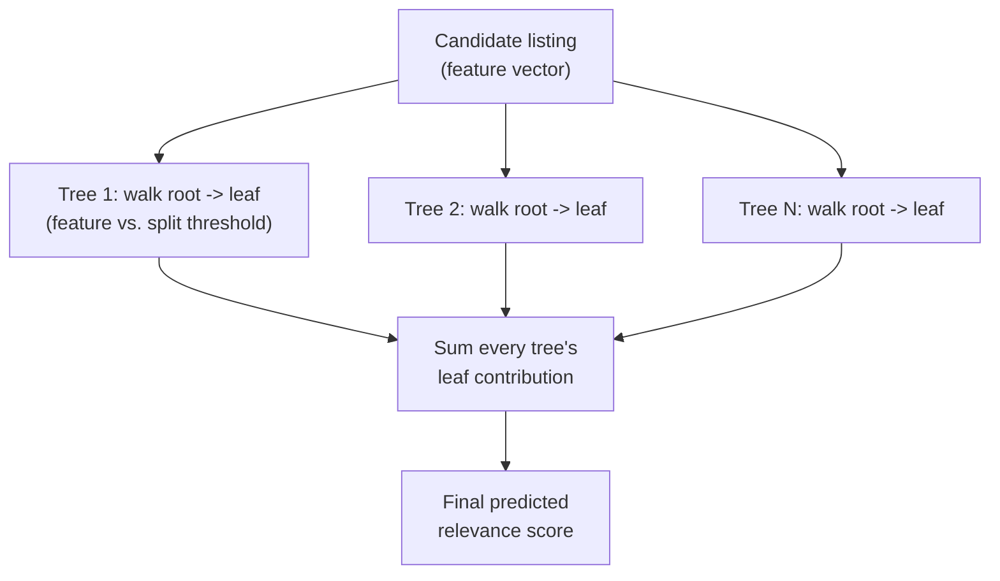
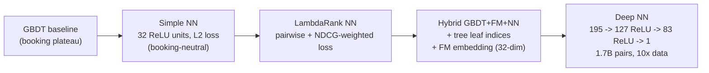
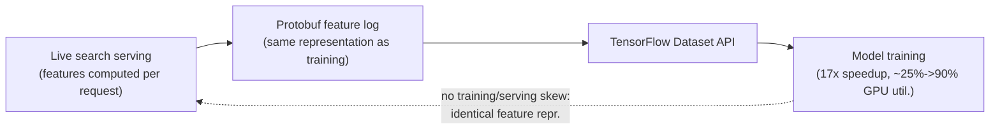
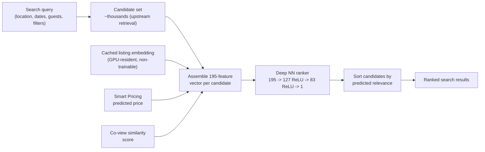

# Capstone #4: Search Ranking — Airbnb Listing Search (GBDT → Neural Ranker)

**Source(s):** Primary — Haldar, Abdool, Ramanathan, Xu, Yang, Duan, Zhang, Zhou, Platt, Sankar, et al., *"Applying Deep Learning to Airbnb Search,"* KDD 2019 (arXiv:1810.09591). This is also widely cited as recognized ML-system-design-interview material, though — unlike capstone #1's Pinterest paper — this document did not independently re-confirm a specific named chapter citing it; that distinction is noted here rather than asserted.

**Confidence:** Strong, primary source, with one honest limitation worth stating up front rather than papering over. This document was written from the paper's own full text (fetched via its ar5iv HTML rendering of arXiv:1810.09591 — abstract and all eight numbered sections, read directly, not summarized secondhand). Every claim tagged **(paper)** below was read directly out of that text. The limitation: this specific paper is unusually *sparse* on exact numeric scale and metric figures compared to capstones #1–#3 in this repo. It never states a listing-corpus size, a search QPS, or a country/market count anywhere in its text (confirmed by a direct, targeted re-check of the full document for exactly these figures) — contrast this with capstone #1's Pinterest paper ("over 600 million visual searches per month") or capstone #3's YouTube paper ("more than a billion users"). It also reports most of its offline-NDCG and online-booking results only as *figures* (Figures 2a, 2b, 4, 5), not as exact numbers in the prose — the one specific in-text offline number it gives is a roughly 1% NDCG gain from one specific regularization change (Step 6). Because of this, Step 2's scale arithmetic below leans more heavily on **(secondary)**-tagged, outside-the-paper figures (Airbnb's own public blog statements about listing-corpus size, not from this KDD paper) than any other capstone in this repo so far, and Step 6 is correspondingly more honest than usual about what exact numbers simply aren't recoverable from the source. A second rendering-level caveat: the HTML extraction used to read this paper visibly duplicated digits throughout (e.g. "3232" instead of "32," "195195" instead of "195") — a known ar5iv/HTML-conversion artifact, not a claim the paper itself makes two different numbers. Every specific figure below reflects the de-duplicated reading (32, not 3232), cross-checked against how this exact paper is independently, consistently cited elsewhere (127-then-83-ReLU hidden layers, 195 input features, 1.7 billion training pairs) before being stated here as paper-confirmed.

**Scope note:** This capstone covers exactly what the paper covers: the **ranking** stage that scores and orders a candidate set of listings for a specific search query, and the five-stage model evolution (manual scoring function → GBDT → a sequence of neural-network architectures) the paper walks through to get there. It does **not** cover: the upstream retrieval/filtering step that narrows Airbnb's full listing inventory down to the "thousands" of candidates **(paper, Section 1)** that ranking actually scores for one query (the paper doesn't detail that earlier stage — it's assumed as a given input); **pricing or dynamic-pricing recommendations** — Airbnb's separate Smart Pricing system (Ye et al., 2018, cited by this paper) is explicitly *out of scope* as its own system, and the only way it appears in this capstone at all is as one input *feature* fed into the ranking model (Step 3), never as something this capstone's own system computes; and the search results page's UI/presentation layer, which the paper never discusses.

---

## Step 1: Clarify Requirements & Frame the ML/AI Objective

**The actual objective, in the paper's own terms (paper).** Airbnb search ranking takes:
- A search query — location, dates, guest count, filters.
- A candidate set of listings — "from the thousands available in the inventory" **(paper, Section 1)**.

...and produces an ordering. The paper frames the problem around a two-sided-marketplace objective: *"Successful sessions end with the guest booking a listing."* **(paper, Section 1)** — not a click or impression, a **booking**: listings a guest is likely to book should surface first, not merely listings they'd click into and bounce from.

**What counts as ground truth / feedback signal (paper):** a binary label per listing impression — **relevance = 1** if that listing was the one the guest booked, **relevance = 0** for every other impression in that same search **(paper, Section 1–2)**. The core ranking model is never trained on a click-based label. **Why booking, not click — this document's own framing, not the paper's phrase:** a click reflects only momentary interest, while a booking requires the guest to commit and the listing to actually match what they wanted closely enough to transact — a stronger, if rarer and more delayed, signal for a two-sided marketplace.

**A second, auxiliary signal the paper tried (paper, Section 3.2):** **long views** — a guest dwelling on a listing's detail page without booking — were added as an auxiliary multi-task training signal, weighted by `log(view_duration)`. This moved the auxiliary metric itself "by a large margin" but left booking-related gains **neutral** — a promising secondary signal that didn't transfer to the metric that matters. Booking stayed the sole ground-truth label driving what shipped.

**Explicitly out of scope**, per the Scope note:
- Pricing/dynamic-pricing recommendations (Smart Pricing, named above).
- The upstream candidate-generation/filtering step producing the "thousands" of listings ranking operates on for a given query.
- The results-page UI.

**Trade-offs considered:** Training directly on booking labels means every gain the model makes is a gain on the metric the business actually cares about, with no proxy-metric gap to worry about correcting for later — a real advantage over, say, capstone #2's click-based CTR label, which is a proxy for advertiser/user satisfaction rather than a direct measure of it. But booking is also a far **rarer**, more delayed signal than a click: most search impressions never result in a booking for *any* listing in that search, and a booking can take meaningfully longer to materialize than a click does, which is a real labeling-latency cost this system accepts in exchange for a cleaner metric (Step 3 revisits this). The long-view auxiliary signal experiment shows the cost of chasing a signal that's *easier* to move than booking is: an auxiliary metric improving substantially while the metric that actually matters stays flat is wasted model capacity and engineering time, unless the two are empirically shown to be correlated — which, per the paper's own result here, they weren't strongly enough to matter.

---

## Step 2: Back-of-Envelope Constraints

**What the paper confirms numerically — and what it doesn't (paper).** Confirmed:
- A per-query candidate set of "thousands" of listings (Section 1).
- An input layer of **195 features** after categorical embedding expansion (Section 2.4).
- **1.7 billion** listing-pair training examples for the final deep model (Section 2.4).
- A protobuf-based feature-logging pipeline delivering a **17x training speedup** and raising GPU utilization from roughly 25% to roughly 90% (Section 5).

Not confirmed anywhere in the text read for this document: total listing-inventory size, search QPS, or market/country count — a real gap versus capstones #1–#3's papers, named in the Confidence note rather than filled in with an invented paper-attributed number.

**Illustrative scale anchor, clearly tagged as outside this paper (secondary, Airbnb's own public reporting, not the KDD paper):** Airbnb's own mid-2019 growth announcement stated "more than 6 million" listings worldwide, across roughly 100,000 cities. This document uses **6 million listings** purely as an illustrative order-of-magnitude anchor for the arithmetic below — it is *not* a number Haldar et al. report, and is kept visibly separate from every paper-confirmed figure in this document.

**Candidate-set scoring cost — the calculation that makes Step 4's central trade-off concrete.** Per-query, ranking scores only the "thousands" of candidates the upstream retrieval step already narrowed the 6-million-listing (illustrative) inventory down to — not the full inventory. Taking an illustrative **2,000 candidates/query** (within the paper's own "thousands," Section 1) and the paper-confirmed **195-feature** input vector (Section 2.4):

```
Deep NN forward pass per candidate (paper-confirmed architecture: 195 -> 127 ReLU -> 83 ReLU -> 1):
  layer_1_multiply_adds = 195 features  × 127 units = 24,765
  layer_2_multiply_adds = 127 units     ×  83 units = 10,541
  output_multiply_adds  =  83 units     ×   1 unit  =     83
  total_multiply_adds_per_candidate ≈ 35,389
  total_flops_per_candidate  ≈ 35,389 × 2 (mult + add) ≈ 70,778 FLOPs

Per query, across the illustrative 2,000-candidate set:
  total_flops_per_query = 70,778 × 2,000 ≈ 141,556,000 FLOPs  (≈ 0.14 GFLOP)
```

**0.14 GFLOP per search request** is trivially small for modern hardware — this calculation's point isn't that the neural ranker is too expensive in raw FLOPs, it's the opposite. That's exactly why the paper's own Section 5 names *feature computation and serving-pipeline latency*, not raw model FLOPs, as the real constraint **(paper)**: *"the latency introduced in the process was a blocker for us."* **The trade-off this sets up for Step 4 (illustrative elaboration of a general, well-known GBDT-vs-NN computational contrast — not a claim this specific paper states in these FLOPs terms):** a feedforward NN's forward pass is dense matrix multiplication, which batches cleanly across all 2,000 candidates in one query (and across many queries) on modern vectorized/GPU hardware; a GBDT ensemble's scoring, by contrast, is a sequence of *branching* tree traversals per candidate — correct, cheap per comparison, but harder to batch into the same kind of dense, hardware-friendly operation. So the real question isn't "which model is faster" in the abstract — it's which cost structure fits the hardware this team's serving fleet already runs.

**Trade-offs considered:** A larger illustrative candidate-set size (say, 5,000 instead of 2,000) scales the total-FLOPs figure up proportionally without changing the real conclusion — raw NN compute is not the serving bottleneck at this scale, feature computation and pipeline latency are (per the paper's own stated blocker) — which is exactly why this document treats the *shape* of that finding as load-bearing and the specific candidate-count anchor as illustrative. Picking a smaller illustrative listing-inventory anchor than Airbnb's own reported 6 million would shrink the implied scale of the upstream retrieval problem without changing anything about ranking's own per-query cost, since ranking only ever sees the already-narrowed "thousands," not the full inventory — a reminder that this capstone's own Step 2 arithmetic is bounded by the Scope note's decision to treat upstream retrieval as out of scope.

---

## Step 3: Data / Knowledge Pipeline

**What data exists, in the paper's own categories (paper, Section 2.4, Section 4):**
- Listing features — price, amenities, historical booking count, and other listing attributes "fed directly with minimal feature engineering" **(paper)**.
- Quasi-static listing attributes (location, bedroom/guest capacity, amenities, house rules) packed into a non-trainable embedding keyed by listing ID (Section 5).
- Model-derived features from two other Airbnb systems: a **Smart Pricing**-predicted price (Ye et al., 2018, cited by this paper; the pricing system itself is out of scope per this capstone's Scope note) and a listing-to-past-views **co-view similarity** score from a separately trained embedding model (Grbovic & Cheng, 2018).
- Query features — the search query's city, hashed together with the candidate listing's **S2 cell** (a hierarchical geographic-cell indexing scheme; "level-12" cell here means a specific, fairly fine-grained tile size in that scheme) into one categorical embedding meant to capture neighborhood-level preference (Section 4.3).

**Feature normalization — a real, named engineering discipline the paper is explicit the NN needed and GBDT didn't (paper, Section 4.1).** Feeding the NN raw, unnormalized versions of the same features that fed GBDT just fine caused the NN's training loss to **saturate** — stop improving, stuck — concrete proof a neural architecture isn't a drop-in replacement for a tree ensemble on the same raw inputs. Normalization rules confirmed by the paper:
- Features that are roughly "normal-like" in distribution get **z-scored** (standardized to zero mean, unit variance).
- Features that follow a **power-law** distribution instead get a log transform of the form `log((1 + x) / (1 + median))` — mapping the feature's own median value to exactly 0, with most of the transformed distribution landing in roughly `{-1, 1}`.
- Geographic coordinates got their own variant: raw latitude/longitude became log-transformed offsets from a map center point (Section 4.2.2).
- Occupancy was normalized by **average length of stay** (Section 4.2.3) — dividing out a listing-type-specific booking-duration pattern so the raw occupancy number is comparable across listings with very different typical stay lengths.

**Data-quality bugs caught by this same normalization discipline (paper, Section 4.2.1):** currency-conversion errors and monthly-rate prices (for stays over 28 days) logged inconsistently with nightly rates — both caught specifically because they showed up as visible spikes in a feature's distribution once someone was actually looking at normalized feature distributions closely enough to notice an anomaly, a direct, concrete payoff of the normalization work above beyond just "the NN trains better now."

**A sparsity/overfitting failure mode specific to one feature (paper, Section 3.1):** a **listing ID embedding** — treating each individual listing's ID as its own learned, high-cardinality categorical embedding, the same general technique Lesson 1's Concept C1 defines for embeddings generally — **overfit**, because any single listing's own booking history is comparatively sparse data to learn a whole embedding vector from, relative to how much data a shared, general-purpose feature benefits from. This is the data-pipeline-level version of the same "how much signal does *this specific* ID actually have behind it" question capstone #3's YouTube paper ran into with its own per-video/per-user embedding IDs, just surfacing as a different concrete failure (overfitting here, rather than that paper's shared-embedding-table parameter-count tension).

**Trade-offs considered:** Feeding listing/amenity/price features "directly, with minimal feature engineering" (the paper's own description) is cheap to build and keeps the model close to the raw signal, but it's exactly this choice that made the normalization discipline above load-bearing rather than optional — skip the z-scoring/log-transform step and, per the paper's own confirmed finding, the NN's training loss simply doesn't move. Deriving features from other models' outputs (Smart Pricing's predicted price, the co-view similarity score) lets ranking benefit from work two entirely separate teams already did, without re-solving pricing or collaborative-filtering-style similarity itself — but it also means ranking's own quality is now partly hostage to those upstream models' own freshness and correctness, a dependency this capstone's Scope note deliberately keeps out of its own boundary rather than re-deriving. A per-listing ID embedding would, if it worked, capture genuinely listing-specific booking patterns no aggregate feature could — but the paper's own confirmed overfitting result shows that benefit isn't free at Airbnb's actual per-listing data volume, a direct, concrete cost of chasing more specificity than the data can actually support.

---

## Step 4: Model/Agent Core Design — GBDT, Then a Sequence of Neural Rankers

This is the step this capstone exists to teach in depth: not one GBDT-to-neural-ranker jump, but a **sequence** of real, paper-documented architecture iterations, each one earning the next.

### Sidebar — Gradient-boosted decision trees (GBDT)

*(This concept has no existing Lesson home — Lessons 1–7 cover classic infra and AI-app fundamentals, not classic tabular-ML model families.)*

- **Why?** A ranking model over heterogeneous tabular features (price, amenity counts, booking history, geo coordinates — Step 3) must learn non-linear feature *interactions* (e.g. "price matters differently depending on neighborhood") without hand-writing every interaction term. A single tree captures interactions naturally, but one deep enough to capture everything relevant tends to overfit badly.
- **What?** A **gradient-boosted decision tree (GBDT)** model is an ensemble of many individually shallow decision trees, built one at a time, where each new tree is trained specifically to correct the *errors* (the gradient of the loss function) the ensemble-so-far is still making — not to independently predict the label from scratch. The final prediction for one example is the sum of every tree's individual contribution. Because each tree is shallow and only has to fix what's still wrong, the ensemble as a whole can model rich, non-linear feature interactions while each individual tree stays simple enough to resist overfitting on its own.
- **How?** At serving time, scoring one candidate listing means running it through every tree in the ensemble:
  - At each tree, start at the root and compare the candidate's relevant feature value against that node's split threshold.
  - Follow the branch that comparison selects, repeating node-by-node down to a leaf.
  - That leaf outputs the tree's own contribution to the final score.
  - Sum every tree's leaf value to get the model's final predicted relevance.

  This is a sequence of cheap, simple numeric comparisons per tree — no matrix multiplication, no learned embedding lookup — which is part of why a GBDT is both a strong, interpretable-per-tree baseline and, per Step 2's contrast, a model whose computation doesn't map onto dense-matrix hardware the way a neural network's does.



**Why GBDT was the right first move, not just the first thing tried (paper).** The GBDT switch (from an earlier, manually-tuned scoring function) was *"one of the largest step improvements in homes bookings in Airbnb's history"* **(paper, Section 1)** — a strong empirical result, not a placeholder the team was waiting to replace. GBDT is a strong fit for this specific problem: tabular, heterogeneous features (price, counts, categorical amenities) with real non-linear interactions, little need for the careful per-feature normalization discipline Step 3 showed the NN required, and a well-understood, comparatively easy-to-operate training/serving story relative to a from-scratch deep-learning stack — exactly the "boring, well-understood tool first" argument this capstone's whole lesson is built around.

**What specifically plateaued (paper).** *"The gains in online bookings eventually saturated with long spells of neutral experiments"* **(paper, Section 1)**. This isn't "the model got worse" — it's "the team kept running real A/B tests against the GBDT baseline and kept getting statistically neutral results," a structurally different, and in some ways more frustrating, signal than an outright regression: there's no single broken thing to go fix, just a baseline that's stopped yielding to the kind of incremental feature/tuning work that used to move it.

### Sidebar — Pairwise learning-to-rank, LambdaRank, and NDCG

*(This concept has no existing Lesson home.)*

- **Why?** A ranking problem isn't quite the same shape as ordinary binary classification: what actually matters is the *relative order* of listings within one search's results, not whether any single listing's predicted score crosses some global threshold. A model trained with an ordinary per-example loss (e.g. the squared-error regression loss the paper's first NN iteration used, Step 4 below) optimizes every prediction independently and has no direct notion of "get this listing ranked above that one, within this specific search."
- **What? — NDCG, defined in full on first use.** **NDCG (Normalized Discounted Cumulative Gain)** is the paper's standard offline ranking-quality metric **(paper, Section 2)**: each position in a ranked list is **discounted** — a relevant result found at position 1 counts for more than the identical relevant result found at position 20 — and the discounted scores across the list are summed (**cumulative gain**) and then **normalized** against the best possible ordering for that same query, so the final score is comparable across queries with different numbers of relevant results. Here, "relevant" means exactly Step 1's label: the booked listing gets relevance 1, every other listing in that search gets relevance 0 **(paper)**. A perfect NDCG score of 1.0 means the booked listing was ranked in the best possible position the metric rewards (typically first); a lower score means it was buried further down the list than it should have been.
- **What? — pairwise learning-to-rank and LambdaRank.** **Pairwise learning-to-rank** reframes training around *pairs* of listings from the same search rather than individual listings in isolation: for a (booked, not-booked) pair from the same search, the model is trained to push its score for the booked listing above its score for the not-booked one. **LambdaRank** is the specific pairwise technique the paper adopts **(paper, Section 2.2)**: for each such pair, a cross-entropy loss is computed on the *difference* between the two listings' scores, and — this is LambdaRank's defining trick — that pair's loss is **weighted by how much NDCG would change** if the two listings' positions were swapped. A pair where swapping would move the booked listing from position 2 to position 1 gets a much larger weight than a pair where swapping would move it from position 40 to position 39 — directly prioritizing the top-of-list errors that actually move the metric the system is evaluated on, rather than treating every mis-ordered pair as equally important.
- **How?** Each training example becomes one (booked, not-booked) pair drawn from the same search session: the model computes a score for each half of the pair, takes the difference, applies a cross-entropy loss to that difference, and scales the resulting gradient by the pair's own `ΔNDCG` weight before the update — illustrated below (this document's Python rendering of the mechanism the paper describes in its own Table 1 pseudocode, not a reproduction of the paper's literal code):

```python
import math

def ndcg_position_discount(rank: int) -> float:
    """Standard NDCG positional discount: 1/log2(rank + 1). Lower rank
    (closer to the top of the list) gets a larger discount weight."""
    return 1.0 / math.log2(rank + 1)


def delta_ndcg_weight(booked_rank: int, other_rank: int) -> float:
    """LambdaRank's pair weight: how much NDCG would change if the booked
    listing and the other listing swapped positions. A pair whose swap
    would move the booked listing much closer to the top gets a much
    larger weight than a pair near the bottom of the list."""
    current_gain = ndcg_position_discount(booked_rank)
    swapped_gain = ndcg_position_discount(other_rank)
    return abs(current_gain - swapped_gain)


def lambdarank_pair_loss(score_booked: float, score_other: float,
                          booked_rank: int, other_rank: int) -> float:
    """Cross-entropy loss on the score difference, scaled by the pair's
    own delta-NDCG weight (Section 2.2's mechanism)."""
    score_diff = score_booked - score_other
    base_cross_entropy = math.log(1.0 + math.exp(-score_diff))
    weight = delta_ndcg_weight(booked_rank, other_rank)
    return weight * base_cross_entropy
```

**The full sequence of architecture iterations (paper, Section 2) — the sequence this capstone's whole teaching point depends on being real, not a single jump.**

1. **GBDT (the plateaued baseline, above).**
2. **Simple NN (Section 2.1):** a single hidden layer of **32 fully-connected ReLU units**, trained on GBDT's existing feature set with an ordinary L2 regression loss (`booked = 1`, else `0`) — deliberately the simplest possible neural model. The paper cites Andrej Karpathy's "don't be a hero" advice directly **(paper, Section 2.1)**: start from the simplest working thing, because the team "started off with some intricate custom architectures, only to get overwhelmed by their complexity" before backing off to this. Result: **booking-neutral** against the GBDT baseline — this iteration's real value wasn't accuracy, it was proving the entire training-to-serving NN pipeline actually worked end to end, before spending any more effort on architecture.
3. **LambdaRank NN (Section 2.2):** the same general shape, now trained with the pairwise, NDCG-weighted loss above instead of plain regression. The paper's own assessment is refreshingly blunt: *"Not being a hero got us off to a start, but not very far"* **(paper, Section 2.2)** — simplicity alone wasn't the fix; the *objective function* mattering (pairwise + NDCG-aware, not pointwise regression) was a real, separate lesson from "start simple."
4. **Hybrid GBDT+FM+NN (Section 2.3):** rather than discarding GBDT, the paper feeds the NN two additional, model-derived input features:
   - Each tree's **leaf index** — which leaf a given candidate landed in, across the whole GBDT ensemble.
   - A **factorization machine (FM)** prediction — an FM is a model that learns feature interactions via low-rank, per-feature embedding vectors (here, a 32-dimensional embedding space) rather than GBDT's explicit tree-split interactions, a different mathematical way of capturing the same kind of "which features interact" signal.

   The paper's own stated motivation for this hybrid stage: the different models (GBDT, FM) were ranking listings differently from each other despite similar aggregate test-set performance — a sign each one was capturing real, complementary signal the others weren't, worth combining rather than picking just one.
5. **Deep NN (Section 2.4):** training data scaled roughly 10x, and the network itself deepened to **two hidden layers — 127 fully-connected ReLU units, then 83** — over the full **195-feature** input (after categorical-to-embedding expansion), trained on **1.7 billion** listing pairs. The paper's own Figure 4 shows this scale-up specifically closing the gap between training and test performance (the earlier, smaller-data models showed a real train/test generalization gap that more data visibly narrowed).



**What the neural architecture actually added, once it got past the "not very far" stage.** Per the evolution above: (a) a genuinely different, NDCG-aware training objective (LambdaRank) that GBDT's own standard training setup didn't give the team for free; (b) a path to *combine* GBDT's and an FM's learned signal inside one model (the hybrid stage), rather than being stuck picking exactly one; and (c) a continuous, differentiable function whose capacity visibly kept improving as training data scaled 10x further (Figure 4) — exactly the dimension along which the GBDT baseline had already stopped responding (Step 4's "saturated" finding above). The paper's own honest retrospective question, asked directly in Section 2.4 and deliberately *not* given a confident yes: *"Could we have launched the DNN directly, skipping all the stages of evolution?"* — left for the reader, not answered outright, which this document flags rather than resolving on the paper's behalf.

**The paper's own closing verdict on the whole trade-off (paper, Section 8) — stated as a trade-off, not a verdict in neural networks' favor alone.** Asked whether deep learning was worth it, the paper answers *"a wholehearted Yes"* — but immediately qualifies: *"moving to deep learning is not a drop-in model replacement at all"* and, for "focused medium sized problems," *"models like GBDT are arguably at par in performance and easier to handle."* This is the explicit, paper-stated version of this capstone's whole lesson: the fancier model was worth reaching for once the simpler one's returns had genuinely dried up — not as a general replacement for GBDT everywhere, and not for free.

**Trade-offs considered:** GBDT's tree-split mechanism handles heterogeneous tabular features and their interactions with comparatively little feature-engineering discipline (Step 3's normalization requirement is specific to the NN, not GBDT) and gives a strong, well-understood baseline fast — but, per the paper's own confirmed plateau, that same mechanism doesn't obviously keep improving as more data and richer, jointly-learnable representations (high-cardinality embeddings, multi-task signals) get thrown at it, at least not at the rate it did early on. The neural path buys exactly that extensibility — a pairwise, NDCG-aware objective; room to absorb GBDT's and an FM's own signal as input features; visible gains from 10x more data — at a real, paper-confirmed cost: normalization discipline GBDT never needed, a team for whom, in the paper's own words from its abstract, *"Deep learning was steep learning for us,"* and — Section 7, Step 6 below — a model that's genuinely harder to interpret once it's shipped. Choosing to feed GBDT's own leaf indices into the NN rather than discarding GBDT outright bought a working middle ground faster than a full rewrite would have, at the cost of keeping a second model (GBDT) in the production pipeline as a dependency rather than fully retiring it at that stage.

---

## Step 5: Serving Architecture

**What the paper actually confirms about the quasi-static listing embedding, kept separate from this document's own inference about serving mechanics (paper, Section 5, plus inference).** Not every feature in the 195-feature input vector (Step 2) is necessarily computed fresh on every search request. The paper confirms only that the quasi-static listing embedding — built from location, bedroom/guest capacity, amenities, and house rules — is packed as **"a non-trainable embedding indexed by the listing id"** that is **"resident in the GPU memory"** **(paper, Section 5)**: non-trainable, listing-ID-indexed, GPU-resident. Section 5 is silent on which of these the embedding actually is:
- Computed fresh per search request.
- Precomputed ahead of time.
- Cached after a first computation.
- Refreshed on some particular trigger or schedule.

**This document's own inference, not a paper claim (illustrative/inference, not paper-confirmed):** a listing's location, bedroom/guest capacity, amenities, and house rules change rarely relative to how often that listing gets searched, so recomputing that part of the feature vector fresh on every single search request that happens to surface this listing would plausibly be wasted work. A reasonable system built this way would instead precompute that embedding once, keyed by `listing_id`, and only recompute it when the underlying listing attributes actually change. That's this document's own extrapolation laid on top of the paper's two confirmed facts above (non-trainable, GPU-resident), not something Haldar et al. state about serving-time mechanics.

**Which Lesson 5 Concept 3 pattern this inferred mechanism actually resembles — not cache-aside.** Lesson 5's **cache-aside** is populated lazily, only on a read miss, and goes stale on its own TTL clock regardless of whether the underlying data actually changed. The mechanism inferred just above is the opposite shape: the embedding gets recomputed specifically *because* the underlying listing attributes changed, not because a TTL expired or a read happened to miss — which is Lesson 5's **write-through** shape (every write to a listing's attributes also drives a synchronous update to that listing's cached/precomputed embedding) applied to a model-input feature instead of a database row, not cache-aside's lazy, read-miss-triggered, TTL-staleness shape.

**The strict latency requirement, confirmed but not quantified (paper).** The paper states directly that the system has to *"adhere to the strict latency requirement of search"* **(paper, Section 5)**, and separately that *"the latency introduced in the process was a blocker for us"* during the deep-learning transition — but, consistent with the Confidence note above, it never gives an exact millisecond figure. This document does not invent one; per Lesson 7's Concept 4 back-of-envelope method (state assumptions explicitly, sanity-check against known reference points), a real deployment facing this gap would reach for exactly the AI-serving latency reference points Lesson 7's own table already establishes (e.g. capstone #10's p50/p99 time-to-first-token figures — p50/p99 being the 50th- and 99th-percentile latency, defined in full in Lesson 9's Concept 2) as *comparison* points for setting its own budget — this capstone's own system just doesn't get to cite one from this specific paper.

**Feature parity between training and serving — the engineering problem that made rapid architecture iteration possible at all (paper, Section 5).** The paper names a concrete production-infrastructure investment, separate from any one model architecture: moving from an older feature-logging/training pipeline to one built on **protobufs** (a compact, schema-defined binary serialization format) and TensorFlow's **Dataset** API.

- **What changed:** feature logging switched to protobuf + Dataset API, so the exact same feature representation used at serving time is logged directly into training data.
- **Why it mattered beyond raw speed:** a pipeline that logs serving-time features verbatim avoids the classic **training/serving skew** failure mode (a model trained on features computed one way silently served on features computed a subtly different way) — the paper doesn't name "training/serving skew" as a term, but the protobuf/Dataset investment is squarely aimed at the same underlying problem that term describes.
- **Confirmed payoff (paper, Section 5):** a **17x training speedup**, and GPU utilization raised from roughly **25% to roughly 90%**.
- **Why that payoff mattered for Step 4:** that throughput side-effect is what actually let the team run the whole five-stage architecture evolution in a reasonable amount of calendar time, rather than being throughput-bound at every iteration.



**Query-time scoring path (illustrative — this document's own rendering of the paper's described stages, not the paper's literal production code, which isn't published):**



```python
from dataclasses import dataclass


@dataclass
class ListingSearchFeatures:
    """One candidate listing's 195-feature (paper, Section 2.4) input vector
    for a single search query -- illustrative field subset, not the paper's
    exact published schema, which it doesn't release."""
    # Listing features (Step 3) -- "fed directly with minimal feature
    # engineering" per the paper, but still normalized per Section 4.1
    price_zscore: float
    amenity_count_zscore: float
    historical_booking_count_log: float          # power-law feature: log((1+x)/(1+median))
    geo_offset_from_center_log: tuple[float, float]  # Section 4.2.2: log-transformed lat/lng offset
    occupancy_normalized_by_avg_stay: float       # Section 4.2.3

    # Model-derived features from other, out-of-scope systems (Step 3)
    smart_pricing_predicted_price: float          # Ye et al. 2018 -- pricing system, out of scope here
    co_view_similarity_score: float               # Grbovic & Cheng 2018 -- past-views similarity

    # Query features (Step 3)
    query_city_x_listing_s2_cell_embedding_id: int   # Section 4.3 -- hashed (city, S2 cell) pair

    # Quasi-static, precomputed-and-cached listing embedding (Step 5, this section)
    cached_listing_embedding: list[float]         # location/bedrooms/amenities/rules, non-trainable


def score_candidates(candidates: list[ListingSearchFeatures], ranking_model) -> list[int]:
    """Ranking's serving-time step: score every candidate in this query's
    "thousands"-sized set (Step 2) and return indices sorted by predicted
    relevance, highest first. `ranking_model` stands in for whichever
    architecture iteration (Step 4) is currently deployed."""
    scores = [ranking_model.predict(c) for c in candidates]
    return sorted(range(len(candidates)), key=lambda i: scores[i], reverse=True)
```

**Trade-offs considered:** Precomputing the quasi-static listing embedding instead of recomputing it fresh per request would buy real serving-time savings on the overwhelming majority of a listing's feature vector that genuinely doesn't change between searches — but, since this document's own reasoning above lands on a write-through shape rather than cache-aside, the real cost that buys isn't a TTL-staleness window; it's the write-through cost Lesson 5's Concept 3 actually names: every listing-attribute update now also pays the cost of synchronously recomputing and re-storing that listing's embedding, whether or not the listing gets searched again any time soon, the same "caching entries that may never actually be read again" cost Lesson 5 attributes to write-through generally — now applied to a model feature instead of a database row, rather than cache-aside's lazy-population, TTL-expiry risk. Investing in the protobuf/Dataset feature-logging pipeline was itself a real, dedicated engineering cost paid once, upfront — but the paper's own confirmed 17x training speedup and the throughput that bought (Section 5) is what made it practical to run through five separate architecture iterations (Step 4) in a reasonable timeframe at all; skipping that investment would have made the exact same model-architecture evolution take proportionally longer per iteration, slowing down the whole learning curve.

---

## Step 6: Evaluation, Monitoring, and Iteration

**NDCG offline, booking-based A/B tests online (paper, Section 2) — and an honest note on how precisely this document can report either.** NDCG (defined in full in Step 4's Sidebar) is the paper's stated primary offline metric, and online evaluation is via live A/B tests measuring actual booking outcomes. Consistent with the Confidence note above, the paper reports most of its results for both as **figures** (2a, 2b, 4, 5) rather than exact numbers in the prose this document could quote — the one specific in-text exception is a roughly **1% NDCG gain** attributed to a particular regularization change (hand-crafted noise shapes used for dropout, Section 6), which this document reports precisely because it's the one number the paper actually states in text rather than leaving in a figure.

**Why offline and online can diverge here too — a direct structural echo of capstone #3's evaluation philosophy, worth naming rather than re-deriving.** The long-view multi-task experiment (Step 1, Step 3) is this paper's own clean instance of exactly the gap capstone #3's YouTube paper names as a general policy risk: an auxiliary offline signal moved substantially while the metric that actually matters (bookings) stayed neutral. Here that gap showed up *within* one offline-metric-adjacent experiment rather than between an offline metric and a live A/B test specifically — but it's the same underlying lesson: a model improving on *some* measurable signal is not the same claim as a model improving on the signal the business actually cares about, and this paper's own multi-task result is a second, independently sourced confirmation of that general risk, not a one-off YouTube-specific quirk.

**Failure modes the paper names directly, beyond the listing-ID overfitting already covered in Step 3 (paper, Section 6–7):** a **zero-initialization** experiment for the network's weights, which the paper calls, in its own words, *"the worst way to start training"* **(paper, Section 6)** — a concrete, named operational lesson about a specific implementation detail that quietly tanked training, caught and corrected. Separately, and more structurally, the paper devotes real space (Section 7) to how hard **feature-importance analysis** got once the model moved to a neural architecture:

- Score decomposition (trying to attribute a prediction to its individual input features directly) turned out to be conceptually flawed for this architecture.
- Simple ablation (removing one feature and re-measuring) got lost in noise.
- Permutation-importance tests (randomly shuffling one feature's values and measuring the resulting performance drop) gave misleading results specifically *because* so many of the model's 195 features are correlated with each other — shuffling one feature's values doesn't isolate its contribution when a correlated feature nearby can partially substitute for it.

A separate analysis technique the paper names, **TopBot** (comparing top-ranked vs. bottom-ranked listings' feature distributions), surfaced a real, concrete finding: it suggested the model wasn't making meaningful use of listing reviews as a feature, a genuine "is the model actually using the signal we gave it" question this analysis was specifically built to catch.

**A deliberate hedge on position bias and selection bias, named explicitly rather than silently skipped.** LambdaRank's own positional discount (Step 4's Sidebar) is the one mechanism in this paper's described training setup that's directly *about* a listing's position in the results list mattering differently depending on where it sits — the closest thing in this paper's text to an explicit position-bias treatment. This document could not find, in the sections of the paper read for this capstone, any further named discussion of position bias (the general risk that a listing ranked first gets booked disproportionately *because* it was shown first, not purely because it was the best match) or selection bias in the training data more broadly. That absence is reported here as a limit on what this document could confirm from the specific text reviewed — not as a confident claim that Haldar et al.'s paper never addresses either topic anywhere at all.

**The feedback loop back into Step 3:** every booking (and every long view, Step 1's auxiliary signal) becomes a new labeled training example for the next retraining cycle; the protobuf-based feature-logging pipeline (Step 5) is what keeps that loop's features consistent between what was logged during serving and what gets used for the next round of training, directly reducing the training/serving-skew risk named in Step 5.


**Trade-offs considered:** Relying on NDCG offline to guide fast iteration, and reserving live A/B booking tests as the final word before shipping, is the same two-tier evaluation discipline capstone #3's paper names explicitly — fast but not fully trustworthy offline signal, slower but authoritative online signal — and this paper's own long-view multi-task result is a second confirmed instance of exactly the gap that discipline exists to catch. Investing real analysis effort into feature-importance tooling (score decomposition, ablation, permutation tests, TopBot) despite each individual technique's own confirmed limitations (Section 7) is still worth doing, because even a partially-misleading signal (TopBot's reviews finding) can surface a real, actionable gap — but it's a genuinely harder, less conclusive exercise for this neural architecture than it likely was for GBDT's comparatively more interpretable per-tree feature splits, a real, ongoing interpretability cost this capstone's Step 4 trade-off already named up front rather than treating this step's difficulty as a surprise.

---

## Source(s) and Further Reading

- Haldar, Abdool, Ramanathan, Xu, Yang, Duan, Zhang, Zhou, Platt, Sankar, et al., *"Applying Deep Learning to Airbnb Search,"* KDD 2019 (arXiv:1810.09591) — **primary**; the source of every claim in this document tagged (paper), including the GBDT plateau statement, the five-stage architecture evolution (simple NN, LambdaRank NN, GBDT+FM+NN hybrid, deep NN), the feature-normalization rules and data-bug catches, the listing-ID overfitting and multi-task long-view results, the protobuf/Dataset pipeline's 17x speedup and GPU-utilization figures, the zero-initialization and feature-importance-analysis findings, and the paper's own closing verdict on GBDT vs. deep learning (Section 8).
- Ye, Gao, Udell, *"Managing Marketplace Supply with Dynamic Pricing"* (as cited by Haldar et al. for Smart Pricing) — **secondary** for this document; cited only as the source of the Smart-Pricing-predicted-price feature named in Step 3, not independently fetched or read here; Smart Pricing itself is explicitly out of scope per this capstone's Scope note.
- Grbovic & Cheng, *"Real-time Personalization using Embeddings for Search Ranking at Airbnb,"* KDD 2018 (as cited by Haldar et al. for co-view similarity) — **secondary** for this document; cited only as the source of the co-view-similarity feature named in Step 3, not independently fetched or read here.
- Airbnb's own 2019 public growth announcement (news.airbnb.com) — **secondary**; the sole source of Step 2's illustrative "6 million listings" anchor, explicitly not from the KDD paper itself, used only as an outside, order-of-magnitude scale reference for this document's own arithmetic.
- `appendix/glossary.md` — new entries added for **GBDT (gradient-boosted decision trees)** and **LambdaRank / pairwise learning-to-rank (NDCG-weighted)**; this capstone defines both in full on first use above rather than assuming familiarity. **Factorization machines (FM)** are also defined in full on first use (Step 4), but, as a judgment call consistent with capstone #3's own precedent for standard-but-secondary ML vocabulary, were not given their own boxed Sidebar or glossary entry — FM appears only briefly, as one input into the hybrid architecture stage, rather than as a concept this capstone's own lesson centers on the way GBDT and LambdaRank are.
- Lesson 1 (`lessons/lesson-1-ai-fundamentals-refresher.md`), Concept C1 — the original full definition of embeddings, referenced in Step 3/Step 4 for the listing-ID embedding and FM embedding discussions rather than re-derived.
- Lesson 5 (`lessons/lesson-5-data-layer.md`), Concept 3 — the write-through pattern this capstone's Step 5 identifies as the closest match for its own inferred serving mechanism behind the quasi-static, precomputed listing embedding (the paper itself confirms only the embedding's non-trainable, GPU-resident, listing-id-indexed nature, not its caching mechanics), referenced rather than re-derived.
- Lesson 7 (`lessons/lesson-7-application-architecture-and-security.md`), Concept 4 — the five-step back-of-envelope method this capstone's Step 2 follows, and the AI-serving latency reference table Step 5 points to in lieu of a paper-confirmed latency figure this specific source doesn't provide.
- `case-studies/video-recommendation/README.md` (capstone #3) — referenced in Step 6 for the structural parallel between this paper's own long-view multi-task result and that capstone's offline-vs-online evaluation-philosophy discussion, both independent instances of the same general risk.
