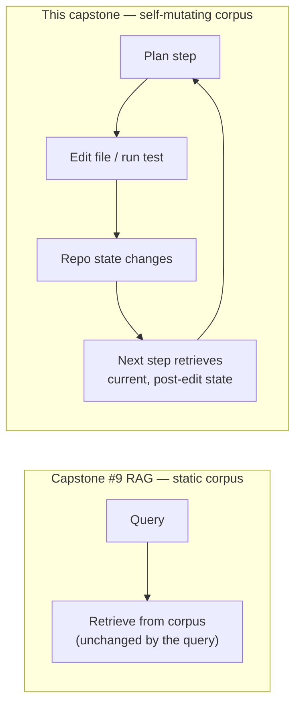
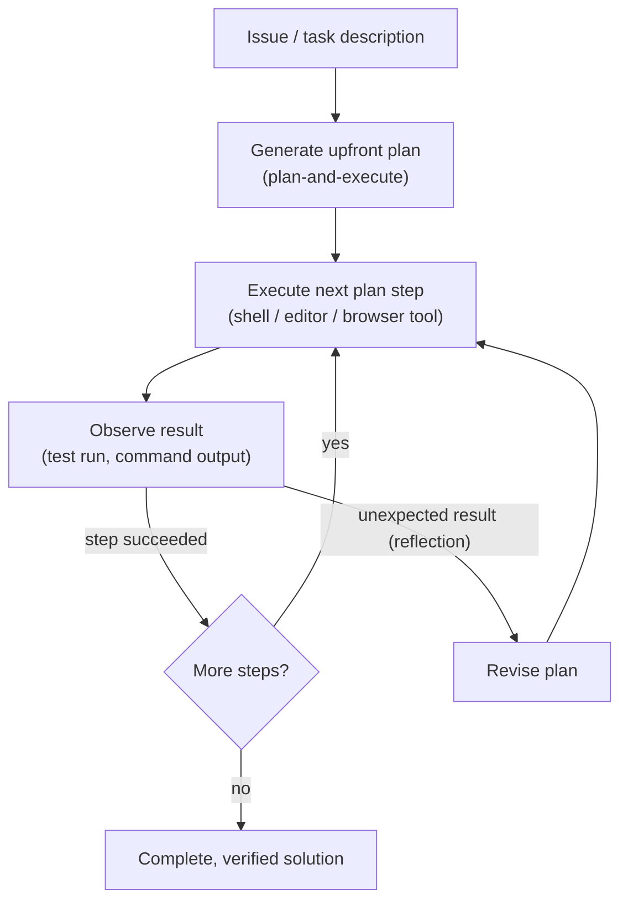
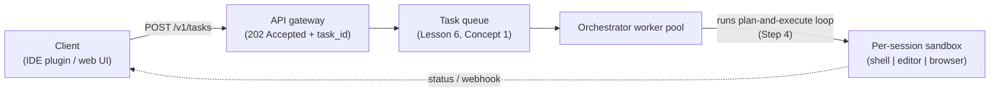
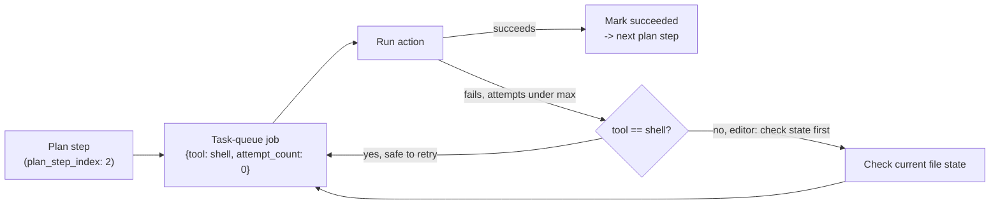
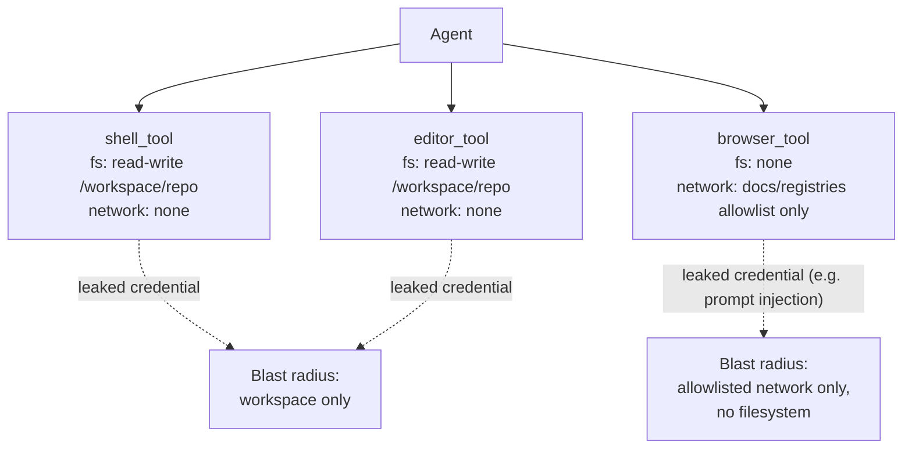
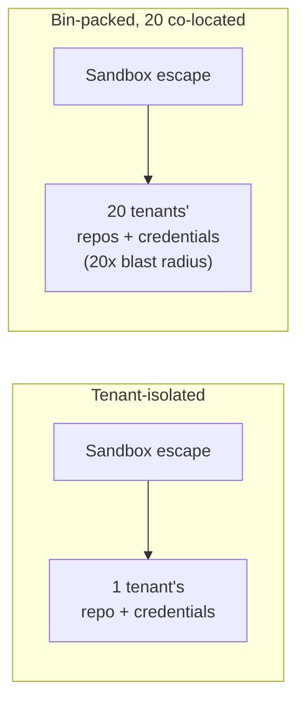
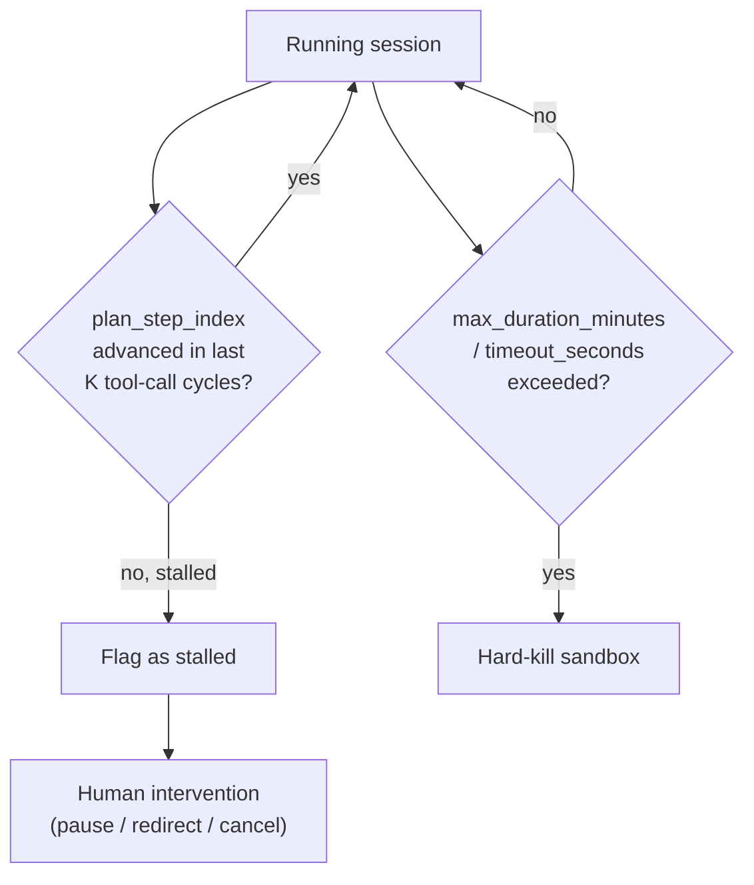

# Capstone #13: Autonomous Coding Agent — Devin-Style Plan-and-Execute

## At a glance

| Topic | Summary |
|---|---|
| Sources | Cognition Labs, "Introducing Devin" (March 2024), read in full from the live page at cognition.com/blog/introducing-devin (redirected from the original cognition.ai domain). Jiménez et al., "SWE-bench: Can Language Models Resolve Real-World GitHub Issues?" (ICLR 2024, arXiv:2310.06770), for the benchmark's own definition. |
| Problem | Given a coding task and real access to a codebase, decide and run a sequence of actions — read files, run shell commands, edit code, run tests, browse docs — and continue to a verified solution, without a human approving each step. |
| Not single-shot | A completion tool makes one model call and stops. This agent runs a loop that observes the result of each action and keeps going, so it can catch and fix its own mistakes mid-task. |
| What Devin claims | "Plan and execute complex engineering tasks requiring thousands of decisions"; shell, code editor and browser inside a sandboxed environment; real-time progress reporting *(source-confirmed)*. |
| The headline number | Devin resolves 13.86% of SWE-bench issues end to end, against a prior best of 1.96%, and 4.80% for models given the exact files to edit — Cognition's own launch claim, on a random 25% subset, Devin unassisted while the baselines were assisted *(source-confirmed, self-reported)*. |
| Not published | Devin's actual architecture, tool-call counts, task durations, concurrency and cost. Every sizing figure in Step 2 and the designs in Steps 3–5 are this document's own *(illustrative)*. |
| First to break | Error compounding over many steps. A 95%-reliable step run 50 times in a row finishes clean under 8% of the time, which is why "fix mistakes" is load-bearing, not decoration. |
| Easy-to-miss traps | A benchmark score is not a merge-ready PR. 13.86% was a 25% subset (~573 tasks, ~79 solved), unassisted-vs-assisted, no independent report. The round-trip count, not the sandbox, drives cost. |
| Practice PDFs | [Study edition](../../capstone-study-and-mock/autonomous-coding-agent/capstone13_autonomous_coding_agent_study.pdf) · [Mock interview](../../capstone-study-and-mock/autonomous-coding-agent/capstone13_autonomous_coding_agent_mock.pdf) |

Evidence labels used below: *(source-confirmed)* means the claim or quote is in the named primary source. *(illustrative)* means it is this document's own planning assumption or design. Cognition's SWE-bench figures are its own launch claim, on a subset, with no independent technical report found as of this writing.

### Concepts this case study builds on

| Concept | Where it is taught | One-line recap |
|---|---|---|
| Plan-and-execute, ReAct, reflection | [Lesson 1, Group D](../../lessons/lesson-1-ai-fundamentals-refresher.md#d-agent-architecture) | Control-flow patterns for how an agent decides and acts across steps. |
| State and checkpointing | [Lesson 1, Group E](../../lessons/lesson-1-ai-fundamentals-refresher.md#e-memory-and-state) | Save progress so a long run can resume instead of restarting. |
| Task queues and idempotency | [Lesson 6, Concept 1](../../lessons/lesson-6-async-and-communication.md#concept-1-message-queues-vs-task-queues) | Jobs with status and retries; retried work must be safe to repeat. |
| Async over synchronous REST | [Lesson 6, Concept 4](../../lessons/lesson-6-async-and-communication.md#concept-4-rpc-vs-rest) | A task longer than a gateway's idle timeout cannot be one held-open request. |
| Least privilege and blast radius | [Lesson 7, Concept 3](../../lessons/lesson-7-application-architecture-and-security.md#concept-3-core-security--encryption-input-sanitization-least-privilege) | Scope each credential to the least it needs; bound what a breach reaches. |
| Back-of-envelope method | [Lesson 7, Concept 4](../../lessons/lesson-7-application-architecture-and-security.md#concept-4-back-of-envelope-estimation-technique--latency-numbers) | State assumptions, decompose, carry units, sanity-check, name the sensitive input. |
| Sandboxing and multi-tenant isolation | [Lesson 8, Concept 2](../../lessons/lesson-8-safety-and-isolation.md#concept-2-sandboxing-agent-execution) and [Concept 5](../../lessons/lesson-8-safety-and-isolation.md#concept-5-multi-tenant-isolation) | Isolate one untrusted run from the host, and one tenant from another. |

---

## Step 1: Clarify Requirements & Frame the ML/AI Objective

### The objective: multi-step completion, not single-shot generation

A single-shot code tool takes one prompt and returns one artifact in one model call, with no execution or verification loop. If it is wrong, nothing inside the tool catches that. This capstone's objective is different in shape: given a task and real access to a codebase, the agent decides a sequence of actions, observes the result of each, and continues until it has a complete, verified solution, with no human approving each step.

Cognition names the scale directly: Devin "can plan and execute complex engineering tasks requiring thousands of decisions," and "can recall relevant context at every step, learn over time, and fix mistakes" *(source-confirmed)*. The thing being optimised is end-to-end completion across many sequential decisions, not the quality of any one generated artifact.

### Two bars for "done", not one

**Benchmark ground truth.** SWE-bench resolve rate, defined in the sidebar below. It is a reproducible, test-based pass or fail that needs no human reviewer per run.

**Real-world ground truth.** A pull request that passes CI and is accepted by a human reviewer. This is stricter: a reviewer also judges style, whether the fix addresses the issue's real intent rather than its symptom, and risk the existing tests do not cover. A patch can pass every SWE-bench test and still be a fix a reviewer would reject. Resolve rate is a cheaper, scalable, genuinely narrower proxy for this bar, not a replacement.

### Sidebar: SWE-bench and resolve rate

This is the first appearance of either term in this repo, so both get a full definition here and a glossary entry.

**Why.** A model's own claim that it "fixed a bug" means nothing without an objective, automatable way to check whether the fix works — the agent version of the problem Lesson 1 raises generally: non-determinism means you cannot eyeball one output and call it done.

**What.** SWE-bench, from Jiménez et al. (ICLR 2024), is a benchmark of 2,294 real GitHub issues drawn from 12 popular open-source Python repositories, each paired with the human-written pull request that originally fixed it. A model gets the issue text and the repository at the commit just before the fix, and must produce its own patch *(source-confirmed, SWE-bench paper)*.

**How it grades.** Resolve rate is the share of tasks a patch resolves under the benchmark's own rule. Grading is test-based, not a human or model judgment of whether the patch looks right. The patch is applied and the repository's real test suite is run. A task counts as resolved only if every test that was failing before the fix (its **fail-to-pass** tests) now passes, and no test that was already passing (its **pass-to-pass** tests) breaks. A single regression fails the whole task *(source-confirmed, SWE-bench paper)*.

### Out of scope

Training or fine-tuning the underlying model (treated here as an off-the-shelf component, as capstone #10 does); the model-serving layer beneath it (capstone #10's territory); a screenshot-driven computer-use agent that operates a screen rather than shell, files and APIs directly (capstone #14); and the internal mechanics of prompt-injection defence or output guardrails (Lesson 8, referenced not re-derived).

### Trade-offs

Framing the objective around multi-step completion accepts a much larger failure surface. A single-shot generator is right or wrong in one call's worth of risk. A multi-step agent can go wrong at any one of dozens or hundreds of decisions, and those per-step errors compound (Step 4). Choosing resolve rate as the primary offline metric buys an automatable pass or fail, but it is a narrow slice of real work: Python only, issue-shaped tasks only, no design work, no review of the fix's quality beyond the named tests. That narrowness is exactly why the CI-plus-review bar is named alongside it.

---

## Step 2: Back-of-Envelope Constraints

Lesson 7's five-step method is applied here, not re-derived: state assumptions, decompose, compute with units, sanity-check the magnitude, name the most sensitive input. Cognition publishes no sizing figures, so every number in this step is *(illustrative)*; the post confirms only the qualitative "multi-hour" and "thousands of decisions" claims.

### Assumptions

- A fleet of **500 concurrent active sessions** at any moment.
- **Task durations:** median 20 minutes, p90 90 minutes, p99 240 minutes. The 90-minute p90 is the same task Lesson 6 used as its own example, reused here on purpose.
- **Sandbox per session:** 4 vCPUs, 8 GB RAM, 20 GB disk — a full dev environment, not one stateless call.
- **Round-trips per task:** about 200 model reasoning or tool-call round-trips for a 90-minute task.
- **Tokens per round-trip:** 3,000 input, 300 output, at this repo's shared illustrative anchor of \$3 per million input tokens and \$15 per million output tokens.
- **Sandbox compute:** \$0.20 per hour, an order-of-magnitude figure for a mid-size cloud VM.

### Decompose

```text
fleet_vcpu_needed      = concurrent_sessions * vcpu_per_session
fleet_ram_needed       = concurrent_sessions * ram_per_session
llm_cost_per_task      = (round_trips * input_tokens_per_rt  / 1e6) * input_price
                       + (round_trips * output_tokens_per_rt / 1e6) * output_price
sandbox_cost_per_task  = task_duration_hours * hourly_sandbox_rate
total_cost_per_task    = llm_cost_per_task + sandbox_cost_per_task
```

### Compute, carrying units

```text
fleet_vcpu_needed = 500 sessions * 4 vCPU/session = 2,000 vCPUs
fleet_ram_needed  = 500 sessions * 8 GB/session   = 4,000 GB RAM

(at the p90, 90-minute task, 200 round-trips)
input_tokens  = 200 * 3,000 = 600,000 tokens = 0.6M
output_tokens = 200 *   300 =  60,000 tokens = 0.06M

llm_cost_per_task     = 0.6 * 3  +  0.06 * 15  =  1.80 + 0.90  =  2.70   (dollars)
sandbox_cost_per_task = 1.5 hours * 0.20/hour  =  0.30                   (dollars)
total_cost_per_task   = about 3.00                                      (dollars)
```

### Sanity-check the magnitude

2,000 vCPUs and 4,000 GB of fleet sandbox capacity is the order of a mid-size production Kubernetes cluster — plausible for hundreds of concurrent sessions, not an obvious error either way. Separately, running the full benchmark once (2,294 tasks) at this document's own roughly \$3 per task costs about `2,294 × 3 ≈ $6,882`. That is a plausible R&D compute cost for one evaluation pass — not \$7 and not \$7 million, which is this step's actual job: catching an error that size, not confirming Cognition's real spend.

### The most sensitive input

The **200 round-trips per task** figure is the one the estimate is most sensitive to, and the one with the least grounding: the post gives no tool-call counts, only "thousands of decisions". If a 90-minute task is closer to 2,000 round-trips, the model-cost term alone rises to about \$27, swamping the \$0.30 sandbox term by nearly two orders of magnitude and pushing total cost from about \$3 to \$27 or more. That is the number worth measuring first in a real prototype, not the sandbox budget.

### Trade-offs

A generous 4-vCPU, 8-GB per-session budget protects a heavy build or large test suite, but at 500 sessions that is 2,000 vCPUs and 4,000 GB reserved, most of it idle during the many round-trips where the sandbox waits on a model response. A flat per-round-trip token estimate also understates long tasks: context grows as plan history and tool outputs accumulate, so a late round-trip costs more tokens than an early one. Read the \$2.70 figure as a conservative floor, not a ceiling.

---

## Step 3: Data / Knowledge Pipeline

### What context the agent needs

- **Repository structure** — the file tree and usually a searchable index over file and symbol names, so the agent can locate code without reading the whole repository on every step.
- **The issue or task description** — the natural-language input defining what "done" means for this run.
- **Relevant code** — found with the same retrieval mechanics Lesson 1 defines (embeddings, vector or keyword search), applied to source instead of documents; named here, not re-derived.
- **Test results as feedback** — the piece a one-shot generator never gets. Running the suite mid-task tells the agent, with real ground truth, whether its last edit helped or broke something.

### The one real difference from a RAG chatbot

Capstone #9's RAG corpus is largely static during a single query; it changes slowly, on its own schedule. This agent's "corpus" is the repository's file contents, and the agent mutates it with its own actions turn over turn. Every edit and test run changes the ground truth the next step reasons about. Context cannot be fetched once up front and reused; each step must reflect the repository's current state.



This is why **state and checkpointing** (Lesson 1, Group E) is a structural requirement once a session runs the 90-plus minutes Step 2 assumes. If the process crashes at minute 70 of a 90-minute task, the alternative to checkpointing is re-running from minute 0 — slow, and risking a re-applied edit that was already made.

### A session-state record

This is richer than Lesson 6's task-queue job schema, which tracks one discrete unit of work; this tracks a whole multi-step session. Step 5 reuses Lesson 6's schema for the individual steps inside the session.

```json
{
  "session_id": "devin-session-7f3a2e91",
  "repo_url": "https://github.com/example-org/example-repo",
  "issue_description": "TypeError when parsing a config file with a trailing comma in an array.",
  "status": "running",
  "created_at": "2026-01-14T09:00:00Z",
  "sandbox_id": "sbx-c9e21a",
  "plan": [
    {"step_index": 0, "status": "succeeded",
     "description": "Reproduce the reported error with a minimal test case"},
    {"step_index": 1, "status": "succeeded",
     "description": "Locate the JSON-parsing path in src/config_loader.py"},
    {"step_index": 2, "status": "running",
     "description": "Patch the parser to tolerate trailing commas; re-run the suite"},
    {"step_index": 3, "status": "pending",
     "description": "Open a pull request with the fix and a regression test"}
  ],
  "current_step_index": 2,
  "last_test_run": {"passed": 142, "failed": 1, "ran_at": "2026-01-14T09:41:00Z"},
  "last_progress_update_at": "2026-01-14T09:41:05Z",
  "max_duration_minutes": 120
}
```

`plan` holds the full upfront plan from Step 4, not just the current step, which is what makes progress auditable: a client reconnecting mid-session sees which steps already succeeded, not one opaque "in progress". `last_test_run` is the test-results-as-feedback field; the current step reasons with its actual current content, not a cached assumption. `sandbox_id` ties the session to its sandbox (Step 5). `max_duration_minutes` is the session timeout that bounds the "went off-track for an hour" failure mode (Step 6).

### Trade-offs

Re-indexing the full repository before every step guarantees the agent never reasons about stale files, but wastes work when most steps touch one or two files. Updating only the files a step changed is cheaper, but relies on the agent's own action log being complete; a missed action leaves it reasoning about a file it believes is unchanged. Storing the full plan array, not just the current step, makes progress auditable and resumable after a crash, at the cost of session-state size growing with plan length.

---

## Step 4: Model/Agent Core Design — the Plan-and-Execute Loop

### One pattern, two names

Devin's architecture is sometimes called a "plan-then-execute loop". Lesson 1, Group D names the identical pattern **plan-and-execute**. These are the same pattern under two names. This document uses Lesson 1's term and links to it rather than re-teaching: a control-flow pattern where the model produces a full multi-step plan up front, then executes each step in sequence, optionally revising the plan if a step's result changes what is needed — in contrast to ReAct's one-step-at-a-time reasoning.

### Mapping Devin's description onto the pattern

Cognition's post never uses this vocabulary; it describes the behaviour ("plan and execute… requiring thousands of decisions", "recall relevant context at every step… and fix mistakes") without naming a control-flow pattern. Mapping that onto plan-and-execute is this document's reasoned categorisation, not a claim about the post's wording.

One detail matters: "fix mistakes" implies an observe-and-correct step *during* execution, not a fixed plan run blindly start to finish. So the loop is best characterised as a hybrid — an outer plan-and-execute structure (a real upfront plan exists and is referenced throughout, as Step 3's schema shows) around an inner, per-step observe-and-adjust behaviour closer to what Lesson 1 names **reflection**.



### The trade-off against two real alternatives

**Single-shot generation** — one model call produces one diff, no execution step. Cheapest and fastest, with no runaway-session risk, but structurally incapable of this task: it never runs a test, never observes a result, and cannot recover from being wrong about the codebase. It is the baseline the others are compared against, not a real contender.

**A tight ReAct loop with no upfront plan** — one step at a time: reason, act, observe, repeat. More flexible moment to moment, with no stale plan to revise. But it has no artifact to report as "here is what I am doing and why" short of narrating each step, and it gives up the auditability a stated plan provides: no single place to check "is this on track", only a trailing history.

**Plan-and-execute with per-step observation** — this capstone's design. The upfront plan is the artifact Step 3's `plan` field reports against, and the thing a reviewer can inspect mid-session to judge the approach before it finishes. The cost: a plan can become wrong once execution reveals something it did not anticipate, which is why "optionally revising the plan" is part of the definition. A plan-and-execute agent that cannot revise is strictly worse than ReAct at surprises.

### Why observation is load-bearing: the compounding-error math

Suppose a task is `n` sequential decisions, each independently correct with probability `p`, and there is no per-step observation or correction at all — a genuinely open loop that commits to a fixed plan and executes it blindly. The chance of finishing with zero mistakes is:

```text
P(task succeeds, no correction) = p^n
```

At `p = 0.95` (a strong per-step rate) and `n = 50` decisions (a conservative fraction of the "thousands" the source claims):

```text
P(success) = 0.95^50 ≈ 0.077   ->   roughly a 7.7% chance of a clean run
```

A 95%-reliable step, with no way to catch its own mistakes, completes a 50-decision task cleanly less than 8% of the time — and that is before the source's "thousands" of decisions push `p^n` far closer to zero. This is an illustrative sanity check, not a claimed derivation of Devin's real 13.86% (Step 6). It only shows why a resolve rate in the single-digit to low-double-digit range is unsurprising for a task of this shape, and why "fix mistakes" is not an optional nicety: without it, `p^n` makes long multi-step autonomy essentially unachievable at any plausible single-step reliability.

### Trade-offs

Single-shot and plan-free ReAct are both cheaper for shorter tasks. This capstone's hybrid is a consequence of the task shape Step 1 scoped (multi-hour, many-decision, needing real execution feedback), not a universal claim that plan-and-execute beats the others; Lesson 1 is explicit that it is a predictability-versus-flexibility trade-off. Building in per-step observation and plan revision adds complexity — the agent needs logic for "is my plan still valid", not just "execute the next step" — but per the math above, skipping it is not a simpler version of the same design, it is a design mathematically unlikely to finish a long task.

---

## Step 5: Serving Architecture

This step delivers on three promises other documents in this repo already made about this capstone.

### Why this cannot be one synchronous request

Lesson 6, Concept 4 states it: a 90-minute (5,400-second) task against AWS ALB's documented 60-second default idle timeout gives `timeout_ratio = 5,400 / 60 = 90x`. Step 2's p90 duration was chosen to match that figure rather than introduce a conflicting one. A task running 90 times longer than the gateway's idle timeout cannot be held open as one request; the gateway closes the connection long before the task finishes. The design follows Lesson 6's decomposition directly:

```text
Client (IDE plugin / web UI)
   |
   | 1. POST /v1/tasks   (REST, fast, well under any gateway timeout)
   v
API gateway  ------------------------------->  Task queue (Lesson 6, Concept 1)
   |  returns 202 Accepted + task_id              one entry = one coding-agent session
   |  immediately, connection closes                       |
   v                                                        v
Client polls / subscribes:                          Orchestrator worker pool
GET /v1/tasks/{id}/status                           pulls a session, runs the
  or a streamed/webhook channel  <---------------    plan-and-execute loop (Step 4)
  ("continuous progress reporting")                  inside a per-session sandbox
                                                             |
                                                             v
                                              Sandboxed compute environment
                                          (shell | editor | browser tools,
                                           three separately-scoped credentials)
```



```http
POST /v1/tasks HTTP/1.1
Host: api.example.com
Content-Type: application/json

{"repo_url": "https://github.com/example-org/example-repo",
 "issue_description": "...", "max_duration_minutes": 120}
```

```http
HTTP/1.1 202 Accepted

{"task_id": "devin-session-7f3a2e91", "status": "queued",
 "status_url": "/v1/tasks/devin-session-7f3a2e91/status"}
```

The submit call returns in milliseconds; everything that takes 90 minutes runs inside the queue's worker, decoupled from that request. The `status_url` is the third channel: the client polls `GET /v1/tasks/{id}/status` or subscribes to a stream and receives exactly Step 3's session-state record, so that record doubles as the internal state and the external progress payload.

### The agent's own steps as a task queue

Lesson 6, Concept 1 states that each agent step — a shell command, a file edit, a test run — is a discrete, retryable, idempotency-sensitive unit of work shaped like an embedding task. Each `plan` entry, once it is the orchestrator's turn to run it, is enqueued as one job, reusing Lesson 6's own fields rather than a second shape:

```json
{
  "task_id": "step-7f3a2e91-02",
  "session_id": "devin-session-7f3a2e91",
  "plan_step_index": 2,
  "tool": "shell",
  "action": "pytest tests/ -k config_loader",
  "status": "running",
  "attempt_count": 0,
  "max_attempts": 2
}
```

Idempotency matters as it did for capstone #9's embedding tasks, but the risk differs by tool:

- **`shell` actions** such as a test command are usually safe to retry — running the same suite twice corrupts nothing.
- **`editor` actions** applying a diff are not automatically safe — applying the same patch twice can fail or silently corrupt the file. A real implementation checks the file's current state before reapplying an edit, a check a plain shell retry does not need.



### Least privilege scoped per tool

Lesson 7, Concept 3 argues that shell, editor and browser are each the kind of access that should be scoped to least privilege individually — a browser tool has no need for filesystem-delete access — rather than granted as one undifferentiated credential. This design confirms that: three separate scoped configurations, not one.

```json
{
  "shell_tool":   {"filesystem": "read-write:/workspace/repo",
                   "network": "none", "max_runtime_sec": 120},
  "editor_tool":  {"filesystem": "read-write:/workspace/repo",
                   "network": "none", "max_file_size_mb": 10},
  "browser_tool": {"filesystem": "none", "no_shell_exec": true,
                   "network": "allowlist:docs-and-registries"}
}
```

- **`browser_tool`** can reach the public internet within an allowlist but has no filesystem access and cannot run shell commands.
- **`shell_tool` and `editor_tool`** can both touch the workspace but have no open network, since neither needs it.
- **If a tool credential leaks or is hijacked** — for example via a prompt-injection attack through a malicious web page the browser reads (Lesson 8) — the blast radius (Lesson 7, Concept 1) is bounded to that one tool's scope, not the full environment.



### Sandbox resource limits

An illustrative Docker-style config for one session's sandbox, sized to Step 2's assumptions:

```json
{
  "cpu_limit": "4",
  "memory_limit": "8g",
  "pids_limit": 512,
  "disk_limit": "20g",
  "network_mode": "none-except-allowlist",
  "timeout_seconds": 7200
}
```

- `pids_limit` caps simultaneous OS processes — a guard against a runaway or malicious command forking enough processes to exhaust the host's process table, independent of the CPU and memory limits.
- `timeout_seconds` (7,200 s = 120 minutes) is the sandbox-level enforcement of Step 3's `max_duration_minutes`. Two layers enforce the same ceiling, so a bug in the session logic does not leave a sandbox running forever.

### Why this raises the sandboxing stakes

Lesson 8 covers two concerns: Concept 2 sandboxes a single agent's execution, isolating one untrusted workload from the host; Concept 5 covers multi-tenant isolation, keeping many customers' data and credentials from leaking into each other on shared infrastructure.

This capstone combines both at a higher stake than either alone. A coding-agent sandbox does not run one-off stateless calls — it holds a customer's actual source code, which routinely contains real secrets (API keys in config, database credentials in `.env`, CI tokens), for a session lasting up to Step 2's 240-minute p99, on a platform serving many customers' repositories at once.

An illustrative blast-radius calculation, in the shape of Lesson 7's own credential-leak example. If sandboxes are fully tenant-isolated — one customer per physical sandbox — a single escape reaches one customer's data. If they were bin-packed for efficiency — say 20 tenant sandboxes on one host, sharing a kernel or hypervisor layer a severe escape could break out of — the same escape reaches all 20:

```text
blast_radius_ratio = co_located_tenants_reachable / tenant_isolated_baseline = 20 / 1 = 20x
```

The identical vulnerability is a 20-times larger incident purely because of the co-location decision. Nothing about the vulnerability changed, only the ceiling on what it reaches.



### Trade-offs

Decomposing each plan step into its own job gives per-step retry and status for free, at the cost of queue overhead on every shell command or edit — negligible against a multi-minute model round-trip, wasteful for a sub-millisecond operation, which is why the pattern fits an agent's tool calls and not a tight in-process loop. Three scoped credentials are more configuration to keep correct than one shared grant, and every new tool means a new scoped credential — but per the blast-radius math, the convenience of one grant is bought at a cost that grows with how many tenants end up co-located. Full per-tenant isolation removes the 20-times exposure entirely, at the cost of lower bin-packing efficiency — the usual isolation-versus-density trade-off, not one this capstone invents.

---

## Step 6: Evaluation, Monitoring, and Iteration

### Offline evaluation: the SWE-bench figure, honestly framed

Cognition's post reports, verbatim *(source-confirmed)*: Devin "correctly resolves 13.86%* of the issues end-to-end, far exceeding the previous state-of-the-art of 1.96%", and that prior models given the exact files to edit "can only resolve 4.80% of issues". Per the SWE-bench paper's own leaderboard, that 1.96% prior best was Claude 2 with BM25 retrieval.

The asterisk attaches two caveats, both confirmed from the page *(source-confirmed)*: the evaluation ran on "a random 25% subset of the dataset", not the full 2,294 tasks; and "Devin was unassisted, whereas all other models were assisted", meaning the baselines were told exactly which files to edit. The 25% subset is about 573 tasks, so 13.86% is roughly 79 tasks resolved. The unassisted-versus-assisted gap cuts in favour of the reported difference being real rather than inflated, but it also means the figures were not measured under identical framing — not apples to apples in the strictest sense.

Read 13.86% as Cognition's own launch claim, not an independently verified or peer-reviewed result. The post itself said a technical report was still "forthcoming"; no independent replication or Cognition technical report could be confirmed as of this writing.

### Online monitoring, mapped to Steps 3 and 5

- **Progress-reporting fidelity** — do `status_url` polls reflect `current_step_index` and `last_test_run` in near-real-time? A lagging feed defeats the async architecture.
- **Intervention and cancellation mid-task** — a human must be able to pause, redirect or kill a running session, not only inspect it after. Concretely, a `DELETE /v1/tasks/{id}` endpoint that terminates the sandbox and marks the session `cancelled`, and an approval gate before high-risk steps such as pushing to a remote branch.
- **Duration and cost distributions against Step 2** — real p50/p90/p99 durations and real cost per task, tracked as capstone #10 tracks its SLA targets, to catch Step 2's flagged round-trip sensitivity drifting from reality.
- **Sandbox utilisation against Step 5's limits** — a session consistently hitting `pids_limit` or `memory_limit` signals the budget is undersized for some class of repository, not necessarily a bad session.

### The failure mode to design against

An agent going off-track for an hour before anyone notices. Nothing about a long autonomous loop guarantees it notices its own drift: a step can keep "succeeding" by the agent's account while making no real progress — repeatedly editing the wrong file, or a flaky test making `last_test_run` bounce between pass and fail. Three layered defences, all already in this design:

- `max_duration_minutes` (Step 3) and `timeout_seconds` (Step 5) bound the absolute worst case.
- A rule flagging "no `plan_step_index` advancement across K consecutive sandbox-tool-call cycles" catches a stalled session well before its hard timeout, distinct from a failing one.
- The human intervention path is what a flagged, stalled session escalates to, rather than silently running to timeout.



### The feedback loop back into Step 3

Sessions that time out, get cancelled, or produce a PR a reviewer rejects (Step 1's stricter bar) are the cases worth reviewing for patterns: a recurring reason a plan goes stale, a repo structure the retrieval step handles badly, a tool-permission boundary that blocked a legitimate action. That review feeds back into the context step (Step 3) and the plan-generation prompting (Step 4), the same "route real failures back into the thing that needs fixing" shape capstone #9's feedback loop follows, applied to agent sessions instead of a retrieval eval set.

### Trade-offs

Auto-cancelling the moment a session looks stalled saves compute and avoids silent drift, but risks killing a session in the middle of a slow-but-legitimate step — a large test suite or a slow registry call — the same interval-versus-threshold trade-off as a health check. Requiring full human review before every merge is safest against Step 1's real-world bar, but does not scale once review itself becomes the bottleneck; auto-merging any PR that passes CI is faster but risks exactly the gap Step 1 named between test-only grading and a reviewer's broader judgment. Which extreme a deployment picks depends on how costly a wrong-but-passing merge is for that codebase — a business decision the architecture does not make for it.

---

## Sources and further reading

- Cognition Labs, "Introducing Devin" (March 2024), cognition.com/blog/introducing-devin, redirected from the original cognition.ai domain — **primary**, read in full from the live page. Source of the sandboxed shell/editor/browser claim, the "plan and execute… thousands of decisions" and "recall relevant context at every step, learn over time, and fix mistakes" quotes, the real-time progress-reporting claim, and the SWE-bench figures (13.86% / 1.96% / 4.80%) with their caveats (random 25% subset; Devin unassisted, baselines assisted). Treated throughout as Cognition's own launch claim, not an independently verified result; the post said a technical report was still forthcoming.
- Jiménez, Yang, Wettig, Yao, Pei, Press, Narasimhan, "SWE-bench: Can Language Models Resolve Real-World GitHub Issues?" (ICLR 2024, arXiv:2310.06770) — **primary**, for the benchmark's own definition only. Source of the task count (2,294 issues, 12 Python repositories), the fail-to-pass/pass-to-pass test-based grading, and the 1.96% prior best being Claude 2 with BM25 retrieval.
- [Lesson 1](../../lessons/lesson-1-ai-fundamentals-refresher.md) — Group D (plan-and-execute, ReAct, reflection), Group E (state and checkpointing), and the embeddings/retrieval concepts reused in Step 3.
- [Lesson 6](../../lessons/lesson-6-async-and-communication.md) — Concept 1 (task-queue job schema and idempotency), Concept 4 (the REST-submit/task-queue/progress-channel decomposition and the 90-times timeout-ratio argument).
- [Lesson 7](../../lessons/lesson-7-application-architecture-and-security.md) — Concept 1 (blast radius), Concept 3 (least privilege, per-tool credentials), Concept 4 (the back-of-envelope method applied in Step 2).
- [Lesson 8](../../lessons/lesson-8-safety-and-isolation.md) — Concept 2 (sandboxing agent execution) and Concept 5 (multi-tenant isolation).
- [Capstone #10](../llm-inference-serving/README.md) and [capstone #9](../rag-contextual-retrieval/README.md) — the model-serving layer treated as out of scope here, and the RAG pipeline contrasted in Step 3.
- [Glossary](../../appendix/glossary.md) — entries for SWE-bench and resolve rate.
