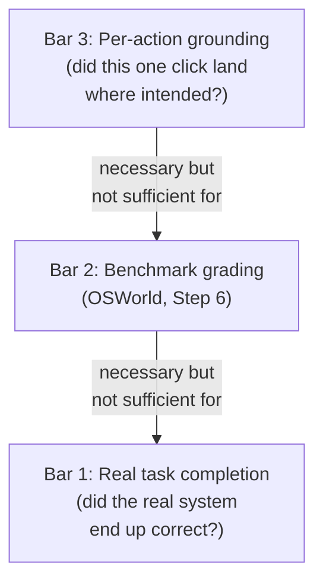
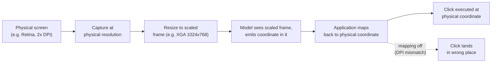
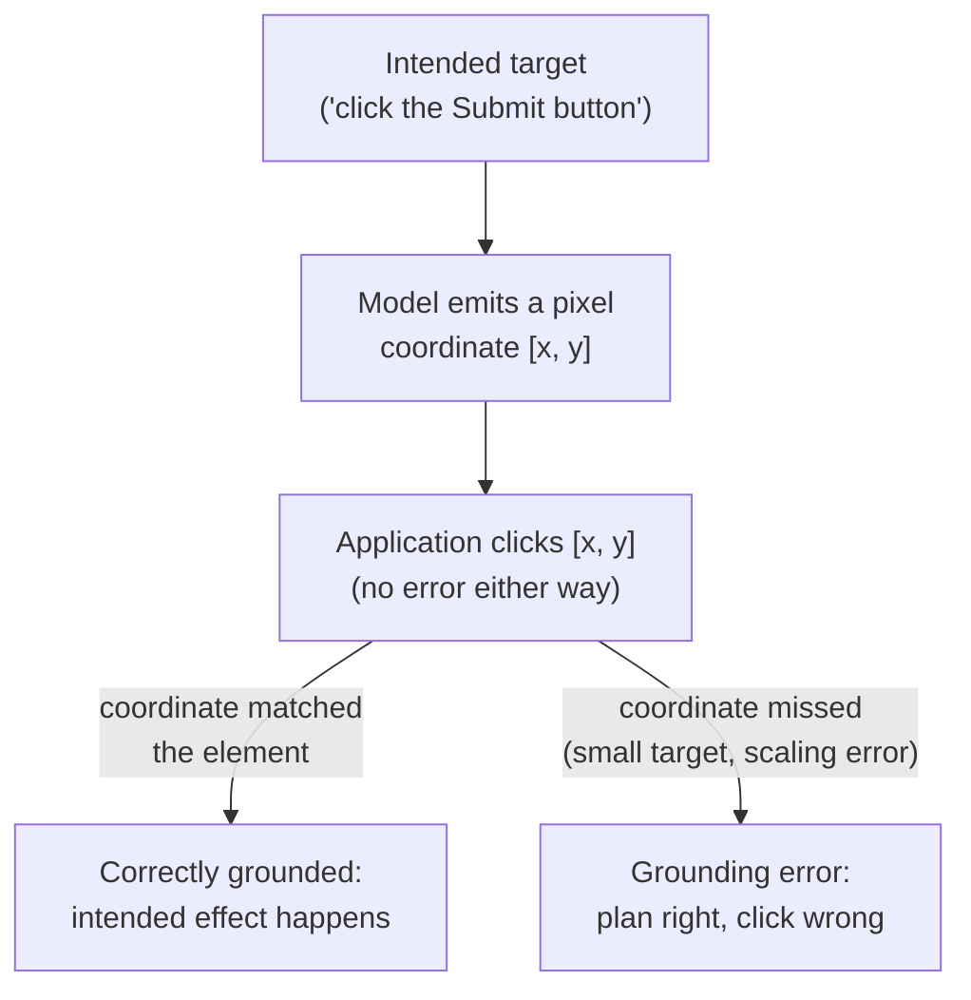
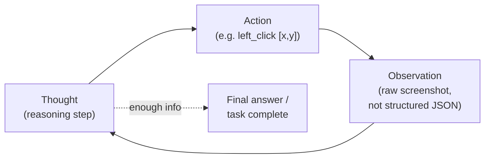
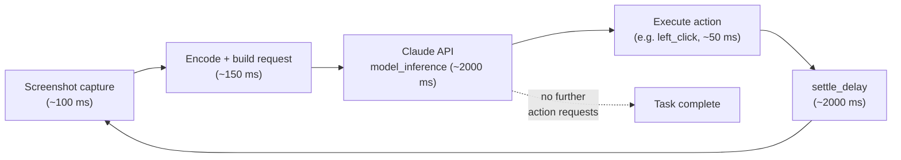
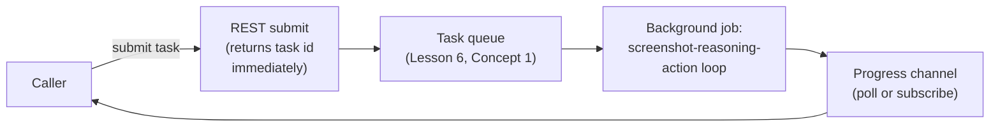
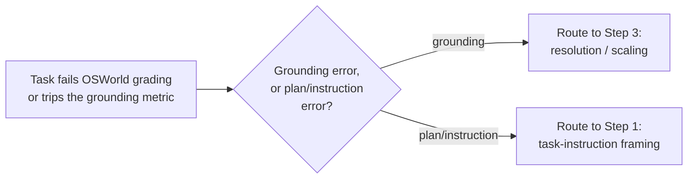

# Capstone #14: Computer-Use Agent — the Screenshot-Reasoning-Action Loop

## At a glance

| Topic | Summary |
|---|---|
| Sources | Anthropic, "Developing a computer use model" (anthropic.com/news/3-5-models-and-computer-use, October 22, 2024), read in full from the live page. Anthropic's own reference implementation, `computer.py` in the `anthropic-quickstarts` repository. Xie et al., "OSWorld" (NeurIPS 2024, arXiv:2404.07972), for the benchmark's own definition. Anthropic's current API docs and LiteLLM's docs, used only where flagged and dated separately. |
| Problem | Given a task in natural language and a piece of software, complete it by operating the software's own graphical interface — looking at a screenshot, moving a cursor, clicking and typing — the same interface a human operator uses. |
| The approach | One general capability, not one integration per app. Anthropic: "Instead of making specific tools to help Claude complete individual tasks, we're teaching it general computer skills" *(source-confirmed)*. |
| The central trade-off | Screenshots in, coordinates out, is far slower and costlier than a direct API for the same task. It is chosen only when no usable API exists, not as a default. |
| Benchmark | OSWorld, screenshot-only: Claude 3.5 Sonnet 14.9%, next-best 7.8%, and 22.0% with more steps; SWE-bench Verified rose 33.4% to 49.0% *(source-confirmed, Anthropic)*. OSWorld's own humans score about 72% *(source-confirmed, OSWorld paper)*. |
| Vendor's own caveats | "Still experimental — at times cumbersome and error-prone"; "Claude's current ability to use computers is imperfect"; "begin exploration with low-risk tasks" *(source-confirmed)*. |
| First to break | Action grounding (a right plan, a click that misses) and prompt injection (the whole screen is the input, so on-screen text can hijack the agent). |
| Easy-to-miss traps | A pixel coordinate is not a semantic target. A benchmark score is not real task completion. The screenshot is the dominant cost and cannot be cached. One moderate task already outlasts a 60-second gateway timeout. |
| Practice PDFs | [Study edition](../../capstone-study-and-mock/computer-use-agent/capstone14_computer_use_agent_study.pdf) · [Mock interview](../../capstone-study-and-mock/computer-use-agent/capstone14_computer_use_agent_mock.pdf) |

Evidence labels used below: *(source-confirmed)* means the claim or quote is in the named primary source. *(illustrative)* means it is this document's own planning assumption or design. Anthropic's current API docs are dated separately from the 2024 announcement throughout; the toolset has since evolved.

### Concepts this case study builds on

| Concept | Where it is taught | One-line recap |
|---|---|---|
| ReAct, tool use | [Lesson 1, Group D](../../lessons/lesson-1-ai-fundamentals-refresher.md#d-agent-architecture) | Reason, act, observe, repeat; a tool call is a structured request the app executes. |
| Prompt caching | [Lesson 1, Group B](../../lessons/lesson-1-ai-fundamentals-refresher.md#b-serving-and-running-models) | A stable prompt prefix can be served from cache; new content cannot. |
| Back-of-envelope method | [Lesson 7, Concept 4](../../lessons/lesson-7-application-architecture-and-security.md#concept-4-back-of-envelope-estimation-technique--latency-numbers) | State assumptions, decompose, carry units, sanity-check, name the sensitive input. |
| Async over synchronous REST | [Lesson 6, Concept 4](../../lessons/lesson-6-async-and-communication.md#concept-4-rpc-vs-rest) | A task longer than a gateway's idle timeout cannot be one held-open request. |
| Blast radius | [Lesson 7, Concept 1](../../lessons/lesson-7-application-architecture-and-security.md#concept-1-monolith-vs-microservices-single-responsibility) | How much one failure or breach can reach; isolation bounds it. |
| Prompt injection | [Lesson 8, Concept 1](../../lessons/lesson-8-safety-and-isolation.md#concept-1-prompt-injection) | Instructions planted in content the model reads as part of its job. |
| Sandboxing agent execution | [Lesson 8, Concept 2](../../lessons/lesson-8-safety-and-isolation.md#concept-2-sandboxing-agent-execution) | Isolate an untrusted run from the host and other sessions. |

---

## Step 1: Clarify Requirements & Frame the ML/AI Objective

### The objective

Given a task in natural language — book a flight, fill an expense report, read an invoice total on a vendor portal and enter it into accounting software — and a target piece of software, the agent completes the task by operating that software's own graphical interface, the same one a human would use. Anthropic's confirmed description: the agent can "direct Claude to use computers the way people do — by looking at a screen, moving a cursor, clicking buttons, and typing text" *(source-confirmed)*.

The model is not handed task-specific functions. Anthropic is explicit that the opposite was deliberate: "Instead of making specific tools to help Claude complete individual tasks, we're teaching it general computer skills" *(source-confirmed)*. One general-purpose capability, reusable across any software with a visual interface, rather than one hand-written integration per application.

### Three bars for success, loosest to strictest

1. **Real task completion** — the real external system ends in the right state: a field now holds the correct value, a file was created, a flight was booked. The only bar an end user cares about, and the hardest to check automatically.
2. **Benchmark grading** — OSWorld (Step 6) runs an automated check against the real final state of a virtual-machine environment, not a human or model judging whether the transcript looks right.
3. **Per-action grounding** — whether each individual click, keystroke or scroll did what the model intended (defined in Step 3). A necessary condition for the first bar, not a replacement: every action can be correctly grounded and the task still fail from a wrong plan or a misread instruction.



### Out of scope

Training or fine-tuning the underlying vision-language model (treated as off-the-shelf, as capstones #10 and #13 do); any claim about how Claude's internal visual grounding works (undisclosed); a survey of scripted GUI-automation tools (RPA, Selenium) that never perceive a screen; and the detailed mechanics of prompt-injection defence or sandboxing (Lesson 8, referenced not re-derived).

### Trade-offs

Framing the objective as "operate the same GUI a human would" rather than "call a purpose-built API" is not a default. It is the choice Step 4 argues is usually the worse one when a usable API exists. Scoping the main ground-truth bar to benchmark grading rather than real production completion buys a reproducible, automatable signal — the same trade-off capstone #13 made for SWE-bench — at the same cost: a benchmark score is a narrower, cheaper proxy for real task completion against arbitrary software the fixed task set never saw.

---

## Step 2: Back-of-Envelope Constraints

Lesson 7's five-step method is applied here, not re-derived. Figures are *(illustrative)* unless marked *(confirmed)*.

### Assumptions

- **Screen resolution:** 1024x768, XGA (Extended Graphics Array), a 4:3 standard. *(confirmed)*: `computer.py` comments "sizes above XGA/WXGA are not recommended", naming XGA, WXGA (1280x800) and FWXGA (1366x768).
- **Tokens per screenshot:** roughly 1,000 to 1,800 input tokens *(confirmed, current API docs; dated separately)*. This uses the midpoint, 1,400.
- **History text per round-trip:** 800 tokens — system prompt, task instruction and running action history, re-sent each turn *(illustrative)*.
- **Output per round-trip:** 150 tokens — a short observation plus one action request; terser than capstone #13's 300, since "click at (512, 340)" is a smaller decision than a code edit *(illustrative)*.
- **Round-trips for a moderate task:** 24 — a multi-field form across a few screens, with a fresh screenshot after essentially every action *(illustrative)*.
- **Pricing:** \$3 per million input tokens, \$15 per million output — this repo's shared anchor *(illustrative)*.
- **Settle delay before the next screenshot:** 2.0 seconds. *(confirmed)*: `computer.py` sets `_screenshot_delay = 2.0` with the comment "delay to let things settle before taking a screenshot".
- **Model inference per round-trip:** 2,000 ms *(illustrative)* — the 2024 announcement publishes no latency figure (a confirmed absence).

### Decompose

```text
input_tokens_per_rt   = image_tokens_per_screenshot + history_text_tokens_per_rt
total_input_tokens    = round_trips * input_tokens_per_rt
total_output_tokens   = round_trips * output_tokens_per_rt
token_cost_per_task   = (total_input_tokens  / 1e6) * input_price
                      + (total_output_tokens / 1e6) * output_price

latency_per_step      = screenshot_capture + encode_and_upload + model_inference
                      + action_execution + settle_delay
total_task_latency    = round_trips * latency_per_step
```

### Compute, carrying units

```text
input_tokens_per_rt  = 1,400 + 800            = 2,200 tokens
total_input_tokens   = 24 * 2,200             = 52,800 tokens = 0.0528M
total_output_tokens  = 24 * 150               =  3,600 tokens = 0.0036M

token_cost_per_task  = 0.0528 * 3  +  0.0036 * 15  =  0.1584 + 0.0540  =  0.21   (dollars)

screenshot_capture   =   100 ms   (illustrative)
encode_and_upload    =   150 ms   (illustrative)
model_inference      = 2,000 ms   (illustrative, least-grounded term)
action_execution     =    50 ms   (illustrative)
settle_delay         = 2,000 ms   (confirmed, computer.py _screenshot_delay = 2.0)
                       --------
latency_per_step     = 4,300 ms   (4.3 seconds)
total_task_latency   = 24 * 4.3 s = 103.2 seconds
```

### Compare against a direct-API equivalent

If the software exposed a real API, the same operation might take about 2 structured calls — say one to read state, one to submit — at 300 input and 50 output tokens each, no image:

```text
direct_api_input_tokens  = 2 * 300 = 600 tokens = 0.0006M
direct_api_output_tokens = 2 *  50 = 100 tokens = 0.0001M
direct_api_cost  = 0.0006 * 3 + 0.0001 * 15 = 0.0018 + 0.0015 = 0.0033  (dollars)

cost_ratio       = 0.2124 / 0.0033 = about 64 to 1
round_trip_ratio = 24 / 2 = 12 to 1
```

At roughly 300 to 800 ms per API call, the direct version finishes in about 1 to 2 seconds against the loop's 103 seconds — a latency ratio of roughly 50 to 100 times. Two independently derived ratios landing in the same double-digit band, cost and latency, is itself a sanity check: neither is off by an order of magnitude.

### Sanity-check the magnitude

103 seconds for a 24-step GUI task is a plausible order for a human filling a short multi-screen form deliberately — not 1 second, not 1,000. It also clears a number this repo already uses: AWS ALB's 60-second default idle timeout (Lesson 6). A single moderate task already exceeds it, which decides Step 5's serving shape.

### The most sensitive input

**Model inference per round-trip** is the least-grounded term — the 2024 announcement publishes no latency, and the settle delay is now a confirmed constant, not a guess. If inference is closer to 4,000 ms once the action history has grown, per-step latency rises to 6,300 ms and the 24-step task to about 151 seconds. That is the number to measure first in a real deployment, as capstone #13 named its own round-trip count.

### Trade-offs

A 24-step anchor keeps the math relatable, but a real distribution has a long tail: a multi-app workflow can run 100-plus steps, where the \$0.21 and 103-second figures scale roughly linearly, making this an expensive, slow way to do what an API could do in a handful of calls — the gap Step 4 must justify crossing. A flat 1,400-token screenshot each turn is also a simplification: Anthropic's current docs recommend pruning old screenshots (keeping 20 or fewer images per request) because they accumulate, so read \$0.21 as a floor for a short task, not a ceiling.

---

## Step 3: Data / Knowledge Pipeline

### What the agent perceives

- **Capstone #13's coding agent** perceives structured text: file contents, shell output, test results — already machine-readable.
- **Capstone #12's support agents** perceive structured records and retrieved policy text.
- **This agent** perceives one thing each step: a raw screenshot, a bitmap of whatever is on the target screen, plus the running history of its own prior actions and the original task.

Nothing arrives pre-parsed into a button's name, a field's label or a form's value. The model derives all of it from pixels, the way a human looking at the screen would. That is the structural reason this architecture needs a concept a JSON-in/JSON-out tool call never needs: action grounding.

### How a screenshot is encoded

Per the reference implementation *(source-confirmed)*, the screen is captured at physical resolution and resized to a scaled coordinate frame before being sent, because that is the frame the model emits coordinates in; it differs from the physical display whenever scaling applies. The model sees and answers in the scaled frame, and the application must map its coordinates back onto the physical screen before executing the click — a real, confirmed source of error if that mapping is off, for example on a high-DPI display where one physical pixel is not one logical pixel.



Anthropic's guidance generalises this: on a 2x display, either downscale the screenshot by 2x before sending, or halve the returned coordinates before executing. The correction must go somewhere, or every click lands wrong by a consistent factor.

### Sidebar: action grounding

First appearance of this concept in the repo, so it gets a full definition and a glossary entry.

**Why.** Tool use (Lesson 1, Group D) defines how a model requests an action: a structured call with argument values the application executes. For `propose_refund(customer_id, amount)`, the argument values are exactly what the model means. A GUI action is different: the model does not name what it clicks (a semantic target, "the Submit button"), it names where — a pixel coordinate — correct only if it lands on the current on-screen location of the intended element. Intended target and actual coordinate can diverge for reasons unrelated to whether the plan was right.

**What.** Action grounding is translating a model's intended action on a graphical interface into the correct low-level input (the exact pixel coordinate of the intended element on the current screen) so that executing it produces the intended effect. An action-grounding error is any case where the plan was correct but the emitted action — the coordinate, the scroll amount, the key sequence — did not match the intended element, so the action "succeeds" mechanically (the click registers, no error thrown) while still being wrong. OSWorld's authors call the same challenge "GUI grounding"; treating the two terms as the same underlying problem is this document's reasoned inference, not a claim either source states in those words.

**How.** A scrollbar or dropdown is harder to ground than a large, uniquely coloured button: a small clickable region, an ambiguous appearance. Anthropic's current docs confirm "some UI elements (such as dropdowns and scrollbars) might be tricky for Claude to manipulate using mouse movements" *(dated separately)*. The mitigation they recommend sidesteps grounding rather than solving it: use a keyboard shortcut (arrow keys to move a selection) instead of a mouse click, since a keyboard action has no coordinate to get wrong.



### A real action request

The field names are Anthropic's confirmed action-call shape; the tagging note spells out which parts are confirmed.

```json
{
  "type": "tool_use",
  "id": "toolu_01A2bCdeFGhij3klmNOp4qrS",
  "name": "computer",
  "input": {"action": "left_click", "coordinate": [512, 340]}
}
```

No field anywhere names "the Submit button" — only `[512, 340]`, a raw coordinate the application executes literally, with no way on its own to check whether it lands on the element the model's reasoning (sent separately, as text, in the same turn) intended.

Tagging note: the `action` and `coordinate` field names are source-confirmed from `computer.py`; the `tool_use`/`id`/`name` envelope is Anthropic's general Messages API tool-use format; the specific id string and the `[512, 340]` value are this document's illustrative placeholders.

### The confirmed action vocabulary

`Action_20241022`, Anthropic's own 10-action set at the time of the 2024 announcement *(source-confirmed, from `computer.py`)*:

| Action | What it does |
|---|---|
| `key` | Press a key or combination (e.g. `Return`, `ctrl+s`) |
| `type` | Type a literal string of text |
| `mouse_move` | Move the cursor to a coordinate, no click |
| `left_click` | Left-click at a coordinate |
| `left_click_drag` | Click-and-drag from one coordinate to another |
| `right_click` | Right-click at a coordinate |
| `middle_click` | Middle-click at a coordinate |
| `double_click` | Double-click at a coordinate |
| `screenshot` | Capture and return the current screen |
| `cursor_position` | Report the cursor's current coordinate |

Every one is a low-level GUI primitive, none specific to any software — the concrete form of the "general computer skills" choice from Step 1.

### The tool's API-facing definition

*(source-confirmed, from `computer.py`'s `to_params`, with `api_type` hard-coded to `computer_20241022`)*:

```json
{
  "type": "computer_20241022",
  "name": "computer",
  "display_width_px": 1024,
  "display_height_px": 768,
  "display_number": 0
}
```

### Trade-offs

Sending a downscaled screenshot cuts token cost and image-size risk but throws away pixel detail — which Anthropic's docs name as one cause when "clicks land in the right area but miss the target": "detail was lost downscaling a 4K+ source" *(source-confirmed, dated separately)*. So the scaling factor is itself a trade-off between cost and grounding accuracy, not a free win.

Representing the screen as one flat image, rather than a structured accessibility tree of named elements, is what makes the approach general across arbitrary software with no per-app work — but it is also the direct cause of the grounding problem; a structured representation would make "click the Submit button" a semantic action, trading generality (it requires the software to expose such a structure, which most legacy GUIs do not) for grounding reliability.

---

## Step 4: Model/Agent Core Design — the Loop as a Variant of ReAct

### Placing the loop in Lesson 1's vocabulary

Lesson 1, Group D defines **ReAct**: the model alternates, in a loop, between a short reasoning step, an action, observing that action's result, and reasoning again, until it has enough to finish. Anthropic's current docs name the computer-use loop directly as "the agent loop" *(dated separately)*. This document treats the computer-use loop as a special case of ReAct, specialised in two ways:

1. **The observation is always a raw screenshot.** A weather tool's observation `{"temperature_f": 72}` is usable directly; this loop's observation is a bitmap the model must visually re-parse every turn. That is the structural cause of the grounding concept (Step 3): a temperature reading cannot be "wrong because imprecise", but a screenshot-derived click coordinate can be wrong despite a mechanically successful click.
2. **The action space is one fixed vocabulary.** Ordinary tool use (Lesson 1, Group D) wraps each meaningful operation in a named function, as capstone #12's `propose_refund(customer_id, amount)` does. This loop exposes Step 3's 10 primitives as the entire toolset, whatever software is running — the concrete form of the "general computer skills" choice.



### Why ever choose this slower, costlier loop?

Step 2 shows the direct-API alternative wins decisively on cost (about 64 times cheaper) and latency (roughly 50 to 100 times faster) whenever a usable API exists. So the real question is when the loop is the only option. Three real reasons:

1. **No API exists at all.** Most installed software — legacy desktop apps, a decade-old internal tool, a vendor admin console built only for humans — has no programmatic interface. For it, a direct-API agent is not a faster alternative; it is not an alternative.
2. **An API exists but lacks what is needed.** A vendor's public API often covers only common cases, while a specific settings toggle or report-export option is reachable only through the web UI. The API surface and the GUI surface of the same product are not guaranteed to match.
3. **The task is about arbitrary, not-known-in-advance software.** "Find the cheapest flight across these three airline sites" or "check whether this government portal shows my application as received" means operating software the builders never integrated with and never will. A bespoke scraper per site does not scale to "any website" — exactly the generality the "general computer skills" framing buys.

### Why the observe half is load-bearing

Suppose a 24-step task runs with no per-step verification — all 24 actions executed blindly, no fresh screenshot between them to catch a mis-grounded click before the next builds on it. Even at a generous 95% per-action grounding accuracy (capstone #13's own illustrative per-step figure, for comparability):

```text
P(all 24 actions grounded, no correction) = 0.95^24 ≈ 0.292  ->  about a 29.2% clean run
```

Nearly 71% of the time at least one of 24 actions would be mis-grounded — not from a wrong plan, but from the accumulated chance of one coordinate missing its target. This is an illustrative sanity check, not a derivation of any Anthropic figure (none is published). It is the concrete reason the documented practice of a fresh screenshot after essentially every action is not optional: without it, a 24-step task's odds of zero uncaught mis-grounded actions are worse than a coin flip. The observe half is ReAct's "observe before the next action", here catching a grounding error before it compounds — the same role capstone #13's "fix mistakes" plays for a general planning error.

### Trade-offs

Choosing a screenshot-perceiving, coordinate-emitting action space over a direct-API or accessibility-tree alternative buys real generality — one capability across any visual software, no per-app work — at the measured cost Step 2 quantified and the grounding failure mode this step quantifies. Anthropic's own candid framing is worth quoting rather than paraphrasing: "At this stage, it is still experimental — at times cumbersome and error-prone" and "Claude's current ability to use computers is imperfect" *(source-confirmed)* — a vendor naming the exact trade-off this step argues for: the loop is chosen only when no cheaper, more reliable alternative exists.

---

## Step 5: Serving Architecture

### The latency chain per step

Step 2's decomposition is the serving reality underneath the loop, mapped onto a real request flow:

```text
Orchestrator process
   |
   | 1. capture current screen            (screenshot_capture, ~100 ms)
   v
Encode image, build request (history + task instruction + new screenshot)
   |  (encode_and_upload, ~150 ms)
   v
Claude API  -- model_inference (~2,000 ms; Step 2's most sensitive term) -->
   |  returns one or more tool_use blocks (Step 3's action schema)
   v
Orchestrator executes the action(s) against the real display / browser
   |  (action_execution, ~50 ms)
   v
settle_delay (~2,000 ms, confirmed: "delay to let things settle before a screenshot")
   |
   +--> loop back to step 1, until the model returns no further action requests
```



### Why this cannot be one synchronous request

Step 2 computed about 103 seconds for a 24-step task, against AWS ALB's 60-second default idle timeout (Lesson 6). A single moderate task already exceeds it — not a multi-hour edge case like capstone #13's coding sessions, but enough to rule out a plain synchronous request for anything beyond the shortest tasks. The architecture is the same shape capstone #13 built: the REST-submit, task-queue, progress-channel decomposition (Lesson 6, Concept 4), reused rather than reinvented.



### The sandboxing requirement

Executing simulated mouse and keyboard input against a real display means the orchestrator needs an actual running display to act against — a virtual framebuffer for a desktop target, or a controllable browser for a web target. Lesson 8, Concept 2 applies at least as strongly as to capstone #13's sandbox: whatever the actions can reach on that display is this architecture's blast radius (Lesson 7, Concept 1), and because the whole mode is "act like a human operator", a bad action has the same reach a human logged into that session would.

### Why prompt injection is unusually acute here

Lesson 8, Concept 1 defines indirect prompt injection: an instruction planted in third-party content the model reads as part of its job. This agent's only input each step is a rendered view of whatever is on screen. If that screen shows a malicious page, the injected instruction is not buried in one retrieved document (capstone #9) or one tool's output (capstone #13) — it is the entirety of what the model perceives, with no separate trusted-system-prompt channel distinguishing it from legitimate content the way a labelled RAG chunk can. Anthropic's current docs state it starkly: "Claude will follow commands found in content even when they conflict with your instructions" *(source-confirmed, dated separately)* — the general risk Lesson 8 names, confirmed as specific to exactly this architecture.

### Caching

Prompt caching (Lesson 1, Group B) splits across this loop:

- **Cacheable:** the system prompt and the action-space definition (Step 3's schema), identical every turn, plus most of the 800 history-text tokens, since most of that history repeats with one new increment.
- **Not cacheable:** the screenshot — Step 2's dominant cost, 1,400 new unique tokens every turn, which cannot be served from cache the way a repeated prompt can.

This directly limits how much of the loop's cost caching can claw back.

### Trade-offs

Routing the loop through a task queue adds real infrastructure a short, sub-60-second task does not strictly need, but per Step 2's sensitivity finding (inference could plausibly double), betting that a task stays under the timeout is a fragile foundation — which is why capstone #13 made the same choice for its longer tasks. Running the display in a dedicated, isolated sandbox costs provisioning overhead per task but bounds the injection and blast-radius risk to that one task's sandbox, rather than letting an injected action reach a shared environment's other sessions or credentials.

---

## Step 6: Evaluation, Monitoring, and Iteration

### Offline evaluation: OSWorld

**Sidebar: OSWorld.** First appearance in the repo; glossary entry added.

**Why.** The reason capstone #13's SWE-bench sidebar gives: a model's own transcript of "I clicked the right button" is not an objective way to know a task succeeded. Something has to check the real resulting state of a real environment, automatically and reproducibly.

**What.** OSWorld, from Xie et al. (NeurIPS 2024), is a benchmark and execution environment of real, open-ended computer tasks across real desktop and web applications (369 tasks on Ubuntu). An agent gets free-form mouse and keyboard control, and completion is checked by an execution-based script against the environment's actual final state, not a judgment of the transcript. A screenshot-only category restricts perception to exactly this architecture — screenshots, no structured accessibility data.

**How.** Anthropic's 2024 announcement reports, verbatim *(source-confirmed)*: "On OSWorld… Claude 3.5 Sonnet scored 14.9% in the screenshot-only category, notably better than the next-best AI system's score of 7.8%. When afforded more steps to complete the task, Claude scored 22.0%." Read against OSWorld's own paper, this is low in absolute terms: OSWorld reports humans completing about 72% of its task set (72.36%) against the best 2024 model near 12% (12.24%) — the concrete form of Step 4's "experimental… cumbersome and error-prone". Even the model generating the headline 14.9% was, by the benchmark's own terms, resolving well under a quarter of its real-world task set.

### Not the only evidence

The same announcement reports a confirmed coding result: "it improves performance on SWE-bench Verified from 33.4% to 49.0%" *(source-confirmed)*. Worth naming because it is a different kind of improvement: SWE-bench Verified measures the underlying model's general reasoning and coding uplift (capstone #13's benchmark family), not this capstone's screenshot-and-action loop. The two should not be conflated just because they were announced together.

### Action-grounding monitoring

A task failing OSWorld's grading does not by itself say why — a wrong plan, or a right plan with a mis-grounded action (Step 3). A real deployment logs, for a sampled subset of completed tasks, whether each action's intended target (from the model's own stated reasoning) matched its actual on-screen effect (checkable from the very next screenshot, already captured by the loop). That is the measurable form of the grounding definition, analogous to capstone #12's validator catch rate: both are the rate at which a specific named failure mode is caught.

### The feedback loop

Tasks that fail grading, or that the grounding metric flags in production, route back to one of two places — the same "route failures back into the thing that needs fixing" shape capstones #9, #12 and #13 use:

- **Step 3's resolution and scaling choices** — a UI element type that consistently mis-grounds may mean the downscaling factor needs adjusting for that class of target.
- **Step 1's task-instruction framing** — a consistently misunderstood instruction is a prompting problem, not a grounding one.



### Failure modes Anthropic discloses

Beyond "experimental… error-prone" (Step 4), the current docs name two patterns relevant to monitoring *(source-confirmed, dated separately)*: Claude "sometimes assumes outcomes of its actions without explicitly checking their results" — the exact failure the observe-and-correct argument exists to reduce, not eliminate — and certain UI elements (dropdowns, scrollbars) are disproportionately hard to ground by mouse alone. A deployment's monitoring should break error rates out by UI-element type, the same "isolate which category drives the error rate" discipline capstone #12 applies per specialist domain.

### Trade-offs

Sampling a subset of tasks for human grounding review scales to real volume but, like every sampled audit this repo names (capstone #11's stratified auditing, capstone #12's validator-audit sampling), trades completeness for cost: a rare but real UI pattern's failure could go unnoticed longer than under full review. Leaning on Anthropic's own "low-risk tasks" recommendation as a deployment gate — restricting early use to tasks where a mis-grounded action is cheap to detect and reverse — is the safest rollout given both the architecture's structural error mode and the vendor's caveats.

But it also means this architecture's highest-value uses (irreversible, consequential actions on legacy software with no API — Step 4's strongest justification for using it at all) are exactly the ones a cautious rollout defers longest: a real tension this document names rather than resolves.

---

## Sources and further reading

- Anthropic, "Developing a computer use model" (anthropic.com/news/3-5-models-and-computer-use, October 22, 2024) — **primary**, read in full from the live page. Source of every quote describing how computer use works ("direct Claude to use computers the way people do — by looking at a screen, moving a cursor, clicking buttons, and typing text"; "Instead of making specific tools to help Claude complete individual tasks, we're teaching it general computer skills"), the OSWorld figures (14.9%, 7.8%, 22.0%), the SWE-bench Verified figures (33.4% to 49.0%), and the caveat language ("still experimental — at times cumbersome and error-prone"; "Claude's current ability to use computers is imperfect"; "begin exploration with low-risk tasks"). The page publishes no latency figure for computer use — a confirmed absence.
- Anthropic, `anthropic-quickstarts` repository, `computer-use-demo/.../tools/computer.py` — **primary**, Anthropic's own reference implementation, read directly. Source of the 10-action `Action_20241022` vocabulary, the `computer_20241022` tool type and `to_params` shape, the XGA/WXGA/FWXGA resolution constants and the "sizes above XGA/WXGA are not recommended" comment, the scaling and coordinate-mapping mechanics, and the `_screenshot_delay = 2.0` settle delay with its "delay to let things settle before taking a screenshot" comment.
- Xie, Zhou, Chen, et al., "OSWorld: Benchmarking Multimodal Agents for Open-Ended Tasks in Real Computer Environments" (NeurIPS 2024, arXiv:2404.07972) — **primary**, for the benchmark's own definition only. Source of the 369-task Ubuntu benchmark, the screenshot-only category, and the human (about 72%) against best-2024-model (about 12%) baselines used as context for how low the 14.9% and 22.0% scores are.
- Anthropic's current API documentation (platform.claude.com) and LiteLLM's provider documentation (docs.litellm.ai) — **secondary**, dated separately from the 2024 announcement throughout. Used only for the per-screenshot token range (1,000 to 1,800), the image-pruning recommendation, the "Claude will follow commands found in content…" injection warning, and the "dropdowns and scrollbars… tricky" and "detail was lost downscaling a 4K+ source" grounding caveats — none backdated to the 2024 claims.
- [Lesson 1](../../lessons/lesson-1-ai-fundamentals-refresher.md) — Group D (ReAct and tool use, the pattern this loop specialises) and Group B (prompt caching, Step 5).
- [Lesson 6](../../lessons/lesson-6-async-and-communication.md) — Concept 1 (task queues) and Concept 4 (the REST-submit/task-queue/progress-channel decomposition and the 60-second ALB idle timeout), reused in Step 5.
- [Lesson 7](../../lessons/lesson-7-application-architecture-and-security.md) — Concept 1 (blast radius) and Concept 4 (the back-of-envelope method applied in Step 2).
- [Lesson 8](../../lessons/lesson-8-safety-and-isolation.md) — Concept 1 (prompt injection, applied to this architecture's acute case) and Concept 2 (sandboxing agent execution).
- [Capstone #13](../autonomous-coding-agent/README.md) — the direct-access coding agent this screenshot-driven architecture contrasts with, and the precedent for the compounding-error math and the reused serving architecture.
- [Glossary](../../appendix/glossary.md) — entries for action grounding and OSWorld.
