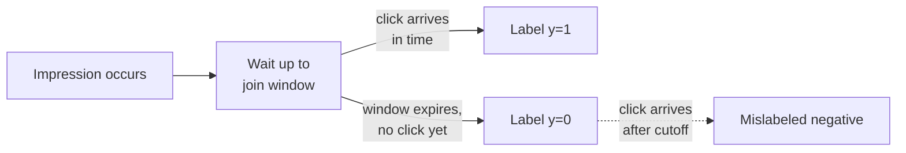
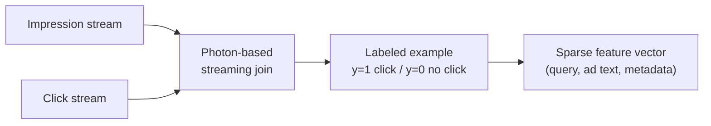
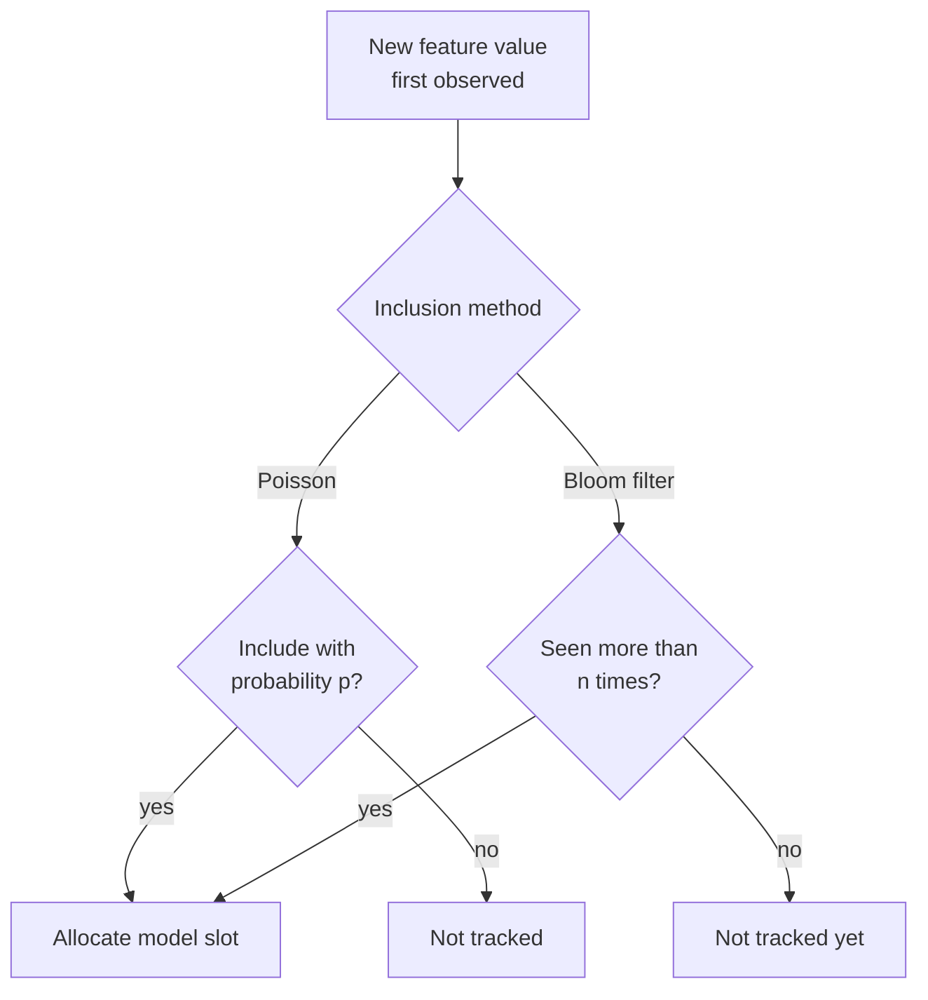
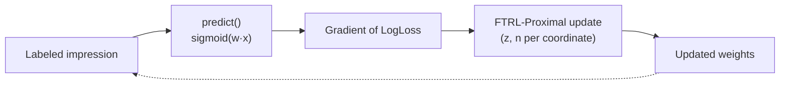
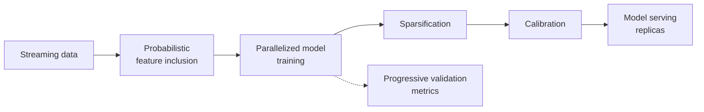
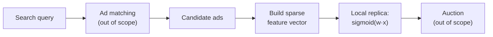
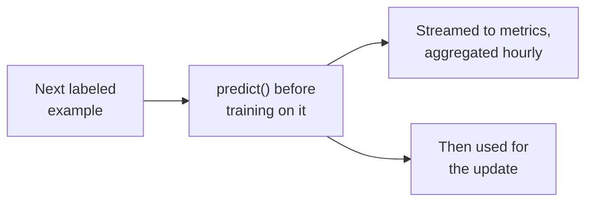

# Capstone #2: Ad Click-Through-Rate (CTR) Prediction — Google's "View from the Trenches"

## At a glance

| Topic | Summary |
|---|---|
| Source | McMahan, Holt, Sculley, Young, Ebner, Grady, Nie, Phillips, Davydov, Golovin, Chikkerur, Liu, Wattenberg, Hrafnkelsson, Boulos and Kubica, "Ad Click Prediction: a View from the Trenches," KDD 2013 (DOI 10.1145/2487575.2488200). |
| Problem | For every ad matched to a search query, estimate the probability that it will be clicked. An auction combines that probability with the advertiser's bid, so the number must be accurate, not just correctly ordered. |
| Scale | Billions of predictions a day, feature vectors with billions of dimensions, hundreds of non-zero values per example, models with billions of coefficients *(source-confirmed)*. The paper gives no exact counts. |
| Core idea | Online logistic regression trained with FTRL-Proximal. Each coordinate has its own learning rate, and an L1 penalty drives unneeded coefficients to exactly zero so the served model is small. |
| Headline results | Per-coordinate learning rates cut AucLoss by 11.2% against one global rate. FOBOS needs 38% more non-zero coefficients than FTRL-Proximal at equal accuracy *(source-confirmed)*. |
| Memory tricks | Storing coefficients as 16-bit fixed point saves 75% of the RAM for coefficient values. Bloom filter inclusion saves 66% of training RAM for 0.008% AucLoss *(source-confirmed)*. |
| Surprise | The paper tried feature hashing and rejected it. It could not shrink below several billion features without observable loss *(source-confirmed)*. |
| Evaluation | AucLoss, LogLoss and SquaredError, reported as relative changes. Progressive validation scores each example before the model trains on it, and a calibration layer fixes bias. |
| First to break | Memory per serving replica, not compute. A 2-billion-coefficient model with 8-byte keys is 20 GB per copy, not the 4 GB that the 75% figure suggests *(illustrative)*. |
| Easy-to-miss traps | The 75% saving covers coefficient values only, not keys. A per-query subsample needs per-query arithmetic, and a 2% click rate per ad is about 5.9% per query. A constant model scores 98% accuracy and chance-level AUC. |
| Practice PDFs | [Study edition](../../capstone-study-and-mock/ctr-prediction/capstone2_ctr_prediction_study.pdf) · [Mock interview](../../capstone-study-and-mock/ctr-prediction/capstone2_ctr_prediction_mock.pdf) |

Evidence labels used below: *(source-confirmed)* means the figure or claim is in the paper. *(illustrative)* means it is this document's planning assumption, chosen to sit inside the paper's qualitative scale.

### Concepts this case study builds on

| Concept | Where it is taught | One-line recap |
|---|---|---|
| Online learning, FTRL-Proximal, per-coordinate rates | [Glossary](../../appendix/glossary.md) | Update the model after every example, and give rarely seen features faster learning rates. |
| Feature hashing | [Glossary](../../appendix/glossary.md) | Map a feature value to a bucket by a hash function instead of a dictionary. |
| Replicating a shared artifact | [Lesson 5, Concept 1](../../lessons/lesson-5-data-layer.md#concept-1-rdbms-scaling) | Read replicas trade storage for latency and availability. |
| Availability patterns | [Lesson 3, Concept 3](../../lessons/lesson-3-scalability-and-availability.md#concept-3-availability-patterns) | A copy that can serve alone survives a lost link to its source. |
| Offline evaluation | [Lesson 9, Concept 2](../../lessons/lesson-9-evaluation-and-observability.md#concept-2-offline-evaluation--golden-datasets-llm-as-judge-regression-suites) | Gate every change on a fixed measurement before it ships. |

---

## Step 1: Clarify Requirements & Frame the ML/AI Objective

### The objective

Click-through rate (CTR) is the share of ad impressions that are clicked. A CTR of 2% means 2 clicks per 100 impressions. This system does not report that rate after the fact. For each candidate ad `a` shown against a query `q`, it estimates P(click | q, a), a single probability between 0 and 1, fast enough to feed an auction that resolves before the results page renders.

The paper describes the pipeline around it *(source-confirmed)*:

- A search query arrives, and advertiser-chosen keywords match an initial set of candidate ads.
- An auction decides whether each ad is shown, in what order, and at what price if it is clicked.
- An important input to that auction, besides the bids, is the estimate P(click | q, a).

This is binary classification with a probabilistic output. The auction needs a calibrated probability, because it combines the number with a bid. A yes-or-no prediction would be useless to it.

### Ground truth

The label is binary. It is 1 if the impression was clicked and 0 if not, and it is observed from user behavior with no human labeling. Labels arrive at the same volume as the traffic. That is a structural advantage over problems that need paid annotators.

The paper says its data comes from a streaming service based on the Photon system, a system for joining continuous data streams *(source-confirmed)*. It does not describe how impressions and clicks are matched. How long to wait before an unclicked impression becomes a negative is therefore a design decision in this document, not something the paper states.

### The label-timing trade-off

A click can arrive after the impression has already been labeled 0. The window length trades two errors.

| Window | Effect | Cost |
|---|---|---|
| Short | An impression is committed as a negative quickly. | Late clicks are labeled 0, so observed CTR is biased down. |
| Long | Every impression waits out the window before it is usable. | Training data is staler. |

Suppose 1% of true clicks arrive after the window *(illustrative)*. Observed CTR is then 1% lower in relative terms: 1.98% instead of 2.00%. Calibration (Step 6) can absorb that on average. It cannot absorb it per slice if delay differs between countries or ad formats.



Delayed labels are studied at length for conversions in Chapelle, "Modeling Delayed Feedback in Display Advertising" (KDD 2014). The CTR paper does not discuss them.

### Out of scope

The paper draws its own boundary, and this case study keeps it:

- The auction: which ads win, in what order, and at what price.
- Ad matching, the keyword step that produces the candidate set before any CTR estimate runs.
- Anything downstream of the click, such as conversion prediction.

### Trade-offs considered

Using click and no-click events as labels costs nothing and lets the model retrain continuously. The label is only a proxy for what the business wants. A user can click an ad and regret it, or skip one that would have helped, and the label cannot tell those apart. A short window keeps training fresh and accepts a small, structural rate of mislabeled negatives.

---

## Step 2: Back-of-Envelope Constraints

### Scale

The paper gives only qualitative scale *(source-confirmed)*:

- Predictions "billions of events per day", and many billions of times per day in the system overview.
- Feature vectors with billions of dimensions.
- Only hundreds of non-zero values in each instance.
- Models with billions of coefficients.
- In some models, half the unique features occur once in a training set of billions of examples.

The arithmetic below picks anchors inside those ranges.

```text
predictions per day  = 10,000,000,000                       (illustrative)
average rate         = 10,000,000,000 ÷ 86,400 = 115,741 predictions/s
peak rate (3×)       = 347,222 predictions/s
```

Each query scores several candidate ads, so the query rate is the prediction rate divided by the candidates per query. The peak ratio of 3 is an assumption: sponsored search spans many time zones, so it is flatter than a single-region consumer app.

### Compute is small, memory is not

A prediction is a sparse dot product over a few hundred coordinates, then a sigmoid.

```text
lookups at peak  = 347,222 × 300 non-zero values ≈ 104 million per second
```

Spread over many servers in many data centers, that is a small load per core. The pressure is memory, because every replica holds the whole model.

### Model memory: what the 75% covers

The paper stores each coefficient as a fixed-point q2.13 value *(source-confirmed)*:

- One sign bit, 2 bits left of the binary point and 13 bits right of it, 16 bits in all.
- It replaces 32- or 64-bit floating point, because nearly all coefficients lie in the range −2 to +2.
- Values outside −4 to 4 are clipped.
- The paper reports no measurable loss against 64-bit floats, and a 75% saving of the RAM for coefficient storage.

The 75% is the ratio of 16 bits to 64 bits. It covers coefficient values, not the keys that identify which feature each value belongs to. The paper notes that a hash table stores a key, either a string or a many-byte hash, beside each value. With an assumed 2 billion non-zero coefficients and 8-byte keys *(illustrative)*:

| Layout | Per coefficient | Model size | Saving |
|---|---|---|---|
| Values only, 64-bit float | 8 bytes | 16 GB | — |
| Values only, q2.13 | 2 bytes | 4 GB | 75% |
| Key and 64-bit float value | 16 bytes | 32 GB | — |
| Key and q2.13 value | 10 bytes | 20 GB | 37.5% |

The whole-model saving is 37.5%, because the key now dominates. A hash table also needs spare slots to keep lookups fast, which multiplies both rows by the same factor. The paper does not say how it stores keys, so the key size is this document's assumption.

### What replication does to the cost

The paper says trained models are replicated to many data centers for serving, so it is "much more concerned with sparsification at serving time rather than during training" *(source-confirmed)*. With an assumed 20 data centers and 4 servers each, there are 80 copies *(illustrative)*:

```text
float values with keys : 80 × 32 GB = 2.56 TB
q2.13 values with keys : 80 × 20 GB = 1.60 TB      (0.96 TB saved)
```

Serving holds only the non-zero coefficients. Training also tracks coefficients that L1 will zero, so its state is larger than the served model. Probabilistic feature inclusion (Step 3) is aimed at that training state.

### Rounding makes 16 bits safe

An online update can be much smaller than the grid spacing of 2^-13, which is about 0.000122. Plain rounding would discard it. The paper uses randomized rounding *(source-confirmed)*:

```text
rounded = 2^-13 × floor(2^13 × w + R)       R uniform between 0 and 1
```

This makes the rounding error zero on average. For a step of 0.00003 on a coefficient, the stored value moves up one grid step with probability 0.00003 ÷ 0.000122 = 24.6%, and stays put otherwise. Over many updates the total movement is correct. The paper notes that it has seen serious round-off problems even with 32-bit floats.

### Trade-offs considered

Traffic scales the rate figures and leaves the 75% alone, since that ratio comes from bit width. The real trade is continuous updating against batch retraining. Updating after each example buys freshness, and it forces the memory and sparsity tricks to be cheap enough to run inline.

---

## Step 3: Data / Knowledge Pipeline

### What the data looks like

Training examples are impressions with their click outcomes. Features come from the query, the text of the ad creative and ad-related metadata *(source-confirmed)*. The data is extremely sparse. Most features are one-hot indicators, for example "this query term is present", and each instance has only hundreds of non-zero values among billions of possible dimensions.



### Sidebar: feature hashing

A categorical feature with billions of possible values normally needs a dictionary that maps each value to a column. Keeping that dictionary synchronized across every replica is infrastructure of its own. Feature hashing replaces it with a function: the column is the hash of the value modulo a fixed number of buckets. The model's width is then fixed, at the price of collisions, where two values share one weight.

```python
import hashlib

def bucket(name: str, value: str, num_buckets: int) -> int:
    key = f"{name}={value}".encode("utf-8")
    return int(hashlib.md5(key).hexdigest(), 16) % num_buckets
```

### The paper rejected hashing

Hashing is the textbook answer, and the paper names two precedents. Weinberger et al. (ICML 2009) hashed a personalized spam-filtering space down to 2^24 features, about 16.8 million, and Chapelle used 2^24 for display advertising *(source-confirmed)*. The paper's own result differs:

> "We tested this approach but found that we were unable to project down lower than several billion features without observable loss. This did not provide significant savings for us, and we have preferred to maintain interpretable (non-hashed) feature vectors instead."

Section 4.1 adds that hashing with collisions "also did not give useful benefit" as a way to cut the memory of rare features.

Non-hashed does not mean no hash table. The paper stores coefficients in a table keyed by the full feature identifier, a string or a many-byte hash, so distinct features keep distinct slots. With 8-byte keys the chance of any collision among two billion features is small, and a 24-bit bucket space would have collided constantly.

Memory decides the rest, and the arithmetic can go either way. A hashed dense array of B buckets costs B × 2 bytes with q2.13 values and no keys. A keyed sparse table with N non-zero coefficients costs N × 10 bytes. Hashing is smaller only if B is below 5N. The paper publishes neither N nor B, so it does not say which side its system fell on. It reports that hashing did not pay.

### Probabilistic feature inclusion

Half the unique features in some models occur once, and a feature that occurs once can never matter. The trouble is that you cannot tell in advance which features will be rare. Pre-processing to drop them needs an extra read and write of the data, and it makes it impossible to try later models that use those features. The paper tried two ways to decide online, as a feature first appears *(source-confirmed)*:

- Poisson inclusion adds a new feature with probability p. The number of sightings before inclusion is geometric with mean 1/p.
- Bloom filter inclusion uses a rolling set of counting Bloom filters to detect the first n sightings. A feature enters the model after it has occurred more than n times. A counting Bloom filter can report a false positive but never a false negative, so a feature occasionally enters early.

| Method | RAM saved | AucLoss detriment |
|---|---|---|
| Bloom filter, n = 2 | 66% | 0.008% |
| Bloom filter, n = 1 | 55% | 0.003% |
| Poisson, p = 0.03 | 60% | 0.020% |
| Poisson, p = 0.1 | 40% | 0.006% |

Both work, and the paper says Bloom filter inclusion gives the better trade. A related approach, an L1 implementation that tracks nothing for zero coefficients, lost unacceptable accuracy. The paper therefore tracks more features in training and sparsifies only for serving.



### Subsampling the training data

Typical CTRs are far below 50%, so clicks are rare and each is worth more to the model. The paper keeps every query where at least one ad was clicked, and a fraction r of the queries where none were *(source-confirmed)*. It samples by query, because many features need common processing of the query phrase. Each event gets an importance weight: 1 in a clicked query and 1/r in an unclicked one.

Why this is unbiased. If event t is kept with probability s, its weight is 1/s, so the expected contribution to the loss is s × (1/s) × loss, which is the loss itself. By linearity of expectation the weighted objective equals the objective on the full data. The paper reports that even aggressive subsampling has a mild effect on accuracy, and that the exact r is not especially important.

The figure to take care with is the click rate. The 2% in the paper's evaluation discussion is a rate per impression. A sample by query depends on the share of queries with any click, which is higher. With 3 ads per query, independent clicks and a 2% rate per ad *(illustrative)*:

```text
queries with at least one click = 1 − 0.98^3 = 5.88%
queries per day                 = 100,000,000
clicked queries                 =   5,880,800
unclicked queries               =  94,119,200
kept unclicked at r = 0.10      =   9,411,920
kept in total                   =  15,292,720   (15.3% of queries, a 6.5× reduction)
```

The weights restore the totals. Weighted impressions are 5,880,800 × 3 + 9,411,920 × 3 × 10, which is 300,000,000, the true count. Without the weights, the model would see 6,000,000 clicks in 45,878,160 impressions, a CTR of 13.1%, 6.5 times too high.

### Feature management

Each input signal, such as "words in the advertisement" or "country of origin", can have many versions and many consumers. The paper deploys a metadata index covering thousands of signals and hundreds of active models *(source-confirmed)*:

- Signals are annotated for deprecation, platform availability and domain applicability.
- When a signal is deprecated, its consumers can be found quickly.
- New signals are vetted by automatic tests, and unused ones are earmarked for deletion.

### Training many variants at once

Testing a change usually means training many near-identical models. The paper shares the per-feature key and counts across variants, so the incremental cost of a variant is only its extra coefficient values *(source-confirmed)*. A further lossy structure stores one coefficient per feature, shared by all variants that include it. It showed nearly identical relative performance and saved an order of magnitude in RAM.

### Trade-offs considered

Hashing gives a fixed, small size and costs interpretability and, at this scale, accuracy. Probabilistic inclusion keeps every surviving feature exact and costs a delay before a new feature takes effect. Subsampling cuts training cost and puts more statistical weight on fewer clicks. It is safe because the correction is exact in expectation, and a wrong weight would bring the bias back.

---

## Step 4: Model/Agent Core Design — Online Learning with FTRL-Proximal

### Sidebar: online learning

Batch learning trains on a fixed dataset, ships, and repeats on a fresh one. With billions of new examples a day and a stated need to update quickly as clicks and non-clicks are observed, a batch cycle finishes on data that is already stale. Online learning processes one example at a time and updates immediately. The paper's footnote stresses that it does not assume independent, identically distributed examples, which matters because click behavior shifts by time of day and by trend.



### The loss and its gradient

On each round the model predicts p = sigmoid(w·x), then sees the label y. The loss is LogLoss *(source-confirmed)*:

```text
loss = −y × log(p) − (1 − y) × log(1 − p)
gradient with respect to w = (p − y) × x
```

### Why not plain gradient descent

Online gradient descent (OGD) predicts well with little compute. It is poor at sparsity. The paper says adding the L1 penalty's subgradient to the OGD update will essentially never make a coefficient exactly zero. What matters for serving is the number of non-zero coefficients.

Other methods do induce sparsity: FOBOS, truncated gradient and Regularized Dual Averaging (RDA). RDA has a better accuracy-against-sparsity trade than FOBOS, yet the paper has seen gradient-descent methods beat RDA on its data. FTRL-Proximal aims at both. With no L1 term it produces the identical sequence of coefficients as OGD. Its lazy form, which stores a running quantity z per coordinate instead of the weight w, lets the L1 term zero coefficients exactly.

### The comparison in Table 1

| Method | Non-zero coefficients | AucLoss detriment |
|---|---|---|
| FTRL-Proximal | baseline | baseline |
| RDA | +3% | 0.6% |
| FOBOS | +38% | 0.0% |
| OGD-Count | +216% | 0.0% |

Read it with the caption. RDA and FOBOS were compared on a smaller prototyping dataset of millions of examples, and OGD-Count on a full-scale dataset *(source-confirmed)*. The rows are therefore not one experiment. RDA's 0.6% detriment is called significant for the application, so RDA loses on accuracy and on sparsity. FOBOS and OGD-Count match FTRL-Proximal's accuracy and need more non-zero coefficients. The paper says it tuned OGD-Count's threshold k to equal FTRL's accuracy, and a larger k gave worse AucLoss.

### Per-coordinate learning rates

A global schedule of 1/sqrt(t) lowers the rate for every coordinate as time passes, whether or not that coordinate's feature was seen. The paper's thought experiment uses 10 coins, one flipped per round. A coin flipped 1,000 times and a coin flipped 10 times, after 1,010 rounds, would share a global rate of 0.031. Treated separately, the rarely flipped coin would keep a rate near 0.32, ten times higher, because we have little evidence about it. The paper's rate for coordinate i is:

```text
rate(i) = alpha ÷ (beta + sqrt(sum of squared gradients seen for i))
```

It reports that alpha is tuned under progressive validation, that beta = 1 is usually good enough, and that this rate is near-optimal in a stated sense. Against one global rate, using per-coordinate rates reduced AucLoss by 11.2%, where reductions of 1% are considered large *(source-confirmed)*.

### The algorithm

This is the paper's Algorithm 1 in Python. The code is this document's rendering of the paper's pseudocode.

```python
import math

class FTRLProximal:
    def __init__(self, alpha: float, beta: float, l1: float, l2: float):
        self.alpha, self.beta, self.l1, self.l2 = alpha, beta, l1, l2
        self.z: dict[int, float] = {}   # accumulated gradient minus weight history
        self.n: dict[int, float] = {}   # sum of squared gradients

    def _weight(self, i: int) -> float:
        z, n = self.z.get(i, 0.0), self.n.get(i, 0.0)
        if abs(z) <= self.l1:
            return 0.0                  # exactly zero: the sparsity
        sign = 1.0 if z > 0 else -1.0
        scale = (self.beta + math.sqrt(n)) / self.alpha + self.l2
        return -(z - sign * self.l1) / scale

    def predict(self, x: dict[int, float]) -> float:
        wx = sum(self._weight(i) * v for i, v in x.items())
        return 1.0 / (1.0 + math.exp(-wx))

    def update(self, x: dict[int, float], y: int) -> None:
        p = self.predict(x)
        for i, v in x.items():
            g = (p - y) * v
            n = self.n.get(i, 0.0)
            sigma = (math.sqrt(n + g * g) - math.sqrt(n)) / self.alpha
            self.z[i] = self.z.get(i, 0.0) + g - sigma * self._weight(i)
            self.n[i] = n + g * g
```

### A hand trace of one coordinate

Take alpha = 0.1, beta = 1, l1 = 0.5, l2 = 0, one feature with value 1, and a prediction of 0.5 while the weight is zero *(illustrative)*.

| Step | Event | gradient | z | n | weight |
|---|---|---|---|---|---|
| 1 | click | −0.5 | −0.5 | 0.25 | 0, since 0.5 is not above l1 |
| 2 | click | −0.5 | −1.0 | 0.50 | 0.0293 |

After one sighting the feature is still exactly zero, so it costs nothing to serve. After two clicks, z passes the threshold, and the weight is positive. A feature seen once can never earn a slot, which is the sparsity at work. The weight at step 2 is (1.0 − 0.5) ÷ ((1 + sqrt(0.5)) ÷ 0.1) = 0.5 ÷ 17.07.

### Counts instead of squared gradients

The learning rate needs the sum of squared gradients per feature. Section 4.5 replaces it with two counts *(source-confirmed)*. Assume every event with a feature has the same probability p = P ÷ (N + P), where P is the number of clicks and N the number of non-clicks. Then the sum is P × N ÷ (N + P). With P = 10 and N = 990, the sum of squares is 10 × 0.99^2 + 990 × 0.01^2 = 9.9, and the formula gives 9,900 ÷ 1,000 = 9.9. The paper calls this a ruthless approximation that works as well for learning rates. Counts can be shared across model variants and stored with variable-length encodings.

### Confidence estimates

Auctions also benefit from knowing how sure a prediction is, to balance showing ads with little data against ads known to be good. Confidence intervals do not fit, because the models are online, regularized, not assumed independent and have billions of parameters, and a standard method needs an n by n matrix inverse. The paper's uncertainty score is an upper bound on how far one example can move the log-odds, computed as a single sparse dot product of the learning-rate vector with the features *(source-confirmed)*.

It was validated on synthetic data. A ground-truth model supplied the true CTRs, labels were sampled from it, and FTRL-Proximal was run on those labels. Figure 3 shows errors correlated with the score. The score performed comparably to a bootstrap of 32 models. The paper reports this as a plot, not as a number.

### Online learning against batch retraining

The paper does not present batch retraining as a rejected alternative. This comparison is this document's own.

| | Periodic batch retrain | Online FTRL-Proximal |
|---|---|---|
| Reproducibility | A version is one fixed artifact | The model is always changing |
| Reaction to a shift | Waits for the next retrain | Adapts within the stream |
| Bad data | Can be inspected before shipping | A bad stretch of data moves the live model |
| Fit with the stated need | Cannot meet it | Designed for it |

### Trade-offs considered

FTRL-Proximal is more complex to implement than OGD, because it stores z instead of w, and the paper shows a measured win over every simpler method tested. Per-coordinate rates need a second statistic per feature. The count approximation recovers part of that cost. The saving is real when counts are shared across variants (Section 4.3), and the paper does not quantify it.

---

## Step 5: Serving Architecture

### The pipeline

Figure 1 of the paper shows streaming data flowing through probabilistic feature inclusion into parallelized model training, then sparsification and calibration, ending in model serving replicas. Progressive validation metrics are drawn off the training stage *(source-confirmed)*.



The paper says its training resembles Downpour SGD from the Google Brain team, with a single-layer model instead of a deep network. That is why it can handle larger data and models than reported elsewhere. It gives no further architecture detail, so the rest of this step is design reasoning.

### The query path

Every replica holds the full model, which makes a prediction a local computation with no network round trip. That follows from replication and is not a claim the paper makes in those words.



### Feature construction

Each signal becomes sparse entries keyed by the full identifier. The coefficient table is keyed exactly, and an unknown key means the feature is absent.

```python
def build_feature_vector(query: str, ad: dict, table: dict[str, int]) -> dict[int, float]:
    keys = [f"query_term={t}" for t in query.lower().split()]
    keys += [f"ad_term={t}" for t in ad["creative_text"].lower().split()]
    keys += [f"advertiser={ad['advertiser_id']}", f"ad_country={ad['country']}"]
    return {table[k]: 1.0 for k in keys if k in table}
```

Here `table` maps a full identifier to a stable column and holds only features that earned a slot. No hash function reduces many values to few.

### What a replica holds

Training keeps z and a count state for every tracked feature, including those L1 will zero. Serving needs only the non-zero weights, and those are what get replicated. With the earlier illustrative sizes, a replica is 20 GB and the whole fleet is 1.6 TB, while training state is larger and sits in one place.

### Update propagation

Training changes weights continuously, so serving copies must be refreshed. The paper does not say how. Two options follow, and the choice turns on a number the paper does not give.

| Option | Strength | Weakness |
|---|---|---|
| Full snapshot every few minutes | Simple and easy to roll back | 20 GB to each of 80 replicas, 1.6 TB per push |
| Delta of changed coefficients | Small if few coordinates change | Needs a fault-tolerant, ordered stream |

The size of a delta is the number of distinct coordinates touched in the interval. With 15.3% of 10 billion events, 1.53 billion training events a day, an interval of 5 minutes holds about 5.3 million events. At 300 non-zero values each that is up to 1.6 billion touches, close to the model's 2 billion coefficients, so everything depends on skew. If a few head features account for most touches, the number of distinct coordinates is far lower. Measure it before choosing.

### Trade-offs considered

Replicating the full model costs storage for every copy and buys latency and the ability to keep serving if a data center is cut off from training. This is the read-replica trade of Lesson 5 and the availability reasoning of Lesson 3, applied to a model artifact. Continuous deltas keep replicas fresh and add a stream to operate. Snapshots are easier to roll back and slower to reflect new clicks.

### Decision table

| Decision | This system's choice | Choose differently when |
|---|---|---|
| Feature identity | Exact keys, no hashing | The sparse keyed table is larger than a hashed dense array and collisions are tolerable |
| Rare-feature control | Bloom filter inclusion | Poisson inclusion if a filter is too costly to run |
| Training algorithm | FTRL-Proximal | Plain OGD if sparsity at serving does not matter |
| Update style | Online, per example | Batch if freshness is not required and reproducibility is |
| Negative sampling | Per-query, with 1/r weights | None, if training cost is no concern |
| Propagation | Depends on measured delta size | Snapshot if the delta approaches the model size |

---

## Step 6: Evaluation, Monitoring and Iteration

### Why accuracy is the wrong metric

The paper never argues against accuracy. Its stated reason for choosing other metrics is that absolute values mislead: "Even if predictions are perfect, the LogLoss and other metrics vary depending on the difficulty of the problem (that is, the Bayes risk). If the click rate is closer to 50%, the best achievable LogLoss is much higher than if the click rate is closer to 2%" *(source-confirmed)*.

The accuracy illustration is this document's own, built on a per-ad click rate of 2% *(illustrative)*. A model that predicts "no click" for every impression is right 98% of the time. It gives every ad the same probability, so it carries no ranking information and is useless to an auction. Its AUC is 0.5, which is chance level, and its AucLoss is 0.5. That is not the worst possible score, since a model that ranks backwards has an AUC below 0.5. The point is that accuracy cannot tell this model from a good one.

### The metrics

- **AUC:** the probability that a randomly chosen clicked impression gets a higher predicted probability than a randomly chosen unclicked one. 1.0 is perfect and 0.5 is chance. The paper reports AucLoss, which is 1 − AUC.
- **LogLoss:** the loss defined in Step 4. It penalizes confident predictions that are wrong about the probability, which AUC cannot see.
- **SquaredError:** a third metric the paper names without more detail.

The paper designs every metric so that smaller is better, and says that it evaluates across several metrics because they respond differently to a change.

### Progressive validation

The paper prefers progressive validation, also called online loss, over cross-validation or a held-out set *(source-confirmed)*. Computing a gradient already needs a prediction. That prediction, made before the model trains on the example, is streamed out and aggregated hourly. It is also computed on slices such as country, query topic and layout.



Its stated advantages are that it uses 100% of the data for both training and evaluation, and that small improvements need a lot of data to see with confidence. Each example is scored before the model has seen it, so each prediction is out of sample at the moment it is made. The caveats are different. A window's number averages the model over the versions it passed through in that window, and two models are comparable only if they are scored on exactly the same data. The paper says as much, and reports relative changes against a baseline because those are far more stable over time.

### How much noise is in a number

With 10 billion events a day *(illustrative)*, one hour has about 417 million. The standard error of an observed 2% rate is the square root of 0.02 × 0.98 ÷ 417 million, which is 6.9 × 10^-6, or 0.034% of the rate. A 95% margin is about 0.07%. A slice with 0.1% of traffic has 417,000 events an hour. Its standard error is 2.2 × 10^-4, 1.1% of the rate, and the 95% margin is about 2.1%. Aggregate numbers detect small shifts. A small slice needs a longer window, which is also why a small aggregate win can hide opposite changes in different slices.

### Calibration

Predictions are calibrated on a slice if, on average, when the model predicts p, the observed click rate is near p *(source-confirmed)*. It is a property of a set of predictions. Systematic bias, the gap between mean predicted and observed CTR on a slice, can come from wrong modeling assumptions, deficiencies in the learning algorithm or hidden features. Good calibration also lets the auction be designed separately from the machine learning.

A calibration layer applies a correction function to the prediction. The paper tried two. A power-law, gamma × p^kappa, fitted by Poisson regression on aggregated data. Isotonic regression, a piecewise correction that is only required to be monotonically increasing, fitted by weighted least squares. The piecewise approach reduced bias significantly at both the high and low ends of the range. The paper adds a limit: without strong extra assumptions, the feedback loop between the model and the auction makes it impossible to give theoretical guarantees for the effect of calibration.

### Slicing and GridViz

Aggregate numbers can hide opposite effects in different countries or query topics. The paper built an interactive visualization, GridViz, that compares model variants against a control across hundreds of slicings, with column width showing importance such as impression count. It supports breakdowns by topic, country, match type and page layout *(source-confirmed)*.

### What did not work

Section 9 reports four negative results *(source-confirmed)*:

| Technique | Result |
|---|---|
| Aggressive feature hashing | No projection below several billion features without observable loss |
| Dropout, rates 0.1 to 0.5 | No benefit in accuracy or generalization, and most often a detriment, since sparse data with noisy labels loses information |
| Feature bagging | Slightly reduced predictive quality, by 0.1% to 0.6% AucLoss depending on the scheme |
| Feature-vector normalization | Early small gains did not translate into overall positive metrics, and the results looked somewhat detrimental |

### What breaks first at 10×

| Quantity | At 10× traffic | Reason |
|---|---|---|
| Prediction rate | 1,157,407/s average, 3,472,222/s peak | Scales with traffic |
| Training events | About 15 billion a day | Scales with traffic |
| Model per replica | Roughly the same | Depends on the number of features, which grows more slowly than traffic |
| Serving fleet memory | Grows with the number of replicas | One full copy each |
| Metric noise | Falls by about 3.2 times | The standard error shrinks with the square root of n |

The model's size depends on how many distinct features earn a slot, and the paper gives no growth rate. A larger fleet needs more memory in total, even though each copy barely changes.

### Risks the paper does not cover

- Click fraud and bots. An online learner absorbs fake clicks within minutes, so filtering belongs upstream of the join.
- A broken feature. A signal that changes meaning silently shifts predictions, which is the case the signal index in Step 3 targets.
- Calibration drift per slice. A late-click bias that differs by market is invisible in the aggregate.

### Trade-offs considered

AUC measures ranking and ignores calibration, so two models with equal AUC can differ greatly in the probabilities the auction uses. That is why the paper also tracks LogLoss and runs a calibration step. Progressive validation gives full statistical power at the cost of comparisons that need identical streams. Isotonic regression fits more shapes than a power law and gives up a closed form.

---

## Sources and Further Reading

- McMahan, Holt, Sculley, Young, Ebner, Grady, Nie, Phillips, Davydov, Golovin, Chikkerur, Liu, Wattenberg, Hrafnkelsson, Boulos and Kubica, "Ad Click Prediction: a View from the Trenches," KDD 2013 (DOI 10.1145/2487575.2488200). The primary source for every figure, formula and quotation marked source-confirmed.
- Ananthanarayanan et al., "Photon: Fault-tolerant and Scalable Joining of Continuous Data Streams," SIGMOD 2013, cited by the paper as the basis of its streaming service. Not read for this document.
- Chapelle, "Modeling Delayed Feedback in Display Advertising," KDD 2014, a pointer on delayed labels for conversions.
- Weinberger, Dasgupta, Langford, Smola and Attenberg, "Feature Hashing for Large Scale Multitask Learning," ICML 2009, the hashing precedent the paper cites.
- [Glossary](../../appendix/glossary.md): online learning, FTRL-Proximal, feature hashing.
- [Lesson 5](../../lessons/lesson-5-data-layer.md) and [Lesson 3](../../lessons/lesson-3-scalability-and-availability.md) for replication and availability.

Labels: *(source-confirmed)* is in the paper. *(illustrative)* is a planning assumption of this document.
