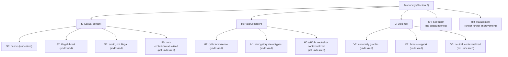
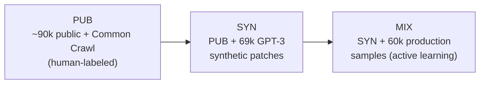
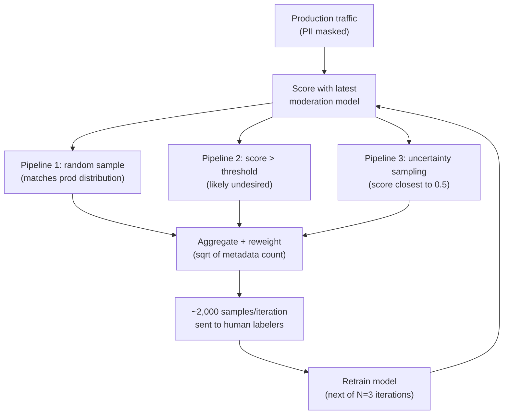
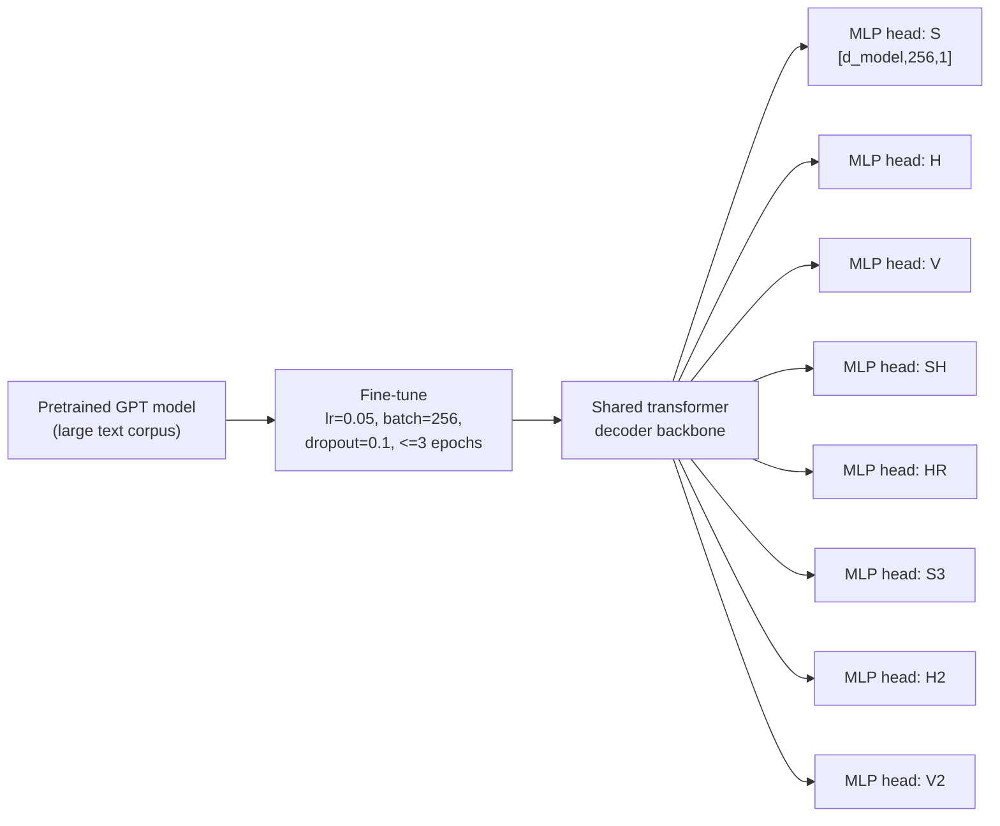
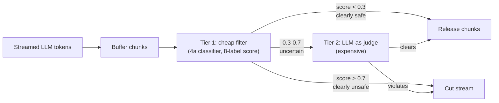
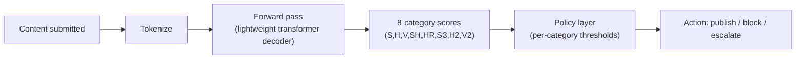

# Capstone #5 / #11: Harmful Content Detection & AI Content Moderation (LLM Era) — OpenAI's Holistic Undesired-Content-Detection System

**Source(s):** Primary — Markov, Zhang, Agarwal, Eloundou, Lee, Adler, Jiang, and Weng, *"A Holistic Approach to Undesired Content Detection in the Real World,"* originally posted as arXiv:2208.03274 (Aug. 2022), published in the *Proceedings of the AAAI Conference on Artificial Intelligence*, vol. 37, pp. 15009–15018 (2023). Also a chapter in *Machine Learning System Design Interview* (Aminian & Xu, ByteByteGo).

**Confidence — and an honest correction to this source's own publication date, in the same spirit as this repo's netflix-feed-ranking and ctr-prediction precedents.** This source is sometimes dated "June 2024." Having fetched and read the paper directly, that date needs a correction: **the underlying research is from 2022–2023, not 2024.** The paper first appeared as an arXiv preprint in August 2022 and was formally published at AAAI 2023. What's actually dated June 2024 is OpenAI's own publication-index page for it (`openai.com/index/a-holistic-approach-to-undesired-content-detection-in-the-real-world/`) — confirmed by fetching that exact page, which returned HTTP 403 to a direct fetch and was retrieved instead via the Wayback Machine (`web.archive.org`, per this repo's standing rule to try that before concluding a source is unreachable), where the page's own byline reads: "OpenAI June 20, 2024 Publication." That page is a listing/abstract entry linking to the paper, not a new piece of research — it appears OpenAI re-surfaced this older work on its publications index in mid-2024, but the paper's own content, numbers, and claims are all 2022–2023 vintage. This document is written from the paper's own full text, fetched directly from its ar5iv HTML mirror (`ar5iv.labs.arxiv.org/html/2208.03274`) and cross-checked character-for-character against the raw extracted text for every sentence placed in quotation marks below — not from the abstract, the OpenAI index page, or secondhand summaries.

**Confidence, continued — the #5 vs. #11 split, stated honestly up front.** For capstone **#5** (the classic-ML angle: a trained classifier moderating user-generated content), this paper is a strong, detailed primary source — taxonomy design, labeling-instruction methodology, the three-pipeline active-learning mechanism, and the specific overfitting-risk mechanism it names are all confirmed directly from the text, with real numbers (not just qualitative "billions"-style statements, unlike capstone #2's CTR paper). For capstone **#11** (the LLM-era angle: streaming moderation of LLM-*generated* output, and a cheap-filter-then-expensive-judge model chain), **the paper does not cover this directly.** Its only connection to moderating language-model *output* specifically is a single sentence in Section 7, plus the footnote attached to it: the main-body text states that classifiers can reduce misuse "by ensuring that policies are operationalized on both inputs and outputs of language models" — and the word "misuse" in that same sentence carries footnote 6, which defines misuse as including "generation of hateful content." So only "generation of hateful content" is actually footnote text; "ensuring that policies are operationalized on both inputs and outputs of language models" is the main-body sentence the footnote marker attaches to, not the footnote itself — either way, a single sentence (plus its footnote), not a described architecture. The paper also confirms, in Section 7.4, that "the model we deploy can not be used to generate text, only to compute safety scores" — i.e. even OpenAI's own deployed classifier from this paper is explicitly *not* the generative model being moderated, just a separate scorer. **The paper contains no discussion anywhere of streaming moderation, of scoring partial/in-progress generated text, or of a multi-tier cheap-filter-then-expensive-judge model cascade.** Step 4b and Step 5b below (the LLM-era serving architecture) are explicitly flagged as **this repo's own constructed extrapolation** of the paper's taxonomy/labeling discipline onto an LLM-generation context — not a sourced claim from Markov et al., and not something to cite as if OpenAI's paper itself designed it. This is also the direct resolution of two forward references already planted elsewhere in this repo: Lesson 8's F4 Concept (`lessons/lesson-8-safety-and-isolation.md`) cites this exact paper for "the content-filtering half of this Concept rather than through a capstone that doesn't exist yet" — this document is that capstone, now written — and `case-studies/llm-api-gateway/README.md`'s Scope note defers "content-safety filtering of model outputs" to "Lesson 8, capstone #11" by name.

**Scope note.** This capstone covers what the paper itself covers for #5, plus this document's own flagged extrapolation for #11. The paper's own system is **text-only, natural-language content moderation** — it says so directly: "We present a holistic approach to building a robust and useful natural language classification system for real-world content moderation." Image, video, and audio moderation are **out of scope** for the paper and for this capstone — a genuinely different (if related) problem this document does not claim the paper addresses. Also explicitly out of scope, deferred to where this repo already covers it: prompt injection and the "RAG/tool-output as attack surface" framing (Lesson 8's F1, already resolved for capstone #9's RAG pipeline); sandboxing agent execution (Lesson 8's F2); schema-constrained output and human-in-the-loop approval gates as a *general* agent-guardrail pattern (Lesson 8's F4 — this capstone is the classifier F4 cites, not a restatement of F4's own schema/approval-gate material); multi-tenant isolation (Lesson 8's F5); and the actual *policy-enforcement decision* (block, remove, demote, escalate to a human reviewer) that a platform makes once a content score comes back — the paper is explicit it builds a **classifier**, not an enforcement system: "Content moderation classifiers have many uses. When paired with fair and robust enforcement practices, they have the potential to reduce certain instances of misuse" (Section 7) — the enforcement practice is named as a separate, paired thing, not part of this system.

---

## Step 1: Clarify Requirements & Frame the ML/AI Objective

**The actual objective, shared by both #5 and #11.** For every piece of text content — a post, comment, message, or (per #11's extension) a chunk of LLM-generated output — estimate, per category in a fixed taxonomy, the probability the content violates it. This is **multi-label binary classification**, distinct from two other capstones' own framings:
- Capstone #2's CTR prediction: one probability per impression.
- Capstone #1's visual search: one embedding per image.
- This capstone: **multiple independent scores**, one per category, since a message can be both violent and hateful at once — categories aren't mutually exclusive, even though the *subcategories within* a top-level category are designed to be as mutually exclusive as possible.

**The taxonomy itself, confirmed directly from the paper (Section 2).** A **taxonomy** here is a structured hierarchy of categories (and subcategories) used to classify content by what kind of policy violation it represents — defined in full since it's central to this capstone and has no existing Lesson 1–6 home. The paper's taxonomy has five top-level categories, each with its own confirmed definition:

- **S — Sexual content:** "Content that depicts explicit or implicit sexual behavior." Undesired subcategories: **S3** (sexual content involving minors), **S2** (sexual activities that could be illegal if they happened in real life today — mapped to US law specifically, per the paper's own footnote), **S1** (erotic content not depicting illegal activity). Not undesired: **S0** (non-erotic or contextualized sexual content, e.g. medical or sex-education material).
- **H — Hateful content:** "Content that is threatening, insulting, derogatory and otherwise abusive content targeting specific chosen groups or members of the group because of their group identities." Undesired: **H2** (calling for violence or threatening), **H1** (derogatory stereotypes or support for hateful statements). Not undesired: **H0.a** (a neutral statement referring to group identity) and **H0.b** (contextualized hate speech, e.g. quoting someone else's statement to provide commentary on it).
- **V — Violence:** "Content that depicts or shows support for physical violence." Undesired: **V2** (extremely graphic violence), **V1** (threats or support for violence). Not undesired: **V0** (neutral, contextualized depictions).
- **SH — Self-harm:** "Content that contains a graphic description or shows support for self-harm." (No subcategories given in the paper.)
- **HR — Harassment:** "Content that may be used to torment or annoy individuals in real life, or make harassment more likely to occur." The paper's own footnote on this category is an honest, confirmed limitation worth carrying forward: "Harassment category is currently under further improvement and will be available in the future."



The paper is explicit that context changes the label: "Some sentences labeled as undesired according to our taxonomy (e.g. 'I will kill you' would be labeled as containing violence) may not be considered undesired when appearing in another context such as fiction" (Section 2).

**What the model actually predicts — the basis for this capstone's schemas and numeric examples:** "Our model learns to predict whether a given sample violates any of 8 chosen categories, including all the top categories (S, H, V, SH, HR) and three most severe subcategories (S3, H2, and V2)" (Section 2). Eight labels, not five — the three most severe subcategories are scored as their own independent outputs.

**What counts as ground truth / feedback signal.** A binary (violates / doesn't violate) label per category per example, produced by trained human annotators following written **labeling instructions** (Step 3 covers the methodology in full) — the capstone's central structural contrast with capstone #2's CTR prediction, whose own Step 1 names it directly: "a real structural advantage over, say, capstone #5/#11's content-moderation taxonomy, which depends entirely on expensive human-labeled data." Unlike a click, which arrives automatically as a byproduct of normal usage, every training label here requires a person to read the content and apply the taxonomy — a cost capstone #2 never pays.

**Explicitly out of scope**, per the Scope note:
- Image/video/audio content (the paper is text-only, confirmed directly).
- The enforcement action taken once a score comes back (the paper builds a scorer, not an enforcer — Section 7).
- The agent-safety-guardrail material already homed in Lesson 8 (F1 prompt injection, F2 sandboxing, F4's schema-validation/human-in-the-loop mechanisms, F5 multi-tenant isolation) — this capstone is the trained classifier F4 cites, not a restatement of F4's other mechanisms.

**Trade-offs considered:** Building ground truth from deliberate human labeling (rather than a free, automatically-arriving behavioral signal like capstone #2's clicks) means every unit of training data costs real money and real annotator time before a single model update happens — directly motivating Step 3's active-learning discipline, whose entire point is squeezing more useful signal out of that expensive, finite labeling budget. Decoupling the classifier (this capstone) from the enforcement decision (explicitly out of scope) buys real flexibility — the same probability score can feed different thresholds for different policies, locales, or product surfaces without retraining the model — at the cost of needing a separate, carefully-designed policy layer to actually turn a score into an action, a layer this capstone's own scope boundary deliberately doesn't specify.

---

## Step 2: Back-of-Envelope Constraints

**Confirmed rare-class prevalence — the paper's own number, not illustrative.** The paper states directly: "only 0.04% of cases included self-harm and 0.017% included hateful content involving threats." These two percentages anchor this capstone's central theme: at production scale, the categories that matter most are also the rarest.

**Scene-setting calculation — what that rarity means in absolute terms at scale (illustrative daily-volume anchor, paper-confirmed rates).** The paper never states an exact daily content-submission volume, so this document picks an illustrative anchor, flagged as such, the same way capstones #2 and #8 anchor an illustrative volume to a paper's confirmed percentage claims:

```
daily_content_submissions (illustrative) = 10,000,000

self_harm_rate (paper-confirmed)          = 0.0004    (0.04%)
hateful_threat_rate (paper-confirmed)     = 0.00017   (0.017%)

expected_self_harm_cases_per_day     = 10,000,000 × 0.0004  = 4,000 cases/day
expected_hateful_threat_cases_per_day = 10,000,000 × 0.00017 = 1,700 cases/day
```

**The point this calculation makes:** even at 0.04%, a platform at this scale still sees thousands of real self-harm cases a day — rare doesn't mean negligible in absolute volume, only vanishingly small as a *fraction* of traffic. That's a **class imbalance** problem: one label vastly outnumbered by the other. Capstone #2's own Step 6 defines this term for a 2%-click-rate CTR problem ("class imbalance... makes accuracy trivially gameable by any model that leans toward predicting the majority class"). Comparing the two capstones' imbalance directly:
- CTR prediction (capstone #2): illustrative 2% positive rate.
- This capstone, self-harm: 0.04% — a 50x more extreme imbalance than CTR's.
- This capstone, hateful threats: 0.017% — over 100x more extreme than CTR's.

The same accuracy-is-the-wrong-metric argument applies with even more force, which is why Step 6 reports **AUPRC**, not accuracy.

**Trade-offs considered:** Picking a larger illustrative daily-volume anchor (say, 100 million submissions/day instead of 10 million) scales the absolute case counts up proportionally without changing the underlying imbalance ratio at all — the 0.04%/0.017% figures are the paper's own confirmed, scale-independent rates, which is why this document treats them as the load-bearing numbers and the daily-volume figure as the illustrative placeholder, the same discipline capstone #2's Step 2 applies to its own RAM-reduction-vs.-daily-event-count split. The real, not-illustrative constraint this scale imposes is Step 3's: a fixed, finite human-labeling budget per time period, against a population where the categories that matter most are also the ones a passively-collected random sample will almost never contain.

---

## Step 3: Data / Knowledge Pipeline

**What data exists, confirmed from the paper (Section 4.4).** Three training-data sources, each building on the last:
- **PUB** — "around 90k public examples including both samples from academic datasets and Web data (Common Crawl) labeled by our annotators."
- **SYN** — PUB plus "69k curated synthetic examples," generated via large pretrained language models (GPT-3, a data-generation tool, not the thing being moderated) to patch weak spots in rare categories and counter demographic bias (Section 3.3).
- **MIX** — SYN plus "60k production samples with labels" — real, human-labeled examples from live traffic.



### Taxonomy design and labeling instructions — the methodology, confirmed (Section 3.2)

**Why this is the hard part, not an afterthought.** The paper states its motivation plainly: "Data label correctness is critical to good model performance. Getting such data can be difficult given that our categories and the boundary lines between them are inherently subjective." This is capstone #5's central teaching point.

**What the paper actually did, confirmed, step by step:**
1. **Specificity and mutual exclusivity by design.** "To make the instructions well-defined, we sought to design detailed definitions and design categories or subcategories to be as mutually exclusive as possible so as to minimize ambiguity." This is why the taxonomy has named, numbered subcategories (S0–S3, H0.a/H0.b/H1/H2, V0–V2) rather than one fuzzy "undesired" bucket — granularity is a *labeling-quality* mechanism, not just policy nicety: "statements such as 'kill all [IDENT_GROUP]' can have different repercussions compared to '[IDENT_GROUP] are dishonest'... the existence of subcategories can also largely reduce the disagreement rate and corner cases during labeling" (Section 2).
2. **Calibration sessions to resolve disagreement.** "We hosted regular calibration sessions to review ambiguous edge cases and instances where external annotators and our internal auditors disagree. Based on feedback from those sessions, we made the instructions more clear and concrete, with numerous examples and clearer definitions around borderline cases."
3. **Targeted auditing, not random auditing.** "Selecting auditing targets at random cannot maximize the value out of auditing due to the imbalanced distribution across categories" — a random audit sample is mostly "safe," telling you almost nothing about whether rare-category labels are correct (Step 2's calculation shows why). The paper's fix: "in each chosen category, we randomly select 10 samples labeled as undesired and 10 samples with model probability greater than 50%. The former help capture false positive cases and the latter provide an estimation on recall. Then we compute the F-1 score for the chosen samples based on the annotator-assigned labels while using auditor-assigned labels as ground truth."
4. **Mislabel detection via cross-split scoring.** "We periodically split our current training dataset into two parts, train separate models on those datasets and use each model to score another half of the dataset that model was not trained on. When the model prediction disagrees with the current ground-truth label, the sample in question gets flagged. A random portion of flagged samples is audited, and if more than 30% are identified as mislabeled, all flagged samples would get labeled again for the second time." A model scoring the half it wasn't trained on becomes a cheap mislabel detector; the 30% threshold decides whether to relabel fully or accept the disagreements as ordinary prediction error.
5. **Annotator welfare, named directly (Section 7.3).** This content is disturbing to read and label at volume — the paper names a real operational commitment, not just a footnote: "Before they opt in, all annotators are vetted by counselors and made aware of the risks and potential harms of working with sensitive data. Our data vendors provide them with access to mental health and wellness resources and annotators have the right to opt out at any point."

### Sidebar — Active learning for rare classes

*(This concept has no existing Lesson 1–6 home — a labeling-methodology technique with no Group A–H lesson covering it. A glossary entry is added alongside this Sidebar.)*

- **Why?** Step 2's calculation already shows the problem: at a 0.04% production prevalence, a fixed labeling budget of, say, 2,000 examples would, under **pure random sampling**, expect fewer than one self-harm example in the whole batch (`2,000 × 0.0004 = 0.8`) — nowhere near enough for a model to learn the category. **Active learning** solves this: spend more of the labeling budget on examples informative about the categories that matter, instead of mostly confirming content is safe.
- **What?** **Active learning** is a methodology where the model (or pipeline around it) actively chooses which unlabeled examples get sent to human labelers next, rather than labeling whatever a passive random sample contains — maximizing how much information each unit of labeling budget buys.
- **How? — the paper's own confirmed, three-stage, three-pipeline procedure (Section 3.1).** Run iteratively:
  1. **Random sampling + scoring.** "A large volume of our production data is selected at random. Any potential personally identifiable information (PII) is masked. The most recent moderation model is used to score these samples and discover which ones may trigger any chosen categories."
  2. **Three parallel selection pipelines**, run over that scored pool: "The first one relies on random sampling such that some fraction of our data remain consistent with the underlying data distribution in production. The second one randomly selects from samples with model score above a certain threshold for each category to identify likely undesired data points. The last pipeline adopts a set of uncertainty sampling strategies... to capture samples that the model is most uncertain about, where the model score for that category is closest to 0.5." **Uncertainty sampling** — a score near 0.5, the decision boundary, rather than confidently near 0 or 1 — targets examples the model doesn't yet know the answer to, typically the most informative ones to label.
  3. **Aggregation and reweighting.** "All the samples selected by different active learning strategies are aggregated and re-weighted based on statistics of certain metadata associated with it. The sampling weight is configured to be proportional to the square root of the sample count. This helps improve the diversity of selected samples with regard to the associated metadata." Square-root (rather than linear) weighting under-weights metadata groups with many samples and over-weights thin ones, buying diversity without fully flattening to uniform.



- **The confirmed, real worked numbers (Section 4.3, Table 4).** Starting from `k₀ = 6,000` public labeled examples and a validation set of "about 5500 samples from the production traffic," the paper ran `N = 3` iterations — each training a model, scoring `5 × 10⁵` (500,000) fresh production samples, and selecting "about 2000" of those for labeling — once using active-learning selection, once using pure random selection, as a controlled comparison. Results (Table 4, every category's random-arm rate, active-learning-arm rate, and resulting multiplier):

  | Category | Random | Active learning | Multiplier |
  |---|---|---|---|
  | S (sexual) | 1.49% | 25.53% | 17.1× |
  | H (hateful) | 0.17% | 3.09% | 18.2× |
  | V (violence) | 0.48% | 9.92% | 20.7× |
  | HR (harassment) | 0.55% | 6.41% | 11.7× |
  | SH (self-harm) | 0.09% | 1.85% | 20.6× |
  | S3 | 0.24% | 2.42% | 10.1× |
  | H2 | 0.03% | 0.67% | 22.3× |
  | V2 | 0.25% | 4.27% | 17.1× |
  | **Safe** | **96.57%** | **59.54%** | — |

  And overall: "about 40% of samples selected by active learning can trigger at least one undesired label, while in comparison only 3.4% of random samples are assigned with any undesired label" — the paper's own summary line: "our active learning strategy can capture undesired content 10+ times more effectively than random sampling on all categories."

  **The same labeling budget, reproduced numerically** (using the confirmed `~2,000` samples/iteration figure and Table 4's own self-harm row, both paper-confirmed):

  ```
  labeling_budget_per_iteration = 2,000

  SH_random_rate = 0.0009    (0.09%, Table 4's random-arm figure for this category)
  SH_active_rate = 0.0185    (1.85%, Table 4's active-learning-arm figure)

  expected_SH_labels_random_batch  = 2,000 × 0.0009 = 1.8 self-harm-labeled examples
  expected_SH_labels_active_batch  = 2,000 × 0.0185 = 37 self-harm-labeled examples

  yield_multiplier = 37 / 1.8 ≈ 20.6×   (matches Table 4's own reported multiplier directly)
  ```

  From the *identical* 2,000-example labeling budget, active sampling turns "fewer than 2 expected self-harm examples" into "37" — the concrete, paper-grounded reason active learning for rare classes is this capstone's central teaching point.

**The overfitting risk the paper actually names — a specific mechanism, not generic "the model overfits" (Section 3.5, "Model Probing" / "Key Tokens Probing").** **The risk is that the model learns to key off spurious surface phrases and common templates in the training text, rather than the actual meaning of the content** — **shortcut learning**, where a statistically-predictive but semantically-wrong feature correlates with the label in the specific training set seen. The paper's worked example: "we observed that our models may incorrectly predict 'all immigrants.' as hate, which is possibly because among 21 training examples containing the phrase (from Röttger et al. 2021), 17 examples are undesired and only 4 examples are safe" — the model learns the literal phrase predicts "hateful," rather than reasoning about whether the sentence is actually hateful in context.

**How the paper detects this — key-token probing.** "We apply input reduction... on the training dataset by removing tokens greedily until the prediction drops below 0.8. On average, we were able to reduce the number of characters per sample from 722.3 to 15.9." This isolates the minimal substring the model keys off — a long phrase means real reasoning, a short one a shortcut. The paper's validation: "by cross-validating with third-party APIs and heuristic keywords, we infer that about 97% of the identified key tokens are indeed unsafe, indicating that the model is picking up the correct feature most of the time." The remaining 3% breaks into three named failure types: "(1) the frequency of irrelevant symbols is high (e.g., the period symbol contributes to the prediction score); (2) some key tokens are long and close to the original example, hinting that the model memorizes training samples; (3) our model is not strong at handling typos and adversarial inputs (e.g., 'w h o r e s' becomes 'e s')." The third — a deliberately typo'd or spaced-out slur still flagged, but for the wrong, truncated reason — is an early signature of adversarial evasion risk (Step 6 returns to this).

**Mitigations, confirmed and honestly scoped.** The paper names four:
- Programmatic detection of overfitted phrases/templates, plus human red-teaming before releases.
- Synthetic patch data targeted at known weak spots (Section 3.3's SH-targeted synthetic examples, and few-shot-prompted GPT-3-generated examples for categories with minimal undesired data even after active learning, manually inspected "to avoid bias amplification").
- Rebalancing the training mixture across data sources (PUB/SYN/MIX, Section 4.4).
- The cross-split mislabel-detection procedure above, which catches a related but distinct failure (wrong labels, not spurious features).

The paper is honest about the limits: "we partially addressed the above issues, and plan to resolve with better data augmentation in the future" (Section 6) — a stated gap, not a solved problem.

**Trade-offs considered:** The three-pipeline active-learning design deliberately keeps a pure-random arm alongside the threshold and uncertainty arms specifically so "some fraction of our data remain consistent with the underlying data distribution in production" — buying rare-class labeling efficiency from the other two arms at the cost of needing to actively protect against the whole labeled set drifting away from what production traffic actually looks like, a real tension the paper's own square-root reweighting step (favoring metadata diversity over raw proportionality) is built to manage, not eliminate. Targeted, stratified auditing (10 undesired-labeled + 10 high-probability samples per category, rather than a random audit sample) buys a far more informative signal about rare-category labeling quality specifically, at the cost of no longer giving an unbiased estimate of overall label accuracy across the full, mostly-safe population — a deliberate trade the paper makes because, per its own stated reasoning, that aggregate number would be "arbitrarily high due to the abundance of true negatives" anyway, i.e. not useful even if it were unbiased. Key-token probing's 97%/3% split itself is a trade-off made visible in the numbers: the method is genuinely informative (it surfaces real overfitting), but the 3% residual still requires a human to manually read and categorize what's wrong — it narrows the haystack from "every training example" down to "the handful of genuinely suspicious key tokens," but doesn't automate the last step.

---

## Step 4: Model/Agent Core Design — Two Angles on the Same Taxonomy

### 4a. The classic-ML angle (#5): a trained multi-label classifier

**The paper's own confirmed architecture (Section 4.1).** "Our model is a lightweight transformer decoder model where the final output linear layer is replaced with 8 MLP heads, each corresponding to one independent matrix of shape [d_model, 256, 1]" — one head per label (S, H, V, SH, HR, S3, H2, V2, per Step 1), each a small multilayer perceptron (MLP — a stack of fully-connected layers with a nonlinearity between them) mapping the shared transformer's final hidden representation through a 256-unit layer to a single output score. The paper's reason for this over a simpler alternative: "we find this head architecture works better than a single deep MLP layer with one output vector of 8 dimensions at avoiding interference between categories and requires fewer parameters to train."

**Initialization and fine-tuning, confirmed.** "The model is initialized from a GPT model that is pretrained on a large text corpus and then fine-tuned with learning rate 0.05, batch size 256, dropout rate 0.1 within MLP heads and up to 3 epochs." This is **transfer learning**: starting from a model with a broad, general-purpose understanding of language, then specializing it via fine-tuning, rather than training from randomly-initialized weights on the moderation data alone — the same strategy as using a pretrained embedding model rather than training from scratch, applied here to a decoder-style language model.



### 4b. The LLM-era angle (#11): streaming moderation and a cheap-filter-then-expensive-judge chain

**Explicitly flagged, per the Confidence note above: this subsection is this repo's own constructed extrapolation, not sourced from Markov et al.** The paper's classifier (4a) scores a complete, already-written piece of text, once, after the fact. An LLM generating a response doesn't produce text that way — it produces a **stream** of tokens over multiple seconds, the mechanism Lesson 10's Concept 3 (`lessons/lesson-10-production-scaling.md`) defines via **Server-Sent Events (SSE)**, referenced here rather than re-derived: a client opens one HTTP connection, and the server sends a sequence of `data:` chunks as generated, ending in a literal `data: [DONE]` line. **Streaming moderation of generated output** means deciding, incrementally, whether to keep letting that stream reach the user, chunk by chunk, rather than scoring one finished document once — a different problem shape from 4a's, though the taxonomy and labeling discipline from Step 3 don't change.

#### Sidebar — Cheap-filter-then-expensive-judge model chain (cascade)

*(This concept has no existing Lesson 1–6 home — an AI-native serving-architecture pattern, not core infra. Explicitly this repo's own construction for the LLM-era angle, not something Markov et al.'s paper describes; a glossary entry is added alongside this Sidebar.)*

- **Why?** Two options, each with a real cost the other avoids:
  - **Full LLM-as-judge on every chunk** (Lesson 9's Concept 2, `lessons/lesson-9-evaluation-and-observability.md`: "using a separate LLM call to score a candidate output's quality... against a rubric") — catches far more nuanced violations than 4a's lightweight classifier, since a judge model can reason about context, sarcasm, and the fictional-framing exception Step 1 named, but adds real cost and latency at a volume larger than what 4a's classifier was ever asked to handle.
  - **Cheap filter alone** (4a's classifier, or a simpler heuristic) — avoids that cost, but inherits the overfitting-to-spurious-features risk Step 3 confirmed, which matters more once an adversarial user is actively trying to coax harmful output *out of* an LLM via a jailbreak, rather than just posting harmful text directly.
- **What?** A **model cascade** (here, a cheap-filter-then-expensive-judge chain) is a multi-tier inference pipeline where a fast, inexpensive model screens every incoming item first, and only the subset it flags as positive or genuinely uncertain escalates to a slower, more accurate model for a second opinion — rather than running the expensive model on every item, or the cheap model alone with no escalation path.
- **How — this document's own constructed design, built on Step 3's mechanism.** Tier 1 (cheap): 4a's lightweight transformer-decoder classifier, scored against the same 8-label taxonomy, applied to the accumulated text at each new streamed chunk. Tier 2 (expensive): escalate to a full LLM-as-judge call (Lesson 9's G2) only when tier 1's score falls in an **uncertain band** around the decision threshold — the serving-time analogue to Step 3's training-time **uncertainty sampling** idea (a score "closest to 0.5" is worth spending more resource on), not something the paper describes for serving.



**Worked example — the cost this cascade buys back, reusing the same $3/1M-input, $15/1M-output illustrative pricing anchor Lessons 7 and 8 establish.** Say an LLM platform generates an illustrative **50,000 responses/day**, and the expensive-judge tier is one additional LLM call per escalated response, averaging 150 input tokens and 20 output tokens (a short violates/doesn't-violate verdict):

```
cost_per_judge_call = (150 / 1,000,000) × $3   +   (20 / 1,000,000) × $15
                     = $0.00045 + $0.0003
                     = $0.00075

responses_per_day = 50,000

# If every response were judged by the expensive tier, with no cheap-filter screen:
cost_if_every_response_judged = 50,000 × $0.00075 = $37.50/day

# Illustrative escalation rate: 8% of responses land in tier 1's uncertain band
# and get escalated (illustrative, not a paper-confirmed figure -- but the same
# rough order of magnitude as the paper's own confirmed active-learning "flag
# rate," 3.4% random / 40% active, Step 3 above, for a structurally similar
# "how much of the traffic needs the expensive check" question):
escalation_rate = 0.08
escalated_responses_per_day = 50,000 × 0.08 = 4,000

cost_with_cascade = 4,000 × $0.00075 = $3.00/day

savings = $37.50 − $3.00 = $34.50/day   (a 92% reduction in judge-tier spend)
```

Tier 1's cost isn't zero — it's a real forward pass of 4a's classifier on every one of the 50,000 responses — but because that classifier is "lightweight" (a small transformer decoder with eight thin MLP heads, not a frontier-scale generative model), its per-call cost is orders of magnitude below an LLM-as-judge call's token cost, which is why this calculation treats it as negligible.

**Trade-offs considered (classic-ML vs. LLM-era, and within the cascade itself):** A dedicated, fine-tuned classifier (4a) is fast and cheap per call, and the paper's own confirmed numbers (Step 6) show it genuinely outperforms a general-purpose off-the-shelf baseline on its own taxonomy — but it's only as good as its own taxonomy and training data, bounded by exactly the overfitting risk Step 3 names, and adapting it to a new category means retraining, not just rewriting a prompt. A general-purpose LLM used directly as a moderation judge is far more flexible to taxonomy changes (a new policy category is a prompt edit, not a retrain) and can reason about context the fictional-framing exception needs — but it's slower and far more expensive per call, and inherits the judge-model biases Lesson 9's own cited source (Zheng et al.) documents for LLM-as-judge generally (a tendency to favor longer or more confidently-worded answers independent of actual correctness) — a risk this document flags as a reasonable inference from that existing finding, not something confirmed for a *moderation* judge specifically. The cascade buys most of the cost savings of cheap-only screening while catching more than cheap-only would on its own, but it has its own distinct failure mode worth naming plainly: the cascade's real accuracy ceiling is bounded by tier 1's false-negative rate *outside* the escalation band, not by tier 2's accuracy — content tier 1 confidently (and wrongly) scores as clearly safe never reaches the expensive judge at all, no matter how good that judge would have been.

---

## Step 5: Serving Architecture

**5a — classic-ML, pre-publish scoring.** The request path this document constructs around 4a's classifier is mirrored directly in the diagram below. **An honest gap:** the paper gives no latency or throughput figures for its deployed classifier — the only throughput-adjacent number is the active-learning pipeline's own offline data-selection step (scoring 5×10⁵ production samples per iteration, Step 3), not a serving-time commitment. This document's own inference: because the paper repeatedly describes the deployed model as "lightweight" by design, it's a plausible fit for a synchronous, pre-publish gate rather than only an async scan — but that deployment-pattern choice is this document's own construction, not something the paper states.



**A schema for the classifier's output — illustrative, built on the paper's confirmed 8-label architecture (the paper doesn't publish its actual production response schema):**

```json
{
  "type": "object",
  "properties": {
    "content_id": {"type": "string"},
    "model_version": {"type": "string"},
    "category_scores": {
      "type": "object",
      "properties": {
        "S":  {"type": "number", "minimum": 0, "maximum": 1},
        "S3": {"type": "number", "minimum": 0, "maximum": 1},
        "H":  {"type": "number", "minimum": 0, "maximum": 1},
        "H2": {"type": "number", "minimum": 0, "maximum": 1},
        "V":  {"type": "number", "minimum": 0, "maximum": 1},
        "V2": {"type": "number", "minimum": 0, "maximum": 1},
        "SH": {"type": "number", "minimum": 0, "maximum": 1},
        "HR": {"type": "number", "minimum": 0, "maximum": 1}
      },
      "required": ["S", "S3", "H", "H2", "V", "V2", "SH", "HR"],
      "additionalProperties": false
    }
  },
  "required": ["content_id", "model_version", "category_scores"],
  "additionalProperties": false
}
```

The eight required keys are exactly the eight labels Step 1 confirmed the model predicts — five top-level categories plus the three most severe subcategories — not an arbitrary illustrative set.

**5b — LLM-era, streaming moderation over a cascade (this document's own construction, per the Confidence note — not paper-sourced).** A runnable Python sketch of the Step 4b cascade, wrapping a token stream shaped like Lesson 10's own confirmed SSE `delta.content` chunks (referenced, not re-derived):

```python
def moderate_llm_stream(token_stream, cheap_filter_score_fn, expensive_judge_fn,
                         escalate_low=0.3, escalate_high=0.7, buffer_chunks=3):
    """Cheap-filter-then-expensive-judge chain over a live SSE-style token
    stream (Lesson 10, Concept 3's wire format). cheap_filter_score_fn(text)
    stands in for 4a's own lightweight classifier, returning its single
    highest category score over the accumulated text so far.
    expensive_judge_fn(text) stands in for an LLM-as-judge call (Lesson 9,
    G2), invoked only when the cheap filter's score falls in the uncertain
    band -- the serving-time analogue this document draws to Step 3's own
    training-time uncertainty-sampling idea, not something the paper itself
    describes for serving."""
    buffer: list[str] = []
    accumulated_text = ""
    for chunk in token_stream:
        buffer.append(chunk)
        accumulated_text += chunk
        if len(buffer) < buffer_chunks:
            continue  # hold a small buffer before any chunk is released
        score = cheap_filter_score_fn(accumulated_text)
        if score < escalate_low:
            yield from buffer                 # clearly safe -- release
            buffer = []
        elif score > escalate_high:
            yield "[response removed: policy violation]"
            return                            # clearly unsafe -- cut stream
        else:
            if expensive_judge_fn(accumulated_text):   # uncertain -> escalate
                yield "[response removed: policy violation]"
                return
            yield from buffer                 # judge cleared it -- release
            buffer = []
    yield from buffer
```

**Trade-offs considered:** Synchronous pre-publish classification (5a) adds real latency to every single publish action, but guarantees nothing unmoderated ever reaches another user — versus async, post-publish scanning, which keeps the publish path fast but accepts a real window during which already-visible content hasn't yet been checked; the paper doesn't confirm which model its own production deployment actually uses, so this is presented as a general, unresolved trade-off, not a paper-confirmed design choice. For the streaming case (5b), buffering a few chunks before releasing them (as the sketch above does, via `buffer_chunks`) trades away some of the perceived-latency benefit streaming exists to provide in the first place (Lesson 10's own "partial-result UX," referenced not re-derived) in exchange for catching a judge-positive verdict *before* any of the flagged text has already reached the user — releasing chunks immediately as they're generated would preserve that low perceived latency, at the direct cost of a brief window where unmoderated text is already visible by the time a verdict comes back, exactly the same publish-time-vs.-safety-window trade-off 5a already names, one layer further down, at the token level instead of the whole-document level.

---

## Step 6: Evaluation, Monitoring, and Iteration

**The paper's own chosen metric, and why — AUPRC, not accuracy or plain AUC.**
- **AUPRC (Area Under the Precision-Recall Curve):** a single number summarizing a classifier's precision-recall trade-off across every decision threshold, integrating the curve traced by plotting precision against recall as the threshold varies. Both axes are computed with respect to the positive class directly.
- **AUC (capstone #2's own metric):** area under the ROC curve, plotting true-positive rate against false-positive rate.
- **Why AUPRC and not AUC here (this document's own inference):** ROC-AUC can look deceptively strong even with poor precision on the rare class, since its false-positive-rate axis is dominated by the much larger negative class — the extreme imbalance Step 2 quantified.

**Confirmed test results (Table 3), against Perspective API as the baseline** — an existing, widely-used toxic-comment-moderation tool named directly by the paper; figures marked `*` are the paper's own flagged "approximated taxonomy match... not an exact fair comparison," since Perspective API's categories don't map one-to-one onto this paper's taxonomy:

| Category | This paper's model | Perspective API |
|---|---|---|
| S | **.9703** | .8709* |
| H | **.7968** | .6914 |
| V | **.7371** | .5201 |
| HR | **.6191** | .3902* |
| SH | **.8070** | — (not covered) |
| S3 | **.7638** | — (not covered) |
| H2 | **.7268** | — (not covered) |
| V2 | **.6061** | — (not covered) |

On external benchmarks built for a different taxonomy (TweetEval Hate, Stormfront Hate), this paper's model still outperforms Perspective API (.6473 vs. .5961; .9053 vs. .8754) despite neither dataset being in its training set — but on Jigsaw's own toxic-comment test set, built for Perspective API's taxonomy, Perspective API wins (.9769 vs. .9304*), from which the paper draws the obvious lesson: "it further proves the point on how important it is to align the taxonomy between training data and use cases in evaluation."

**Monitoring for overfitting and adversarial evasion — the same key-token probing mechanism from Step 3, now an ongoing discipline.** The confirmed "w h o r e s" → "e s" finding (Step 3) is exactly the kind of signal production monitoring should watch for: a classifier that keys off the full, unobfuscated form of a slur will miss a deliberately spaced-out or character-substituted version — evasion a motivated bad actor finds quickly once a classifier is live. Re-running key-token probing periodically, and tracking what fraction of flagged key tokens are the "irrelevant symbol" or "memorized training text" failure modes (the 3% residual, Step 3) rather than genuinely unsafe content, catches drift in *why* the model decides, not just whether its aggregate accuracy has moved.

**Distribution shift, confirmed with real numbers (Section 4.4, domain adversarial training).** The paper measures how much a domain-adaptation technique (Wasserstein Distance Guided Domain Adversarial Training, WDAT — training the model to learn representations that don't give away whether an example came from public data or production traffic) helps self-harm detection, across the three training mixes from Step 3: "DAT improved SH AUPRC from 0.063 to 0.281 on PUB and from 0.086 to 0.296 on SYN, whereas the improvement is only from 0.621 to 0.632 on MIX." The teaching point: a domain-adaptation trick buys an enormous relative improvement (PUB: +346%, SYN: +244%) when the training set is mostly public/synthetic data far from the real production distribution, but almost nothing (MIX: +1.8%) once genuine, labeled production examples (Step 3's active-learning output) are already in the mix.

**The feedback loop.** Step 3's active-learning procedure *is* the feedback loop: each of the paper's confirmed `N = 3` iterations trains a new model, scores a fresh 500,000-sample batch of production traffic, and selects the next labeling batch based on what the live model is most uncertain or most likely to flag — the model's own blind spots shape what gets labeled next, round after round, rather than a frozen set revisited on some unrelated schedule.

**Failure modes, confirmed and honestly scoped — including ones the paper names about itself.**

1. **The US-centric taxonomy limitation** (Section 7.1): "much of our data is drawn from a US-centric context and the taxonomy was designed to best fit this data" — this will systematically misjudge content whose cultural or legal context differs (recall S2's own footnote: "this mapped most closely to what's illegal in USA").
2. **An incomplete category:** the Harassment category is explicitly "currently under further improvement" at time of publication — not yet as mature as the other four.
3. **No single technique is a complete fix**, echoing the defense-in-depth framing Lesson 8's F1 Concept establishes for prompt injection (a parallel this document draws, not a claim the paper makes): "we also encourage the use of this taxonomy in concert with other mitigation strategies, as there is no silver bullet for content moderation."
4. **For the #11 LLM-era extension — this document's own flagged inference:** an **escalation-rate drift** monitor (Step 4b's cascade) — a sudden rise or fall in the percentage of generations routed to the expensive judge is worth alerting on, since it could signal either the cheap filter miscalibrating or a genuine shift in what the generative model produces (e.g. right after a model upgrade) — a signal with no equivalent in the paper's own static, single-model classifier, which never has a second, upstream model whose behavior could shift underneath it.

**Trade-offs considered:** Tracking AUPRC per category separately (eight numbers, Table 3) rather than one blended aggregate score gives a far more honest picture of where the model is actually weak (HR's own confirmed .6191 is visibly the softest of the five top-level categories) — at the cost of needing a genuine per-category judgment call about which regressions actually matter enough to block a release, since no single blended number can make that call automatically. Re-running key-token probing on a recurring cadence, rather than once before launch, buys real, ongoing visibility into adversarial-evasion drift — at the cost of needing someone to keep reviewing that 3% problematic residual by hand, a recurring cost that scales with how often the check is run, not a one-time investment. Investing in a sophisticated domain-adaptation technique like WDAT is worth the most exactly when real production labels are still scarce (PUB/SYN, per the confirmed +346%/+244% figures above) and worth comparatively little once active learning (Step 3) has already supplied a healthy volume of real production-labeled examples (MIX's own confirmed +1.8%) — meaning the active-learning pipeline and the domain-adaptation technique are not equally valuable investments at every stage of a system's maturity, and a team with a fixed engineering budget should weight them accordingly.

---

## Source(s) and Further Reading

- Markov, Zhang, Agarwal, Eloundou, Lee, Adler, Jiang, and Weng, *"A Holistic Approach to Undesired Content Detection in the Real World,"* arXiv:2208.03274 (Aug. 2022); *Proceedings of the AAAI Conference on Artificial Intelligence*, vol. 37, pp. 15009–15018 (2023) — **primary**; full text fetched and read directly from the paper's ar5iv HTML mirror, with every quoted sentence in this document separately cross-checked, character-for-character, against the raw extracted text. Source of every figure, formula, definition, and quoted claim tagged to a specific section above, including the taxonomy (Section 2), the labeling-instruction and audit methodology (Section 3.2), the three-pipeline active-learning mechanism and Table 4's confirmed numbers (Sections 3.1/4.3), the key-token-probing overfitting-detection method (Section 3.5), the model architecture (Section 4.1), Table 3's AUPRC comparison against Perspective API (Section 4.2), and the domain-adversarial-training numbers (Section 4.4).
- OpenAI's publication-index page for this paper (`openai.com/index/a-holistic-approach-to-undesired-content-detection-in-the-real-world/`), dated "June 20, 2024" — **primary** (OpenAI's own site), but confirmed, via a Wayback Machine snapshot retrieved after a direct fetch returned HTTP 403, to be only an index/abstract listing linking to the paper above, not new research; cited here specifically to correct the publication-date confusion noted in this document's Confidence note above.
- `case-studies/ctr-prediction/README.md` (capstone #2) — referenced above for the already-defined **class imbalance** and **AUC** concepts this document extends rather than redefines, and for that capstone's own Step 1 naming this exact capstone (#5/#11) as the structural contrast on labeling cost.
- `lessons/lesson-8-safety-and-isolation.md`, Concept F4 — cites this exact paper for "the content-filtering half of this Concept rather than through a capstone that doesn't exist yet"; this document is that capstone, now written, and does not contradict or duplicate F4's own schema-constrained-output and human-in-the-loop material, which remains F4's territory.
- `lessons/lesson-9-evaluation-and-observability.md`, Concept G2 — the **LLM-as-judge** definition and Zheng et al.'s own documented judge-model biases, referenced directly in Step 4b's cascade design and trade-offs rather than re-derived.
- `lessons/lesson-10-production-scaling.md`, Concept 3 — the **Server-Sent Events (SSE)** streaming wire format Step 4b/5b's LLM-era serving architecture is built on top of, referenced not re-derived.
- `case-studies/llm-api-gateway/README.md` (capstone #15) — its own Scope note defers "content-safety filtering of model outputs" to "Lesson 8, capstone #11" by name; this document resolves that forward reference for the LLM-era half of this capstone.
- `appendix/glossary.md` — new entries added for **active learning** and **model cascade (cheap-filter-then-expensive-judge chain)**; both are defined in full on first use above rather than assumed familiar.
