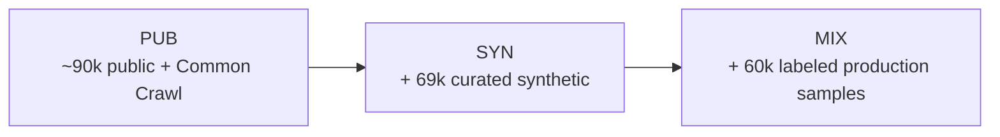
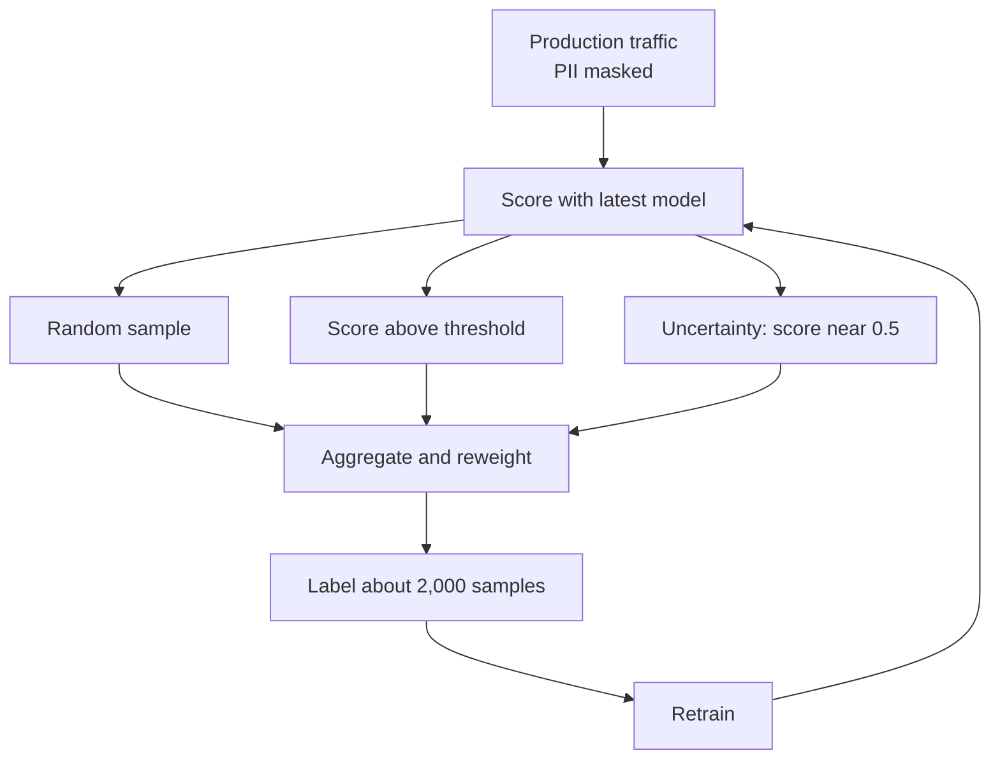
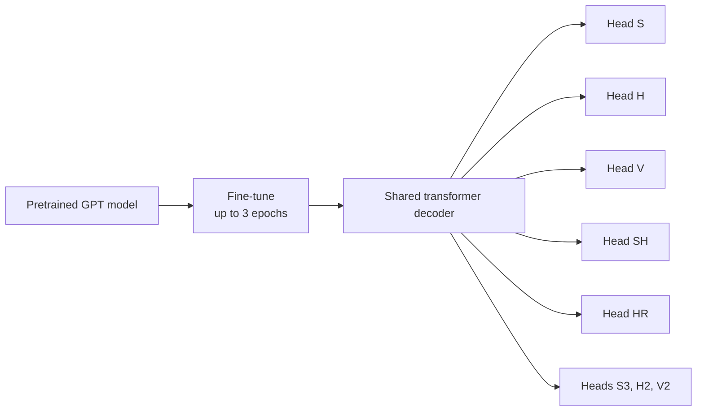
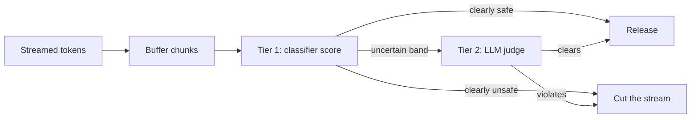
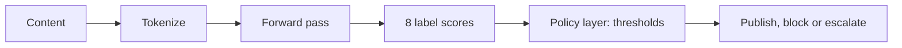

# Capstone #5 / #11: Harmful Content Detection & AI Content Moderation (LLM Era) — OpenAI's Holistic Undesired-Content-Detection System

## At a glance

| Topic | Summary |
|---|---|
| Source | Markov, Zhang, Agarwal, Eloundou, Lee, Adler, Jiang and Weng, "A Holistic Approach to Undesired Content Detection in the Real World," arXiv:2208.03274 (August 2022), published at AAAI 2023. |
| Problem | Build a text classifier that scores content against a taxonomy of undesired categories, for the inputs and outputs of language models, when the categories that matter most are the rarest and the labels are subjective. |
| Core idea | A carefully designed taxonomy and labeling process, an active-learning loop that spends the labeling budget on rare cases, synthetic data to patch weak spots, and probing to catch a model that keys off the wrong words. |
| Taxonomy | Five top-level categories (sexual, hateful, violence, self-harm, harassment) with subcategories. The model predicts 8 labels: the five categories plus the three most severe subcategories S3, H2 and V2 *(source-confirmed)*. |
| Rarity | Among sampled user prompts, 0.04% involved self-harm and 0.017% hateful content with threats *(source-confirmed)*. |
| Headline results | Active learning selected samples with at least one undesired label 40% of the time against 3.4% for random selection, 10 to 22 times more per category (Table 4). On the paper's public test set the model beats Perspective API on all four categories the two share (Table 3) *(source-confirmed)*. |
| Surprises | Large amounts of noisy synthetic data hurt. Domain adversarial training helped a lot at the start and little or negatively once labeled production data was in the mix. Academic data can hurt at a later stage *(source-confirmed)*. |
| Not in the paper | Streaming moderation of generated text, a cheap-filter-then-judge cascade, and any latency or throughput figure. Steps 4b and 5b are this document's design. |
| First to break | The labeling budget, not compute. At the random-sample rate of 0.09% for self-harm, 100 positive examples take about 111,000 labels, against about 5,400 with active learning *(illustrative arithmetic on Table 4)*. |
| Easy-to-miss traps | AUPRC values depend on how rare a category is and cannot be ranked across categories. A streaming judge that re-reads the whole text on every check costs more than judging once. A short key token is not a shortcut. |
| Practice PDFs | [Study edition](../../capstone-study-and-mock/harmful-content-detection/capstone5_harmful_content_detection_study.pdf) · [Mock interview](../../capstone-study-and-mock/harmful-content-detection/capstone5_harmful_content_detection_mock.pdf) |

Evidence labels used below: *(source-confirmed)* means the figure or claim is in the paper. *(illustrative)* means it is this document's planning assumption or design. The paper reports its results on a public test set, because it cannot share its production test data.

### Concepts this case study builds on

| Concept | Where it is taught | One-line recap |
|---|---|---|
| Guardrails and output validation | [Lesson 8, Concept 4](../../lessons/lesson-8-safety-and-isolation.md#concept-4-guardrails-and-output-validation) | Check a model's output against a policy before it is released. |
| LLM as a judge | [Lesson 9, Concept 2](../../lessons/lesson-9-evaluation-and-observability.md#concept-2-offline-evaluation--golden-datasets-llm-as-judge-regression-suites) | Use a model to score another model's output against a rubric. |
| Streaming responses | [Lesson 10, Concept 3](../../lessons/lesson-10-production-scaling.md#concept-3-streaming-responses) | A server sends a response in chunks as it is generated. |
| Active learning, model cascade | [Glossary](../../appendix/glossary.md) | Choose what to label next, and screen cheaply before an expensive check. |

---

## Step 1: Clarify Requirements & Frame the ML/AI Objective

### The objective

For a piece of text, estimate for each category in a fixed taxonomy the probability that it violates that category. This is multi-label binary classification, with one independent score per label. A text can be both violent and hateful, so labels are not mutually exclusive, although subcategories within a category are designed to be as exclusive as possible.

The paper frames the use as moderating the inputs and outputs of language models. Model providers want assurance that models will not produce content their policies disallow, and customers sometimes need control over content for sensitive use cases or brand risk. The training data comes from production traffic of that kind: user prompts, which the paper says are usually much longer than public datasets and often contain few-shot prompts *(source-confirmed)*. It is not a social-media post corpus.

### The taxonomy

| Category | Definition in short | Undesired subcategories | Not undesired |
|---|---|---|---|
| S, sexual | Explicit or implicit sexual behavior | S3 involving minors, S2 sexual activity that could be illegal in real life, S1 erotic content that is not illegal | S0 non-erotic or contextualized, such as medical or sex education |
| H, hateful | Threatening, insulting or derogatory content targeting groups for their identity | H2 calling for violence or threatening, H1 derogatory stereotypes or support for hateful statements | H0.a neutral reference to a group, H0.b contextualized hate such as a quote with commentary |
| V, violence | Depicts or supports physical violence | V2 extremely graphic, V1 threats or support | V0 neutral, contextualized depictions |
| SH, self-harm | A graphic description of, or support for, self-harm | None given | |
| HR, harassment | Content that may torment or annoy individuals, or make harassment more likely | None given | |

S2 maps most closely to what is illegal in the USA, per the paper's footnote. The model predicts 8 labels: S, H, V, SH, HR, S3, H2 and V2. The paper says context changes the label: "I will kill you" would be labeled violence and may be acceptable in fiction.

### Ground truth

Trained annotators label each example against written instructions. Every training label costs a person's time, which is the cost a click-based problem never pays. The instructions and the quality process are the heart of the paper (Step 3).

### Out of scope

- Images, video and audio. The paper is text only.
- The enforcement decision after a score: block, remove, demote or escalate. The paper says classifiers have many uses, and they can reduce misuse when paired with fair and robust enforcement practices. The enforcement is a separate piece.
- Prompt injection, sandboxing and multi-tenant isolation, which [Lesson 8](../../lessons/lesson-8-safety-and-isolation.md) covers.

### Trade-offs considered

Human labels cost money and time before any model update, which motivates the active-learning loop. Keeping the classifier apart from enforcement lets one score feed different thresholds for different policies and products, and needs a separate policy layer to act on it.

---

## Step 2: Back-of-Envelope Constraints

### Rarity

The paper says that among sampled user prompts only 0.04% included self-harm and 0.017% included hateful content involving threats *(source-confirmed)*. It gives no traffic volume. With an assumed 10 million submissions a day *(illustrative)*:

```text
self-harm     = 10,000,000 × 0.0004  = 4,000 a day
hate, threats = 10,000,000 × 0.00017 = 1,700 a day
```

Rare as a share is not rare in absolute terms. The imbalance is 50 times sharper than a 2% click rate for self-harm, and more than 100 times for hateful threats.

### The labeling budget

Table 4 reports the share of selected samples that carry each label under random sampling and under the active-learning strategy. For self-harm, 0.09% against 1.85%.

```text
labels needed for 100 self-harm examples
random sampling   = 100 ÷ 0.0009 = about 111,000 labels
active learning   = 100 ÷ 0.0185 = about 5,400 labels      (20.6 times fewer)
one iteration of 2,000 labels: 1.8 expected positives at random, 37 with active learning
```

At the production rate of 0.04%, a batch of 2,000 random samples would hold 0.8 self-harm examples on average.

### Trade-offs considered

A larger traffic assumption scales the daily counts and leaves the rates and the labeling cost alone. The binding constraint is the number of labeled positives a fixed budget can buy.

---

## Step 3: Data / Knowledge Pipeline

### Data sources

The paper builds three training sets for its experiments *(source-confirmed)*:

- PUB: about 90,000 public examples, from academic datasets and Common Crawl web data, labeled by the team's annotators.
- SYN: PUB plus 69,000 curated synthetic examples.
- MIX: SYN plus 60,000 labeled production samples.



### Labeling and quality control

The paper says data label correctness is critical and that the categories and their boundaries are inherently subjective. Its measures:

- Definitions as detailed and concrete as possible, with categories and subcategories designed to be as mutually exclusive as possible. Subcategories also reduce disagreement and corner cases.
- Regular calibration sessions to review edge cases and disagreements between external annotators and internal auditors, which produced clearer instructions with many examples.
- Audits that do not sample at random. Per category, 10 samples labeled undesired and 10 samples with model probability above 50% are checked. The first group finds false positives and the second estimates recall. The F1 score of the annotators' labels is computed against the auditors' labels. Plain agreement rate is poor, because with rare positives it can be arbitrarily high from the abundance of true negatives.
- Mislabel detection. The training set is split in two, a model is trained on each half and scores the other half, and disagreements with the labels are flagged. A random portion of the flagged samples is audited, and if more than 30% are mislabeled, all flagged samples are labeled again.

### Annotator disagreement and welfare

The paper discusses that disagreement among annotators can itself be a signal, particularly for data about marginalized groups, and that resolving it by majority vote can erase minority views. It does not say that it preserved disagreements. On welfare, annotators are vetted by counselors and told the risks before opting in, vendors give access to mental health and wellness resources, and annotators can opt out at any point *(source-confirmed)*.

### Sidebar: active learning

Active learning lets the pipeline choose which unlabeled examples go to human labelers, so each label buys more information. The paper's loop has three stages:

- Select production samples at random, mask personally identifiable information, and score them with the latest model.
- Run three parallel selection pipelines: random samples that keep the production distribution, random samples above a score threshold per category, and uncertainty sampling that takes samples whose score is closest to 0.5.
- Aggregate the selections and reweight by metadata, with weight proportional to the square root of the sample count, which improves diversity.

The paper says it updates the mixture of strategies over time, and that its strategy is simple and does not include diversity sampling.



### The experiment

The experiment ran the loop twice, once with active selection and once with random selection *(source-confirmed)*. It started from 6,000 public labeled examples and a validation set of about 5,500 production samples. It then ran 3 iterations. Each trained a model, scored 500,000 production samples, and chose about 2,000 to label.

| Category | Random | Active learning | Multiplier |
|---|---|---|---|
| S | 1.49% | 25.53% | 17.1× |
| H | 0.17% | 3.09% | 18.2× |
| V | 0.48% | 9.92% | 20.7× |
| HR | 0.55% | 6.41% | 11.7× |
| SH | 0.09% | 1.85% | 20.6× |
| S3 | 0.24% | 2.42% | 10.1× |
| H2 | 0.03% | 0.67% | 22.3× |
| V2 | 0.25% | 4.27% | 17.1× |
| Safe | 96.57% | 59.54% | |

A sample can carry several labels, so columns sum to more than 100%. About 40% of actively selected samples had at least one undesired label, against 3.4% of random ones. The multiplier depends on the mix of the three pipelines and on the threshold, which the paper does not report, so it is a property of this setup and not of active learning in general. The paper also reports that active learning improved performance on all categories after 3 iterations, as a chart.

### Synthetic data

The paper uses synthetic data in three ways *(source-confirmed)*:

- Zero-shot prompts to GPT-3 from human-written templates, to start the process where no public data exists, for categories such as SH and V2.
- Few-shot prompts built from existing undesired examples, for subcategories that had little data even after several iterations. The generated text is manually inspected to avoid amplifying bias.
- Curated template data against counterfactual bias. An early model gave "black women." a high hate score. Templates such as "[subject] is selfish" were filled with real demographic attributes, which give hateful samples, and with random object names such as "black blanket", which give safe samples. Adding 69,000 of these raised the average AUPRC on hateful content from 0.417 to 0.551.

Large amounts of noisy synthetic data did not help. Synthetic examples twice the size of the labeled set, labeled by how they were prompted, hurt performance. The paper suspects that once there is a large high-quality dataset, the noise confuses the model.

### Model probing

The risk is that the model learns surface features. In the paper's example, "all immigrants." was predicted as hate, possibly because 17 of 21 training examples with the phrase, from a public dataset, were undesired and 4 were safe.

- Key token probing. Remove tokens greedily until the prediction falls below 0.8. On average this cut samples from 722.3 to 15.9 characters. About 97% of the identified key tokens were unsafe, checked against third-party APIs and keywords, so the model was mostly using the right feature.
- The remaining 3% showed three problems: irrelevant symbols such as a period contributing to the score, some long key tokens close to the whole example which hint at memorization, and weakness against typos and adversarial text, for example "w h o r e s" reducing to "e s".
- Red-teaming before releases found a high hate score for any text with the "#" token, probably from short tweets in academic data, and high hate and violence scores for racial words, so that "I hate black cats!" was a risk.

A short key token is not by itself a shortcut. Most short key tokens were unsafe words, which is the right feature. The warning signs are irrelevant symbols and long key tokens that match the example. The paper says it partially addressed these and plans better data augmentation.

### Privacy and consent

The paper says it obtains consent from all customers whose data is used to train the moderation models, lets customers opt out, includes no production data in the dataset it releases, and protects production data in the labeling and active-learning pipelines. It considers training-data leakage risk extremely low because the deployed model only computes scores and cannot generate text.

### Trade-offs considered

The random arm keeps the labeled set close to production while the threshold and uncertainty arms find rare cases. Stratified audits give a useful signal about rare categories and no unbiased overall accuracy. Key token probing finds suspect tokens and still needs a person to read them.

---

## Step 4: Model/Agent Core Design — Two Angles on the Same Taxonomy

### 4a. The classifier the paper describes

The model is a lightweight transformer decoder whose final linear layer is replaced with 8 MLP heads. Each head is an independent matrix of shape [d_model, 256, 1], one per label. The paper found this works better than a single deeper MLP with an 8-dimensional output at avoiding interference between categories, and needs fewer parameters. It starts from a GPT model pretrained on a large text corpus and is fine-tuned with learning rate 0.05, batch size 256, dropout 0.1 within the MLP heads and up to 3 epochs, as stated in the paper *(source-confirmed)*.



### Domain adversarial training

Models trained on public datasets did not do well on production traffic, which is longer and contains few-shot prompts. The paper adds Wasserstein distance guided domain adversarial training (WDAT). A domain critic head tries to tell public examples from production ones, and the model is trained so that it cannot. The DAT models used 100,000 additional unlabeled production examples *(source-confirmed)*. Table 5 gives the average AUPRC on a production validation set:

| Category | PUB | PUB + DAT | SYN | SYN + DAT | MIX | MIX + DAT |
|---|---|---|---|---|---|---|
| S | .698 | .730 | .726 | .745 | .943 | .939 |
| H | .417 | .491 | .551 | .476 | .843 | .818 |
| V | .490 | .529 | .532 | .531 | .640 | .633 |
| HR | .258 | .369 | .326 | .356 | .453 | .482 |
| SH | .063 | .281 | .086 | .296 | .621 | .632 |
| S3 | .592 | .759 | .779 | .777 | .911 | .936 |
| H2 | .393 | .643 | .570 | .577 | .851 | .854 |
| V2 | .165 | .453 | .093 | .507 | .443 | .533 |
| Mean of the 8 | .385 | .532 | .458 | .533 | .713 | .728 |

The gain is large with public data only (mean +0.147), smaller with synthetic data added (+0.075), and small with labeled production data (+0.015). It still helps weak categories such as SH and V2 and slightly hurts H and V once there is enough in-distribution data. The mean over categories is arithmetic on the table. On the self-harm row alone, the gains are 346% on PUB, 244% on SYN and 1.8% on MIX.

### 4b. The streaming angle (this document's design)

The paper scores a complete piece of text. A language model produces a stream over several seconds, as [Lesson 10](../../lessons/lesson-10-production-scaling.md#concept-3-streaming-responses) describes. Moderating the stream means deciding chunk by chunk whether to keep sending. The paper has no discussion of streaming, partial text or a cascade of models, and everything in this subsection is a design built on its taxonomy and classifier *(illustrative)*.

### Sidebar: a cheap filter, then an expensive judge

A cascade screens every item with a fast model and sends only the flagged or uncertain subset to a slower, more accurate one.

- Tier 1 is the classifier of 4a, applied to the text so far.
- Tier 2 is an LLM judge, as in [Lesson 9](../../lessons/lesson-9-evaluation-and-observability.md#concept-2-offline-evaluation--golden-datasets-llm-as-judge-regression-suites), called when the tier 1 score falls in an uncertain band.



The thresholds are assumptions. A real system sets them per category from the precision-recall curve and the cost of each kind of error.

### What the cascade costs

The judge sees the response and a rubric. Assume 700 input tokens and 20 output tokens, at an assumed \$3 per million input and \$15 per million output tokens, with 50,000 responses a day and 8% escalated *(illustrative)*:

```text
cost per judge call = 700 ÷ 1,000,000 × 3 + 20 ÷ 1,000,000 × 15 = $0.0024
judge every response = 50,000 × 0.0024 = $120 a day
judge the 8% only    =  4,000 × 0.0024 = $9.60 a day
```

That omits tier 1. If tier 1 re-scores the whole text so far at every check, a 500-token response checked every 3 tokens has 166 checks, and the tokens scored add up to about 41,600, which is 83 times the response length. Assume tier 1 costs 1/100 of the judge's price per token, or \$0.03 per million:

| Tier 1 policy | Tokens scored per response | Tier 1 cost a day | Total with 8% judged | Saving against judging all |
|---|---|---|---|---|
| Whole text every 3 tokens | 41,583 | \$62.37 | \$71.97 | 40% |
| Last 64 tokens every 3 tokens | 10,624 | \$15.94 | \$25.54 | 79% |
| Whole text every 50 tokens | 2,750 | \$4.13 | \$13.73 | 89% |
| One pass at the end | 500 | \$0.75 | \$10.35 | 91% |

The cascade only pays if tier 1 is cheap at the level of the whole stream. Windowing, checking less often, or reusing the computation for the text already seen keeps it cheap. Checking less often leaves more text released before a verdict.

### Trade-offs considered

A fine-tuned classifier is fast and cheap per call and cannot adapt to a new category without retraining. An LLM judge adapts through a prompt edit and costs more per call, with judge biases that [Lesson 9](../../lessons/lesson-9-evaluation-and-observability.md) discusses. The cascade's accuracy ceiling is set by tier 1's misses outside the uncertain band, since content scored confidently safe never reaches the judge.

---

## Step 5: Serving Architecture

### 5a. The classifier as a gate

The deployed model is available through the OpenAI Moderation endpoint and only computes safety scores, which the paper notes. It gives no latency or throughput figures, and does not say whether scoring is synchronous before publishing or asynchronous after. The description of the model as lightweight makes a synchronous gate plausible, which is this document's reading.



The output is eight scores, one per label.

```json
{
  "content_id": "c-1029",
  "model_version": "mod-2023-02",
  "category_scores": {
    "S": 0.01, "S3": 0.00, "H": 0.02, "H2": 0.00,
    "V": 0.91, "V2": 0.12, "SH": 0.00, "HR": 0.04
  }
}
```

The field names and the version string are illustrative. The paper does not publish its response format.

### 5b. A sketch of the stream gate (this document's design)

```python
def moderate_stream(chunks, score_fn, judge_fn, low=0.3, high=0.7, hold=3):
    """Tier 1 score_fn(text) returns the highest label score for the text so far.
    Tier 2 judge_fn(text) returns True if the text violates policy."""
    held, text = [], ""
    for chunk in chunks:
        held.append(chunk)
        text += chunk
        if len(held) < hold:
            continue
        score = score_fn(text)
        if score >= high or (score >= low and judge_fn(text)):
            yield "[response removed: policy violation]"
            return
        yield from held
        held = []
    yield from held
```

This sketch re-scores the whole text on every check, the 41,583-token policy in the table above. A real version would score a window or reuse earlier computation.

### The held chunks

Holding a few chunks before release delays the text by that much and lets a verdict arrive before a flagged chunk reaches the user. Releasing at once keeps streaming fast and means flagged text may already be visible. The same trade-off applies to a whole document under synchronous and asynchronous moderation.

### Decision table

| Decision | This system's choice | Choose differently when |
|---|---|---|
| Label set | 8 labels, with three severe subcategories | Fewer labels if the policy has fewer categories |
| Data collection | Active learning over production traffic | Random sampling if every category is common |
| Audit sampling | Stratified, scored by F1 per category | Random if all categories are frequent |
| Model | Fine-tuned classifier with one head per label | A prompted LLM if the taxonomy changes often |
| Domain adaptation | WDAT when labeled production data is scarce | Skip it once in-distribution labels are plentiful |
| Streaming checks | Windowed or sparse tier 1, judge on the uncertain band | Whole-text scoring only for short outputs |
| Enforcement | A separate policy layer | A fixed threshold if one product and one policy |

### Trade-offs considered

A synchronous gate guarantees that nothing unmoderated is published and adds latency to every request. An asynchronous scan keeps publishing fast and leaves a window. The paper does not say which it uses.

---

## Step 6: Evaluation, Monitoring and Iteration

### The metric

The paper reports AUPRC, the area under the precision-recall curve. Precision and recall are both defined on the positive class. The paper does not explain its choice. ROC-AUC puts the false positive rate on an axis dominated by the large negative class, so it can look strong even with poor precision on a rare category. That is this document's reasoning.

AUPRC depends on how common the category is in the test set, because a model that guesses at random has an AUPRC equal to the share of positives. So the eight numbers in Table 3 cannot be ranked against each other. The softest score does not mean the weakest model.

### Results against Perspective API

Table 3 compares the model with Perspective API, an existing toxic-comment tool. Starred values come from an approximate taxonomy match, which the paper says is not an exact comparison *(source-confirmed)*.

| Test set and category | Perspective API | This model |
|---|---|---|
| Public set, S | .8709* | .9703 |
| Public set, H | .6914 | .7968 |
| Public set, V | .5201 | .7371 |
| Public set, HR | .3902* | .6191 |
| Public set, SH, S3, H2, V2 | not covered | .8070, .7638, .7268, .6061 |
| Jigsaw, identity hate | .6644 | .6890 |
| Jigsaw, insult | .8814 | .8548 |
| Jigsaw, obscene | .9500 | .8353* |
| Jigsaw, threat | .7492 | .6144* |
| Jigsaw, toxic | .9769 | .9304* |
| TweetEval, hate | .5961 | .6473 |
| TweetEval, offensive | .7919* | .7024* |
| Stormfront, hate | .8754 | .9053 |
| Reddit, sexual | .8961* | .9417* |

The model wins on the set labeled with its own taxonomy and on two external hate sets that were not in its training data. Perspective API wins on most of Jigsaw's categories and on TweetEval offensive, which fit its taxonomy. The paper's conclusion: how important it is to align the taxonomy between training data and use cases. The production test set is not shared, so no production figure is reported.

### Monitoring

- Key-token probing, repeated. The "w h o r e s" finding is a sign of weak handling of obfuscated text, and a motivated user finds that once a classifier is live.
- The share of key tokens that are irrelevant symbols or near copies of training text.
- Score distributions per category on fresh production samples, since the data shifts.
- For the streaming cascade (this document's design), the escalation rate to the judge. A sudden change can mean the filter is miscalibrated or the generating model changed.

### Limits the paper states

- The data is US-centric and the taxonomy was designed to best fit it.
- Harassment was not yet available in the public endpoint, per the paper's footnote.
- The model has demographic bias. It may give higher hate scores to input containing "gay" and higher sexual scores to input containing "her". Template data did not remove it.
- Only about 5% of training samples are non-English, and multilingual performance was not rigorously evaluated.
- Red-teaming is internal, done with each new model version, and the paper says it is not scalable.
- There is no silver bullet, and the taxonomy should be used with other mitigations.

### What breaks first at 10×

| Quantity | At 10× | Reason |
|---|---|---|
| Daily positives for rare labels | 10 times as many | Rates are unchanged |
| Labeling budget | Unchanged unless raised | Labels are paid for by the person-hour |
| Scoring cost | 10 times | One pass per item |
| Streaming checks | 10 times, more if re-scoring whole text | Cost grows with response length squared |
| Audits | 10 times the drift to watch | More traffic, more edge cases |

### Trade-offs considered

Reporting one AUPRC per category shows where the model is weak and cannot be compared across categories. Repeating probing needs someone to read the residual by hand. WDAT is worth the most when production labels are scarce, and the active-learning loop pays off throughout.

---

## Sources and Further Reading

- Markov, Zhang, Agarwal, Eloundou, Lee, Adler, Jiang and Weng, "A Holistic Approach to Undesired Content Detection in the Real World," arXiv:2208.03274 (v2, February 2023), AAAI 2023. The primary source for every figure and claim marked source-confirmed.
- [Lesson 8, Concept 4](../../lessons/lesson-8-safety-and-isolation.md#concept-4-guardrails-and-output-validation): guardrails and output validation.
- [Lesson 9, Concept 2](../../lessons/lesson-9-evaluation-and-observability.md#concept-2-offline-evaluation--golden-datasets-llm-as-judge-regression-suites): LLM as a judge.
- [Lesson 10, Concept 3](../../lessons/lesson-10-production-scaling.md#concept-3-streaming-responses): streaming responses.
- [Capstone #2, CTR Prediction](../ctr-prediction/README.md): class imbalance and AUC, and a problem whose labels cost nothing.
- [Capstone #15, LLM API Gateway](../llm-api-gateway/README.md): the gateway whose scope defers output moderation to this case study.
- [Glossary](../../appendix/glossary.md): active learning, model cascade.

Labels: *(source-confirmed)* is in the paper. *(illustrative)* is a planning assumption or design of this document.
