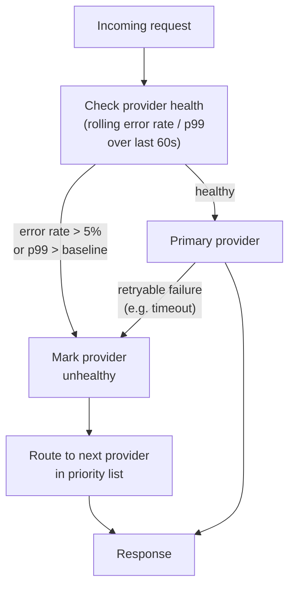
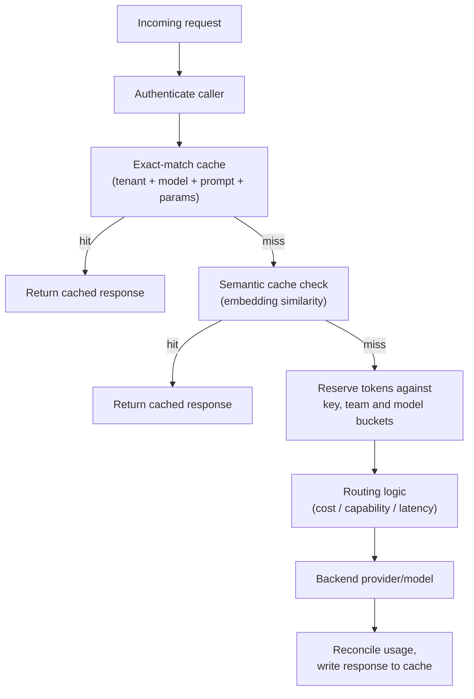
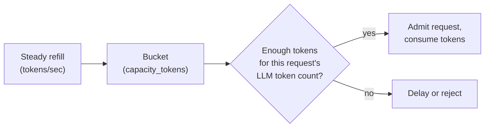
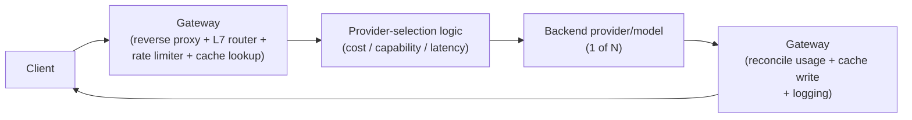

# Capstone #15: LLM API Gateway

## At a glance

| Topic | Summary |
|---|---|
| Sources | Product documentation of three gateways: LiteLLM (docs.litellm.ai), Portkey (portkey.ai/docs) and Cloudflare AI Gateway (developers.cloudflare.com/ai-gateway). No company has published a primary engineering write-up of this pattern, so every design choice here is "how shipped products do it," not "how company X does it." |
| Problem | One API in front of several LLM providers and models. It authenticates callers, enforces rate limits and budgets, caches responses, routes each request, falls back when a provider fails, and meters usage. |
| Core idea | Count tokens, not requests. Limit the rate in tokens and cap the spend in money, because token prices differ across models. Admit a request on an estimate made before the call, then reconcile with the usage the provider reports. |
| Targets | Gateway-added latency under 20 ms against a model first-token time of 200 ms to 2 s. Gateway availability at least as high as the provider set behind it *(illustrative)*. |
| Headline example | 490 requests of 50 tokens plus 10 requests of 128,000 tokens is 500 requests: 100% of a 500-request quota and 130% of a 1,000,000-token budget. |
| Token bucket | Refill rate = capacity ÷ 86,400 seconds: 1,000,000 tokens a day is 11.57 tokens a second. A bucket as large as the daily budget lets 2× the budget through in any rolling 24 hours. |
| What the products document | LiteLLM: token and request limits, budgets in US dollars, cooldown after a 429 or more than 50% failures in a minute. Portkey: limits on requests or tokens, budgets by cost or tokens. Cloudflare: rate limiting that counts requests *(source-confirmed)*. |
| First to break at 10× | The shared budget store and the gateway's own availability. Before them, the provider-side token limits. |
| Easy-to-miss traps | Output tokens are unknown at admission. A token budget is not a dollar budget across providers. A cache shared across tenants leaks answers. Retries multiply load on a failing provider. A budget store that fails open stops capping. |
| Practice PDFs | [Study edition](../../capstone-study-and-mock/llm-api-gateway/capstone15_llm_api_gateway_study.pdf) · [Mock interview](../../capstone-study-and-mock/llm-api-gateway/capstone15_llm_api_gateway_mock.pdf) |

### Concepts this case study builds on

| Concept | Where it is taught | One-line recap |
|---|---|---|
| Model routing and gateways, semantic caching | [Lesson 1, Group B](../../lessons/lesson-1-ai-fundamentals-refresher.md#b-serving-and-running-models) | A layer in front of models picks one per request; a semantic cache matches similar prompts, not only identical ones. |
| TTFT, availability: series chains and redundancy | [Lesson 3, Concept 1](../../lessons/lesson-3-scalability-and-availability.md#concept-1-performance-vs-scalability-latency-vs-throughput) and [Concept 3](../../lessons/lesson-3-scalability-and-availability.md#concept-3-availability-patterns) | First-token time is the wait before the first token; a chain's availability is the product of its parts. |
| DNS routing | [Lesson 4, Concept 1](../../lessons/lesson-4-network-and-delivery.md#concept-1-dns) | Latency-based routing at the DNS layer reacts only as fast as a record's TTL. |
| Reverse proxy, load balancer, request vs token rate limits | [Lesson 4, Concept 4](../../lessons/lesson-4-network-and-delivery.md#concept-4-reverse-proxy-and-load-balancer-vs-reverse-proxy) | One component can hide the backends, route by content and limit traffic; a request limit is blind to token counts. |
| Caching strategies and semantic caching | [Lesson 5, Concept 4](../../lessons/lesson-5-data-layer.md#concept-4-bridge--semantic-caching-and-vector-databases-as-this-lessons-ai-native-cousins) | Match on meaning to raise the hit rate, at the cost of approximate answers. |
| Credentials and multi-tenant isolation | [Lesson 8, Concept 3](../../lessons/lesson-8-safety-and-isolation.md#concept-3-credential-and-secret-handling-for-agents-with-tool-access) and [Concept 5](../../lessons/lesson-8-safety-and-isolation.md#concept-5-multi-tenant-isolation) | Scope every credential narrowly; one tenant must never see another's data. |
| Percentile latency | [Lesson 9, Concept 2](../../lessons/lesson-9-evaluation-and-observability.md#concept-2-offline-evaluation--golden-datasets-llm-as-judge-regression-suites) | p99 is the value that 99% of requests beat. |
| Token budgets and streaming | [Lesson 10, Concept 2](../../lessons/lesson-10-production-scaling.md#concept-2-rate-limiting-and-token-budgets) and [Concept 3](../../lessons/lesson-10-production-scaling.md#concept-3-streaming-responses) | Budgets are enforced in tokens with degradation tiers; streamed output is metered as it flows. |

---

## Step 1: Clarify Requirements & Frame the Objective

### What the system does

One API surface proxies requests across several LLM providers or models. It handles authentication, rate limiting, budget enforcement, response caching and automatic fallback when a provider fails.

This is the routing layer only. It sits in front of model-serving backends such as capstone #10 (`case-studies/llm-inference-serving`) and decides which one handles a request. It does not cover the serving itself, model training, or content moderation of outputs (Lesson 8, capstone #11).

### The objective

A traditional API gateway rate-limits requests. For LLM traffic a request count has no fixed relationship to cost: one request can carry 50 tokens or 128,000 (Lesson 4, Concept 4). So the gateway has to count tokens. Counting tokens is not quite enough, though, because two different limits are involved:

| Limit | Unit | Why |
|---|---|---|
| Rate limit | Tokens per minute (and requests per minute) | Protects capacity and stays inside each provider's own limits. |
| Budget | Money per day or month | A token costs very different amounts on different models. A million tokens can cost \$0.15 on one model and \$15 on another, a 100× spread *(illustrative)*, so a token budget does not bound spend once routing can pick either. |

The products reflect this split. LiteLLM documents `tpm_limit` (tokens per minute) and `rpm_limit` (requests per minute), and budgets in US dollars (`max_budget`) *(source-confirmed)*. Portkey documents limits "on requests or tokens," and budgets by "costs incurred or tokens used" *(source-confirmed)*. Cloudflare AI Gateway documents rate limiting as "limiting the number of requests" *(source-confirmed)*.

### Targets

- **Gateway-added latency:** under 20 ms for tokenizing, budget checks, routing and cache lookup, against a model first-token time of 200 ms to 2 s (Lesson 3, Concept 1) *(illustrative)*.
- **Gateway availability:** every provider behind the gateway becomes unreachable when the gateway is down, so it is a new single point of failure in front of whatever redundancy exists behind it (Step 5).
- **Metering accuracy:** the gateway's token count should match what the provider bills, within a small margin that the team states and watches (Step 6).

### Feedback signal

Metered usage against the configured limits, and provider error and latency telemetry, which drives the fallback decisions in Step 4.

### Trade-offs considered

Minimizing gateway latency argues for skipping the token count. Accurate token-based enforcement needs the count before the request is allowed. Step 2 shows the cost of counting is small, and the harder problem is the part of the count that is not known yet.

---

## Step 2: Back-of-Envelope Constraints

### Why request counting hides the budget risk

A team has a budget of 1,000,000 tokens a day, enforced naively by a limit of 500 requests a day with no per-request token cap. It sends 490 small requests of 50 tokens and 10 requests that each carry a 128,000-token context.

```text
small requests: 490 × 50 tokens       =     24,500 tokens
large requests:  10 × 128,000 tokens  =  1,280,000 tokens
total consumed                         =  1,304,500 tokens
```

A request-based view reports "500 of 500 requests used, 100% of quota," which looks normal. The token view is 1,304,500 ÷ 1,000,000, about 130% of the budget already consumed. The two accountings disagree by 30 points on the same traffic. Lesson 4's worked example shows the same gap per minute.

### Output tokens are unknown at admission

The gateway knows the input token count exactly, by tokenizing. It does not know how many tokens the model will generate. It can only bound them with the request's `max_tokens`. The practical design is **reserve and reconcile**:

1. Reserve input tokens plus `max_tokens` against the buckets before the call.
2. After the response, replace the reservation with the provider-reported usage and refund the difference.

```text
request: 2,000 input tokens, max_tokens 4,096, actual output 300
reserved   = 2,000 + 4,096 = 6,096 tokens
actual     = 2,000 + 300   = 2,300 tokens
refund     = 3,796 tokens

100 requests in flight: 609,600 reserved against 230,000 actually used, 2.65 times as much
under a 100,000 tokens-per-minute limit: 16 concurrent requests by reservation, 43 by actual use
```

A generous default `max_tokens` therefore throttles throughput without saving a single token. Set it near the expected output length.

Two further points. Providers tokenize differently, so the gateway's estimate can drift from the billed count, and the provider-reported usage is the figure to reconcile against. And for streamed responses the gateway meters tokens as they flow and decides what to do if a budget runs out mid-stream (Step 5).

### Tokenizing is cheap

Tokenizing a 2,000-token request with a fast byte-pair-encoding tokenizer typically takes 1 to 2 ms *(illustrative)*. Against a first-token time of 200 ms to 2 s that is between 0.05% and 1%, so token-aware enforcement is a small cost and not a reason to skip it.

### Sizing the bucket

The bucket refills continuously. For the daily key bucket in Step 4:

```text
refill rate = capacity ÷ seconds in the period = 1,000,000 ÷ 86,400 = 11.57 tokens/s
```

Two consequences follow from how big the capacity is.

- **Capacity equal to budget allows 2×.** A full bucket can pay 1,000,000 tokens at once, then refill 1,000,000 more over the next 24 hours: 2,000,000 tokens in one rolling day, against a calendar-day quota that would allow 1,000,000. The bucket removes the fixed-window boundary exploit, but it does not give a hard daily cap by itself. Pair a smaller burst bucket with a separate period counter if a hard cap matters.
- **Capacity must hold the biggest legitimate request.** A 128,000-token request with `max_tokens` 4,096 costs 132,096. A bucket whose capacity is below that rejects the request forever, however long it waits.

### Trade-offs considered

A hard per-request cap (reject any single request over 20,000 tokens) would have prevented the scenario above, but it breaks legitimate long-context uses such as capstone #9's "summarize this 80-page document." An aggregate budget lets large requests through, but needs real-time metering (Step 3) to enforce.

---

## Step 3: Data Pipeline

What flows through the gateway:

- **Request and response logs:** content, or a privacy-preserving hash and metadata, timestamped and tagged by caller.
- **Metering records:** input and output token counts per request, tagged by key, team and model, aggregated into running counters that Step 2's arithmetic depends on.
- **A cached-response store:** keyed by request content (Step 4).
- **Provider health and latency telemetry:** rolling error rates and latencies per provider, which feed the fallback logic.

### The counters need a shared, durable store

Budget and rate counters must be shared across gateway instances and survive a restart, and an admission check must update them atomically. LiteLLM's documentation says its budgets need a Postgres database, and that without one `max_budget` fails open and requests are not capped *(source-confirmed)*. Whether the gateway fails open or closed when its counter store is unavailable is a design decision (Step 5).

### Trade-offs considered

Logging full prompts and completions gives complete debuggability and auditability, at privacy and storage cost: callers' prompts and completions are now stored. Logging only metadata is cheaper and safer, but a specific bad response cannot be inspected afterward. It is a real trade-off, not a solved problem.

---

## Step 4: Model/Agent Core Design — Routing, Fallback and Caching

### Routing strategies

How the gateway picks a provider or model for a request:

- **Cost-based:** the cheapest provider that still meets a minimum capability tier.
- **Capability-based:** by a required feature, such as a 128K-token context window or function calling.
- **Latency-based:** the provider with the best recently measured latency. It is the idea behind DNS latency-based routing (Lesson 4, Concept 1) applied per request, so it reacts in seconds and not at the speed of a record's TTL.

LiteLLM's router documents strategies of this kind: `simple-shuffle` (the default, weighted or random), `latency-based-routing`, `cost-based-routing`, `least-busy` and `usage-based-routing` *(source-confirmed)*.

### Fallback logic

The gateway tracks each provider's recent error rate and latency over a short window, and marks the provider unhealthy when a trip condition fires. The example rule is illustrative:

- **Error-rate trip:** more than 5% of requests in the last 60 seconds return a 5xx server error.
- **Latency trip:** p99 latency exceeds a multiple of the provider's own recent baseline.

Once marked unhealthy, requests go to the next provider in a priority list.



Four details decide whether this works in practice.

- **A minimum sample.** With 10 requests a minute, one 5xx is a 10% error rate. Require a minimum number of requests, for example 20, before a rule can trip.
- **Which failures retry.** Timeouts, 5xx errors and rate-limit (429) responses can be retried, the last with backoff. Bad requests, authentication failures, context-window overflows and content-policy rejections cannot be fixed by another provider. LiteLLM's documentation matches this: exponential backoff for rate-limit errors, immediate retry for generic errors, and no failover for context-window or content-policy errors *(source-confirmed)*.
- **A retry budget.** If every failing request is retried 3 times, a provider that is already struggling sees up to 4× the load, and so do the fallbacks. Cap retries as a share of traffic, for example 10%, which limits the extra load to 1.1×.
- **No mid-stream fallback.** After a streamed response has started, the gateway cannot switch providers without restarting the response. Fall back before the first token, or surface the error.

### Caching

- **Exact-match caching** keys a response on the literal request: model, full prompt and parameters. It is simple and always correct for a repeat, but hits only on byte-for-byte repeats.
- **Semantic caching** (Lesson 1, Group B; Lesson 5, Concept 4) keys on an embedding and matches on similarity. It raises the hit rate by matching near-duplicate prompts.

Questions the cache design must answer:

- **Whose cache is it?** A cache shared across tenants can return one tenant's answer to another. Put the tenant (key or team) in the cache key unless the prompt is public.
- **Which parameters?** A sampled answer (temperature above zero) served repeatedly stops being varied. Cache only where a repeat is acceptable.
- **How close is close?** Two prompts that differ in one digit, such as "cancel order 1234" and "cancel order 1243," can embed almost identically and need different answers. A similarity threshold that is too low turns that into a wrong answer served with confidence.
- **Which provider produced it?** A semantic hit returns an answer from whichever provider served the original request, which may not be the one routing would pick now. Whether that is acceptable is a product decision the gateway has to make explicit.
- **Does a hit spend budget?** A hit costs no provider tokens. Most designs count a hit against rate limits but not against spend. State the rule.



### Sidebar: the token bucket algorithm

*(First appearance in this repo of this algorithm.)*

- **Why:** a rate limit needs an algorithm, not just "count and reset." A fixed-window counter that resets every 60 seconds lets a client send the full limit at the end of one window and the full limit again at the start of the next: two limits' worth in a couple of seconds.
- **What:** a **token bucket** holds up to a maximum capacity of "tokens," a generic rate-limiting unit that is not necessarily an LLM token. Tokens are added at a steady rate up to the capacity. Each unit of traffic consumes some. If the bucket lacks enough, the request is delayed or rejected. Refill is continuous, so there is no window boundary to exploit. In any interval of length T, at most capacity + refill_rate × T can pass.
- **How:** here the "tokens" consumed by a request equal its LLM token count, so the bucket enforces a rate in LLM tokens, as Step 1 requires.



A rate-limit configuration, illustrative and not any product's literal schema:

```json
{
  "rate_limit_configs": [
    {
      "scope": "api_key",
      "id": "key_prod_team-growth",
      "bucket": {
        "capacity_tokens": 1000000,
        "refill_rate_tokens_per_sec": 11.57,
        "budget_period": "daily"
      }
    },
    {
      "scope": "team",
      "id": "team-growth",
      "bucket": {
        "capacity_tokens": 5000000,
        "refill_rate_tokens_per_sec": 57.87,
        "budget_period": "daily"
      }
    },
    {
      "scope": "model",
      "id": "large-context-model-v2",
      "bucket": {
        "capacity_tokens": 20000000,
        "refill_rate_tokens_per_sec": 231.48,
        "budget_period": "daily"
      }
    }
  ]
}
```

- `capacity_tokens` is the bucket's maximum size, the ceiling on a burst.
- `refill_rate_tokens_per_sec` makes a full bucket refill once per `budget_period`: 1,000,000 ÷ 86,400 = 11.57, 5,000,000 ÷ 86,400 = 57.87, and 20,000,000 ÷ 86,400 = 231.48.
- A request is checked against all three scopes it matches (its key, its team, its target model) and is admitted only if every bucket has enough. The deduction has to be all-or-nothing: if the team bucket is short, the key bucket must not keep the tokens it already took.
- Step 2's two sizing consequences apply here: with capacity equal to the daily budget, a rolling 24 hours can see twice the budget, and every capacity here is above the 132,096-token cost of the largest request.

### Trade-offs considered

- **Cost-based routing** minimizes spend but, alone, can send a quality-sensitive request to a weaker model because it is cheapest. It needs a capability floor in front of it.
- **Latency-based routing** gives the best per-request experience but can concentrate traffic on whichever provider is fastest at the moment, undermining the diversification a multi-provider gateway exists to give.
- **Exact-match caching** never raises the cross-provider question, at the price of a much lower hit rate than semantic caching.

---

## Step 5: Serving Architecture

### Request flow

Client → gateway (reverse proxy, L7 router, rate limiter and cache lookup in one component) → provider selection (Step 4) → one of N providers → the response returns through the gateway (reconcile usage, cache write, logging) → client.



The gateway plays three roles at once (Lesson 4, Concept 4): a **reverse proxy** that hides the providers from the client, an **L7 load balancer** that routes on request content (the model asked for, the capability needed), and a **rate limiter** that enforces the buckets. Before a request reaches a regional gateway, DNS-level geolocation or latency routing (Lesson 4, Concept 1) may already have chosen the region. That is a coarser, slower decision than the per-request routing here.

### Streaming

Chat responses are streamed. The gateway forwards the stream and meters tokens as they flow (Lesson 10, Concept 3). Two rules matter. If the client disconnects, cancel the upstream request so no tokens are generated for nobody. If a budget runs out mid-stream, decide in advance whether to cut the stream or let it finish and charge the overage.

### Availability of the gateway itself

Lesson 3's Concept 3 arithmetic, with illustrative availabilities of 99.95% for the gateway and 99.9% for each provider:

```text
direct to one provider                        = 0.999      → 8.76 hours of downtime a year
one gateway, one provider                     = 0.9995 × 0.999 = 0.9985   → 13.1 hours
one gateway, two providers with fallback      = 0.9995 × (1 − 0.001²) = 0.999499   → 4.4 hours
gateway pair, two providers                   = (1 − 0.0005²) × (1 − 0.001²) = 0.9999988  → 39 s
```

A single gateway in front of two providers still halves the downtime of calling one provider directly, but it caps the benefit: the 4.4 hours are the gateway's own. Running the gateway as an active-active pool, ideally across regions, removes that cap. The arithmetic assumes independent failures. A bad configuration pushed to every instance at once is the correlated failure the formula leaves out.

### Shared state

Active-active instances must share budget and rate counters. A central store keeps limits exact, costs a network round trip on each admission, and becomes a dependency. Per-instance local counters avoid the dependency but let each instance overshoot until counters are reconciled. The store also decides the failure mode:

- **Fail closed** (reject when the store is down) protects budgets and turns a store outage into an outage of the gateway.
- **Fail open** (admit when the store is down) keeps traffic flowing and lets spend run uncapped until it returns.

LiteLLM documents both behaviors: budgets fail open without a database, and a fail-closed rate-limiting option returns 503 *(source-confirmed)*.

### Decision table

| Decision | Default in this design | Choose the alternative when |
|---|---|---|
| Rate-limit unit | Tokens per minute, plus requests per minute | Requests only if every request costs about the same. |
| Budget unit | Money per period | Tokens only if one model serves all traffic. |
| Admission count | Reserve input plus `max_tokens`, then reconcile | Charge on completion only if overshoot is tolerable. |
| Cache scope | Per tenant | Shared if the prompts are public. |
| Semantic cache | Off for actions and personal data, on for FAQ-style traffic | On everywhere only with a tested similarity threshold. |
| Fallback trigger | Error rate over a minimum sample, plus latency | Latency only if errors are rare. |
| Counter store failure | Fail closed for hard budgets | Fail open for soft budgets, with an alert. |
| Budget overage | Soft overage with alerts for interactive work | Hard cutoff for batch jobs and for keys of unknown owners. |

### Trade-offs considered

One logical gateway is simpler to reason about and monitor, but it is the weakest link in the chain, the same single point of failure a multi-provider gateway was meant to protect against, moved up one layer. An active-active pool fixes that, at the cost of running and synchronizing more than one copy.

---

## Step 6: Evaluation, Monitoring and Iteration

### What to monitor

- **Cache hit rate,** separately for exact-match and semantic caching, since they carry different correctness guarantees and a blended number hides which one drives the rate.
- **Budget burn rate** per key and team, close to real time. If a team has used 60% of its day's budget by noon, it is on course for 120%.
- **Estimate drift:** the gateway's token count against the provider-reported usage. A growing gap means reservations or budgets are wrong.
- **Fallback trigger frequency** per provider. A rising trend over weeks is a signal in itself.
- **Provider latency and error dashboards,** which feed fallback and longer-term provider choices.
- **Gateway overhead** at p50 and p99 against the 20 ms target.
- **Retry share** of traffic, to see retry amplification before a provider falls over.

### What triggers a change

- A provider's fallback frequency trending up over weeks: deprioritize or drop it from the pool.
- A burn rate projected to exceed budget before the period ends: alert early, before a hard cutoff surprises a team mid-task.
- A dropping cache hit rate after a prompt-template change: check the cache key. A template that embeds a timestamp defeats exact-match caching even though the meaningful part of the prompt did not change.
- A rising estimate drift: re-check the tokenizer used for each provider.

### What breaks first at 10×

Illustrative baseline: 200 requests a second at peak, 2,300 tokens a request, and about 2 ms of gateway CPU per request.

| Dimension | Today | At 10× | What gives way first |
|---|---|---|---|
| Gateway CPU | 200 × 2 ms = 0.4 cores | 2,000 × 2 ms = 4 cores, plus redundancy | Not the gateway's CPU. Provision for the active-active pool. |
| Counter store | Each request does about 6 counter operations (reserve and reconcile on 3 buckets): 1,200 per second | 12,000 per second | The shared store, if it was sized for today's load. Compare against its measured capacity. |
| Provider limits | 460,000 tokens a second, 27.6 million a minute | 276 million a minute | The providers' own token-per-minute limits, and then price. Spread across keys and providers, and degrade before refusing (Lesson 10, Concept 2). |
| Cache | A hit rate of a given size | The same rate saves ten times the tokens | Little breaks. Check memory and eviction. |

### Security and abuse cases

- **The gateway holds the provider keys.** It is a single choke point for credentials. Store them in a secret manager, scope each caller's key narrowly (Lesson 8, Concept 3), and rotate on a schedule.
- **Cross-tenant cache leakage.** A cache key without the tenant leaks answers between callers. A cache poisoned with a wrong answer serves it to everyone who matches.
- **Denial of wallet.** A leaked key can burn a team's budget. Per-key limits, burn-rate alerts and a hard cap on keys of unknown ownership bound the loss.
- **Spoofed tenant identity.** Take the tenant from the authenticated key, never from a header the caller can set.
- **Logs are data.** Stored prompts and responses carry personal and confidential content. Apply retention and access rules (Lesson 8, Concept 5).
- **The gateway does not stop prompt injection.** It can limit damage with budgets and scoping, but injection defense belongs to the application (Lesson 8, Concept 1).

### Trade-offs considered

A hard cutoff at 100% of budget gives predictable cost and an outage for the team, possibly mid-task. Soft overage keeps work running, but needs a billing process and risks overrun if nobody acts on the alert. It is a product and finance decision as much as an engineering one.

---

## What the three products document

As of 2026-10-17. Each row is what the cited documentation states, as a reference point for the design above.

| Topic | LiteLLM | Portkey | Cloudflare AI Gateway |
|---|---|---|---|
| Rate limits | `tpm_limit` (tokens per minute) and `rpm_limit` (requests per minute), per key and team, and per model | On requests or tokens, per minute, hour or day | The number of requests |
| Budgets | In US dollars (`max_budget`) with a `budget_duration`; needs a database, otherwise fails open | By cost incurred or tokens used | Not covered by the overview page |
| Fallback and cooldown | Cooldown after a 429, or after more than 50% failures in a minute; `allowed_fails` default 3, `cooldown_time` default 5 seconds | Fallbacks between providers and models | Request retry and model fallback |
| Retries | Exponential backoff for rate-limit errors, immediate retry for others | Automatic retry strategies | Request retry |
| Caching | Not covered by the pages read | Simple and semantic caching | Caching of responses |

The 5% error rule in Step 4 is this document's illustration. LiteLLM's documented cooldown rule is a 50% failure rate within a minute, plus an immediate cooldown on a 429.

---

## Sources and Further Reading

Labels used above: *(source-confirmed)* means the figure or quotation is stated in the cited source. *(illustrative)* means it is an assumption made for this design.

- LiteLLM documentation, "Budgets, Rate Limits" (docs.litellm.ai/docs/proxy/users) and "Router" (docs.litellm.ai/docs/routing), read 2026-10-17. The source of the limit units, the dollar budgets, the routing strategies and the cooldown and retry behavior.
- Portkey documentation, "AI Gateway" (portkey.ai/docs/product/ai-gateway), read 2026-10-17. The source of the feature list, the cost and token budgets, and the request and token rate limits.
- Cloudflare AI Gateway documentation (developers.cloudflare.com/ai-gateway), read 2026-10-17. The source of the request-count rate limiting, the caching and the analytics.
- Lesson 1 (`lessons/lesson-1-ai-fundamentals-refresher.md`), Group B: model routing and semantic caching.
- Lesson 3 (`lessons/lesson-3-scalability-and-availability.md`), Concepts 1 and 3: first-token time and the availability arithmetic.
- Lesson 4 (`lessons/lesson-4-network-and-delivery.md`), Concepts 1 and 4: DNS routing, and the reverse-proxy and request-versus-token-limit material that is this capstone's premise.
- Lesson 10 (`lessons/lesson-10-production-scaling.md`), Concept 2: the budget enforcement that builds on this capstone's bucket configuration.
