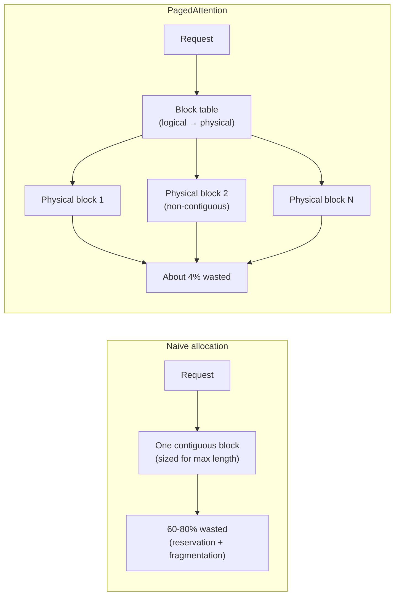
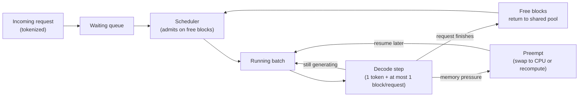
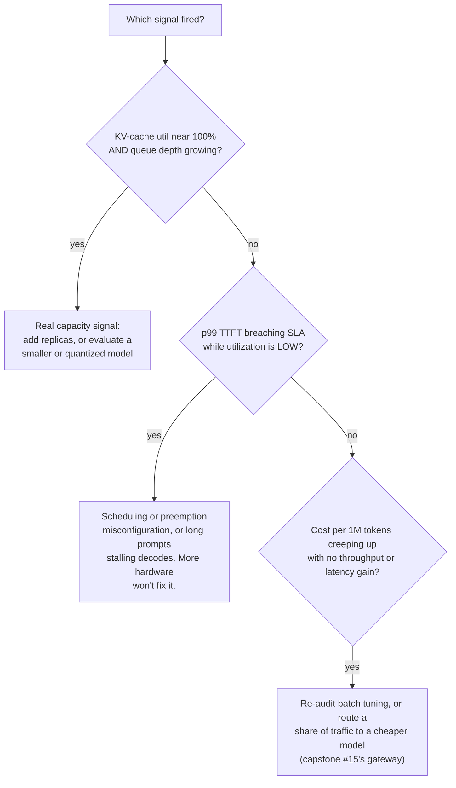

# Capstone #10: LLM Inference Serving at Scale

## At a glance

| Topic | Summary |
|---|---|
| Sources | Kwon et al., "Efficient Memory Management for LLM Serving with PagedAttention," SOSP 2023 (arXiv:2309.06180), the vLLM paper. Character.AI, "Optimizing AI Inference at Character.AI," blog.character.ai, Jun. 20, 2024. |
| Problem | Serve one already-trained 13B-parameter model to 1,000 concurrent conversations on 80 GB GPUs, within latency targets and a cost target *(illustrative)*. GPU memory runs out long before compute does. |
| Core idea | Store each request's KV cache in small fixed-size blocks, scattered anywhere in GPU memory and tracked by a per-request block table, as an operating system pages virtual memory. Admission to the running batch is gated on free blocks. |
| Targets | p50 / p99 time-to-first-token under 200 ms / 1.5 s. p50 / p99 inter-token latency under 40 ms / 120 ms. Cost per million tokens against a stated budget *(illustrative)*. |
| Headline results | Earlier systems used only 20.4% to 38.2% of KV-cache memory for real token states. vLLM used 96.3%. vLLM raised throughput 2 to 4× at the same latency *(source-confirmed)*. |
| KV cache per token | 819,200 bytes = 800 KB for OPT-13B: 2 × 40 layers × 5,120 hidden × 2 bytes *(source-confirmed)*. A full 2,500-token request holds about 2.0 GB. |
| Fleet size | 26 full-length requests per 80 GB GPU if memory is packed perfectly, 25 with PagedAttention's waste: about 40 GPUs for 1,000 conversations. Contiguous allocation needs about 110 to 200. |
| Cost | About \$1.11 per million output tokens at \$2.50 per GPU-hour and full utilization, 3× to 5× that without PagedAttention *(illustrative)*. |
| First to break at 10× | GPU count and cost scale linearly with concurrency. Before that, KV-cache headroom: queue depth and p99 latency climb while utilization sits near 100%. |
| Easy-to-miss traps | A 13B model sized with 7B dimensions. A sizing that assumes zero memory waste. A 200 ms first-token target that a cold 2,000-token prompt cannot meet. Round-robin routing that throws away cached prefixes. |
| Practice PDFs | [Study edition](../../capstone-study-and-mock/llm-inference-serving/capstone10_llm_inference_serving_study.pdf) · [Mock interview](../../capstone-study-and-mock/llm-inference-serving/capstone10_llm_inference_serving_mock.pdf) |

### Concepts this case study builds on

| Concept | Where it is taught | One-line recap |
|---|---|---|
| KV cache, continuous batching, quantization (B1) | [Lesson 1, Group B](../../lessons/lesson-1-ai-fundamentals-refresher.md#b-serving-and-running-models) | The keys and values of earlier tokens are stored so each new token does not recompute them; requests join a running batch as others finish; fewer bits per number shrink memory. |
| Latency vs. throughput, TTFT and inter-token latency, the batch-size knob (I1) | [Lesson 3, Concept 1](../../lessons/lesson-3-scalability-and-availability.md#concept-1-performance-vs-scalability-latency-vs-throughput) | A bigger batch raises tokens per second for the whole system and slows each request's stream. |
| Availability: series chains and redundancy (I3) | [Lesson 3, Concept 3](../../lessons/lesson-3-scalability-and-availability.md#concept-3-availability-patterns) | A chain is as weak as its parts multiplied together; a redundant pair of the weakest part improves it most. |
| Load balancers and session persistence | [Lesson 4, Concept 3](../../lessons/lesson-4-network-and-delivery.md#concept-3-load-balancers) | Sending a client's requests to the same backend keeps that backend's per-client state useful. |
| Back pressure | [Lesson 6, Concept 2](../../lessons/lesson-6-async-and-communication.md#concept-2-back-pressure) | When work arrives faster than it drains, bound the queue and slow or shed load. |
| Percentile latency, SLOs | [Lesson 9, Concept 2](../../lessons/lesson-9-evaluation-and-observability.md#concept-2-offline-evaluation--golden-datasets-llm-as-judge-regression-suites) | p50 is the median; p99 is the value 99% of requests beat. |

---

## Step 1: Clarify Requirements & Frame the Objective

### What the system does

It serves chat-completion requests for a single, already-trained LLM: a prompt goes in, a streamed sequence of generated tokens comes out. Many conversations run at once on a fixed pool of GPUs.

This is the inference-serving layer only, for one model in one deployment. Routing across several providers or models, rate limiting and fallback are the job of capstone #15 (`case-studies/llm-api-gateway`), which sits in front of a system like this one. Training, fine-tuning and output-quality evaluation are out of scope (Lesson 9).

### The objective

Unlike a prediction capstone, there is no accuracy metric. The objective is a set of **SLA** (service-level agreement: a committed performance target) and cost targets. Getting them wrong makes every later design decision optimize the wrong thing.

| Target | Example value *(illustrative)* |
|---|---|
| p50 / p99 time-to-first-token (TTFT): the wait before the first generated token | under 200 ms / 1.5 s |
| p50 / p99 inter-token latency: the gap between later tokens | under 40 ms / 120 ms per token |
| Aggregate throughput: tokens per second across the cluster at peak | 1,000 streams × 25 tokens/s = 25,000 tokens/s |
| Cost per million tokens served | GPU-hour cost divided by tokens served (Step 2) |

p50 is the median, and p99 is the value that 99% of requests beat. The matching **SLO** (service-level objective) is the internal target a team holds itself to, usually stricter than the SLA it promises. It is measured as real p99 latency and cost per token, tracked continuously (Step 6).

### Trade-offs considered

An aggressive p50 TTFT and a high aggregate throughput are in tension, because larger batches raise throughput and slow each request (Lesson 3, Concept 1). State both targets up front with a priority for when they conflict. Otherwise "just lower the batch size when it is slow" silently blows the throughput target.

---

## Step 2: Back-of-Envelope Constraints

### Assumptions

- A 13B-parameter model with the shape of OPT-13B: 40 transformer layers and hidden dimension 5,120 *(source-confirmed)*.
- FP16 weights (2 bytes per number) on one 80 GB GPU such as an A100 80 GB *(illustrative)*.
- 1,000 concurrent active conversations, each with a 2,000-token context and 500 generated tokens *(illustrative)*.

Sizes are rounded: 800 KB is read as 0.8 MB, and 1 GB as 1,000 MB. Exact binary units change the results by under 10%.

### Memory per GPU

```text
weights          = 13 billion parameters × 2 bytes = 26 GB
runtime overhead ≈ 2 GB (activations and buffers)
KV-cache budget  = 80 − 26 − 2 = 52 GB
```

### KV cache per token

The KV cache holds one key vector and one value vector for every layer of every token processed so far (defined in Lesson 1, Concept B1).

```text
KV bytes per token = 2 (K and V) × layers × hidden_dim × bytes_per_value
                   = 2 × 40 × 5,120 × 2
                   = 819,200 bytes = 800 KB
```

The paper gives the same figure for OPT-13B, and notes that a 2,048-token request can take up to 1.6 GB *(source-confirmed)*. Shape matters: 32 layers and 4,096 hidden is the shape of a 7B model and would give 512 KB per token. Use the dimensions of the model you are actually serving.

### One request, one GPU, the cluster

```text
one full-length request = 2,500 tokens × 0.8 MB = 2,000 MB = 2.0 GB
requests per GPU        = 52 GB / 2.0 GB = 26   (perfect packing)
GPUs for 1,000 requests = 1,000 / 26 = 38.5, so 39
```

One request, at a realistic length, holds about 2 GB of GPU memory for its KV cache before any compute happens. Memory runs out before compute, which is the core lesson of this capstone.

Two refinements:

- **Peak sizing is conservative.** A request is at 2,500 tokens only at its end. Averaged over its life it holds about 2,250 tokens, roughly 10% less.
- **Waste is part of the answer.** The 26 assumes every byte of the budget holds real token states. The paper measured what share actually does (Step 4):

| Allocation | Share of KV memory holding real tokens | Requests per GPU | GPUs for 1,000 |
|---|---|---|---|
| Earlier systems, best case | 38.2% | 26 × 0.382 ≈ 9 | about 112 |
| Earlier systems, worst case | 20.4% | 26 × 0.204 ≈ 5 | about 200 |
| PagedAttention (vLLM) | 96.3% | 26 × 0.963 ≈ 25 | 40 |

The shares are the paper's averages over its experiment *(source-confirmed)*; applying them to this fleet is a scaling argument. The conclusion survives rough numbers: without block-level allocation, the same traffic needs about three to five times the GPUs.

### Throughput and cost

At the 40 ms p50 inter-token target, each stream receives 25 tokens per second:

```text
cluster throughput = 1,000 streams × 25 tokens/s = 25,000 tokens/s = 90 million tokens/hour
fleet cost         = 40 GPUs × $2.50 per GPU-hour = $100 per hour   (price is illustrative)
cost per 1M tokens = $100 / 90 = about $1.11
without PagedAttention: 112 to 200 GPUs → about $3.11 to $5.56 per million tokens
```

This counts output tokens only, assumes every stream generates continuously, and ignores prompt processing. Real utilization is lower, which raises the cost in proportion: at 50% utilization it doubles.

### Two checks on the targets

**Inter-token check.** Is 40 ms per token consistent with 25 requests per GPU? Each decode step reads all weights once and every active request's KV cache. With an assumed 2 TB/s of memory bandwidth:

```text
weights read per step  = 26 GB
KV read per step       = 25 requests × 1.8 GB (2,250 tokens × 0.8 MB) = 45 GB
time per step ≥ (26 + 45) GB / 2,000 GB/s = about 35 ms
```

That is close to the 40 ms target, so the sizing and the target agree. It also shows why adding requests to a batch lengthens every stream's step time.

**First-token check.** Can a 200 ms p50 TTFT be met? Processing a prompt costs about 2 × parameters × tokens in floating-point operations (ignoring attention's extra term). With an assumed 300 TFLOP/s of usable peak compute:

```text
cold 2,000-token prompt = 2 × 13e9 × 2,000 = 5.2e13 operations → about 0.17 s at peak
at a realistic 40% of peak → about 0.4 s
turn with 100 new tokens and 1,900 cached → about 9 ms at peak
```

A cold 2,000-token prompt cannot meet a 200 ms p50, before any queueing. The target is only reachable if most turns reuse cached prefix blocks (Steps 5 and 6).

### Trade-offs considered

- A smaller or more aggressively quantized model shrinks weights and per-token KV size, so more requests fit per GPU, at some cost in output quality. INT8 weights alone would free 13 GB (about 6 more requests per GPU).
- Multi-query and grouped-query attention reduce KV size by sharing keys and values across heads. That is a training-time architecture decision, not something to retrofit onto a trained model.

---

## Step 3: Data / Knowledge Pipeline

There is no training-data pipeline: the system serves a fixed, already-trained model. What flows through it:

- **Incoming prompts**, tokenized on arrival.
- **Generated tokens**, streamed back as they are produced.
- **Usage telemetry:** input and output token counts per request, tagged by caller or tenant, feeding the cost-per-token tracking (Steps 1 and 6).
- **Latency telemetry:** TTFT and inter-token latency per request, feeding the p50 / p99 dashboards (Step 6).

### Trade-offs considered

Logging full prompts and completions makes any bad response debuggable, but stores sensitive user content at scale, with storage cost and privacy exposure. Logging only token counts and latencies is cheaper and safer, but a specific bad response can no longer be inspected, only its statistics.

---

## Step 4: Model/Agent Core Design — PagedAttention

### Why contiguous allocation wastes memory

A naive system gives each request one contiguous block of GPU memory, sized up front for its maximum possible length, because a basic attention kernel expects keys and values in one contiguous region. That produces three kinds of waste:

- **Reservation:** space reserved for tokens the request will generate later, unusable by anyone else in the meantime.
- **Internal fragmentation:** space left over inside a block when the request ends shorter than its reserved maximum.
- **External fragmentation:** gaps between blocks, left as requests of different sizes finish at different times, too small or awkward to satisfy a new contiguous request.

In the paper's measurements, only 20.4% to 38.2% of KV-cache memory held real token states in the existing systems *(source-confirmed)*. That is the "60 to 80% waste" quoted for naive allocation.

### What PagedAttention does

PagedAttention borrows **virtual-memory paging** from operating systems. An OS divides a process's logical address space into fixed-size pages, maps each to a possibly non-contiguous physical frame through a page table, and lets the process address memory without knowing where its pages sit.

Applied to the KV cache:

- Each request's cache is split into fixed-size **blocks**, stored anywhere in GPU memory. vLLM's default block size is 16 tokens *(source-confirmed)*.
- A per-request **block table** records which physical block holds which logical positions.
- vLLM's custom attention kernel reads keys and values across non-contiguous blocks directly, which a contiguous-memory kernel cannot do.

Because any free block can go to any request, both kinds of fragmentation disappear at the source. Blocks are allocated one at a time as a sequence grows, so nothing is reserved in advance, and there is no contiguity requirement to violate. In the paper's Figure 2, vLLM's token states take 96.3% of the cache, so about 4% is lost to the last partly filled block of each request and other overheads *(source-confirmed)*.

### Sharing blocks across requests

Because blocks are reached through a table, several requests with an identical prefix can point their tables at the same physical blocks. This covers parallel samples from one prompt and users who share a long system prompt. The mechanism is **copy-on-write**, the same one behind OS process forking: owners share one physical copy until one needs to modify it, and only then does that owner get a private copy. A shared prefix is paid for once, not per request.



### A sketch of the allocator

Illustrative, not vLLM's production code:

```python
BLOCK_SIZE = 16  # tokens per block, a tunable constant

def blocks_needed(total_tokens: int) -> int:
    return -(-total_tokens // BLOCK_SIZE)          # ceiling division

class PagedKVCacheAllocator:
    def __init__(self, total_blocks: int):
        self.free_blocks = list(range(total_blocks))   # physical block IDs
        self.block_tables: dict[str, list[int]] = {}   # request_id -> blocks

    def ensure_capacity(self, request_id: str, total_tokens: int) -> bool:
        """total_tokens = prompt + generated, including the token about
        to be written. Returns False if the caller must preempt."""
        table = self.block_tables.setdefault(request_id, [])
        while len(table) < blocks_needed(total_tokens):
            if not self.free_blocks:
                return False
            table.append(self.free_blocks.pop())
        return True

    def free_request(self, request_id: str) -> None:
        self.free_blocks.extend(self.block_tables.pop(request_id, []))
```

Worked check with a 16-token block: a 40-token prompt needs 3 blocks (48 slots, 8 spare). Tokens 41 to 48 fit. Token 49 needs a 4th block. At most 15 slots per request are ever unused.

### Trade-offs considered

- **Static pre-allocation** has slightly less bookkeeping, with no block-table lookup in every attention computation, but it wastes the 60 to 80% above, so far fewer requests fit per GPU.
- **Continuous batching** (which requests are in the running batch) and **PagedAttention** (how their memory is laid out) solve two different layers of the same problem. They are complementary. Continuous batching on contiguous memory still suffers fragmentation underneath.
- **PagedAttention's indirection** adds a small cost per attention computation. The paper reports it is far outweighed by the throughput from fitting more requests per GPU.
- **Block size:** larger blocks use the GPU more efficiently per kernel call but waste more space per request. The paper's default of 16 is a middle point.

---

## Step 5: Serving Architecture

### The request lifecycle

1. An incoming request is tokenized and placed in a **waiting queue**.
2. A **scheduler** admits waiting requests into the **running batch** as soon as enough free KV-cache blocks exist. Admission is gated on free blocks, not on a fixed request count.
3. Each decode step, every running request produces one token and needs at most one new block.
4. Finished requests return their blocks to the shared pool.



### Preemption under memory pressure

When free blocks run out mid-decode, the scheduler preempts requests rather than failing. The paper's policy is first-come-first-served: the earliest-arrived requests keep their memory and the latest-arrived are preempted first *(source-confirmed)*. A preempted request can be handled two ways:

- **Swapping:** copy its blocks to CPU memory and copy them back on resume. The CPU swap space never needs to exceed the GPU's KV blocks.
- **Recomputation:** drop its blocks and rebuild them in one prompt-style pass over the original prompt plus the tokens generated so far.

Rough arithmetic for a 2,000-token request: its KV is 1.6 GB, which takes about 64 ms each way at an assumed 25 GB/s of PCIe bandwidth, so about 130 ms round trip. Recomputing costs about 0.17 to 0.4 s of GPU compute (Step 2). On paper swapping wins, but both ignore real overheads, and vLLM's documentation currently makes recompute the default (see "What has changed since the paper"). Measure on your own stack.

### Prefill and decode interfere

Processing a long prompt (prefill) is compute-heavy, while generating tokens (decode) is memory-bound. If a long prompt is processed in one go, every running stream stalls behind it. An 8,000-token prompt is about 2 × 13e9 × 8,000 = 2.1e14 operations, around 0.7 s at peak, against a 120 ms p99 inter-token target. The usual fix is to split the prompt into chunks and batch each chunk with the running decodes, so no stream waits more than one chunk.

### Routing between replicas

A request's KV cache lives on one replica. Spreading a conversation's turns round-robin across N replicas means a cached prefix is found only 1 time in N, so the cold-prompt cost of Step 2 returns. Route by conversation (session affinity, Lesson 4, Concept 3), and accept the load imbalance that follows.

### Where this sits in the availability chain

Lesson 3's Concept 3 computes a gateway, inference backend and vector database in series.

```text
chain availability = 0.9995 × 0.999 × 0.9999 = 0.998401   → about 14.0 hours of downtime a year
two independent backend replicas: 1 − 0.001² = 0.999999
chain with the pair = 0.9995 × 0.999999 × 0.9999 = 0.999399 → about 5.3 hours a year
```

The replica pool described here is that inference backend. The gain assumes the two replicas fail independently. A shared driver bug or a bad deploy takes both down together, and failover does not save in-flight streams or warm caches.

### Decision table

| Decision | Default in this design | Choose the alternative when |
|---|---|---|
| KV-cache allocation | Paged blocks | Never, for a shared multi-request server. Contiguous allocation only for a single-request tool. |
| Block size | 16 tokens | Larger blocks if kernels are the bottleneck and requests are long. Smaller if requests are short. |
| Admission | Free blocks, not a request count | A hard request cap only as a safety limit on top. |
| Preemption mode | Recompute in current vLLM | Swap when host-to-GPU bandwidth is high and recompute is long (very long contexts). Test both. |
| Prefix reuse | On, with cache isolation per tenant | Off for single-use prompts, or where side channels matter more than speed. |
| Headroom | Run below 100% KV utilization | Close to full only when cost matters more than p99 and demand is stable. |
| Model precision | FP16 | INT8 or lower when memory is the limit and an eval shows acceptable quality. |
| Routing | Session affinity | Round-robin only if prefix reuse is not part of the latency plan. |

### Trade-offs considered

Preemption by swap or recompute avoids rejecting a request in a memory crunch, at the cost of a real resume delay. Queueing or rejecting new requests when the GPU is full avoids that overhead, but makes admission latency worse for anything arriving during saturation.

---

## Step 6: Evaluation, Monitoring, and Iteration

### What to monitor

- **KV-cache utilization:** blocks in use over total blocks. It is the most direct health signal, since memory is the binding resource.
- **Queue depth:** requests waiting for a batch slot. Growth at high utilization is capacity exhaustion, not a blip.
- **Preemption count:** frequent preemption means the cache is too small for the load.
- **p50 / p99 TTFT and inter-token latency**, against the Step 1 targets.
- **Cost per million tokens:** GPU-hour cost over tokens served.
- **Prefix-cache hit rate:** the share of prompt tokens served from cached blocks, tracked on its own because the TTFT target depends on it (Step 2).

### What each signal means



### What breaks first at 10×

| Dimension | Today | At 10× | What gives way first |
|---|---|---|---|
| Concurrent conversations | 1,000; 40 GPUs; \$100/hour | 10,000; about 400 GPUs; about \$1,000/hour | Cost and capacity planning. Utilization targets, GPU supply and a single gateway tier come before the allocator does. |
| Memory levers | 26 GB of weights; 25 requests per GPU | INT8 weights: 13 GB, 65 GB for KV, about 32 requests per GPU, 313 GPUs. INT8 KV as well: about 65 per GPU, 154 GPUs. | Output quality. Each lever needs an evaluation before it ships (Lesson 9). |
| Peak-hour burst | Headroom of a few requests per GPU | A burst consumes headroom first, then queues | p99 TTFT. Apply back pressure (Lesson 6, Concept 2): bound the queue, then shed or degrade. |

### Security and abuse cases

- **Prefix reuse is a side channel.** If two tenants share cached blocks, a fast first token can reveal that someone else sent the same prompt prefix. vLLM's documentation describes cache salting: only requests with the same salt can reuse cached blocks. Use per-tenant salts where tenants must not learn about each other.
- **Noisy neighbors.** One caller with very long contexts can consume most of the block pool. Cap context length and in-flight requests per tenant, and meter tokens (Lesson 10).
- **Cancellation.** If a client disconnects, the server should stop generating and call `free_request()` so the blocks return to the pool. Otherwise capacity goes to tokens nobody will read.
- **Logging.** The Step 3 trade-off decides what is stored. If prompts are logged, apply the same retention and access rules as any user data.

### Trade-offs considered

Aggressive headroom keeps p99 latency safe against spikes but pays for idle GPUs. Running close to full utilization is cheaper per token on average, but leaves little margin before queue depth, and then p99 latency, starts climbing. Neither is correct in general. It is the Step 1 latency-versus-cost trade-off, now informed by real numbers.

---

## What has changed since the paper

As of 2026-10-17. The paper is from SOSP 2023.

| Topic | In the paper (2023) | Today | Consequence for this design |
|---|---|---|---|
| Preemption mode | Swap to CPU or recompute, both described | vLLM's documentation says the default preemption mode is recompute rather than swap, and that recompute has lower overhead in the V1 architecture. | Plan for recompute; keep the swap arithmetic as a comparison, and measure both. |
| Prefill and decode interference | Not addressed | The documentation says chunked prefill is enabled by default whenever possible. It batches pending decodes first and splits a prefill that does not fit into `max_num_batched_tokens`. Smaller values favor inter-token latency; values above 8,192 are recommended for throughput. | Tune `max_num_batched_tokens` against the p99 inter-token target from Step 1. |
| Prefix reuse | Block sharing for parallel sampling, beam search and shared prompts | The documentation describes automatic prefix caching: each full block is hashed from its tokens and its prefix, eviction is least-recently-used, and only full blocks are cached. Cache salting isolates tenants. | This is the mechanism behind the TTFT plan in Step 2 and the side channel in Step 6. |
| Production evidence | Benchmarks on OPT, LLaMA and ShareGPT workloads | Character.AI reports that it has reduced serving costs by at least 33× since launching in 2022 *(source-confirmed)*, and that serving costs 13.5× less than building on leading commercial APIs. It credits "innovations around Transformer architecture and 'attention KV cache'" and "improved techniques for inter-turn caching," and says it serves around 20,000 queries per second. | The 33× compares Character.AI with its own 2022 costs and bundles several changes. It is not the gain from inter-turn caching alone, and the post gives no cache hit rate. |

---

## Sources and Further Reading

Labels used above: *(source-confirmed)* means the figure or quotation is stated in the cited source. *(illustrative)* means it is an assumption made for this design.

- Kwon et al., "Efficient Memory Management for LLM Serving with PagedAttention," SOSP 2023 (arXiv:2309.06180). The source of the PagedAttention mechanism, the KV-cache figures, the waste percentages, the default block size, the scheduling policy and the throughput result.
- Character.AI, "Optimizing AI Inference at Character.AI," Jun. 20, 2024 (blog.character.ai/optimizing-ai-inference-at-character-ai). The source of the 33×, 13.5× and 20,000 queries-per-second figures.
- vLLM documentation, "Optimization and Tuning" (docs.vllm.ai/en/latest/configuration/optimization/) and "Automatic Prefix Caching" (docs.vllm.ai/en/latest/design/prefix_caching/), read 2026-10-17. The source of the preemption default, chunked prefill, hashing, eviction and cache salting.
- Lesson 1 (`lessons/lesson-1-ai-fundamentals-refresher.md`), Concept B1: KV cache, continuous batching, quantization.
- Lesson 3 (`lessons/lesson-3-scalability-and-availability.md`), Concepts 1 and 3: the batch-size table and the availability arithmetic that Step 5 applies.
- `appendix/token-and-latency-numbers.md`, section 7: the KV-cache memory figures used here.
