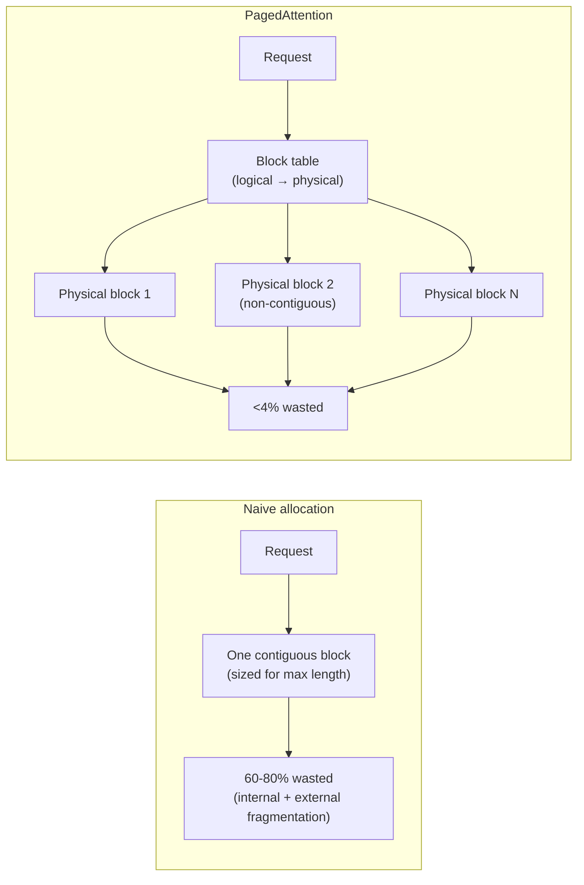
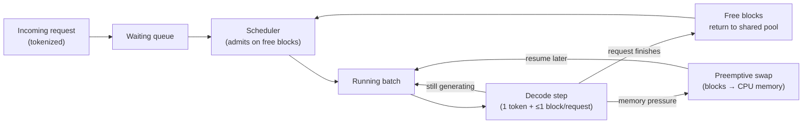
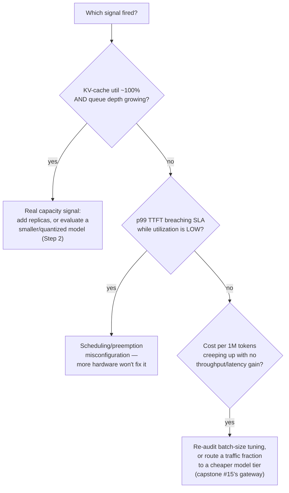

# Capstone #10: LLM Inference Serving at Scale

**Source(s):** Primary — Kwon et al., *"Efficient Memory Management for LLM Serving with PagedAttention,"* SOSP 2023 (arXiv:2309.06180) — the vLLM paper, source of the actual mechanism this capstone is built around. Secondary/unconfirmed — Character.AI's Noam Shazeer, June 2024 engineering post reporting a ~33x serving-cost reduction via KV-cache reuse across conversation turns.

**Confidence:** The PagedAttention mechanism (Steps 4-5 below) is grounded in a primary, peer-reviewed source — a named research team's own published paper with its own benchmark numbers. The Character.AI production result is **not** presented with the same confidence: it is widely covered secondhand, and no still-live primary URL for it could be confirmed. It's included because the ~33x figure is a genuinely useful illustration of what KV-cache-focused optimization can achieve in production, but treat it as a reported claim, not a verified one, and don't cite it as if it carries the same evidentiary weight as the vLLM paper.

**Scope note:** This capstone is the inference-serving layer only — one model, running efficiently, at scale, for one deployment. It does **not** cover routing a request across *multiple* providers or models, rate limiting, or fallback-on-outage — that's a distinct, separate concern covered by capstone #15 (`case-studies/llm-api-gateway`), which sits in front of a system like this one. It also does not cover model training, fine-tuning, or output quality/safety evaluation (Lesson 9's territory) — this capstone is purely "how do you serve a fixed, already-trained model's inference requests efficiently."

---

## Step 1: Clarify Requirements & Frame the Objective

Unlike a classic ML-prediction capstone, where Step 1's objective is a metric like precision@k or CTR, this infrastructure capstone's "objective" is a set of **SLA** (service-level agreement — a committed performance target) and cost targets, not a prediction-quality metric. Getting these targets wrong lets every downstream architecture decision (Steps 4-5) optimize for the wrong thing — exactly what Step 1 exists to prevent.

**Functional scope:** Serve chat-completion-style requests (a prompt in, a streamed sequence of generated tokens out) for a single, already-trained LLM, across many concurrent users and conversations, on a fixed pool of GPU hardware.

**Non-functional targets (the actual numbers being optimized for):**
- **p50 / p99 time-to-first-token (TTFT)** — p50 (median) and p99 (99th-percentile, i.e. "no worse than this for 99% of requests") targets for the delay before the first generated token arrives. Example targets: p50 TTFT < 200ms, p99 TTFT < 1.5s.
- **p50 / p99 inter-token latency** — the delay between each subsequent token. Example targets: p50 < 40ms/token, p99 < 120ms/token.
- **Aggregate token-generation throughput** — the system-wide rate (tokens/sec) the serving cluster sustains under peak load.
- **Cost per 1M tokens served** — the actual dollar cost target, derived from GPU-hour cost divided by tokens served, which Step 2 and Step 6 both depend on.

**Equivalent of "ground truth / feedback signal":** for a prediction task this would be labeled data; here it's SLO (service-level objective — the internal target a team holds itself to, usually stricter than the externally promised SLA) compliance — real measured p99 latency and cost-per-token, tracked continuously (Step 6) against the targets above.

**Explicitly out of scope:** multi-provider routing and fallback (capstone #15), model training/fine-tuning, and output-quality evaluation (Lesson 9).

**Trade-offs considered:** Setting an aggressive p50 TTFT target (prioritizing a snappy single-conversation experience) and a high aggregate-throughput target *at the same time* is itself a trade-off commitment, not a free combination — Lesson 3's Concept I1 shows exactly why: larger batch sizes raise aggregate throughput but raise individual-request latency. Stating both targets up front, with explicit priority if they conflict under real load, is what prevents an ad hoc "just lower the batch size when it's slow" fix from silently blowing the throughput target instead.

---

## Step 2: Back-of-Envelope Constraints

**Assumptions for this estimate** (realistic, not the only valid choice): a 13B-parameter-class model, 32 transformer layers, hidden dimension 4096, served at FP16 precision (16-bit floating point — 2 bytes per number), on a single 80GB GPU (e.g. an A100 80GB). Target: sustain 1,000 concurrent active conversations cluster-wide, average context length 2,000 tokens, average generation length 500 tokens per conversation.

**Model weight memory:** 13 billion parameters × 2 bytes/parameter = 26GB. That leaves roughly 80GB − 26GB − ~2GB (activations and other runtime overhead) ≈ **52GB available for KV cache** on this one GPU.

**KV-cache memory per token — the calculation that makes "KV cache is the bottleneck, not FLOPs" concrete rather than asserted.** The KV cache (Lesson 1's Concept B1 defines it in full: the stored key/value tensors from every previously-processed token, kept so each new token's attention computation doesn't have to recompute them) stores, per token, one key vector and one value vector for *every* layer:

```
KV-cache bytes per token = 2 (K and V) × num_layers × hidden_dim × bytes_per_value
                         = 2 × 32 × 4096 × 2
                         = 524,288 bytes
                         = 512 KB/token  (0.5 MB/token)
```

For one conversation reaching 2,500 tokens total (2,000 context + 500 generated) held resident in GPU memory at its peak:

```
KV cache for one full-length request = 2,500 tokens × 0.5 MB/token = 1,250 MB ≈ 1.22 GB
```

**That single number is the whole point of this step.** One request, at a realistic length, consumes over a gigabyte of GPU memory just for its KV cache — before counting a single FLOP of actual matrix-multiply compute. With ~52GB available for KV cache on this GPU:

```
Max concurrent full-length requests per GPU ≈ 52GB / 1.22GB ≈ 42 requests
```

To sustain the targeted 1,000 concurrent conversations cluster-wide, this implies roughly **1,000 / 42 ≈ 24 GPUs** of this class are needed *purely to hold KV cache* — a cluster-sizing number driven by memory capacity, not by how many FLOPs these GPUs can compute. This is concrete evidence for the capstone's core lesson: in LLM serving, GPU memory — not compute — is usually what runs out first, consumed by the KV cache.

**Trade-offs considered:** A smaller or more aggressively quantized model (Lesson 1's Concept B1 defines quantization) shrinks both the weight memory *and* the per-token KV-cache size proportionally, buying more concurrent-request headroom per GPU at some cost to output quality. Architectural changes like multi-query or grouped-query attention (sharing key/value projections across multiple attention heads) reduce per-token KV-cache size directly — but that's a training-time model-architecture decision, not something a serving team can retrofit onto an already-trained model at serving time.

---

## Step 3: Data / Knowledge Pipeline

For a classic ML-prediction capstone, this step covers training-data collection, labeling, and freshness. That doesn't apply here: **this capstone has no training-data pipeline** — it serves an already-trained, fixed model. What actually flows through this system operationally is:

- **Incoming prompts** — the user's (or upstream application's) input text, tokenized on arrival.
- **Generated output tokens** — streamed back to the caller as they're produced.
- **Usage/cost telemetry** — input and output token counts per request, tagged by whatever caller/tenant identifier is relevant, feeding directly into the cost-per-token tracking Step 1 set as a target and Step 6 monitors continuously.
- **Latency telemetry** — TTFT and inter-token latency measured per request, feeding the p50/p99 dashboards Step 6 depends on.

**Trade-offs considered:** Logging full prompt and completion text for every request gives complete debuggability when something goes wrong, but means storing potentially sensitive user content at scale, with real storage cost and privacy/compliance exposure. Logging only token counts and latencies (no content) is cheaper and safer, but means a specific bad response can't be inspected after the fact — only its statistics.

---

## Step 4: Model/Agent Core Design — PagedAttention

### Why naive KV-cache allocation wastes memory

A naive serving system allocates each request's KV cache as one contiguous GPU-memory block, sized up front for its *maximum possible* sequence length, since a basic attention implementation expects its K/V tensors in one contiguous region. This produces two kinds of waste, borrowing OS memory-management vocabulary:
- **Internal fragmentation** — if a request's actual generation ends up shorter than the max length it reserved space for, that unused space sits idle inside the block, unusable by any other request even though it's technically "free."
- **External fragmentation** — as differently-sized requests finish and free memory at different times, the freed space becomes a patchwork of gaps too small or oddly-placed to satisfy a new request's contiguous-block requirement, even when total free memory would otherwise be enough.

The vLLM paper reports that systems using this naive approach waste roughly **60-80% of allocated KV-cache memory** to exactly these two effects.

### What PagedAttention does instead

**PagedAttention** borrows **virtual memory paging** from operating systems: instead of giving a process one contiguous block of physical memory, an OS divides its logical address space into fixed-size **pages**, maps each to a (possibly non-contiguous) physical memory **frame** via a **page table**, and lets the process address memory logically without knowing where its pages physically sit.

PagedAttention applies this to KV cache: each request's KV cache is divided into fixed-size **blocks** (the page analog), stored **non-contiguously** anywhere in GPU memory. A per-request **block table** (the page-table analog) tracks which physical block holds which logical position in the sequence. This isn't just bookkeeping — vLLM's custom GPU attention kernel is written to read K/V values across non-contiguous blocks directly, something a naive contiguous-memory implementation can't do, so a new kernel was required to exploit it.

Because any free block, anywhere in memory, can be handed to any request needing one more, both fragmentation types are eliminated at the source rather than mitigated: no "reserved-but-unused" internal waste (blocks allocate only as a sequence grows, one at a time) and no external fragmentation (no contiguous-block requirement to violate). The paper reports this cuts memory waste from 60-80% down to under 4%.

**Cross-request block sharing:** because blocks are addressed indirectly through a block table rather than owned exclusively by one request, multiple requests sharing an identical prefix — e.g. parallel decodes from the same prompt, or users whose conversations share a long system prompt — can point their block tables at the *same* physical blocks, using **copy-on-write** (the mechanism behind OS process forking: multiple owners share one physical copy until one needs to modify it, at which point only that owner gets a private copy). This turns a shared prefix into a one-time cost instead of a per-request duplicate.



A simplified sketch of the core allocator logic (illustrative, not vLLM's actual production code):

```python
BLOCK_SIZE = 16  # tokens per block, a tunable constant

class PagedKVCacheAllocator:
    def __init__(self, total_blocks: int):
        self.free_blocks = list(range(total_blocks))   # pool of physical block IDs
        self.block_tables: dict[str, list[int]] = {}    # request_id -> [physical_block_ids]

    def allocate_block(self, request_id: str) -> int:
        if not self.free_blocks:
            raise MemoryError("No free KV-cache blocks — evict, swap, or preempt a request")
        block_id = self.free_blocks.pop()
        self.block_tables.setdefault(request_id, []).append(block_id)
        return block_id

    def needs_new_block(self, request_id: str, tokens_generated_so_far: int) -> bool:
        blocks_held = len(self.block_tables.get(request_id, []))
        return tokens_generated_so_far > blocks_held * BLOCK_SIZE

    def free_request(self, request_id: str) -> None:
        self.free_blocks.extend(self.block_tables.pop(request_id, []))
```

**Trade-offs considered:** Static pre-allocation (the naive approach above) has slightly lower per-step bookkeeping overhead — no block-table indirection to resolve on every attention computation — but wastes the 60-80% of memory described above, meaning far fewer concurrent requests fit per GPU. Plain continuous batching (Lesson 1's Concept B1, Lesson 3's Concept I1) without PagedAttention still helps throughput by letting multiple requests share a GPU forward pass, but if the underlying KV-cache memory is still contiguously allocated per request, it still suffers the same fragmentation problem underneath — continuous batching and PagedAttention solve two different layers of the same problem (which requests are in the active batch, vs. how their memory is physically managed) and are complementary, not competing, techniques. PagedAttention's own block-table indirection is a real, if small, added cost per attention computation — the paper's benchmarks show this cost is comfortably outweighed by the throughput gained from serving far more concurrent requests per GPU.

---

## Step 5: Serving Architecture

The request lifecycle, shown in the diagram below:
- An incoming request is tokenized and placed in a **waiting queue**.
- A **scheduler** admits waiting requests into the **running batch** as soon as enough free KV-cache blocks exist to hold at least one more block for a new or continuing request — admission is gated on *free blocks*, not a fixed request-count limit, a direct consequence of Step 4's design.
- Each decode step, every request in the running batch produces one new token and consumes at most one new block.
- Finished requests free their blocks back into the shared pool.

Under memory pressure, the scheduler can use **preemptive scheduling**:
- Temporarily evict a lower-priority or longer-running request's blocks to CPU memory (**swapping**, the OS virtual-memory term), freeing GPU memory for a higher-priority request.
- Later, swap the evicted blocks back in to resume that request.
- The trade-off: a slower resume (the CPU-to-GPU transfer cost) in exchange for not rejecting the new request outright.



**This is the same batch-size/throughput-latency knob Lesson 3's Concept I1 walks through, applied at this paper's benchmark scale.** Lesson 3's I1 table shows batch size trading per-token latency for aggregate throughput at a small illustrative scale (batch 1 → 20 tokens/sec at 50ms/token; batch 32 → 400 tokens/sec at 80ms/token). PagedAttention is what lets that batch size grow large in production, at the scale where GPU *memory* — not compute — is the binding constraint, exactly the regime Step 2's arithmetic puts this system in.

**This serving system is also the "inference backend" node in Lesson 3's Concept I3 availability chain.** That worked example computes combined availability for a gateway → inference backend → vector DB chain in series (≈99.84%, ~14 hours/year downtime), then shows that making just the inference backend redundant — an active-active pool of two independently-available replicas — brings downtime down to ~5.3 hours/year. The PagedAttention-backed replica pool described here is literally that "inference backend" component.

**Trade-offs considered:** Preemptive swap-to-CPU avoids outright rejecting a request during a memory crunch, at the cost of a real resume latency once that request is swapped back in — versus simply queueing or rejecting new requests when the GPU is full, which avoids any swap overhead but makes admission latency worse for anything arriving during a saturated period.

---

## Step 6: Evaluation, Monitoring, and Iteration

**What to monitor in production:**
- **KV-cache utilization %** — blocks currently in use divided by total blocks available; the single most direct health signal for this specific system, since Steps 2 and 4 both established that memory, not compute, is the binding resource.
- **Queue depth** — the number of requests waiting for a batch slot; a growing queue at high KV-cache utilization is the clearest sign of genuine capacity exhaustion rather than a transient blip.
- **p50 / p99 TTFT and inter-token latency** — measured continuously against the Step 1 targets.
- **Cost per 1M tokens served** — derived from GPU-hour cost divided by tokens actually served, tracked against the Step 1 cost target.
- **KV-cache reuse hit rate across turns** — the secondary-sourced technique behind Character.AI's reported ~33x figure; tracked separately from the primary-sourced PagedAttention metrics above precisely because it rests on weaker evidence (per this doc's Confidence note).

**What triggers a change:** each monitored signal points at a different fix — reading it as a capacity problem when it's really a config problem (or vice versa) wastes money or leaves the SLA breached.



**Trade-offs considered:** Provisioning aggressive headroom (running well below max KV-cache utilization at all times) keeps p99 latency safe against traffic spikes but means paying for GPU capacity that sits idle most of the time. Running close to full utilization is cheaper per token served on average but leaves little margin before queue depth — and therefore p99 latency — starts climbing during any demand spike. Neither is correct in general; it's the same latency-vs-cost trade-off from Step 1, now informed by real monitored numbers instead of an upfront guess.

---

## Source(s) and Further Reading

- Kwon et al., *"Efficient Memory Management for LLM Serving with PagedAttention,"* SOSP 2023 (arXiv:2309.06180) — **primary**, the source of the PagedAttention mechanism, the fragmentation-waste percentages, and the virtual-memory-paging framing used throughout Steps 4-5.
- Character.AI / Noam Shazeer, June 2024 engineering post on serving-cost reduction via KV-cache reuse — **secondary/unconfirmed**; widely covered secondhand, no still-live primary URL confirmed. Cited only for the illustrative ~33x figure, not as a verified production benchmark.
- Lesson 1 (`lessons/lesson-1-ai-fundamentals-refresher.md`), Concept B1 — full definitions of KV cache, continuous batching, and quantization, referenced rather than re-derived throughout this document.
- Lesson 3 (`lessons/lesson-3-scalability-and-availability.md`), Concepts I1 and I3 — the throughput/latency batch-size table and the series/parallel availability math this capstone's Step 5 applies directly, rather than re-deriving.
