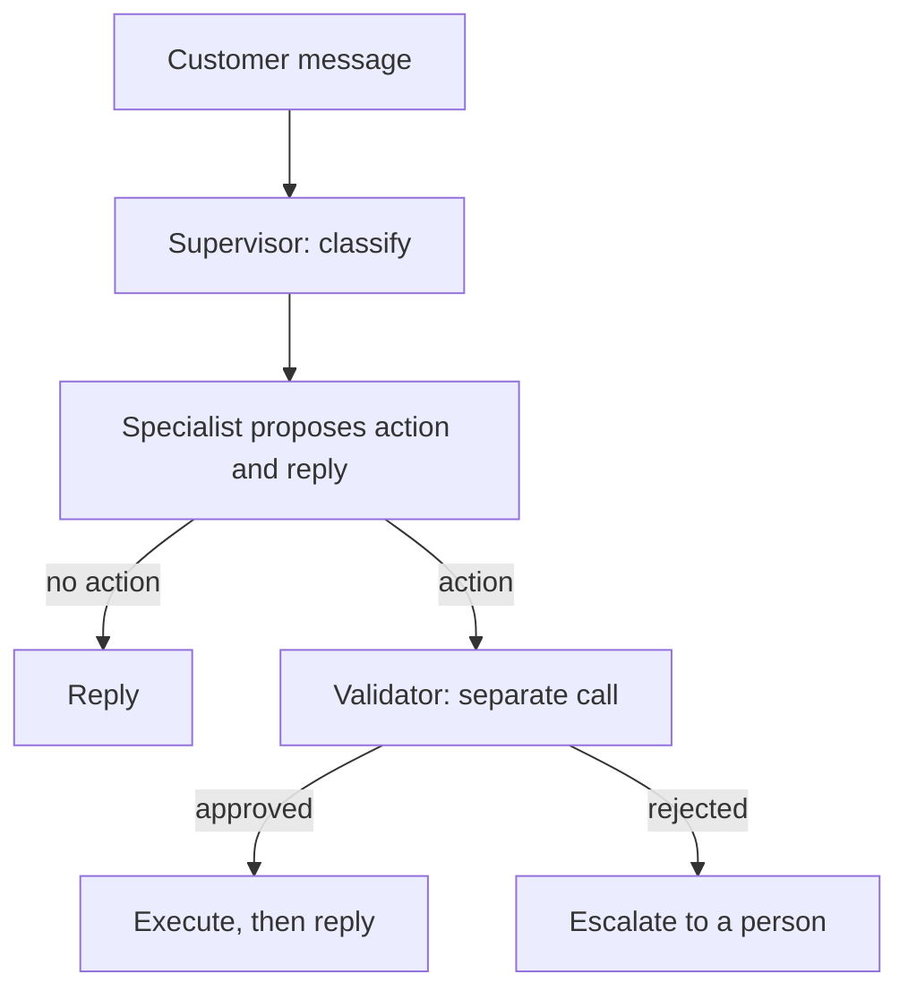
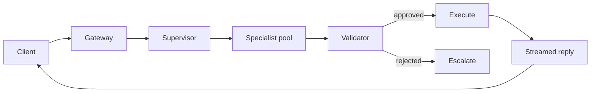

# Capstone #12: Multi-Agent Customer-Support Platform — Sierra's Supervisors and Klarna's AI Assistant

## At a glance

| Topic | Summary |
|---|---|
| Sources | Three Sierra blog posts: "From LLMs to enterprise-grade agents" (October 2, 2025), "Sierra Agent OS 2.0" (November 5, 2025) and "Constellation of models" (December 3, 2025). Klarna's press release "Klarna AI assistant handles two-thirds of customer service chats in its first month" (February 27, 2024). Press coverage of Klarna's later change of course, reported from Bloomberg and Reuters interviews. |
| Two cases | Sierra is a platform for building customer-service agents. Klarna built its own assistant, which its release says is powered by OpenAI. No source says Klarna uses Sierra, so they are two cases and not one system. |
| Problem | Resolve customer requests end to end, such as refunds, cancellations and disputes, with an acceptable rate of wrong or policy-violating actions reaching the customer. |
| Sierra's approach | Agents are assembled from 15 or more models chosen by task. Supervisory agents filter input, audit every action and response, and can switch from observing to intercepting. The goal is bounded error rates, not perfect adherence *(source-confirmed)*. |
| Klarna's results | In its first month the assistant had 2.3 million conversations, two-thirds of customer service chats, with customer satisfaction on par with human agents, a 25% drop in repeat inquiries, errands resolved in under 2 minutes against 11, and an estimated \$40 million profit improvement in 2024. All are Klarna's own claims *(source-confirmed)*. |
| Later | Press coverage of interviews in May and September 2025 reports Klarna's CEO saying that the focus on cost led to lower quality and that the company was hiring human agents again *(reported, secondary)*. |
| Not published | Error rates, validator catch rates, Klarna's architecture, and Sierra's routing logic. The supervisor, specialist and validator pattern in Step 4 is this document's design. |
| First to break | Cost of false alarms. A validator's compute is cheap, and each wrongly blocked good action becomes a human escalation. |
| Easy-to-miss traps | Klarna is not shown to be a Sierra customer. An outcome metric is not a correctness metric. A benefit-to-cost ratio that leaves out false positives is overstated by a large factor. |
| Practice PDFs | [Study edition](../../capstone-study-and-mock/multi-agent-customer-support/capstone12_multi_agent_customer_support_study.pdf) · [Mock interview](../../capstone-study-and-mock/multi-agent-customer-support/capstone12_multi_agent_customer_support_mock.pdf) |

Evidence labels used below: *(source-confirmed)* means the claim or figure is in the named primary source. *(illustrative)* means it is this document's planning assumption or design. Klarna's figures come from Klarna itself, a month after launch, and are not independently audited.

### Concepts this case study builds on

| Concept | Where it is taught | One-line recap |
|---|---|---|
| Multi-agent orchestration | [Lesson 1, Group D](../../lessons/lesson-1-ai-fundamentals-refresher.md#d-agent-architecture) | A supervisor delegates to agents with distinct roles. |
| Guardrails and output validation | [Lesson 8, Concept 4](../../lessons/lesson-8-safety-and-isolation.md#concept-4-guardrails-and-output-validation) | Check outputs and actions against a policy before release. |
| Series availability | [Lesson 7, Concept 1](../../lessons/lesson-7-application-architecture-and-security.md#concept-1-monolith-vs-microservices-single-responsibility) | Services in a chain are less available than one service alone. |
| Little's law | [Lesson 6, Concept 2](../../lessons/lesson-6-async-and-communication.md) | Items in a system equal arrival rate times time in the system. |
| LLM as a judge | [Lesson 9, Concept 2](../../lessons/lesson-9-evaluation-and-observability.md#concept-2-offline-evaluation--golden-datasets-llm-as-judge-regression-suites) | A model scoring another model's output, with biases of its own. |

---

## Step 1: Clarify Requirements & Frame the ML/AI Objective

### The objective

Klarna's release lists what its assistant handles: refunds, returns, payment-related issues, cancellations, disputes and invoice inaccuracies. The objective is to resolve such requests autonomously while keeping the rate of incorrect or policy-violating actions low. A system graded only on how many conversations it handled without a person would be rewarded for a confident wrong action as much as for a right one.

### The error philosophy Sierra states

Sierra's October post says the models are non-deterministic, so the same input can give different outputs, and that at scale a one-in-ten-thousand hallucination rate is a daily occurrence. It shifts the goal from perfect adherence to bounded error rates, which turns the challenge into a systems problem. It sorts instructions into buckets with different tolerance *(source-confirmed)*:

| Instruction type | Tolerance |
|---|---|
| Adversarial input, sensitive topics, illegal activities | Lowest. Maximum adherence, and robotic replies are acceptable. |
| Brand guidelines, sensitive policies | Lower. High adherence with nuanced replies. |
| Standard operating procedures and policies | Medium. Follow the spirit and keep flexibility. |
| Phrasing and tone | Medium to high. Conversational within the company's tone. |

### Three measures

- Resolution rate: the share of conversations handled to completion without a human. Klarna says the assistant handled two-thirds of customer service chats in its first month. The release does not say whether that means no human involvement at all.
- Escalation rate: the share handed to a person, either because the agent cannot complete the task or because a check blocked the action.
- Validator catch rate: the share of actually bad proposed actions that an independent check blocks. Neither company publishes one.

### What Klarna reports

All of these come from Klarna's own release *(source-confirmed)*: 2.3 million conversations in the first month, two-thirds of chats; the equivalent work of 700 full-time agents; satisfaction on par with human agents; more accurate errand resolution, leading to a 25% drop in repeat inquiries; errands resolved in under 2 minutes against 11 before; 23 markets, 24/7, more than 35 languages; an estimated \$40 million profit improvement in 2024. The 25% drop in repeat inquiries is the closest thing to a quality measure in the release. It is still Klarna's claim.

### What happened later

Press coverage reports that in May 2025 Klarna's CEO told Bloomberg that the use of AI had been too focused on cost as an evaluation factor, which ultimately leads to a decline in quality, and that Klarna would hire human agents again. It reports a follow-up to Reuters in September 2025 that the automation drive had gone too fast. Klarna says it is combining scalable AI with high-quality human support. These are secondary reports of interviews. They are a reminder that an outcome metric a month after launch is not a long-run correctness result.

### Out of scope

- Model training, and the connectors to real order and billing systems.
- Sierra's internal routing and model-selection logic, which it does not publish.
- Content moderation of user text, which [capstone #5 and #11](../harmful-content-detection/README.md) cover.

### Trade-offs considered

Resolution rate is easy to measure and rewards avoiding escalation, even when escalation is right. Satisfaction is not correctness: a customer can be pleased with a fast, friendly wrong answer.

---

## Step 2: Back-of-Envelope Constraints

### Klarna's volume

If 2.3 million conversations are two-thirds of chats, total chat volume is 2.3 million ÷ (2 ÷ 3) = about 3.45 million a month, and about 1.15 million went elsewhere. The release gives 114 million global active users and 3.4 million transactions a day for the company:

```text
chats a day = 3,450,000 ÷ 30 = 115,000, about 3% of the 3.4 million daily transactions
AI-handled a day = 2,300,000 ÷ 30 = 76,667
```

### Concurrent sessions

By Little's law, sessions open at once equal the arrival rate times the time each takes:

```text
arrival rate = 76,667 ÷ 86,400 = 0.89 conversations a second
sessions in progress = 0.89 × 120 s = at most 106
```

Klarna says customers resolve errands in less than 2 minutes, so 120 seconds is an upper bound, and the time to resolve may differ from the length of a chat. An average is not a peak, so provisioning needs a multiple of it *(illustrative: 2 to 4 times)*.

### A check on the 700 agents

If 2.3 million conversations a month took the previous 11 minutes of agent time each, the work would be 421,667 hours a month, which is about 2,600 full-time agents at 160 hours a month. Klarna says 700. For 700 agents to do that work, each conversation takes about 2.9 minutes of agent time:

```text
700 × 160 h × 60 = 6.72 million minutes ÷ 2.3 million conversations = 2.9 minutes
```

So the 11 minutes was probably elapsed time per errand including waiting, and agents handled several chats at once. The figures cannot be combined without that definition.

### Errors at scale

Sierra's one-in-ten-thousand example is arithmetic. With 76,667 conversations a day and an assumed 8 agent messages each, 613,000 messages a day at one in ten thousand is about 61 problem messages a day *(illustrative)*.

### Latency of a three-role chain

If a supervisor, a specialist and a validator run one after another, the floor is the sum. With assumed latencies of 400, 900 and 500 ms, it is 1.8 seconds, twice a single 900 ms call *(illustrative)*. Sierra says that for simple tasks its models are chosen to satisfy tighter latency constraints for natural-sounding voice conversations.

### Trade-offs considered

The latency assumptions are the most sensitive input. A validator that must re-retrieve policy could take 2 seconds, which changes the floor more than any other term.

---

## Step 3: Data / Knowledge Pipeline

### Customer context

Sierra's November post describes the Agent Data Platform as the memory and intelligence layer of its Agent OS. It unifies every conversation, the unstructured data in calls, chats and emails, with structured data: customer data, billing systems, inventory, policies and transactions. The aim is for an agent to remember prior conversations and preferences, surface insights and act on a customer's behalf *(source-confirmed)*.

### Policy and knowledge

Rules such as refund eligibility are shared by every customer. That is a retrieval problem like the one in [capstone #9](../rag-contextual-retrieval/README.md). A specialist needs both the customer's records and the shared policy for one request, from two sources with different freshness.

### Consistency

If an agent has just processed a refund, the next turn's context must show it, or the agent can refund twice. That needs a strong read for the fields an action touches, as Lesson 3 describes. The sources do not say how Sierra or Klarna do it.

```json
{
  "customer_id": "cust_8f21a0",
  "last_updated_at": "2026-10-11T14:32:05Z",
  "recent_orders": [{"order_id": "ord_55213", "status": "delivered", "last_action": null}],
  "open_disputes": []
}
```

The schema is illustrative. `last_action` is where a double refund would show first.

### Trade-offs considered

One unified store buys continuity and concentrates sensitive billing data in the layer that most needs tight access control. Keeping customer data and shared policy in separate retrieval paths costs a second call and avoids indexing private data next to shared content.

---

## Step 4: Model/Agent Core Design

### What Sierra describes

Sierra's December post says agents are assembled from 15 or more frontier, open-weight and proprietary models, chosen by task *(source-confirmed)*:

- Low-latency tool calling and decision-making, for simple tasks such as order management and lookups.
- High-precision classification, for example identifying suspicious behavior.
- Long-context reasoning, for complex policies and dense technical information.
- Tone, so that the agent sounds warm and on-brand.

It says no single model meets every task's constraints, and that a model that reasons well often degrades when forced to answer faster. It runs task-specific evaluations, looks for gaps, and fine-tunes models where off-the-shelf ones fail. Its Agent OS has modular task abstractions that isolate responsibilities: retrieval, classification, tools, policies and tone. Certain tasks get more agency, which is enabled by employing supervisors to enforce guardrails, policies and quality checks.

### The supervisors

The October post describes them in detail *(source-confirmed)*:

- Every production agent is managed by several supervisory agents. They play different roles and use different LLMs depending on the task. Each supervisor's role is well defined, its level of agency can be controlled individually, and it can be evaluated and improved independently.
- Input filtering: one supervisor detects and intercepts threats in the user's input, from multi-turn context poisoning to jailbreaks.
- Output interception: supervisors audit an agent's every action and response for non-compliance or harmful language. For high-risk topics a supervisor can switch from observing to intercepting. If a fix would change the meaning materially or add too much latency, it can escalate or end the conversation.
- Detecting underspecification: supervisors look for ambiguous situations, combined with filters for sensitive topics.
- Reviews after a turn and after a conversation, combining fast, high-recall detection with slower, high-precision reasoning, which surfaces and logs defects.

The posts do not publish catch rates, error rates or the routing logic.

### The pattern used in the rest of this case study

Sierra's supervisors enforce policy. They are not described as routing a request to a billing or a returns specialist. The design below, a supervisor that routes by domain, specialists that propose actions and a separate validator, is this document's pattern for teaching *(illustrative)*. It is consistent with Sierra's description of independent supervisors and does not claim to be Sierra's design.

### Sidebar: a validator as a separate role

A model asked to check its own answer has the same context and blind spots that produced it. A separate check, in its own call and with its own narrower context, is more independent. The check can use any mechanism from Lesson 8: a schema, a content filter or a human gate. The point is the separation. Sierra's description that each supervisor can be evaluated independently supports it, and the stronger claim that a validator should never see the specialist's reasoning is this document's choice.

```python
def handle_turn(session, message):
    intent = supervisor_classify(message, session.summary)
    draft = SPECIALISTS[intent].propose(message, session.customer, policy.retrieve(intent))
    if draft.action is None:
        return draft.reply
    verdict = validator_check(draft.action, session.customer, policy.retrieve(intent))
    if verdict.approved:
        execute(draft.action)
        return draft.reply
    return escalate_to_human(session, draft.action, verdict.reason)
```



A verdict that names the policy it applied is auditable:

```json
{"approved": false, "reason_code": "amount_exceeds_policy", "policy_citation": "refund-policy-3.2"}
```

### Against a single monolithic agent

One model drafting and checking is simpler and has no extra latency, and it shares its own blind spots. The three-role design costs the latency of Step 2 and three services to keep healthy. In series, each 99.9% available, they are 99.7003% available, about 26.3 hours of downtime a year. With an active pair per service the chain reaches about 99.9997%, about 1.6 minutes a year, at the cost of six replicas.

### Trade-offs considered

Routing by domain keeps each specialist narrow and assumes a request fits one domain, which fails for a cancellation that also needs a prorated refund. The validator must retrieve its own context, so retrieval happens twice.

---

## Step 5: Serving Architecture

### What the sources say

Sierra provides built-in redundancy across model providers for mission-critical tasks. It monitors latency, error rates and timeouts, and when a provider degrades, automated routing fails over to equivalent, healthier models. The November post lists channels: chat, voice, email, SMS, ChatGPT and the contact center *(source-confirmed)*. The sources give no more about serving.

### A request path *(illustrative)*



Streaming the reply, as in [Lesson 10](../../lessons/lesson-10-production-scaling.md#concept-3-streaming-responses), hides some of the three-call latency from the customer, as long as no unvalidated action text is released early.

### Check before or after acting

A synchronous check guarantees an unchecked action never executes and pays the latency on every action turn. An asynchronous audit removes the latency and leaves a window where a refund has already been sent. Sierra's observe and intercept modes are this choice made per topic: observe for low-risk topics and intercept for high-risk ones. For refunds, disputes and cancellations, which move money or commit a customer, the synchronous check is the safer default.

### The chat widget

A chat widget's static files are the same for every customer and suit a content delivery network. With 6 files per widget load, 76,667 loads a day and a 97% hit ratio *(illustrative)*:

```text
76,667 × 6 = about 460,000 requests a day; 13,800 reach the origin (3%)
```

The model calls are not cacheable, and Klarna's 23 markets make an edge cache worthwhile for the static part only.

### Many tenants

A platform serving many companies shares infrastructure among them. Lesson 8's silo, pool and bridge models decide how tenant data is separated, and the context store is where the stakes are highest.

### Trade-offs considered

Validating in line prevents unchecked actions and costs latency. Failover across providers keeps the agent running and needs equivalent models, whose prompts differ by family, as Sierra's December post notes.

---

## Step 6: Evaluation, Monitoring and Iteration

### The economics of a validator, with false alarms counted

All rates below are assumptions *(illustrative)*. Take 76,667 conversations a day with 40% proposing an action: 30,667 actions. A 3% bad-action rate and a 90% catch rate:

```text
bad actions = 30,667 × 0.03 = 920         caught = 828        reach the customer = 92
validator compute = 30,667 × $0.0012 = $36.80 a day   ($3 / $15 per million tokens; 300 in, 20 out)
```

The validator's compute is tiny, and the old way to present it would stop there at 112 times the benefit, with a bad action worth \$5. That leaves out false alarms. If the validator wrongly blocks 2% of the 29,747 good actions, that is 595 escalations a day. At an assumed \$4 of human handling each:

```text
benefit            = 828 × $5       = $4,140
validator compute  =                = $37
false escalations  = 595 × $4       = $2,380
net                = 4,140 − 37 − 2,380 = $1,723 a day, a ratio of 1.7, not 112
precision of blocks = 828 ÷ (828 + 595) = 58%
```

Whether the validator pays depends on the false-positive rate and the cost of an escalation far more than on its compute. At a 1% false-positive rate the escalation cost halves, to about \$1,190. And if a bad action is worth \$2 instead of \$5, the same 2% rate turns the net negative: 1,656 − 37 − 2,380 = −761 a day.

### Failure modes

- A false negative: a bad action approved. These are the 92 a day above.
- A false positive: a good action blocked, which lowers the resolution rate and adds human work.
- Correlated blind spots, if the specialist and the validator are the same model family. Sierra says different supervisors use different LLMs, which helps. A policy citation in each verdict gives a partial check.
- Quality decay after the first month. Klarna's later statements are an example of a cost-focused metric hiding a quality loss.

### Monitoring

- Resolution and escalation separately, since a rising escalation rate can mean the validator is catching real problems or that specialists are getting worse.
- The validator's catch rate, estimated by human audit of approved actions, chosen from risky strata and not at random.
- Error rate per domain and per specialist.
- Repeat inquiries, the nearest thing to Klarna's quality measure. Klarna says it fell 25%.
- Post-conversation review that pairs fast, high-recall detection with slower, high-precision reasoning, as Sierra describes.

### The feedback loop

Rejected and escalated cases go back to the policy knowledge base, which may have a gap, and to the specialist's prompt, which may need correcting.

### What breaks first at 10×

| Quantity | At 10× | Reason |
|---|---|---|
| Concurrent sessions | Up to 1,060 | Arrival rate times time |
| Validator compute | \$368 a day | One call per action |
| False escalations | 5,950 a day at the same rate | Scale with actions |
| Audit work | 10 times the sample for the same coverage | Scales with volume |

### Trade-offs considered

Auto-executing approved actions scales and lets a validator blind spot run unnoticed. Auditing a sample costs recurring review time and finds it. How much audit to buy depends on what a residual bad action costs in the domain.

---

## Sources and Further Reading

- Sierra, "From LLMs to enterprise-grade agents," October 2, 2025. The source for the supervisors, input filtering, output interception and the error philosophy.
- Sierra, "Sierra Agent OS 2.0: from answers to memory and action," November 5, 2025. The source for the Agent Data Platform and the channels.
- Sierra, "Constellation of models: the architecture powering Sierra's agents," December 3, 2025. The source for the 15 or more models, task-based selection and failover.
- Klarna, "Klarna AI assistant handles two-thirds of customer service chats in its first month," February 27, 2024. The source for every Klarna figure marked source-confirmed.
- Press coverage of Klarna's CEO interviews with Bloomberg in May 2025 and Reuters in September 2025 (secondary, reported). The source for the later change of course.
- [Lesson 1](../../lessons/lesson-1-ai-fundamentals-refresher.md), [Lesson 7](../../lessons/lesson-7-application-architecture-and-security.md), [Lesson 8](../../lessons/lesson-8-safety-and-isolation.md) and [Lesson 9](../../lessons/lesson-9-evaluation-and-observability.md): orchestration, availability, guardrails and judging.
- [Capstone #5 and #11](../harmful-content-detection/README.md): stratified audits and a cascade of checks.
- [Glossary](../../appendix/glossary.md): Little's law, validator and guardrail agent.

Labels: *(source-confirmed)* is in the named primary source. *(illustrative)* is a planning assumption or design of this document.
