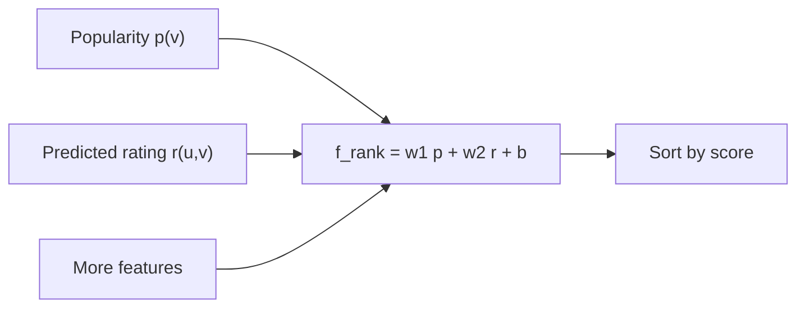
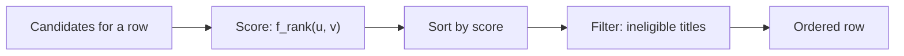

# Capstone #8: Personalized Feed Ranking — Netflix's Row Ranking

## At a glance

| Topic | Summary |
|---|---|
| Sources | Amatriain and Basilico, "Netflix Recommendations: Beyond the 5 Stars," Part 1 (April 6, 2012) and Part 2 (June 20, 2012), Netflix Tech Blog. Two company blog posts, not papers. |
| Problem | Order the titles in each row of a member's homepage so that the titles the member is most likely to play and enjoy come first, in real time. |
| Core idea | Rating prediction was a proxy. The ranking function combines predicted rating with popularity and other features, and is learned from historical positive and negative examples. |
| Objective | Maximize member satisfaction and month-to-month retention, which the posts say correlates well with consumption of video *(source-confirmed)*. |
| Scale in 2012 | More than 23 million subscribers in 47 countries; 2 billion hours streamed in the last quarter of 2011; 2 million queue adds and 4 million ratings a day; more than 5 billion ratings; 75% of what people watch comes from some sort of recommendation *(source-confirmed)*. |
| Evidence | The posts give the Netflix Prize error figures, one function form, and a bar chart without numbers or a stated metric. They report no ranking results as numbers. |
| Not published | Latency, request rate, catalog size, weights, the features that drove the large gain, and any serving architecture. Step 5 is this document's design. |
| First to break | Not compute. Scoring a row is cheap. The posts' own limits are data and evaluation: offline metrics only indicate online results, and tests have thousands of members. |
| Easy-to-miss traps | A model with a better RMSE can order titles worse. The bar chart does not say what it measures. The accepted prize ensemble was not what shipped. A play is not a person, since a household shares an account. |
| Practice PDFs | [Study edition](../../capstone-study-and-mock/netflix-feed-ranking/capstone8_netflix_feed_ranking_study.pdf) · [Mock interview](../../capstone-study-and-mock/netflix-feed-ranking/capstone8_netflix_feed_ranking_mock.pdf) |

Evidence labels used below: *(source-confirmed)* means the figure or claim is in one of the two posts. *(illustrative)* means it is this document's planning assumption or design. The posts' original addresses no longer resolve, so both were read from archived copies.

### Concepts this case study builds on

| Concept | Where it is taught | One-line recap |
|---|---|---|
| Two-stage retrieval then ranking | [Capstone #3](../video-recommendation/README.md) | Narrow a corpus cheaply, then rank a short list with richer features. |
| Pairwise learning to rank, NDCG | [Capstone #4](../airbnb-search-ranking/README.md) | A loss over pairs, weighted by the change in NDCG. |
| Offline evaluation | [Lesson 9, Concept 2](../../lessons/lesson-9-evaluation-and-observability.md#concept-2-offline-evaluation--golden-datasets-llm-as-judge-regression-suites) | Gate changes on a fixed measurement and know what it cannot show. |
| Ranking function | [Glossary](../../appendix/glossary.md) | A score built from several signals, not equal to any one. |

---

## Step 1: Clarify Requirements & Frame the ML/AI Objective

### The Prize and its proxy

In 2006 Netflix announced a competition: \$1 million to whoever improved the accuracy of its existing system, Cinematch, by 10%. Improving recommendations is hard to measure, so the posts say Netflix had to find a proxy question that was easier to evaluate: the root mean squared error (RMSE) of the predicted rating. The posts give the figures *(source-confirmed)*:

| Model | RMSE | Improvement over 0.9525 |
|---|---|---|
| Cinematch, the baseline | 0.9525 | none |
| Prize target | 0.8572 or less | 10% |
| SVD, matrix factorization, alone | 0.8914 | 6.4% |
| RBM, restricted Boltzmann machines, alone | 0.8990 | 5.6% |
| A linear blend of the two | 0.88 | 7.6% |

The first Progress Prize went a year in to the Korbell team with an 8.43% improvement, after more than 2,000 hours of work and a combination of 107 algorithms. The percentages in the table are arithmetic on the posts' figures.

### What shipped

Netflix put the two underlying algorithms, SVD and RBM, into production, where the post says they are still used as part of the recommendation engine. They first had to overcome two limits: the code was built to handle 100 million ratings, against the more than 5 billion Netflix has, and it was not built to adapt as members added more ratings. The \$1 million Grand Prize ensemble, which blended hundreds of models, was evaluated offline and not shipped, because the additional accuracy gains did not seem to justify the engineering effort. The post adds that Netflix's focus had by then shifted.

### Why the objective moved

The posts describe what changed with streaming (launched 2007):

- For DVDs, selection was distant in time from viewing, people chose carefully because an exchange took more than a day, and there was no feedback during viewing.
- For streaming, members want something great to watch right now, can sample several videos, can watch several in a session, and the service can observe whether a video was watched fully or partly.

Predicting a rating accurately is just one of many components. The posts also list context, title popularity, interest, evidence, novelty, diversity and freshness. Part 2 states the reformulated question: optimize the probability that a member chooses to watch a title and enjoys it enough to come back to the service.

### The business objective

The goal of ranking is the best possible ordering of items for a member, within a context, in real time. The business objective is to maximize member satisfaction and month-to-month retention, which correlates well with maximizing consumption of video. The algorithms therefore give the highest scores to titles a member is most likely to play and enjoy. The posts say 75% of what people watch is from some sort of recommendation, so ordering carries real weight.

### What a row is

Part 1 says each genre row has three layers of personalization: the choice of genre, the titles selected within it, and their ranking. Netflix measured an increase in retention by placing the most tailored rows higher on the page. The posts also say that Top 10 is meant for a household, with different tastes in it, so that Netflix optimizes for diversity as well as accuracy.

### Ground truth

The signal is behavioral: plays and how much was watched, queue adds, searches, and the presentations a member saw and how they interacted with them. A household can share an account, so one account's plays mix several people. Ratings are one input among several.

### Why predicted rating alone ranks badly

Part 2 says using predicted ratings on their own can lead to items that are too niche or unfamiliar being recommended, and can exclude items the member would want to watch even though they may not rate them highly.

### Out of scope

- The Prize-era rating models, treated as one input.
- Row and genre selection, a layer above the ranking of titles within a row.
- Explanations, diversity and freshness as separate systems. The posts name them without describing them.

### Trade-offs considered

Engagement and retention are noisier and slower than a rating, and only live tests measure them with confidence. A proxy such as RMSE is easy to optimize and can be improved without improving what members want to watch.

---

## Step 2: Back-of-Envelope Constraints

### What Part 1 states

More than 23 million subscribers in 47 countries. Those subscribers streamed 2 billion hours in the last quarter of 2011. Every day they add 2 million movies and TV shows to the queue and generate 4 million ratings. Netflix has more than 5 billion ratings. Part 2 adds that it receives several million stream plays each day and millions of search terms *(source-confirmed)*.

### Derived rates

```text
ratings a second  = 4,000,000 ÷ 86,400 = about 46
hours a day       = 2,000,000,000 ÷ 92 days = about 21.7 million
hours per subscriber a day = 21.7 million ÷ 23 million = about 0.95, or 57 minutes
ratings on file per subscriber = 5,000,000,000 ÷ 23,000,000 = about 217
```

The subscriber count is from April 2012 and the viewing total is for the previous quarter, so the 57 minutes is approximate.

### A check between two figures

Part 2 says "several million" stream plays a day. Total viewing is 21.7 million hours a day:

```text
21.7 million hours ÷ 3 million plays = 7.2 hours per play
21.7 million hours ÷ 9 million plays = 2.4 hours per play
```

Even at nine million plays a day, the average play is 2.4 hours, longer than most films. Either a play means a session of several titles, which the posts say members do, or "several million" is loose. The figures should not be combined without knowing the definition of a play.

### What the posts do not give

A catalog size, the number of rows on a homepage, or titles per row. Part 1 says genres are chosen "from the thousands possible". With assumed values *(illustrative)*:

```text
40 rows × 75 titles = 3,000 scores per homepage
23,000,000 subscribers × 1.5 homepage loads a day = 34.5 million loads
34.5 million ÷ 86,400 = about 400 loads a second, about 1,600 at an assumed peak of 4
1,600 × 3,000 = about 4.8 million scores a second at peak
```

Each score is a weighted sum of a few numbers, so the arithmetic is small. The load is in reading the signals: popularity for each title and the member's predicted rating for each title.

### Trade-offs considered

The two exact daily volumes in the posts make the rate figures reliable, and the homepage numbers are assumptions. Each is chosen to sit inside what the posts say and none is a measurement.

---

## Step 3: Data / Knowledge Pipeline

### The data sources

Part 2 lists them *(source-confirmed)*:

| Source | What the post says |
|---|---|
| Ratings | Several billion item ratings, millions of new ones a day |
| Popularity | Computed over time ranges such as hourly, daily or weekly, or within a group of members by region or another similarity measure |
| Stream plays | Several million a day, with context such as duration, time of day and device type |
| Queue adds | Millions of items a day |
| Metadata | Actors, director, genre, parental rating and reviews |
| Presentations | What was recommended and where it was shown, and the member's scrolls, mouse-overs, clicks or time on the page |
| Social data | What connected friends have watched or rated |
| Search terms | Millions a day |
| External data | Box office performance or critic reviews |

Other features include demographics, location, language and temporal data.

### Popularity as freshness

Computing popularity over several windows and within groups means a title trending now, in one region or cohort, shows up in that group's signal sooner than in one all-time number. The posts describe no similar mechanism for the predicted rating. Part 1 says the Prize algorithms were not built to adapt as members added more ratings, and that Netflix had to overcome that.

### Presentations

The presentations data lets Netflix see how a recommendation affected what a member did. The posts do not say how they correct for the position at which an item was shown. That is a risk to check, since a title shown first is clicked more for being first.

### Stale or wrong data

Neither post describes a correction mechanism. The one process they describe is the offline and online testing cycle in Step 6, which catches a bad change and not a slow decay.

### Trade-offs considered

Several popularity windows give freshness and local relevance at the cost of several computations. Implicit signals give far more volume than ratings and are noisier: a play shows a member started a title, not that they liked it.

---

## Step 4: Model/Agent Core Design

### From popularity to a ranking function

Part 2 starts from the obvious baseline: popularity. On average, a member is most likely to watch what most others are watching. But popularity is the opposite of personalization, since it produces the same ordering for every member. Predicted rating on its own risks niche and unfamiliar picks. The post wants rankings that balance both, and gives a simple scoring function as an illustration:

```text
f_rank(u, v) = w1 × p(v) + w2 × r(u, v) + b
```

Here u is the member, v the video, p the popularity and r the predicted rating. The bias b is constant and does not affect the final order. Items are passed through the function and sorted by descending score. The post says there are many ways to build one, from simple scoring to pairwise preferences to optimization over the whole ranking.



### Setting the weights

The post names two ways. One is to sample the weight space and let members decide through many A/B tests, which it calls time consuming and not very cost effective. The other is to formulate it as a machine learning problem: select positive and negative examples from historical data and let an algorithm learn the weights that optimize the goal. That family is learning to rank, central to search engines and ad targeting. The post adds a crucial difference for recommendations: there is no global notion of relevance, and the model has to be personalized.

### A worked example *(illustrative)*

Normalize both signals to a 0 to 5 scale, with w1 = 0.6 and w2 = 0.4. Title A is a niche documentary, with popularity 0.3 and a predicted rating of 4.5. Title B is a blockbuster, with popularity 4.6 and a predicted rating of 3.6.

```text
A = 0.6 × 0.3 + 0.4 × 4.5 = 0.18 + 1.80 = 1.98
B = 0.6 × 4.6 + 0.4 × 3.6 = 2.76 + 1.44 = 4.20          B ranks first
A ranks first only if w2 × 0.9 > w1 × 4.3, that is w2 ÷ w1 above 4.8
```

So the order flips on the weight ratio. The weights, and the scales of the signals, decide what the function is.

### The chart in Part 2

A bar chart titled "Ranking improvement over baseline" has popularity at zero, then "+ Ratings" at about one third (roughly 32% by reading the bar), then "+ More Features & Optimized Models" at about 225%. The post does not say what metric the chart measures, whether it is offline or online, or which features drove the larger gain. It says some features showed no positive effect while others improved ranking accuracy tremendously. The chart supports the direction and not a feature-by-feature account.

### Model families the post names

Logistic regression, support vector machines, neural networks and gradient boosted decision trees, which are classifiers that can be used for ranking. Methods designed for learning to rank, such as RankSVM and RankBoost. The post says there is no easy answer: the simpler the feature space, the simpler the model can be, and it is easy to get trapped where a new feature shows no value because the model cannot learn it, or where a powerful model looks useless because the features do not exploit it. Part 2 also lists methods a practitioner should know, from linear regression and elastic nets to SVD, RBMs, Markov chains, LDA, association rules, random forests and clustering.

### RMSE and ordering

RMSE is the square root of the mean of squared errors. It scores each prediction on its own and has no notion of order across titles. An invented example *(illustrative)*: titles A, B and C truly rate 4.5, 4.0 and 3.0.

| Model | Predictions for A, B, C | RMSE | Order |
|---|---|---|---|
| 1 | 4.0, 4.2, 3.1 | 0.32 | B, A, C (top two swapped) |
| 2 | 5.0, 3.5, 2.0 | 0.71 | A, B, C (correct) |

Model 1 has less than half the error and the wrong top pair. Model 2 has the larger error and the right order. This is the mechanical reason accuracy on ratings and quality of ranking are different targets.

### Trade-offs considered

A linear function is easy to debug and cannot express interactions, such as popularity mattering more for a new member. A stronger model can learn them if the features support it. Learning weights from history scales better than sequential tests and inherits whatever the earlier ranking did to the data.

---

## Step 5: Serving Architecture

### What the posts say

Only that ranking is decomposed into scoring, sorting and filtering sets of movies for presentation, in real time. They give no latency, no caching description and no candidate generation. The rest of this step is this document's design *(illustrative)*.

### A request path



```python
def rank_row(candidates, w1: float, w2: float, b: float, top_n: int) -> list[str]:
    scored = [(c, w1 * c["popularity"] + w2 * c["predicted_rating"] + b) for c in candidates]
    scored.sort(key=lambda pair: pair[1], reverse=True)
    kept = [c for c, _ in scored if not c["already_watched"] and not c["blocked"]]
    return [c["title_id"] for c in kept[:top_n]]
```

The filter's reasons, already watched and blocked, are examples. The posts do not say what is filtered.

### What can be cached

The predicted rating is specific to a member and a title, so the ordering is too, and it cannot be a global list. Popularity is shared and is computed on a window cadence, so it can be cached and read cheaply. A cached value is stale by up to the window, which trades some freshness for less work per request.

### Trade-offs considered

Scoring each row fresh keeps the order current and costs compute in proportion to rows and candidates, about 4.8 million scores a second at the assumed peak. Caching popularity saves most of the reads and misses a spike inside the window.

---

## Step 6: Evaluation, Monitoring and Iteration

### Offline metrics

Part 2 lists the offline metrics tracked *(source-confirmed)*: ranking measures such as normalized discounted cumulative gain, mean reciprocal rank and fraction of concordant pairs; classification metrics such as accuracy, precision, recall and F-score; RMSE; and other metrics for aspects such as diversity.

- NDCG is defined in the [Airbnb case study](../airbnb-search-ranking/README.md).
- Mean reciprocal rank (MRR) averages 1 divided by the rank of the correct item. Rank 1 gives 1.0 and rank 10 gives 0.1. For three requests with the right item at ranks 1, 3 and 10, MRR is (1 + 0.33 + 0.1) ÷ 3 = 0.48.
- Fraction of concordant pairs (FCP) is the share of pairs of items, one truly preferred over the other, that the model orders correctly.

### Why offline is only an indication

The post says Netflix keeps track of how well the offline metrics correlate with online gains in A/B tests, and that, since the mapping is not perfect, offline performance is used only as an indication to make informed decisions on follow-up tests.

### Online tests

The process is four steps: start with a hypothesis, design a test, execute it, and let the data speak. Many metrics are tracked, and Netflix ultimately trusts member engagement, such as hours of play, and retention. Tests usually have thousands of members and 2 to 20 cells, and scores of tests run in parallel *(source-confirmed)*.

Two things follow from those numbers *(illustrative arithmetic)*:

```text
retention near 90% with 5,000 members a cell: standard error = sqrt(0.9 × 0.1 ÷ 5,000) = 0.42%
95% margin on the difference between two cells = 1.96 × 0.42% × sqrt(2) = about 1.2 points
20 cells against one control at 5% each: chance of one false positive = 1 − 0.95^19 = 62%
```

A test of that size can see a retention change of more than a point or so, which is a large effect, so a continuous measure such as hours of play is more sensitive. The post does not describe how it corrects for many cells. A correction is needed.

### The Top10 Marathon

A focused 10-week effort to test dozens of ideas for the Top10 row. Six ideas were rolled out as A/B tests each week, with offline and online metrics tracked, and the winners are part of production. Six a week for ten weeks is about 60 tests.

### Failure modes

- A change that improves an offline metric and does not move engagement.
- A popularity feedback loop: popular titles are shown more, so they get more plays and score higher. The posts do not discuss this, and it is this document's inference.
- A model that lets predicted rating dominate again, bringing back niche picks.
- Position effects in the presentations data, which the posts do not address.

### What breaks first at 10×

| Quantity | At 10× | Reason |
|---|---|---|
| Scores a second | About 48 million | Rows, titles and homepage loads |
| Popularity computations | Scale with the number of windows and groups | One per title per group |
| Test power | Better with 10 times the members per cell | Standard error falls with the square root |
| Parallel tests | More false positives without a correction | Comparisons multiply |

### Trade-offs considered

A basket of offline metrics shows more kinds of regression and needs judgment about which one matters. Many parallel tests give fast iteration and need statistical discipline.

---

## Sources and Further Reading

- Amatriain and Basilico, "Netflix Recommendations: Beyond the 5 Stars, Part 1," Netflix Tech Blog, April 6, 2012. The source for the Prize figures, the 2012 scale figures, the shift to streaming and the business objective.
- Amatriain and Basilico, "Netflix Recommendations: Beyond the 5 Stars, Part 2," Netflix Tech Blog, June 20, 2012. The source for the ranking function, the data sources, the model families, the offline metrics, the A/B testing process and the Top10 Marathon.
- [Capstone #3](../video-recommendation/README.md), [capstone #4](../airbnb-search-ranking/README.md) and [capstone #6](../pymk-friend-recommendation/README.md): related ranking and feedback-loop cases.
- [Glossary](../../appendix/glossary.md): ranking function.

Labels: *(source-confirmed)* is in one of the two posts. *(illustrative)* is a planning assumption or design of this document.
