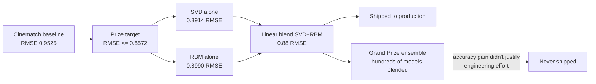
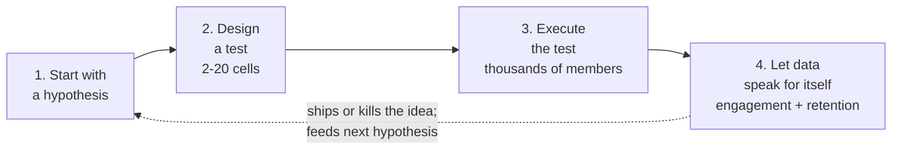

# Capstone #8: Personalized Feed Ranking — Netflix's Row Ranking

**Source(s):** Primary — Amatriain and Basilico (Netflix Personalization Science and Engineering), *"Netflix Recommendations: Beyond the 5 Stars, Part 1,"* Netflix Tech Blog, posted Friday, April 6, 2012; and *"Netflix Recommendations: Beyond the 5 Stars, Part 2,"* Netflix Tech Blog, posted Wednesday, June 20, 2012.

**Confidence:** Moderate-to-strong on text, with one honest limitation on scope and one explicit clarification of which error metric the posts actually name, both stated up front rather than papered over.

- **On access:** the original URLs (`techblog.netflix.com/2012/04/netflix-recommendations-beyond-5-stars.html` and the `/2012/06/` companion) no longer resolve live — Netflix's tech blog has moved at least twice since 2012, first to Blogspot-hosted `techblog.netflix.com`, then to Medium at `netflixtechblog.com`. The current `netflixtechblog.com` URLs for this same two-part post (`.../netflix-recommendations-beyond-the-5-stars-part-1-55838468f429` and `-part-2-d9b96aa399f5`) exist but returned HTTP 403 Forbidden to automated fetches during research for this document. Per this repo's standing rule to try the Wayback Machine before concluding a source is unreachable, both original Blogspot URLs were checked against `archive.org`'s availability API, which returned live, 200-status snapshots for both (`web.archive.org/web/20170430215314/.../2012/04/...` for Part 1, `web.archive.org/web/20170430194230/.../2012/06/...` for Part 2). Both snapshots were retrieved directly via `curl`, stripped of markup, and read in full — this document is written from that raw, character-checked text, not from secondhand summaries or the KDnuggets/other reprints that also exist. Every quoted sentence below was checked against that extracted text before being placed in quotation marks; a small number of sentences in the raw HTML contained stray whitespace artifacts from embedded hyperlinks (e.g. a space inserted before a comma where linked anchor text ended) — those specific sentences are paraphrased here instead of quoted, precisely because this document can't certify their exact character-level spacing, even though their wording is otherwise legible and unambiguous.
- **On the two embedded charts:** Part 2 includes two images — a bar chart titled "Ranking improvement over baseline" and a scatter diagram illustrating a two-dimensional popularity/rating ranking space. Both images still load from their original Blogspot-hosted URLs via the same Wayback Machine snapshot and were downloaded and viewed directly for this document (not described secondhand). The bar chart has no alt-text or caption with exact numbers, so the percentages reported in Step 4 below are this document's own **visual estimate** of where each bar's edge falls against the chart's own 0–250% axis gridlines — reported as approximate, not as Netflix's own stated figures (and more directly verified than a chain of secondary coverage of the same chart, e.g. an Engadget summary, would be).
- **On scope and genre:** this source is a **2012 company blog post, not a peer-reviewed paper or a systems paper** — it is strategic/product-framing writing aimed at a general technical audience, not an engineering-internals document like capstone #7's arXiv paper. It confirms the *problem framing* (ranking vs. rating-prediction), the *general shape* of the ranking function, the *data sources* that feed it, and the *evaluation discipline* (offline metrics, A/B testing) in real, specific, quotable detail — but it gives **no serving-infrastructure detail** at all: no latency numbers, no QPS figures, no caching-tier description, no model-versioning/rollout mechanics the way capstone #7's Uber paper or capstone #3's YouTube paper do. Step 5 (serving architecture) is flagged accordingly as this document's own constructed design, built on the post's own confirmed "scoring, sorting, and filtering" framing but not itself a Netflix-confirmed infrastructure diagram.
- **A clarification on terminology, stated explicitly:** this capstone's teaching point is sometimes paraphrased as "a system can nail **MAE** on ratings and still produce a bad row ordering." Having read both posts in full, **the metric the posts themselves actually name, repeatedly and specifically, is RMSE (root mean squared error), not MAE (mean absolute error)** — the Netflix Prize's own target metric, confirmed directly below in Step 1 (RMSE of 0.9525 → 0.8572). Both MAE and RMSE are defined in full below, per this repo's depth bar, but this document does not claim the posts themselves say "MAE" anywhere — that word is a common compressed paraphrase of "rating-prediction error metric," not a term either post uses. This distinction is flagged here rather than silently "corrected" by just swapping the word in, so the gap between that shorthand and the source's own vocabulary is visible rather than hidden.

**Scope note:** This capstone covers what the two posts themselves cover: the **ranking** problem specifically — producing the ordering of titles within a row, and, more broadly, the decision of what to optimize for in presenting a personalized set of titles to a member. It does **not** cover the Netflix Prize's own matrix-factorization/RBM rating-prediction models in architectural depth (SVD and RBM are named only as historical context for *why* the company moved past pure rating-prediction); it does not cover which rows get chosen or how many rows appear (the posts mention "genre" row selection and the Top10 row only as context for why ranking matters, not as a worked algorithm); and it does not cover recommendation diversity, freshness, or explanation-generation as their own systems, even though the posts name all three as factors — this document treats them as named factors in Step 1's objective, not as separately designed subsystems.

---

## Step 1: Clarify Requirements & Frame the ML/AI Objective

**Where this problem starts: the Netflix Prize's own framing, and why it was always a proxy.** In 2006 Netflix launched a public competition — $1 million to whoever improved the accuracy of its existing rating-prediction system, Cinematch, by 10%. Because "improve recommendations" isn't directly measurable, Netflix needed a narrower, quantifiable proxy: **root mean squared error (RMSE)** of predicted star ratings — "the race was on to beat our RMSE of 0.9525 with the finish line of reducing it to 0.8572 or less" **(Part 1)**.

The RMSE progression the competition actually produced, confirmed directly **(Part 1)**:
- **Baseline to beat:** RMSE 0.9525, target 0.8572 or less.
- **SVD (Matrix Factorization) alone:** 0.8914 RMSE.
- **RBM (Restricted Boltzmann Machines) alone:** 0.8990 RMSE — "competitive but slightly worse" than SVD.
- **Linear blend of SVD + RBM:** 0.88 RMSE — this combined pair is what Netflix actually put into production.
- **$1M Grand Prize ensemble** ("blending hundreds of predictive models"): evaluated but **never shipped** — "the additional accuracy gains that we measured did not seem to justify the engineering effort needed to bring them into a production environment" **(Part 1)**, an explicit instance of an accuracy win not justifying its engineering cost.



**The actual objective — stated directly, and it is not "predict the rating accurately."** Both posts are explicit that rating-prediction accuracy was only ever one ingredient, not the goal. Part 1 states it plainly: "accurate prediction of a movie's rating is just one of the many components of an effective recommendation system that optimizes our members enjoyment. We also need to take into account factors such as context, title popularity, interest, evidence, novelty, diversity, and freshness" **(Part 1)**.

The posts name the real objective in two complementary ways:
- **Operationally, for the ranking system specifically:** "Our business objective is to maximize member satisfaction and month-to-month subscription retention, which correlates well with maximizing consumption of video content. We therefore optimize our algorithms to give the highest scores to titles that a member is most likely to play and enjoy" **(Part 1)**.
- **As the post's own summary of how the company's thinking evolved past the Prize:** "The Netflix Prize abstracted the recommendation problem to a proxy question of predicting ratings. But member ratings are only one of the many data sources we have and rating predictions are only part of our solution. Over time we have reformulated the recommendation problem to the question of optimizing the probability a member chooses to watch a title and enjoys it enough to come back to the service" **(Part 2)**.

**This is the capstone's central teaching point, in the source's own words**: the objective is not "minimize the error of a 5-star rating prediction," it's "maximize the chance a member plays a title and is satisfied enough to keep subscribing" — a genuinely different optimization target that a model could, in principle, nail on the first metric while failing badly on the second.

**What counts as ground truth / feedback signal.** Unlike the Netflix Prize's explicit 5-star ratings (a label a member has to deliberately provide), the broader ranking objective's real feedback signal is **behavioral**: what a member actually plays, how much of it they watch, whether they return to the service. The posts describe several concrete behavioral data sources that stand in for this (Step 3 covers them in full): stream plays, queue adds, search terms, and "presentations" — logged impressions plus how a member interacted with them (scrolls, mouse-overs, clicks, time spent) **(Part 2)**. Explicit ratings remain one input (`r(u,v)` in Step 4's formula) but aren't the optimization target — just one feature feeding a ranking function aimed at engagement and retention.

**Why rating prediction alone produces a bad ranking — the post's own stated failure mode.** Part 2 names the specific risk directly: "Using predicted ratings on their own as a ranking function can lead to items that are too niche or unfamiliar being recommended, and can exclude items that the member would want to watch even though they may not rate them highly" **(Part 2)**. A ranking system that sorts purely by predicted rating optimizes for the wrong proxy, in exactly the sense Step 1's framing above sets up — Step 4 below works this out numerically, with a documentary/blockbuster example showing a lower-rated title outranking a higher-rated one.

**Explicitly out of scope:**
- The Netflix Prize-era rating-prediction models (SVD/RBM) themselves, treated here as one input signal (`r(u,v)`) to the ranking function rather than the system this capstone is about.
- Row/genre *selection* (which rows appear on a given member's homepage, and in what order) — the posts describe this as a separate layer of personalization above ranking, not the ranking problem itself.
- The recommendation-explanation and diversity/freshness mechanisms the posts name as factors but don't describe as separate worked systems.

**Trade-offs considered:** Framing the objective as "maximize engagement/retention" rather than "minimize rating-prediction error" is strictly harder to optimize directly — engagement and retention are noisier, slower-arriving, more confounded signals than a clean numeric rating label, and (per Step 6) can only really be measured with confidence through live A/B testing rather than a clean offline metric. But optimizing the easier, cleaner proxy (RMSE on ratings) risks exactly the failure mode named above: a model can get RMSE arbitrarily close to its theoretical floor and still recommend titles members don't actually want to watch tonight. Retaining predicted rating as one input to a broader ranking function (rather than discarding the Netflix Prize-era work entirely) preserves the real investment already made in that signal — SVD and RBM "are still used as part of our recommendation engine" **(Part 1)**, years after the Prize ended — while not letting that signal alone drive the final ordering.

---

## Step 2: Back-of-Envelope Constraints

**Confirmed scale, directly from Part 1 (as of its April 2012 publication date).** "Today, Netflix has more than 23 million subscribers in 47 countries. Those subscribers streamed 2 billion hours from hundreds of different devices in the last quarter of 2011. Every day they add 2 million movies and TV shows to the queue and generate 4 million ratings" **(Part 1)**. Separately, Part 1 notes the ratings corpus had outgrown the Prize-winning algorithms: "they were built to handle 100 million ratings, instead of the more than 5 billion that we have" **(Part 1)** — i.e., over 5 billion ratings on file as of 2012. Part 2 adds daily-volume figures for several other signal types: "we receive several million stream plays each day," "our members add millions of items to their queues each day" (consistent with Part 1's 2-million figure), and "our members directly enter millions of search terms in the Netflix service each day" **(Part 2)**.

**A real, derived calculation: average ratings-ingestion rate.** Taking Part 1's confirmed 4 million ratings/day figure:

```
ratings_per_second = 4,000,000 ratings/day ÷ 86,400 seconds/day
                   ≈ 46.3 ratings/sec, averaged across the day
```

This is a modest write rate by modern standards, but it's a real, source-derived number (not illustrative) — unlike capstones #7 and #3, this post gives exact daily totals, so no illustrative scale anchor is needed here.

**A second real, derived calculation: average daily viewing hours per subscriber.** Taking Part 1's confirmed "2 billion hours" streamed in "the last quarter of 2011" (a quarter = roughly 92 days, Oct–Dec) against the "more than 23 million subscribers" figure (both confirmed, though not necessarily measured at exactly the same moment — the subscriber count is as of the April 2012 post date, the streaming total is for the prior quarter, a looseness this document flags rather than treats as exact):

```
daily_streamed_hours = 2,000,000,000 hours ÷ 92 days
                      ≈ 21,739,130 hours/day, platform-wide

hours_per_subscriber_per_day ≈ 21,739,130 ÷ 23,000,000
                              ≈ 0.95 hours/subscriber/day
                              ≈ 57 minutes/subscriber/day, averaged across all subscribers
```

**~57 minutes of average daily viewing per subscriber** is this document's own derived figure from two separately-confirmed numbers — not one Netflix states directly — included as a concrete version of what Step 1's "maximize consumption" objective is actually trying to move: watched-hours, not a rating-prediction error metric.

**What the posts do not give a number for — flagged honestly, then filled illustratively.** Neither post states an exact title-catalog size, an exact count of rows shown per homepage, or an exact number of titles shown per row. The only directly relevant quantitative hint is Part 1's mention of selecting "what genres to show from the thousands possible" **(Part 1)** — confirming there are, at minimum, thousands of *possible* genre-based rows, though not how many actually render on one member's homepage. The figures below are this document's own illustrative construction, clearly kept separate from the confirmed figures above, in the same spirit as capstone #3's and #7's illustrative scale anchors:

```
catalog_size (illustrative)        ≈ 10,000 titles
rows_per_homepage (illustrative)   ≈ 40 rows      (a small slice of "thousands possible")
titles_per_row (illustrative)      ≈ 75 titles    (most never scrolled to; a handful shown "above the fold")

scores_computed_per_homepage_load (illustrative) = 40 rows × 75 titles/row
                                                  = 3,000 ranking-function evaluations per homepage render
```

Each of those 3,000 evaluations, per Step 4 below, is a cheap weighted combination of a handful of features (not a full neural-network forward pass) — which is why this scale is survivable in real time, the same way capstone #7's Uber model stays within its latency budget because most of its cost sits in cheap embedding-table lookups rather than dense compute.

**An illustrative homepage-load QPS estimate**, anchored to the confirmed 23-million-subscriber figure, assuming an illustrative 1.5 homepage loads/subscriber/day (not stated by either post):

```
daily_homepage_loads (illustrative) = 23,000,000 subscribers × 1.5 loads/day
                                     ≈ 34,500,000 loads/day

average_qps (illustrative) = 34,500,000 ÷ 86,400 seconds/day
                            ≈ 399 requests/sec, averaged across the day

peak_qps (illustrative, 4x peak-to-average ratio,
          consistent with capstone #7's own illustrative ratio
          for similarly evening/prime-time-concentrated demand)
          ≈ 399 × 4 ≈ 1,596 requests/sec at peak
```

**Trade-offs considered:** Leaning on the post's own two exact daily-volume figures (4 million ratings/day, 2 billion hours/quarter) for the two real calculations above, rather than inventing illustrative anchors for everything, keeps this section's arithmetic honest about what's actually confirmed — but it does mean this capstone's QPS/scoring-load figures (catalog size, rows/homepage, titles/row, homepage-load rate) lean more heavily on illustrative construction than, say, capstone #1's Pinterest capstone, whose source paper states an exact "over 600 million visual searches per month" figure directly. Treating "thousands of possible genre rows" as a floor on catalog diversity rather than inventing a precise catalog-size figure from nothing keeps the illustrative rows_per_homepage/titles_per_row figures tethered to at least one real data point, at the cost of a wider plausible range than a fully paper-confirmed figure would have.

---

## Step 3: Data / Knowledge Pipeline

**The confirmed, named data sources feeding ranking (Part 2's own list, "Data and Models" section).** Part 2 lays out, as a direct enumerated list, what feeds Netflix's recommendation models **(Part 2)**:

- **Ratings** — "several billion item ratings from members," receiving "millions of new ratings a day."
- **Item popularity** — computed multiple ways: "over various time ranges, for instance hourly, daily, or weekly," and also by grouping "members by region or other similarity metrics."
- **Stream plays** — "several million" per day, which "include context such as duration, time of day and device type."
- **Queue adds** — "millions of items" per day.
- **Catalog metadata** — "actors, director, genre, parental rating, and reviews."
- **Presentations** — "what items we have recommended and where we have shown them," plus logged interactions on those impressions ("scrolls, mouse-overs, clicks, or the time spent on a given page").
- **Social data** — "what connected friends have watched or rated."
- **Search terms** — "millions of search terms" entered per day.
- **External data** — "box office performance or critic reviews," sourced outside Netflix's own product.

Part 2 also names a longer tail of contextual features used in modeling more broadly: "demographics, location, language, or temporal data" **(Part 2)**.

**Why popularity is computed multiple ways rather than as one fixed number — the post's own stated freshness mechanism.** Unlike a single static popularity score, Part 2 is explicit that popularity is computed "over various time ranges, for instance hourly, daily, or weekly" and segmented "by region or other similarity metrics" **(Part 2)** — meaning a title's popularity signal can reflect what's trending *right now*, in a specific region or similarity cohort, rather than only a slow-moving all-time average. This is the post's own closest equivalent to an explicit freshness mechanism, though it describes no analogous correction for the predicted-rating signal itself — unlike capstone #3's YouTube paper, which names a specific "example age" feature for exactly this purpose (a different source, not claimed here as something this post also describes).

**What happens when the data is wrong or stale — an honest gap, not papered over.** Neither post describes a correction mechanism for stale or wrong data the way capstone #3's YouTube paper (recency-bias correction via "example age") or capstone #7's Uber paper (weekly retraining, monitored drift) do, and this document does not invent one. The one general mechanism the posts do confirm — the offline/online testing cycle covered in Step 6 — is their implicit answer: a change that looks good offline but fails a live A/B test gets caught before full rollout rather than silently shipped and left to decay. That mechanism catches *any* bad change, data-driven or otherwise — broader than a data-staleness fix specifically, but the honest answer the source actually gives.

**Trade-offs considered:** Computing popularity across multiple time windows and multiple member segments (rather than one single global number) buys real freshness and local relevance — a title trending this week in one region shows up in that region's ranking signal faster than a single all-time global popularity score could reflect it — at the cost of maintaining several parallel popularity computations instead of one. Relying on implicit behavioral signals (stream plays, queue adds, presentations) as the bulk of the ranking-relevant data, rather than only explicit ratings, buys the same "vastly more volume, deep into the catalog's long tail" advantage capstone #3's YouTube paper names for implicit watch signals over explicit ratings — at the cost of every one of those signals being a *noisier*, more confounded proxy for genuine satisfaction than an explicit rating is (a stream play doesn't confirm the member liked what they watched, only that they started it).

---

## Step 4: Model/Agent Core Design

This is this capstone's central teaching point, in the source's own structure: **ranking is a distinct modeling problem from rating prediction**, solved with its own function that combines rating prediction as just one input among several.

**The starting point: a ranking function as a linear combination of two signals.** Part 2 opens with the simplest possible baseline and its problem: "If you are looking for a ranking function that optimizes consumption, an obvious baseline is item popularity. The reason is clear: on average, a member is most likely to watch what most others are watching. However, popularity is the opposite of personalization: it will produce the same ordering of items for every member. Thus, the goal becomes to find a personalized ranking function that is better than item popularity" **(Part 2)**. Part 2's fix: combine popularity with the member's own predicted rating, rather than using either alone — "rather than using either popularity or predicted rating on their own, we would like to produce rankings that balance both of these aspects" **(Part 2)**. The resulting function, in the post's own notation (reproduced here with standard subscript notation rather than the raw-text spacing artifacts the original HTML's subscript/italic formatting left behind when stripped to plain text):

```
f_rank(u, v) = w1 · p(v) + w2 · r(u, v) + b
```

where `u` = user (member), `v` = video item (title), `p(v)` = the title's popularity score, `r(u, v)` = the member's predicted rating for that title, and `w1`, `w2`, `b` are learned weights and a bias term **(Part 2)**. The post is explicit that the bias term `b` is a constant that "ends up not affecting the final ordering" once titles are sorted by score — it shifts every title's score equally, so it can't change their relative rank.

```mermaid
flowchart LR
    POP["Popularity p(v)\n(hourly/daily/weekly windows,\nregion/similarity segments)"] --> COMB
    RAT["Predicted rating r(u,v)\nSVD/RBM-era signal"] --> COMB
    MORE["More features\n(\"some help, some don't\")"] --> COMB
    COMB["Learning to rank\n(learn w1, w2, ... from\nhistorical positive/negative examples)"] --> FRANK["f_rank(u,v) = w1*p(v) + w2*r(u,v) + b"]
    FRANK --> SORTSTEP["Sort titles by score\n(per-member, per-row)"]
```

### Sidebar — Ranking function (a weighted, multi-signal score, as distinct from a single pointwise prediction)

*(First appearance in this repo of this specific concept — this is a recommendation-ranking-specific modeling pattern, not core infra, and has no existing Lesson 1–6 home. It is related to, but distinct from, two already-glossaried concepts from earlier capstones in this repo: capstone #3's two-stage retrieval-then-rank architecture, which is about funnel *stages* narrowing a huge corpus down in two passes, not about how a single stage's score is computed; and capstone #4's LambdaRank/pairwise learning-to-rank, which is about the *training loss* used to fit a ranking model's weights, not about what inputs that model combines. This Sidebar names the piece neither of those already covers: the ranking function itself, as a score built by combining several distinct signals rather than being equal to any one of them.)*

- **Why?** A single predicted value — a rating, a click probability, a popularity count — captures only one slice of what makes a recommendation good. Sorting purely by predicted rating risks Step 1's named failure (niche, unfamiliar picks); sorting purely by popularity discards personalization entirely, since it "will produce the same ordering of items for every member" **(Part 2)**. A ranking function combines several such signals into one sortable score, so none carries the whole burden alone.
- **What?** A **ranking function** is a scoring function that takes a user and an item (and whatever other contextual signals are available) and returns a single real-valued score, combining several input signals rather than being identical to any one of them. Part 2's own starting point is the simplest version — a **linear combination** (weighted sum plus bias, as above) — but the post is explicit this is only illustrative, not the full production system: "There are many ways one could construct a ranking function ranging from simple scoring methods, to pairwise preferences, to optimization over the entire ranking" **(Part 2)**, and separately: "apart from popularity and rating prediction, we have tried many other features at Netflix. Some have shown no positive effect while others have improved our ranking accuracy tremendously" **(Part 2)**.
- **How?** The weights (`w1`, `w2`, and however many more features get added) aren't picked by hand. Part 2 names two approaches directly, and prefers the second: "You could sample the space of possible weights and let the members decide what makes sense after many A/B tests. This procedure might be time consuming and not very cost effective. Another possible answer involves formulating this as a machine learning problem: select positive and negative examples from your historical data and let a machine learning algorithm learn the weights that optimize your goal" **(Part 2)**. This family of techniques is named directly: "**Learning to rank**" — a machine-learning subfield, defined here since the post names it without explaining it, in which a model is trained not to predict a single absolute value, but to produce a *relative ordering* as close as possible to the correct one, typically via labeled or inferred preference pairs rather than single independent data points. The post draws out one contrast worth keeping: "a crucial difference in the case of ranked recommendations is the importance of personalization: we do not expect a **global notion of relevance**, but rather look for ways of optimizing a personalized model" **(Part 2)** — unlike a search engine or ad-ranking system (also classic learning-to-rank applications), where a document or ad is more or less relevant to a query independent of who's asking, Netflix's function must produce a *different* correct ordering per member, because the optimized target (predicted enjoyment) is itself member-specific, not query-specific.

**A worked, illustrative numeric example: how a lower-rated title can out-rank a higher-rated one.** Netflix's own posts don't give a fully worked numeric example — this is this document's own construction, built on the `f_rank` formula above, to make the central teaching point concrete: two titles whose relative rank *flips* once popularity is added, even though one has a clearly higher predicted rating.

```
# Illustrative weights and scores -- not Netflix's own published values.
# p(v) and r(u,v) both normalized to a 0-5 scale for comparability.

w1, w2, b = 0.6, 0.4, 0.0   # illustrative: popularity weighted slightly
                            # more heavily than predicted rating

# Title A: a niche prestige documentary this member would likely rate highly,
#          but that almost nobody else on the platform watches.
p_A, r_A = 0.3, 4.5         # low popularity, high predicted rating

# Title B: a broadly popular blockbuster this member would rate only
#          moderately, but that performs well across the whole member base.
p_B, r_B = 4.6, 3.6         # high popularity, more moderate predicted rating

f_rank_A = w1 * p_A + w2 * r_A   # 0.6*0.3 + 0.4*4.5 = 0.18 + 1.80 = 1.98
f_rank_B = w1 * p_B + w2 * r_B   # 0.6*4.6 + 0.4*3.6 = 2.76 + 1.44 = 4.20

# Despite A's predicted rating (4.5) being noticeably higher than B's (3.6),
# B's combined score (4.20) beats A's (1.98) -- B ranks higher in the row,
# precisely the "balance both aspects" behavior Part 2 describes, and
# precisely why sorting by r(u,v) alone would have put A on top instead.
```

This illustrative flip is the numeric version of Part 2's own scatter diagram (the "Two-dimensional ranking" chart, viewed via the Wayback Machine snapshot): it plots titles by predicted rating on one axis and popularity on the other, with a diagonal "Score" arrow and five titles numbered 1–5 along it in final-rank order — the same point made arithmetically above: position on either axis alone doesn't determine rank, only position relative to the combined-score line does.

**The real, confirmed result: adding features and optimizing the model measurably beats popularity and rating alone.** Part 2 includes a bar chart, titled "Ranking improvement over baseline," comparing three configurations against a popularity-only baseline (0% improvement, by construction): "+ Ratings" and "+ More Features & Optimized Models." Viewed directly from the Wayback Machine snapshot (no alt-text/caption gives exact numbers, so these are this document's own visual estimate against the chart's labeled 0–250% gridlines): the "+ Ratings" bar reaches roughly **35%** improvement over the popularity baseline, and the "+ More Features & Optimized Models" bar reaches roughly **225%** improvement over the same baseline — a visibly much larger jump from adding further features and tuning the model than from adding predicted rating alone. The post doesn't name which features drove that larger jump (beyond "some have shown no positive effect while others have improved our ranking accuracy tremendously"), so this document reports only the chart's shape and rough magnitude, not a feature-by-feature breakdown the source doesn't give.

**Candidate model families named directly (Part 2):**
- **General supervised classification methods repurposed for ranking** — "Logistic Regression, Support Vector Machines, Neural Networks, or Decision Tree-based methods such as Gradient Boosted Decision Trees (**GBDT**)" — GBDT already defined in full in this repo's capstone #4, `case-studies/airbnb-search-ranking/README.md` — linked here rather than re-derived.
- **Algorithms purpose-built for learning to rank** — "a great number of algorithms specifically designed for learning to rank have appeared in recent years such as **RankSVM** or **RankBoost**" **(Part 2)**.

The post is explicit there's no universal answer: "There is no easy answer to choose which model will perform best in a given ranking problem. The simpler your feature space is, the simpler your model can be. But it is easy to get trapped in a situation where a new feature does not show value because the model cannot learn it. Or, the other way around, to conclude that a more powerful model is not useful simply because you don't have the feature space that exploits its benefits" **(Part 2)** — confirming model capacity and feature richness must be chosen jointly, not independently.

**MAE and RMSE, defined in full (standard regression-error metrics, not themselves a glossary-worthy new concept — same treatment this repo's capstone #2 gives AUC/LogLoss).** **MAE (mean absolute error)** is the average of the absolute differences between predicted and actual values across all predictions: `MAE = (1/n) · Σ|predicted_i − actual_i|`, treating every unit of error the same regardless of direction or magnitude. **RMSE (root mean squared error)** is the square root of the average of the *squared* differences: `RMSE = √((1/n) · Σ(predicted_i − actual_i)²)` — squaring first means larger individual errors are penalized disproportionately more than smaller ones (an error of 2 contributes 4 to the pre-root sum, not 2), so RMSE is more sensitive to occasional large misses than MAE is. Both are **pointwise prediction-accuracy metrics**: they score how close a single predicted rating is to a single actual rating, independent of any other title. Neither metric has any notion of *order* across multiple titles at all — a model could have a worse RMSE than another model while still producing a better final row ordering, and vice versa, because RMSE never looks at relative positions, only absolute per-prediction error. This is the precise, mechanical reason Step 1's central claim holds: nailing the rating-prediction metric and nailing the ranking are genuinely different optimization targets, not just different names for the same thing.

**Trade-offs considered:** A simple linear ranking function (the illustrative `w1·p(v) + w2·r(u,v) + b` starting point) is easy to reason about, fast to score, and easy to debug when a ranking looks wrong — but it can only capture additive relationships between signals; it has no way to express, for instance, "popularity should matter more for new members with thin rating histories, and less for members with years of ratings behind them" without an explicit interaction feature built for that purpose. A more powerful model family (GBDT, a neural ranker, a dedicated learning-to-rank algorithm like RankSVM/RankBoost) can learn such interactions automatically, at the direct cost the post itself names: a more powerful model is only useful if the feature space actually exploits its added capacity, and a richer feature space is only useful if the model is powerful enough to learn from it — mismatching the two wastes the investment in whichever side was upgraded alone. Learning the weights from historical positive/negative examples (the ML approach) scales far better than manually sampling the weight space via sequential A/B tests, but it inherits whatever bias already exists in that historical data (Step 3's "what happens when the data is wrong" discussion) — a historical record generated under one ranking function's own past decisions, used to train the next one, is not a fully independent signal the way a from-scratch randomized experiment would be.

---

## Step 5: Serving Architecture

**What the posts themselves confirm about serving — a real but general framing, not an infrastructure diagram.** Part 1 states the serving-time requirement directly: "The goal of our ranking system is to find the best possible ordering of a set of items for a member, within a specific context, in real-time. We decompose ranking into scoring, sorting, and filtering sets of movies for presentation to a member" **(Part 1)** — **scoring, sorting, and filtering**, the three operations ranking decomposes into. Neither post goes further into infrastructure specifics (no latency SLA, no caching-layer description, no candidate-generation detail) — per the Confidence note above, this section is this document's own constructed elaboration of that framing, not a Netflix-confirmed architecture.

**An illustrative, constructed request path, built directly on the post's own scoring/sorting/filtering framing.** For one row on one member's homepage, at the moment that row needs to render:

1. **Candidate set** — titles for the row are assembled (e.g. "Dramas," narrowed to that genre) — analogous in shape, though not confirmed as the same mechanism, to capstone #3's YouTube candidate-generation stage.
2. **Scoring** — Step 4's `f_rank(u, v)` is evaluated once per candidate, using the member's predicted rating, the current popularity signal (per Step 3's multi-window mechanism), and whatever other features the live model uses.
3. **Sorting** — candidates are ordered by descending score.
4. **Filtering** — titles already watched (or already queued, depending on the row's purpose), parental-control-excluded, or otherwise ineligible for this row are removed before the list is returned.

This four-step shape is this document's own construction; only the overall "scoring, sorting, and filtering" framing itself, and the real-time requirement, are source-confirmed. The diagram below mirrors it directly.

```mermaid
flowchart LR
    C["Candidate set\ne.g. \"Dramas\" row"] --> S["Scoring\nf_rank(u,v) = w1*p(v) + w2*r(u,v) + b"]
    S --> SO["Sorting\ndescending score"]
    SO --> F["Filtering\nwatched / queued / parental-control"]
    F --> OUT["Final ordered row"]
```

**An illustrative request-path function, built directly on Step 4's own `f_rank(u,v) = w1·p(v) + w2·r(u,v) + b` formula** — this document's own construction, not Netflix's published serving code (which isn't public), but a concrete rendering of the scoring/sorting/filtering sequence above, using exactly the signal names Step 3 and Step 4 already established (`p(v)` = popularity, `r(u, v)` = predicted rating, `w1`/`w2`/`b` = the same learned weights and bias term):

```python
from dataclasses import dataclass


@dataclass
class CandidateTitle:
    """One candidate title for a single row -- illustrative fields only,
    named after exactly the signals Step 3 ("Data and Models") and Step 4
    already confirmed feed the ranking function: popularity p(v) and
    predicted rating r(u, v)."""
    title_id: str
    popularity: float          # p(v), Step 3's multi-window popularity signal
    predicted_rating: float     # r(u, v), the SVD/RBM-era signal (Step 1)
    already_watched: bool
    excluded_by_parental_control: bool


def rank_row(member_id: str, candidates: list[CandidateTitle],
             w1: float, w2: float, b: float, top_n: int) -> list[str]:
    """Illustrative serving-time rendering of Part 1's own "scoring,
    sorting, and filtering" framing for one row on one member's homepage.
    Not Netflix's own published code -- a constructed illustration of the
    three-operation sequence the post names, built directly on Step 4's
    f_rank(u, v) = w1*p(v) + w2*r(u, v) + b formula."""
    # 1. Scoring: evaluate f_rank(u, v) once per candidate in this row.
    scored = [
        (c, w1 * c.popularity + w2 * c.predicted_rating + b)
        for c in candidates
    ]

    # 2. Sorting: order candidates by descending score.
    scored.sort(key=lambda pair: pair[1], reverse=True)

    # 3. Filtering: drop titles already watched or parental-control-excluded.
    filtered = [
        c for c, _score in scored
        if not c.already_watched and not c.excluded_by_parental_control
    ]

    return [c.title_id for c in filtered[:top_n]]
```

**Why per-row, per-member computation is the only option, given the objective from Step 1.** Because the ranking function's whole point (Step 4's popularity-vs-personalization framing) is to produce a *different* ordering per member, this step can't be precomputed and cached globally the way a "most popular this week" list could — `r(u, v)` is member-specific by construction, so the output is too, and must be computed (or refreshed) close to render time, per member, per row. What *can* be cached, consistent with Step 3's fixed-window popularity computation (hourly/daily/weekly) rather than live per-request, is `p(v)` itself — refreshed only on the windowed cadence, then read cheaply at scoring time.

**Trade-offs considered:** Scoring every row freshly per request (rather than precomputing and caching full rows per member ahead of time) guarantees the ordering reflects the freshest available signals — the latest popularity window, the latest ratings, the latest viewing history — at the cost of real per-request compute that scales with the number of candidates per row and the number of rows per homepage (Step 2's illustrative ~3,000-evaluation figure). Precomputing and caching popularity signals on a fixed refresh cadence (rather than recomputing them live on every request) trades away some freshness — a title that goes viral in the hour since the last popularity refresh won't show that spike yet — for a large reduction in per-request compute, since popularity doesn't change meaningfully within the gap between refreshes the way a member's own predicted-rating inputs could, request to request, as they watch more titles in the same session.

---

## Step 6: Evaluation, Monitoring, and Iteration

**Offline metrics the post names directly — and they're explicitly broader than just RMSE.** Part 2 lists the metrics tracked before anything goes live: "from ranking measures such as normalized discounted cumulative gain, mean reciprocal rank, or fraction of concordant pairs, to classification metrics such as accuracy, precision, recall, or F-score. We also use the famous RMSE from the Netflix Prize or other more exotic metrics to track different aspects like diversity" **(Part 2)**. That's three groups of offline metrics tracked side by side:
- **Ranking measures** — NDCG, MRR, FCP.
- **Classification metrics** — accuracy, precision, recall, F-score.
- **Rating-prediction and other metrics** — RMSE, plus "more exotic metrics" for diversity.

**Normalized Discounted Cumulative Gain (NDCG)** is already defined in full in this repo's capstone #4, `case-studies/airbnb-search-ranking/README.md` glossary entry — linked here rather than re-derived, since it's the same metric, not a new one. Two new ranking-specific metrics the post names that haven't appeared elsewhere in this repo, defined in full on first use here (following the same precedent capstone #2 set for AUC/LogLoss — standard evaluation-metric vocabulary, defined inline rather than promoted to a Sidebar/glossary entry, since neither is itself a novel AI-native architectural concept):
- **Mean reciprocal rank (MRR)** — for a set of queries (or, here, ranking requests) each with one known "correct" or target item, MRR is the average, across all of them, of `1 / rank`, where `rank` is the position of the correct item in the returned ordered list (rank 1 = top of the list, contributing a full 1.0; rank 10 contributes only 0.1). It rewards getting the single right answer near the top of the list specifically, and penalizes it heavily the further down that one answer falls.
- **Fraction of concordant pairs (FCP)** — the fraction of all pairwise comparisons between a higher-truly-preferred item and a lower-truly-preferred item that the model's own ordering gets in the correct relative order (the higher-preferred item ranked above the lower-preferred one). A pair where the model's ordering agrees with the true preference order is "concordant"; one where it disagrees is "discordant." FCP is the concordant fraction across every such pair in the evaluation set — a metric that, unlike RMSE, directly measures ordering correctness rather than per-item prediction error.

**The explicit, honest limit of offline metrics — the post's own stated reason online A/B testing is still required.** Part 2 states this directly, and it's the capstone's evaluation-side version of Step 1's central claim: "We keep track of how well those metrics correlate to measurable online gains in our A/B tests. However, since the mapping is not perfect, offline performance is used only as an indication to make informed decisions on follow up tests" **(Part 2)**. An improvement on any offline metric — including RMSE, including NDCG — is treated as a *hypothesis* about what might work live, never as proof by itself.

**The online evaluation process — Consumer (Data) Science, the post's own name for it.** The post describes a four-step cycle: "1. Start with a hypothesis ... 2. Design a test ... 3. Execute the test ... 4. Let data speak for itself" **(Part 2)**. Scale: "Tests usually have thousands of members and anywhere from 2 to 20 cells exploring variations of a base idea. We typically have scores of A/B tests running in parallel" **(Part 2)**. The metrics ultimately trusted to make a ship/no-ship decision: "we ultimately trust member engagement (e.g. hours of play) and retention" **(Part 2)** — directly matching Step 1's stated business objective, and notably *not* an offline rating-prediction metric.



**A real, named example of this process at scale: the Top10 Marathon.** Part 2 describes "a focused, 10-week effort to quickly test dozens of algorithmic ideas related to improving our Top10 row... Think of it as a 2-month hackathon with metrics... We rolled out 6 different ideas as A/B tests each week and kept track of the offline and online metrics. The winning results are already part of our production system" **(Part 2)** — a confirmed instance of the offline-then-online pipeline above, run at a high iteration rate (6 ideas/week) rather than one change at a time.

**The feedback loop back into Step 3.** Every stream play, queue add, rating, search, and logged "presentation" interaction becomes new input for the next round of feature/model development — the same "behavioral data arrives as a byproduct of product usage" pattern named in earlier capstones (e.g. capstone #2's click labels, capstone #3's watch-completion labels), feeding both the ranking function's features (Step 3) and the offline metrics that screen the next A/B test.

**Failure modes.**
1. **The confirmed offline/online mapping gap itself** — Part 2's own stated reason offline metrics "are used only as an indication," not a guarantee: a model could post a genuine RMSE or NDCG improvement offline and still fail to move member engagement online, for reasons the offline metric structurally can't see (a change that looks like a better ranking on held-out historical data might not reflect how members actually respond to a changed homepage in the moment).
2. **A popularity-reinforcement risk** — **this document's own inference, not a claim either post makes**: because the ranking function (Step 4) includes popularity as a weighted input, and popularity is itself partly a function of what the ranking function has already surfaced, there's a structural opening for a feedback loop where already-popular titles get weighted toward the top, growing more popular still, at the expense of titles a given member might have genuinely enjoyed more — the same shape of self-reinforcing loop capstone #6's LinkedIn PYMK names for its own well-connected-members case, though Netflix's posts don't discuss this risk anywhere this document found.
3. **Rating-prediction-only ranking, if ever reverted to** — Step 1's own named failure mode (over-recommending niche/unfamiliar titles, under-recommending broadly-liked ones) would resurface directly if a future model change inadvertently let predicted rating dominate the combined score again.

**Trade-offs considered:** Tracking a wide basket of offline metrics (NDCG, MRR, FCP, accuracy/precision/recall/F-score, RMSE, plus "more exotic metrics" for diversity) rather than a single offline number gives a richer, more honest pre-launch signal — no single metric can flag every kind of regression (a ranking-order problem an RMSE improvement wouldn't catch; a diversity problem none of the ranking-order metrics would catch) — at the cost of needing a human judgment call about which metric's movement actually matters for a given change, since the post is explicit that none of them perfectly predicts the online result anyway. Running dozens of parallel A/B tests, each with thousands of members and up to 20 cells (the Top10 Marathon's 6-ideas-per-week cadence), buys fast iteration and the ability to compare several ideas against the same baseline at once — at the cost of needing real statistical discipline to avoid false positives across that many simultaneous comparisons, a concern the post itself names in passing ("Think about dependent & independent variables, control, significance...") without detailing its own correction method.

---

## Source(s) and Further Reading

- Amatriain and Basilico, *"Netflix Recommendations: Beyond the 5 Stars, Part 1,"* Netflix Tech Blog, April 6, 2012 — **primary**. Original URL (`techblog.netflix.com/2012/04/netflix-recommendations-beyond-5-stars.html`) no longer resolves; retrieved via Wayback Machine snapshot (`web.archive.org/web/20170430215314/http://techblog.netflix.com:80/2012/04/netflix-recommendations-beyond-5-stars.html`), fetched directly via `curl`, stripped to plain text, and read in full. Source of every claim tagged **(Part 1)** above, including the Netflix Prize/RMSE framing, the SVD/RBM production history, the confirmed 2012 scale figures (23M subscribers, 47 countries, 2B hours/quarter, 4M ratings/day, 2M queue adds/day), and the "scoring, sorting, and filtering" definition of ranking.
- Amatriain and Basilico, *"Netflix Recommendations: Beyond the 5 Stars, Part 2,"* Netflix Tech Blog, June 20, 2012 — **primary**. Original URL (`techblog.netflix.com/2012/06/netflix-recommendations-beyond-5-stars.html`) no longer resolves; retrieved via Wayback Machine snapshot (`web.archive.org/web/20170430194230/http://techblog.netflix.com:80/2012/06/netflix-recommendations-beyond-5-stars.html`), fetched directly via `curl`, stripped to plain text, and read in full. Source of every claim tagged **(Part 2)** above, including the `f_rank(u,v) = w1·p(v) + w2·r(u,v) + b` ranking function, the "Learning to rank" framing, the named model families (Logistic Regression, SVM, Neural Networks, GBDT, RankSVM, RankBoost), the full data-sources list, the offline-metric list (NDCG, MRR, FCP, accuracy/precision/recall/F-score, RMSE), the A/B testing/Consumer Data Science process, and the Top10 Marathon example. The post's two embedded images (the "Ranking improvement over baseline" bar chart and the two-dimensional popularity/rating scatter diagram) were downloaded from their original Blogspot-hosted URLs (still reachable through the same Wayback Machine snapshot) and viewed directly for this document, not described secondhand.
- `netflixtechblog.com` — the same two-part post's current Medium-hosted home (`.../netflix-recommendations-beyond-the-5-stars-part-1-55838468f429` and `-part-2-d9b96aa399f5`); both returned HTTP 403 to automated fetches during research for this document and were not used as a source; the Wayback Machine snapshots of the original Blogspot URLs above were used instead, per this repo's standing rule to try the Wayback Machine before treating a source as unreachable.
- `case-studies/airbnb-search-ranking/README.md` (capstone #4) — referenced above for the already-glossaried **GBDT** and **NDCG** entries this capstone links to rather than re-defines, and for the related-but-distinct **LambdaRank/pairwise learning-to-rank** concept this capstone's Sidebar explicitly distinguishes itself from.
- `case-studies/video-recommendation/README.md` (capstone #3) — referenced in Step 5 for the structural parallel (not confirmed as the same mechanism) between this capstone's illustrative candidate-set-per-row step and YouTube's own confirmed two-stage candidate-generation/ranking funnel, and referenced in Step 6 for the shared "behavioral data arrives as a byproduct of product usage" pattern both capstones' training/feature data share.
- `case-studies/ctr-prediction/README.md` (capstone #2) — referenced in Step 4 for the precedent this document follows in defining MAE/RMSE/MRR/FCP in full inline without promoting them to a Sidebar/glossary entry, the same treatment that capstone gives AUC and LogLoss as standard evaluation-metric vocabulary rather than novel AI-native concepts.
- `case-studies/pymk-friend-recommendation/README.md` (capstone #6) — referenced in Step 6 for the structural parallel this document draws (explicitly flagged as its own inference, not a claim Netflix's posts make) between a popularity-weighted ranking function's potential feedback loop and LinkedIn PYMK's own confirmed already-well-connected-members feedback loop.
- `appendix/glossary.md` — a new entry added for **ranking function (multi-signal scoring)**, this capstone's central concept with no existing Lesson 1–6 home. **Learning to rank**, **MAE**, **RMSE**, **MRR**, and **FCP** are defined in full on first use above (Step 4 and Step 6) but, as a deliberate call consistent with capstone #2's precedent for AUC/LogLoss, were judged to be standard ML evaluation-metric/subfield vocabulary rather than genuinely new AI-native architectural concepts, and so were not given their own Sidebar or glossary entries.
