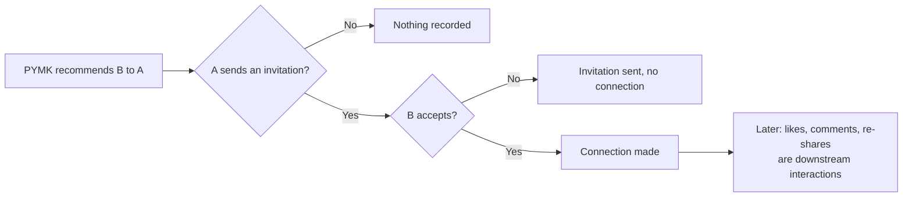
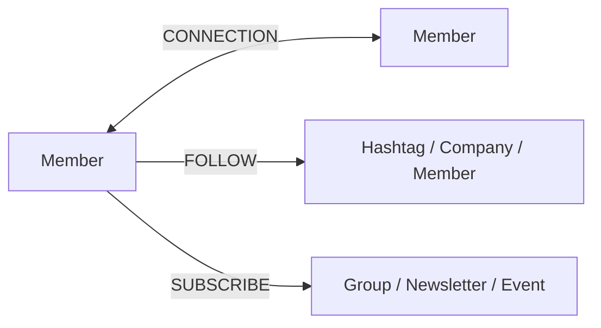
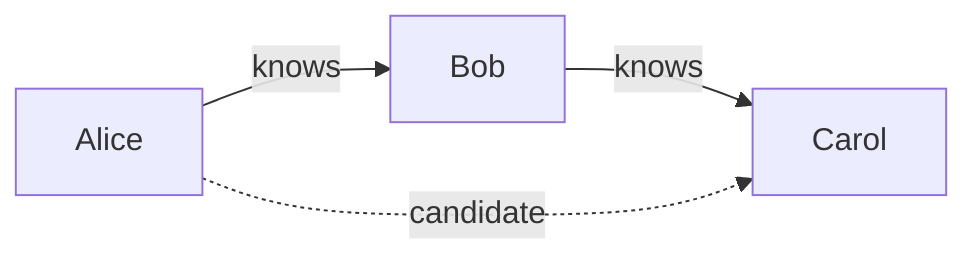
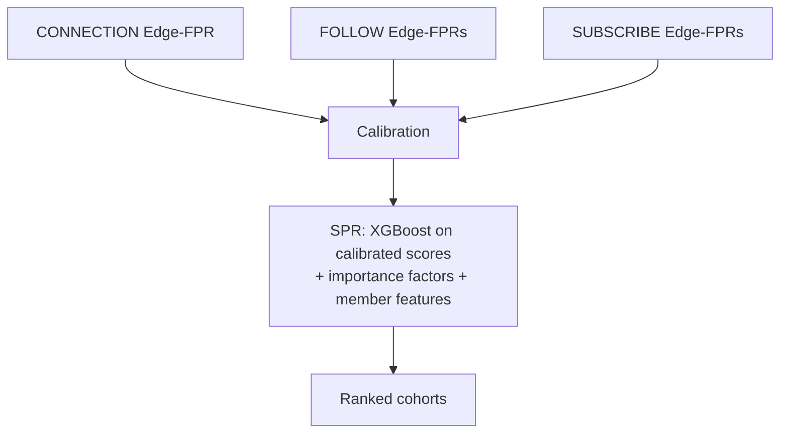
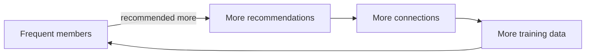
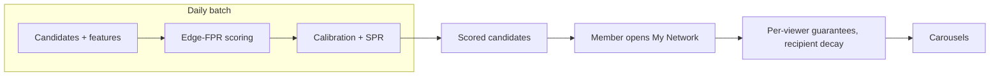

# Capstone #6: Friend/Connection Recommendation — LinkedIn's "People You May Know" (PYMK)

## At a glance

| Topic | Summary |
|---|---|
| Sources | Three LinkedIn Engineering pages. The 2020 post "Building a Heterogeneous Social Network Recommendation System" (October 6, 2020, Agrawal, Saha, Wang, Nigam and Lawrence). The 2021 post "Optimizing People You May Know (PYMK) for Equity in Network Creation" (August 5, 2021, Yin and co-authors). The PYMK team page. |
| Problem | Recommend people a member may know, from a graph that grows faster than the site, and keep the recommender from favoring members who are already well connected. |
| Core idea | A binary classifier scores whether two people know each other, with triangle closing (friends of friends) as the main candidate signal. A re-ranker discounts overloaded recipients, and a fairness re-ranker gives qualified infrequent members equal representation. |
| Wider system | The 2020 post describes a second-pass ranker that orders cohorts of different entity types against each other. It predicts downstream interactions, meaning likes, comments and re-shares on the recommended entity's content, not connection acceptance *(source-confirmed)*. |
| Scale | PYMK processes hundreds of terabytes a day and hundreds of billions of potential connections, trains on billions of samples with hundreds of features, and refreshes results daily *(source-confirmed, team page)*. |
| Headline results | Impression decay cut overloaded recipients by 50%, requests sent fell 1%, recipient sessions rose 1%. Fairness re-ranking raised invitations sent to infrequent members by 5.44% and connections they made by 4.8%, with frequent members neutral *(source-confirmed, 2021 post)*. |
| Not published | The label definition, offline metrics, model sizes, latency, and the re-ranking parameters. The sharded graph store in Step 5 is a teaching design. |
| First to break | Second-degree expansion. The team page says data processing grows much faster than the site, because PYMK looks at connections of connections. |
| Easy-to-miss traps | A downstream interaction is not a connection. A 1:2 impression guarantee gives follow cohorts more impressions, not connections more weight. An edge list stores each connection twice, not four times. A neutral result for frequent members is not proof of no harm. |
| Practice PDFs | [Study edition](../../capstone-study-and-mock/pymk-friend-recommendation/capstone6_pymk_friend_recommendation_study.pdf) · [Mock interview](../../capstone-study-and-mock/pymk-friend-recommendation/capstone6_pymk_friend_recommendation_mock.pdf) |

Evidence labels used below: *(source-confirmed)* means the figure or claim is on one of the three pages. *(illustrative)* means it is this document's planning assumption or design. The pages are blog posts, so they give few numbers and no formulas.

### Concepts this case study builds on

| Concept | Where it is taught | One-line recap |
|---|---|---|
| Sharding a table by key, and the cost of cross-shard queries | [Lesson 5, Concept 1](../../lessons/lesson-5-data-layer.md#concept-1-rdbms-scaling) | Split rows across nodes by a key. A query that needs several shards is assembled by the application. |
| Graph databases | [Lesson 5, Concept 2](../../lessons/lesson-5-data-layer.md#concept-2-nosql-types) | Nodes and edges, built for traversals. |
| Offline evaluation | [Lesson 9, Concept 2](../../lessons/lesson-9-evaluation-and-observability.md#concept-2-offline-evaluation--golden-datasets-llm-as-judge-regression-suites) | Gate changes on a fixed measurement, and know what it cannot show. |
| Heterogeneous network, triangle closing, equity re-ranking | [Glossary](../../appendix/glossary.md) | Mixed node and edge types, friends-of-friends candidates, and a fairness correction after scoring. |

---

## Step 1: Clarify Requirements & Frame the ML/AI Objective

### The objective

The team page says that at the heart of PYMK is a binary classification problem: predict whether two people know each other. The 2021 post says PYMK estimates the propensity to connect between two members with a combination of linear and non-linear models, produces a P(connect) score, and recommends a list of potential new connections ranked by it. The team page says PYMK uses a logistic regression model to combine hundreds of features. The pages differ in level of detail and may describe different parts of the system.

### How a connection forms

A sender sends an invitation, and a connection forms only after the recipient accepts it *(source-confirmed, 2021 post)*. So there are two events, and they can move apart: invitations sent and connections made. A recommendation that is shown and ignored, or sent and declined, is not a success.

### Labels

The pages do not define the training label. The 2021 post says the algorithms "learn from recommendations that result in successful matches", and that frequent members are more represented in the training data because they are more active. That points to training examples drawn from the outcomes of recommendations. The exact rule is not published, so any statement of it is a design choice.

### Downstream interactions are a different thing

The 2020 post's second-pass ranker predicts downstream interactions. A like, comment or re-share on content produced by the recommended entity counts. For a connection edge, that means likes, comments or re-shares on content posted by the new connection. It is not the same as an accepted invitation, and the two should not be mixed up when reading the metrics.



### Out of scope

- The page layout. The 2020 post says cohorts are shown as horizontal carousels on the My Network tab.
- The models for follow and subscribe recommendations.
- LinkedIn's feed and jobs systems.

### Trade-offs considered

A score trained only to predict connection has no reason to care who receives an invitation or who is under-served. The 2021 post is about exactly that gap, and the changes in Step 4 spend some invitation volume to close it.

---

## Step 2: Back-of-Envelope Constraints

### What the team page says

PYMK daily processes hundreds of terabytes of data and hundreds of billions of potential connections, pushes new results every day, and trains on billions of samples. Because it looks at the second-degree network, the rate of growth in processing is much faster than the growth of the site *(source-confirmed)*. The pages give no member count or degree.

### Sizing the graph

The numbers below assume 700 million members and an average of 400 connections each *(illustrative)*.

```text
edge rows, each connection stored from both ends = 700,000,000 × 400 = 2.8 × 10^11
at 24 bytes a row = 6.7 TB in all, about 3.3 GB on each of 2,048 shards
```

Counting by the sum of degrees avoids double counting: every row is one half of a connection, and the number of halves is members times average degree.

### Second-degree expansion

```text
2-hop walks for one member = 400 × 400 = 160,000
for all members            = 700,000,000 × 160,000 = 1.12 × 10^14 a day
```

This is the mean-field figure. Real degrees are skewed, and the sum of squared degrees is larger than members times the mean degree squared, so the true count is higher.

### Reconciling with the team page

The team page's candidates are hundreds of billions, not 112 trillion. Taking 3 × 10^11 candidate pairs:

```text
candidate pairs per member = 3 × 10^11 ÷ 700,000,000 = about 430
share of the 160,000 raw walks that survive = 430 ÷ 160,000 = 0.27%
if all 3 × 10^11 were raw walks: degree = sqrt(430) = about 21 connections per member
```

So either members have about 21 connections each, which is far below typical, or most second-degree pairs are filtered out before scoring. The second is the more plausible reading, and the pages do not say how the filtering is done.

### Reading the graph for a batch job

If a daily job looks up each friend's list for each member, the number of lookups equals the number of edge rows:

```text
lookups a day = 2.8 × 10^11, which is 3.2 million a second over 24 hours
data returned = 2.8 × 10^11 × 400 ids × 8 bytes = 896 TB
```

That is the same order as the team page's hundreds of terabytes a day. At an assumed 20,000 lookups a second per node, 3.2 million a second needs about 162 nodes, so this load is set by throughput and not by the 6.7 TB of storage.

### Trade-offs considered

A smaller degree shrinks the 2-hop cost with its square. Any degree consistent with hundreds of billions of candidates still rules out expanding all second-degree pairs without filtering.

---

## Step 3: Data / Knowledge Pipeline

### Sidebar: heterogeneous network

A graph where nodes and edges come in several types. The 2020 post describes three edge types *(source-confirmed)*:

| Edge | Connects | Direction |
|---|---|---|
| CONNECTION | a member to another member | two-way. Both the inviter and the receiver get access to each other's content |
| FOLLOW | a member to a hashtag, company or member | one-way |
| SUBSCRIBE | a member to a group, newsletter or event | one-way |



The edges serve different value propositions, so their success signals differ. That is why the 2020 post ranks entities of one type first and cohorts of different types second.

### Sidebar: triangle closing

The team page's example: if Alice knows Bob and Bob knows Carol, then maybe Alice knows Carol. Two edges form an open triangle, and the hypothesis is that the third edge is unusually likely. The page says closed triangles are then scored with signals such as whether the pair overlapped at an organization or school, their age difference, and their geographic distance. Triangle closing proposes candidates and the other features rank them.



### Features the team page names

- Overlap at an organization or school, age difference and geographic distance.
- An organizational-overlap model from LinkedIn's WWW 2013 research. It uses when each person joined and left, the size of the organization, and how social the organization is. Working together for 10 years in a small organization implies more affinity than a few months.
- Impression discounting, from the team's KDD 2014 paper: results that members saw and ignored are ranked lower.

The neural-network embeddings of network topology that the 2020 post mentions are member features of the second-pass ranker. They are not named as inputs to PYMK's own model.

### Cold start

A new member has no connections, so triangle closing has nothing to expand. That follows from the mechanism and is not stated on the pages. The 2020 post does say that frequent members give rich data while inactive members lead to less data and lower-quality recommendations.

```python
def friends_of_friends(member: int, adj: dict[int, set[int]]) -> dict[int, int]:
    """Candidates and the number of mutual connections for each."""
    direct = adj.get(member, set())
    mutual: dict[int, int] = {}
    for friend in direct:
        for other in adj.get(friend, set()):
            if other != member and other not in direct:
                mutual[other] = mutual.get(other, 0) + 1
    return mutual
```

This is this document's sketch of the idea, not LinkedIn's code. For one member it does about 160,000 steps at the assumed degree, and for all members the 1.12 × 10^14 above.

### Trade-offs considered

Triangle closing is cheap, precise and explainable ("you both know N people"), and it has low recall: two people with no shared connection are invisible to it. The organizational-overlap model costs feature work and fresh data and separates a short overlap from a long one.

---

## Step 4: Model/Agent Core Design

### A. The two-phase ranking in the 2020 post

The post says ranking heterogeneous recommendations follows two phases *(source-confirmed)*:

- Edge-FPR, the first-pass rankers. They rank entities of one type among themselves, and cohorts of them are shown as carousels. The models are separate and independent, can use XGBoost, logistic regression or deep neural networks, may optimize different business metrics, and may produce scores on different scales.
- SPR, the second-pass ranker. It ranks cohorts of different types against each other, so a member can choose the next edge to grow.

SPR is an XGBoost model that predicts the probability of downstream interactions with the top k entities of a cohort. It trains with a logistic loss on binary labels, using calibrated Edge-FPR scores and member features: profile features, activity features and neural-network embeddings of network topology. An aggregation function, which could be a weighted mean or a non-linear function, converts entity scores to a cohort score.



### Three challenges and the answers

| Challenge | The post's answer |
|---|---|
| Scores from different models are not comparable | Calibration maps the quantiles of each Edge-FPR score to the observed response used to train that Edge-FPR. The mapping might be log-linear. |
| Training data over-represents some edges. Members connect to few people and follow many hashtags, so follow edges get disproportionately high scores | Counterfactual experiments temporarily remove part of a member's network, by dropping content from feed and notifications for some existing edges, and measure the effect on engagement. The estimates become importance factors that multiply the scores of the corresponding cohorts. |
| Retraining one model forces retraining the other | Keep Edge-FPR and SPR independent, so a change to an Edge-FPR does not force an SPR retrain. The post says tight coupling could give slightly better accuracy and would slow iteration. |

### Training data and impression guarantees

SPR trains on a 5% holdout, a random bucket where cohorts are shown in random order, so that the Edge-FPR ranking does not bias the data. The post suggests the same data can train the Edge-FPRs.

A new entity type could be pushed down and never gather training data. The post offers stochastic impression guarantees per cohort type. One simple form reads the importance of each edge type and sets a constraint on the number of cohorts of each type. Its example: a 1:2 importance for connection against follow would ensure twice as many impressions of follow cohorts as of connection cohorts, while the ranking among them is still set by SPR. The guarantees are adjusted monthly or quarterly, are given per viewer and per edge type, and are not global per cohort, which the post calls far too complex to operationalize.

Importance factors multiply scores. Impression guarantees are a separate constraint on counts, and the 1:2 example is about impressions.

### Results the 2020 post reports

A/B tests showed more engaged members and a significant increase in downstream interactions, and more members created edges and had conversations over them. It reports no magnitudes. It also notes cannibalization across edge types: forming one kind of edge can come at the cost of another.

### B. The 2021 equity work

The 2021 post says a challenge for the system is controlling for sociological factors such as a member's visibility off-platform, and that AI products can reflect an existing bias toward some groups. Frequent members (FMs, more engaged) are more represented in the training data, they are recommended at a higher rate, they make more connections, and that gives them further representation. Infrequent members (IMs) sit on the other side of the loop, although a member with very few connections might gain more from one more connection.



### Change 1: impression decay

Some members, such as influencers, senior executives and recruiters, receive very many requests. That can overrun their feed and notifications with updates that seem random, and they may miss relevant opportunities. The fix re-ranks by discounting recipients with an excess number of invitations: newScore = score × df, with df between 0 and 1. As a recipient gets more invitations, the original score has to be higher to appear. The post's example deprioritizes recipients with more than 10 invitations in the past week, and production uses a piecewise linear function of the number received.

The post says it expected a small decrease in engagement because fewer invitations would be sent, and went ahead to improve the experience.

### Change 2: fairness re-ranking

Using the LinkedIn Fairness Toolkit, the team re-ranked connection suggestions according to equality of opportunity and equalized odds, giving qualified IMs and FMs equal representation. The post does not publish the method.

### Sidebar: equality of opportunity and equalized odds

These are standard fairness criteria, which the post names without defining. Equality of opportunity asks that equally qualified members of different groups have the same true positive rate. Equalized odds also asks for the same false positive rate. Used as a re-ranking constraint, they adjust the final order so that a qualified IM is not ranked below an equally qualified FM because of the biased score.

### Trade-offs considered

Decoupling the two phases speeds iteration and needs calibration. Re-ranking after the model is cheap to deploy and leaves the base model learning from the same biased data, so the correction has to keep running.

---

## Step 5: Serving Architecture

### What the team page says

New PYMK results are pushed every day, and results are refreshed daily. Named infrastructure: the Voldemort key-value store, Azkaban for Hadoop workflows, and Apache Kafka for streaming *(source-confirmed)*. The page names no graph database and no sharding scheme.

### A sharded edge-list design (illustrative)

This section is a teaching design built on Step 2. It is not LinkedIn's architecture.

```sql
CREATE TABLE connections (
    member_a_id  BIGINT NOT NULL,
    member_b_id  BIGINT NOT NULL,
    shard_key    SMALLINT GENERATED ALWAYS AS (member_a_id % 2048) STORED,
    PRIMARY KEY (shard_key, member_a_id, member_b_id)
);
-- each connection is stored twice, as (A, B) and (B, A)
```

Rows number 2.8 × 10^11, about 137 million per shard across 2,048 shards, and about 3.3 GB per shard at 24 bytes a row. Capacity alone would need very few shards. The shard count is set by throughput: 3.2 million lookups a second is about 162 nodes at the assumed speed, so 2,048 shards work as units of placement, about 13 per node.

### Triangle closing across shards

One member's direct connections sit on one shard. Each friend's list sits on another shard, keyed by the friend's ID. So one member's expansion is one home-shard query plus up to one query per friend.

```python
def candidates(member: int, router, shards: int = 2048) -> dict[int, int]:
    sql = "SELECT member_b_id FROM connections WHERE shard_key = %s AND member_a_id = %s"
    direct = set(router.query(member % shards, sql, (member % shards, member)))
    mutual: dict[int, int] = {}
    for friend in direct:
        rows = router.query(friend % shards, sql, (friend % shards, friend))
        for other in rows:
            if other != member and other not in direct:
                mutual[other] = mutual.get(other, 0) + 1
    return mutual
```

At 400 friends that is 401 queries for one member. A batch job pays this cost across a daily window, as the page's daily cadence suggests. An alternative that avoids per-member lookups is a self-join of the edge list on the middle member, which Hadoop-style jobs do. Its raw output is the 1.12 × 10^14 walks, so counting mutual connections and dropping weak candidates has to happen while the data is being shuffled.

### Where real time begins

The pages do not describe the online path. The 2020 post says impression guarantees are given per viewer and per edge type. A reasonable reading is that scored candidates are produced daily and request-time logic applies guarantees and the discount for recipients. That is this document's inference.



### Decision table

| Decision | This system's choice | Choose differently when |
|---|---|---|
| Candidate source | Friends of friends, then pair features | Add other sources if mutual connections miss people |
| Model | Logistic regression over hundreds of features (team page) | Non-linear models, which the 2021 post mentions |
| Ranking across types | A separate second-pass ranker with calibration | One model if there is a single entity type |
| Coupling | Independent first and second pass | Tight coupling only if accuracy outweighs speed of iteration |
| Fairness | Re-rank after scoring | Reweight training data to correct the source |
| Candidate computation | Daily batch | Streaming updates if freshness matters more than cost |

### Trade-offs considered

Sharding by the first member makes one member's friends a single-shard read and the second hop a scatter. A daily batch trades freshness for a workload that fits the throughput. A new connection does not reach the candidates of the member's friends until the next run.

---

## Step 6: Evaluation, Monitoring and Iteration

### Offline

None of the pages names an offline metric for PYMK's model. Evaluation reported is by A/B test.

### Online results

The 2021 post's results *(source-confirmed)*:

| Change | Result |
|---|---|
| Impression decay | Overloaded recipients reduced by 50%, with survey results saying the experience of sending and receiving requests improved. Connection requests sent fell 1%. Sessions from the recipient side rose 1%. Sender-side sessions were neutral. Overall a 1% session win. |
| Fairness re-ranking | Invitations sent to IMs rose 5.44% and connections made by IMs rose 4.8%. Metrics for FMs stayed neutral. |

The post explains the 1% recipient gain this way: members with fewer invitations were receiving more, and invitations are more efficient at driving engagement for them. It reads the neutral FM metrics as a sign that recommendation quality improved overall, since moving invitations from FMs to IMs would typically lower the FM metrics.

Treat that reading with care. The post gives no confidence intervals or effect sizes for the neutral result, and a neutral measurement is not proof of no change. It also reports that invitations sent to IMs rose, and says nothing on whether those invitations were wanted.

### Measuring the recipient side

Recipient impact is harder to attribute, because a recipient can receive invitations from several senders. The team built an attribution framework: if a recipient gets a notification that Sender A wants to connect and then comes to accept it, the session goes to A. If the recipient comes on their own and goes straight to Sender B's invitation, it goes to B *(source-confirmed)*.

### Monitoring by cohort

The post reports its standard metrics, invitations, connections and sessions, split by cohort. It does not define a single equity metric. The practice that follows is to read each cohort separately, since an average over all members is dominated by frequent members and would hide what happens to infrequent ones.

### What the pages do not settle

- Cannibalization across edge types, which the 2020 post names without numbers.
- Whether the 50% fall in overloaded recipients is the right target. The post states the aim and not a threshold.
- Plans: short and long-term tests of changing exposure for equality of opportunity, and comparisons by protected attributes such as gender.

### What breaks first at 10×

| Quantity | At 10× | Reason |
|---|---|---|
| Edge rows | 2.8 × 10^12 | Members times degree |
| Daily lookups | 3.2 × 10^7 a second, or 1,620 nodes at the assumed speed | One lookup per edge row |
| Raw 2-hop walks | Up to 100 times at 10 times the degree | Grows with the square of degree |
| Candidate pairs | Depends on the filtering | The pages do not say |

If degree grows 10 times, the 2-hop count grows 100 times. If only members grow, it grows 10 times. The team page says processing grows much faster than the site, which matches the degree case.

### Risks

- Cold start for new members, by construction.
- A feedback loop in the training data that favors frequent members.
- Cannibalization across edge types, named by the 2020 post.
- Attribution error on the recipient side.

### Trade-offs considered

A/B tests are the only evidence the pages give, and they show a dynamic shift in who is recommended that a fixed offline set would not. Splitting results by cohort costs measurement work and keeps a gain for one group from hiding a loss for another.

---

## Sources and Further Reading

- LinkedIn Engineering, "Building a Heterogeneous Social Network Recommendation System," October 6, 2020. The source for the edge types, the two phases, calibration, importance factors, the random bucket, impression guarantees and the qualitative result. It does not mention triangle closing or mutual connections.
- LinkedIn Engineering, "Optimizing People You May Know (PYMK) for Equity in Network Creation," August 5, 2021. The source for the feedback loop, impression decay, the fairness re-ranking and the quantified results.
- LinkedIn Engineering, People You May Know team page. The source for the binary classification framing, triangle closing, the features, logistic regression, the scale statements, the named infrastructure and the daily refresh. It cites the WWW 2013 organizational-overlap work and the KDD 2014 impression discounting paper, which were not read for this document.
- [Lesson 5](../../lessons/lesson-5-data-layer.md), Concepts 1 and 2: sharding and graph databases.
- [Capstone #3, Video Recommendation](../video-recommendation/README.md): a related two-stage design.
- [Glossary](../../appendix/glossary.md): heterogeneous network, triangle closing, equity re-ranking.

Labels: *(source-confirmed)* is on one of the three pages. *(illustrative)* is a planning assumption or design of this document.
