# Capstone #6: Friend/Connection Recommendation — LinkedIn's "People You May Know" (PYMK)

**Source(s):** Primary — LinkedIn Engineering, *"Building a Heterogeneous Social Network Recommendation System,"* Oct. 6, 2020 (originally published at `engineering.linkedin.com/blog/2020/building-a-heterogeneous-social-network-recommendation-system`, now served at `linkedin.com/blog/engineering/optimization/building-a-heterogeneous-social-network-recommendation-system`), co-authored by Parag Agrawal, Ankan Saha, Yafei Wang, Aastha Nigam, and Eric Lawrence. Primary — LinkedIn Engineering, *"Optimizing People You May Know (PYMK) for Equity in Network Creation,"* Aug. 5, 2021 (`linkedin.com/blog/engineering/member-customer-experience/optimizing-pymk-for-equity-in-network-creation`). A third primary source, used because the two posts above turn out not to cover it — see the honesty note below — is LinkedIn Engineering's PYMK team overview page (`engineering.linkedin.com/teams/data/artificial-intelligence/people-you-may-know`).

**Confidence:** Moderate-to-strong, but with one specific, honest correction worth surfacing rather than papering over. The 2020 heterogeneous-network post and the 2021 equity post are this capstone's two headline sources, and together they might seem to establish triangle-closing — the idea that this capstone exists to teach — as a feature either post actually describes. Both posts were fetched and read in full for this document. **The 2020 post does not mention triangle-closing, mutual connections, or any graph-traversal feature at all** — its only reference to graph structure is a single, generic line about "neural-network embeddings that capture the member's network topology" as one input feature among several. Triangle-closing — the actual concept this capstone is supposed to teach — is instead described, in exactly these terms, on LinkedIn Engineering's separate PYMK team overview page, which also carries PYMK's confirmed scale figures (used in Step 2) and the plain statement that "PYMK uses a logistic regression model." This document therefore treats all three pages as primary LinkedIn Engineering sources, but is explicit, at every point below, about which specific page confirms which specific claim — the three pages describe PYMK at different levels (team-level overview vs. the broader 2020 cross-entity recommender vs. the 2021 fairness follow-up) and are not simply interchangeable. All of this document's **(2020 post)**, **(2021 post)**, and **(team page)** tags were read directly from each page's fetched text, not inferred or merged across pages without saying so. Figures tagged **(illustrative)** are this document's own worked estimates, clearly kept separate from confirmed figures throughout, consistent with how capstones #1–#5 in this repo handle scale numbers the sources themselves only give qualitatively.

**Scope note:** This capstone covers PYMK specifically — the model and infrastructure that predicts and ranks **member-to-member connection** recommendations. The 2020 post actually describes a broader system: the same ranking framework (described below) also drives recommendations for hashtags to follow, companies to follow, other members to follow, groups, newsletters, and events — PYMK is only the "CONNECTION edge type" slice of that larger heterogeneous recommender. This document stays focused on the CONNECTION slice and treats the other five entity types only as context for why PYMK's own score has to be made comparable to scores from entirely different models (Step 4). Also out of scope: the actual UI/ranking-surface design of the MyNetwork tab itself (the 2020 post confirms recommendations are presented "as a horizontal carousel," but this document doesn't design that surface) and anything about the non-CONNECTION entity types' own models.

---

## Step 1: Clarify Requirements & Frame the ML/AI Objective

**The actual objective.**

- LinkedIn's own PYMK team page frames the core task directly: PYMK is built around a binary classification problem — predicting whether two people know each other, i.e., whether a connection between them is likely **(team page)**.
- Notation: for a given member `A` and a candidate member `B`, estimate `P(connect | A, B)` — the probability that, if `B` is recommended to `A`, a connection between them will actually form.
- This is link prediction over an existing graph: the model trains on already-connected member pairs as positive examples and, implicitly, non-connected pairs as the background negative class **(team page)**, then scores pairs that aren't connected yet but plausibly could be.

**What counts as ground truth / feedback signal — and why it isn't one single signal.**

- Training labels come from the graph itself: a pair is positive if a `CONNECTION` edge already exists between them **(team page, inferred framing)**.
- The sources are honest that this is close to, but not exactly, "did the recommendation lead to a connection" — the 2021 equity post tracks two separable downstream events as genuinely distinct metrics, not one:
  - **Invitations sent** — a member acted on a recommendation by sending a connection request.
  - **Connections made** — the recipient accepted it **(2021 post)**.
- These diverge in the equity post's own reported results (Step 6): a member sending more invitations is not the same outcome as more of those invitations actually being accepted — and only the latter is the real ground-truth event this document cares about most. A recommendation that's displayed but never acted on, or acted on but rejected, is not success.
- The broader 2020 post's term for this same general class of event, generic across entity types, is a **"downstream-interaction"** — for PYMK specifically, a connection accepted; for a hashtag recommendation, a follow **(2020 post)**.

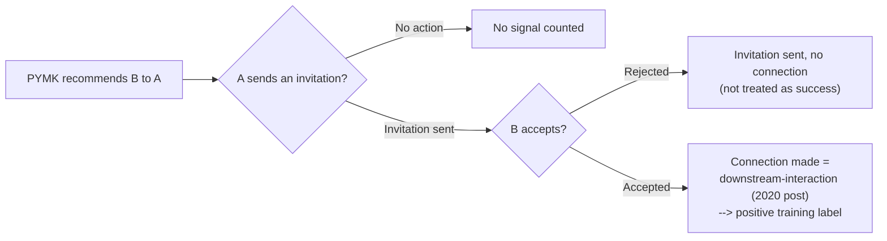

**Explicitly out of scope:**

- The MyNetwork tab's presentation layer (carousel placement, visual cohort design).
- The non-CONNECTION entity types (Hashtag, Company, Member-Follow, Groups, Newsletters, Events) that share PYMK's second-pass ranking layer (Step 4) but have their own separate first-pass models.
- Anything about LinkedIn's broader feed-ranking or job-recommendation systems, which are separate products.

**Trade-offs considered:** Training on existing-connection labels (link prediction) lets the model learn directly from the graph's own structure without needing any separate manual labeling process — the same "labels arrive for free as a byproduct of the product being used" advantage capstone #2's CTR model has over hand-labeled systems. But a model trained purely to predict `P(connect)` as high as possible, with no other constraint, has no built-in reason to prefer *showing* that recommendation to a member who genuinely needs more connections over a member who already has plenty and would accept almost anything recommended to them — this exact gap is what Step 4's equity work exists to close, and framing the objective honestly here (raw connection-likelihood, not yet "equitable connection-likelihood") is what sets that trade-off up rather than hiding it until Step 4.

---

## Step 2: Back-of-Envelope Constraints

**Confirmed scale, directly from the source (team page).**

- The system "daily processes 100s of terabytes of data, 100s of billions of potential connections" **(team page)**.
- It trains on "billions of samples" **(team page)**.
- It combines "hundreds of features" in its logistic regression model **(team page)**.
- These are the only hard, LinkedIn-confirmed scale figures either source gives for PYMK specifically — no post discloses an exact member count, exact edge count, or exact QPS figure for the CONNECTION edge type.

**An illustrative member-count anchor, kept visibly separate from the figures above.** LinkedIn's own public announcements put its member base at roughly 740 million as of February 2021 **(secondary — tertiary business-press reporting of a LinkedIn-sourced figure, not independently confirmed by either engineering post read for this document; used here purely as an order-of-magnitude anchor, the same discipline Lesson 5's own case-study pointer for this capstone already applies)**.

**A numeric sanity-check: does "100s of billions of potential connections" per day line up with 740 million members?** Taking a representative point estimate of 300 billion potential connections/day (within the team page's own "100s of billions" range) against the 740-million-member illustrative anchor:

```
implied_candidate_pairs_per_member_per_day = 300,000,000,000 potential connections
                                              ÷ 740,000,000 members
                                            ≈ 405 candidate pairs evaluated per member per day
```

**~400 candidate pairs per member per day** is a plausible order of magnitude for a friends-of-friends (second-degree) candidate pool after some amount of filtering/truncation — it's neither "a handful" nor "every other member on the platform," which is exactly the shape triangle-closing (Step 3) produces: a pool bounded by how many second-degree neighbors a member's own direct connections introduce, not by the platform's total size. This cross-check is this document's own derivation, built entirely from the team page's confirmed order-of-magnitude figure plus one illustrative, clearly-tagged anchor — the same "reproduce the source's own number from first principles" sanity check capstones #1–#3 already use.

**Why naive, full triangle-closing is computationally infeasible at this scale — the calculation that motivates Step 5's sharded serving design.** Triangle-closing (defined formally in Step 3) requires, for one member, expanding every one of their direct connections' own connections — a 2-hop graph traversal. Taking an illustrative average degree of **400 direct connections per member (illustrative — not a number either source states; chosen only because it lands this calculation's output in the same order of magnitude as the team page's own confirmed "100s of billions" figure, as a plausibility check, not because either post names 400 as LinkedIn's actual average degree)**:

```
two_hop_expansion_steps_per_member = direct_connections × connections_of_each_connection
                                    = 400 × 400
                                    = 160,000 traversal steps per member (naive, unfiltered)

aggregate_daily_steps (illustrative, full member base) = 740,000,000 members × 160,000
                                                        ≈ 1.18 × 10^14 (118 trillion) traversal steps/day
```

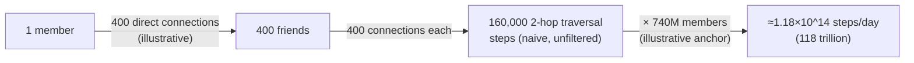

- 118 trillion 2-hop traversal steps a day, if computed by naively walking the live graph on every member every day, is not a number any single database node — or even a modest cluster of un-sharded ones — can absorb inside a "daily" batch window alongside the hundreds of terabytes of other data the team page says the system already processes.
- This is the concrete, numeric version of why PYMK's candidate generation has to run against a graph storage layer that's already partitioned for exactly this access pattern (Step 5), not computed fresh, un-sharded, against a single store.

**Trade-offs considered:** Using the team page's confirmed, if qualitative, "100s of billions"/"billions of samples"/"hundreds of features" figures as the load-bearing facts (rather than inventing precise-looking numbers neither source gives) keeps this document honest about what's actually confirmed — the cost is that Step 2's arithmetic has to lean more heavily on illustrative anchors than, say, capstone #2's CTR paper, which at least states exact dimensionality figures. Picking a smaller illustrative average-degree anchor (say, 150 instead of 400) would shrink the 2-hop traversal-cost estimate roughly proportionally to its square, but wouldn't change the qualitative conclusion — any average-degree anchor consistent with the team page's own confirmed "100s of billions of potential connections" scale produces a traversal cost that rules out live, un-sharded, full-graph computation.

---

## Step 3: Data / Knowledge Pipeline

### Sidebar — Connection graph and heterogeneous network

*(This concept, "heterogeneous network," has no existing Lesson 1–9 home; "connection graph" itself is not re-derived here — it's a direct application of Lesson 5's Concept 2 graph-database definition (nodes and edges, purpose-built for traversal queries) to this specific domain, linked rather than re-taught.)*

- **Why?** Lesson 5's Concept 2 already defines a graph database generically: nodes, edges, and traversal queries that are cheap to express there but expensive as chained joins in a relational model. PYMK's actual data is exactly that shape, specialized to one domain: a **connection graph** is a graph database instance where nodes are LinkedIn members and edges represent a relationship between two members — here, specifically, the bidirectional `CONNECTION` edge type **(2020 post)**. But `CONNECTION` is only one of several edge types in LinkedIn's actual production graph, per the 2020 post (see What, below, and the diagram).
- **What?** A **heterogeneous network**, in the sense the 2020 post's architecture uses it, is a graph containing more than one *type* of node and more than one *type* of edge, where each (node-type, edge-type) combination can carry its own distinct meaning and its own distinct model — as opposed to a **homogeneous network**, where every node and edge is the same type (a connection graph considered on its own, with only members and `CONNECTION` edges, is homogeneous). LinkedIn's actual production graph is heterogeneous: member nodes connect to member nodes (`CONNECTION`), to hashtag/company/member nodes (`FOLLOW`), and to group/newsletter/event nodes (`SUBSCRIBE`) **(2020 post)**. PYMK is the slice of this heterogeneous network that only concerns member-to-member `CONNECTION` edges.

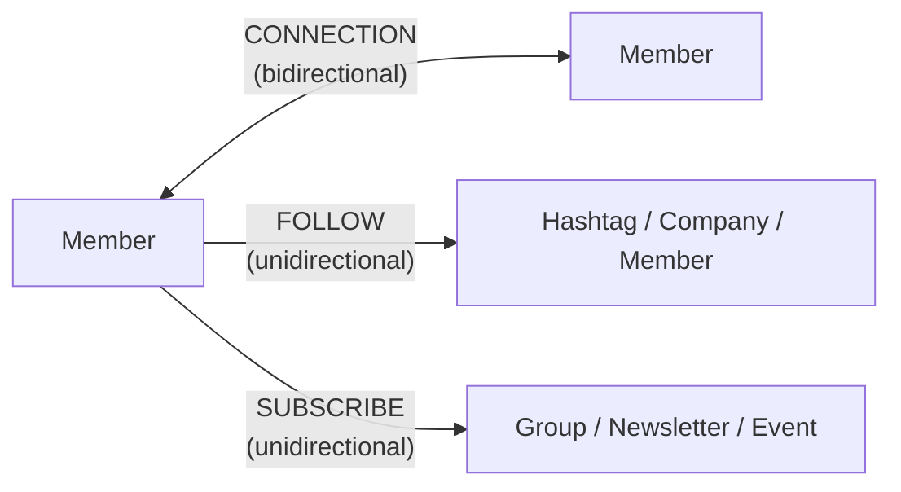
- **How?** Confirmed asymmetry matters mechanically: a `CONNECTION` edge is bidirectional — if `A` connects to `B`, `B` is connected to `A` too — while `FOLLOW` and `SUBSCRIBE` are unidirectional **(2020 post)**. This is exactly why the recommender can't use one shared ranking model across every entity type unmodified: a connection's "did it work" signal (an accepted, mutual edge) is structurally different from a follow's (one-directional, no acceptance step) — precisely why the 2020 post's architecture (Step 4) separates a per-edge-type first-pass model from a shared second-pass layer that reconciles scores across these edge types, rather than training one model end to end.

**Triangle-closing: the central graph feature this capstone exists to teach.**

### Sidebar — Triangle-closing

*(This concept has no existing Lesson 1–9 home.)*

- **Why?** Predicting `P(connect | A, B)` for every one of the "100s of billions of potential connections" (Step 2) the platform could in principle consider is wasteful if most pairs have near-zero chance of ever connecting — two members on opposite sides of the graph, with no shared context, almost never form a connection. A cheap, high-precision way to narrow the candidate pool before expensive scoring happens is exactly what candidate generation (vs. ranking — the same two-stage shape capstone #3's glossary entry already names) needs.
- **What?** **Triangle-closing**, in the PYMK team page's own framing, means looking at friends-of-friends: "if Alice knows Bob and Bob knows Carol, then maybe Alice knows Carol" **(team page)**. Graph-theoretically, `Alice–Bob` and `Bob–Carol` are two edges of an open triangle (a "wedge"); triangle-closing is the hypothesis that a third edge, `Alice–Carol`, is unusually likely to form, closing the triangle — because two people who already share one mutual connection are, structurally, far more likely to actually know each other than two arbitrary members are.

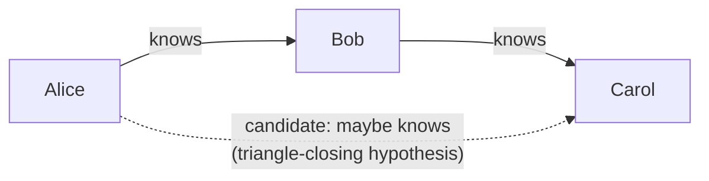
- **How?** The team page is explicit that triangle-closing isn't the finish line, only the candidate-generation step: "one can then score these closed triangles with such features as whether the pair overlapped at an organization or school" **(team page)** — i.e., once a candidate pair is surfaced because they share a mutual connection, that pair still gets scored by the same richer feature set (organizational overlap, age difference, geographic distance — all named by the team page) before a final recommendation is made. Triangle-closing itself just answers "which pairs are even worth scoring," not "how strong is this specific pair's match."

**The rest of PYMK's confirmed feature set (team page).** Beyond triangle-closing:

- **Age difference** between the two members.
- **Geographic distance**.
- **Organizational-overlap model** — richer than a simple "worked at the same company" boolean: it factors in when each person joined and left the organization, the organization's size, and how socially connected that organization tends to be on LinkedIn, contrasting (the team page's own example) a long tenure at a small, tightly-connected organization against a few overlapping months at a large one **(team page)**.
- **"Neural-network embeddings that capture the member's network topology"** — a feature the 2020 post adds that the team page doesn't mention **(2020 post)**: a learned, dense representation of a member's position in the graph, fed as a member-level feature alongside the hundreds of others the team page's logistic regression model combines.

**What happens when the graph data is wrong or stale.** A newly-joined member starts with zero direct connections — triangle-closing, by construction, can surface no friends-of-friends candidates at all for a member with no friends yet **(this document's own inference from the mechanism above, not a claim either source states directly)**. This cold-start gap is the structural root of the exact "infrequent member" disadvantage the 2021 equity post addresses (Step 4) — fewer connections means fewer, lower-quality recommendations, which keeps connections thin (the loop below), a pattern the 2020 post names directly in its own, more general terms: "there is also heterogeneity in interactions among member groups... frequent members continuously provide us with rich data" while "inactivity from infrequent members leads to lack of data and lower-quality recommendations" **(2020 post)**.

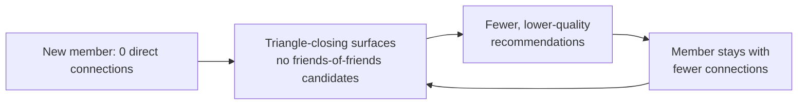

**A real triangle-closing feature-extraction function.** The following is this document's own illustrative implementation of the triangle-closing mechanism described above — a mutual-connection-count feature extractor over an adjacency-list representation of the connection graph, the same general shape as a candidate generator's actual logic, not the team's own (unpublished) production code:

```python
def mutual_connection_candidates(member_id: int, adjacency: dict[int, set[int]],
                                  min_mutual: int = 1) -> dict[int, int]:
    """Triangle-closing candidate generation over an in-memory adjacency list.

    adjacency[x] is the set of member IDs directly connected to member x
    (a CONNECTION edge, bidirectional per the 2020 post).

    For `member_id`, find every second-degree neighbor (a friend of a friend)
    who is NOT already a direct connection, and count how many distinct
    mutual (first-degree) connections link member_id to each candidate --
    this count is the "closed triangle" signal the team page's scoring
    step (organization/school overlap, etc.) is then applied on top of.
    """
    direct_connections = adjacency.get(member_id, set())
    mutual_count: dict[int, int] = {}

    for friend_id in direct_connections:
        for second_degree_id in adjacency.get(friend_id, set()):
            if second_degree_id == member_id:
                continue                                   # skip back-edge to self
            if second_degree_id in direct_connections:
                continue                                   # already connected -- not a candidate
            mutual_count[second_degree_id] = mutual_count.get(second_degree_id, 0) + 1

    # Each entry's value is the number of distinct "closed triangles" --
    # mutual direct connections -- between member_id and that candidate.
    return {cand: count for cand, count in mutual_count.items() if count >= min_mutual}
```

This is the exact computation Step 2's arithmetic flagged as infeasible to run live against the full, un-sharded graph at LinkedIn's scale — every call to `mutual_connection_candidates` is one member's slice of the 118-trillion-step/day aggregate estimate, which is why Step 5's serving design has to shard the underlying `adjacency` structure rather than hold it as one in-memory dict.

**Trade-offs considered:** Triangle-closing is cheap, high-precision, and directly explainable (a recommended connection can be shown "you both know N people"), but it's also a low-recall candidate source by construction: two members who would genuinely benefit from connecting but share zero mutual connections (e.g., two people about to start working together for the first time) are structurally invisible to this signal alone, which is presumably part of why the team page lists age/geography/organizational-overlap as separate, complementary candidate/scoring signals rather than relying on triangle-closing exclusively. The organizational-overlap model's extra richness (tenure dates, org size, org social density, not just a same-company boolean) costs real feature-engineering and data-freshness effort — an org's "social density" has to itself be computed from the same graph, recomputed as the org and its membership changes — but a cruder same-company boolean would conflate a two-week internship overlap with a ten-year shared tenure, a distinction the team page's example explicitly cares about getting right.

---

## Step 4: Model/Agent Core Design

This capstone's two central teaching points, each confirmed from a different one of the three LinkedIn pages read for this document.

### Teaching point A: the heterogeneous recommender's two-phase ranking (2020 post)

**Edge-FPR — first-pass ranking, per edge/entity type.**

- The 2020 post names its first stage **Edge-FPR** (edge-level first-pass ranker): "the Edge-FPR models are separate and independent AI models" **(2020 post)** — one per edge type (`CONNECTION`, `FOLLOW`, `SUBSCRIBE`), with `FOLLOW` further split by entity sub-type (diagrammed below).
- Algorithm options named for an Edge-FPR model: **XGBoost** (Extreme Gradient Boosting — a widely-used, optimized implementation of the gradient-boosted decision tree (GBDT) technique already defined in capstone #4's Step 4 Sidebar, known for speed and strong out-of-the-box performance on structured/tabular data), logistic regression, and deep neural networks — without stating which specific algorithm backs the `CONNECTION` edge type's own model **(2020 post)**.
- The PYMK team page fills that specific gap: PYMK's own model — the `CONNECTION`-edge Edge-FPR, in the 2020 post's vocabulary — "uses a logistic regression model for the binary classification problem to combine hundreds of features" **(team page)**.
- This document treats these as two descriptions of the same component at different levels of specificity — the 2020 post naming the general architecture's flexibility, the team page naming PYMK's own specific choice — not as disagreeing sources.

**SPR — second-pass ranking, shared across entity types.**

- Edge-FPR's outputs — a `P(connect)`-shaped score for PYMK, a `P(follow)`-shaped score for a hashtag recommendation, etc. — aren't directly comparable to each other; they come from entirely different models trained on entirely different label distributions.
- The 2020 post's second stage exists specifically to make them comparable: "we develop an XGBoost model that predicts the probability of downstream-interactions" **(2020 post)**, trained with a logistic loss over binary labels, taking calibrated Edge-FPR scores as input features.
- Aggregation function: "could be a simple weighted mean aggregation or a complicated non-linear aggregation" **(2020 post)**.
- The two stages are deliberately kept separate: "we keep Edge-FPR and SPR completely independent to avoid back-and-forth updates" **(2020 post)** — a direct, confirmed design choice, not an implementation detail left to inference.

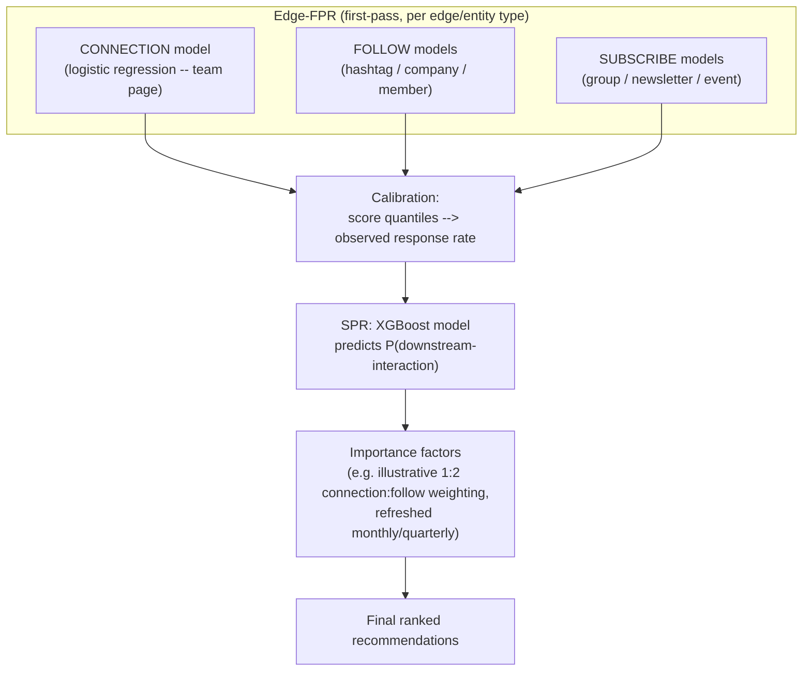

**Calibration — why cross-entity-type comparison needs it at all.**

- A raw PYMK score of 0.4 and a raw hashtag-follow score of 0.4 don't mean the same thing if the two underlying models were trained on different label bases and different feature distributions — SPR can't meaningfully combine them until they're put on a shared scale.
- The 2020 post's calibration step maps score quantiles to observed response rate (diagrammed above) via a mapping function it says "could take a log-linear form," without committing to one functional form **(2020 post)**.
- This is, in effect, the same underlying problem capstone #2's CTR system solves differently (Step 6 there): turning a raw model score into a number that means the same thing — a calibrated probability — across contexts where the raw score alone wouldn't be comparable.

**Importance factors.**

- A separate mechanism layered on top of calibrated SPR scores: per-edge-type (or per-cohort) **importance factors**, estimated from counterfactual experiments (the post describes temporarily withholding content from certain existing edges — e.g. filtering a member's feed or notifications — and measuring the resulting change in engagement) and then multiplied into a cohort's final score, refreshed "monthly or quarterly" **(2020 post)**.
- The post's own illustrative (not measured) example, "a 1:2 importance for connection vs. follow edge" **(2020 post)**, means weighting a connection roughly twice as valuable as a follow recommendation of equal predicted probability — a product decision layered on top of the model's raw output, not learned by the model itself.

### Teaching point B: the 2021 equity trade-off — this capstone's most distinctive lesson

**The problem, in the post's own terms.**

- The 2021 post frames this directly as a fairness challenge inherent to any system trained on its own historical outcomes: "a significant challenge for the accuracy of this system is controlling for external sociological factors," and the post is explicit that an AI product "can reflect an existing bias towards some groups of people over others" **(2021 post)**.
- Mechanism: **frequent members (FMs)** — members who are already highly active and well-connected — "are typically recommended to other members at a higher rate," and because they get recommended more, they make more connections, and "these members can make even more connections, giving them further representation in the training data" **(2021 post)**.
- This is a closed feedback loop (diagrammed below), confirmed directly by the post's own language.

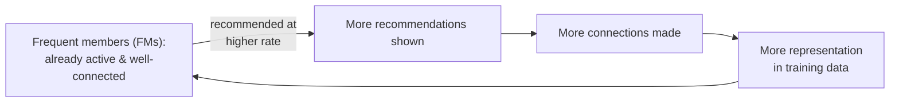

- **Infrequent members (IMs)** sit on the losing end of that same loop, receiving fewer recommendations and contributing less training signal — even though, as the post notes, "a member who has very few connections might receive greater incremental utility from adding one more connection" **(2021 post)** — i.e., the member the raw `P(connect)`-maximizing system under-serves is plausibly the one who'd benefit most from being served well.
- (A secondary, non-LinkedIn description of this same dynamic as "the rich get richer" is attributed by VentureBeat's coverage to a LinkedIn product manager, Albert Cui — that specific phrase does not appear in the primary 2021 post itself, and this document keeps that distinction explicit rather than presenting a secondhand paraphrase as the post's own wording.)

**Two separate interventions, not one.** The post describes two distinct changes, addressing two distinct problems:

1. **Impression decay, for overloaded recipients.** A separate, member-experience-framed problem: some members were receiving so many connection invitations that their networks and feeds became cluttered. The fix re-scores a candidate recommendation as `newScore = score * df` (diagrammed below) — implemented in production as a piecewise linear function of recent invitation count, with the exact breakpoints and slopes not disclosed by the post **(2021 post)**. This is a direct, explicit instance of trading away raw predicted-connection-probability for a different goal: the post states it expected the change to cause a small drop in overall invitation volume (fewer invitations get sent once heavily-recommended recipients are deprioritized), and chose to proceed anyway because the user-experience benefit — fewer members buried in invitations — was judged worth that cost **(2021 post, paraphrased; the post's own exact wording here could not be confirmed character-for-character from the fetched text available to this document, so it is reported as a paraphrase rather than a quotation)**.

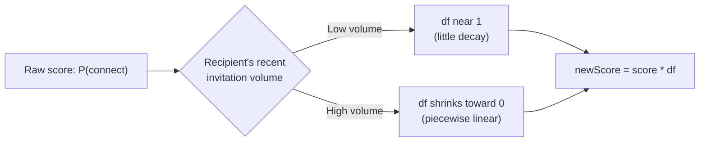

2. **Fairness re-ranking, for infrequent vs. frequent members.** Built on LinkedIn's own Fairness Toolkit (LiFT), applying what the post calls "equality of opportunity and equalized odds" as re-ranking notions **(2021 post)** — standard fairness-ML criteria (defined below) — specifically to "fairly representing infrequent and frequent members by giving qualified IMs and FMs equal representation in recommendations" **(2021 post)**. The post does not publish the exact re-ranking algorithm or constraint parameters.

### Sidebar — Equity re-ranking: equality of opportunity and equalized odds

*(This is the first appearance in this repo of recommendation-system fairness/equity re-ranking as a concept; checked against Lessons 1–10 — Lesson 9's Concept 2 covers LLM-judge *evaluation* bias, a different problem (a judge model's own scoring blind spots), not a recommender's training-data feedback loop or a fairness-constrained re-ranking technique, so no existing lesson home applies.)*

- **Why?** A model trained purely to maximize `P(connect)` has no mechanism built in to notice that it's systematically under-serving one group of members relative to another — Teaching point B's feedback loop is exactly what happens when nothing corrects for that. Re-ranking based on a fairness criterion is a way to intervene *after* the model produces its raw scores, without having to retrain the underlying model itself.
- **What?** **Equality of opportunity**, as a general fairness-ML criterion (not a formula the 2021 post itself publishes — this is the standard definition of the term, included here because the post names the criterion without defining it), requires that qualified members of different groups (here, infrequent vs. frequent members) have an equal true-positive rate — an equally qualified IM and FM should be equally likely to actually get a recommendation that leads to a connection. **Equalized odds** is a stricter version requiring both the true-positive rate *and* the false-positive rate to match across groups. Applying either as a re-ranking constraint means: after the base model scores every candidate, the final ranking is adjusted so that qualified members from the disadvantaged group (IMs) are not systematically ranked lower than equally-qualified members from the advantaged group (FMs), rather than leaving the ranking as whatever the raw, feedback-loop-biased `P(connect)` score alone would produce.
- **How?** The 2021 post doesn't publish the exact mechanics, but the conceptual shape (diagrammed below) is structurally the same "insert a correction pass after the base model's raw score" shape as the impression-decay re-ranker above — just correcting for member-frequency-group disparity instead of recipient invitation-volume.

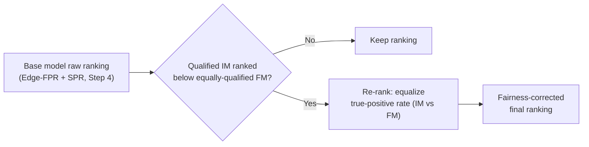

**The trade-off, stated explicitly, because it's this capstone's whole point.**

- This is a real, LinkedIn-documented case of deliberately not shipping the raw `P(connect)`-maximizing ranking, on the theory that doing so would entrench the FM-favoring feedback loop Teaching point B describes.
- It is not a free win measured purely on the system's own original objective: the post is explicit that engagement metrics like invitations sent were expected to decrease from the impression-decay change specifically because fewer invitations get sent once over-recommended recipients are deprioritized, and the team proceeded anyway, judging the user-experience and equity goals worth that expected cost.
- For the IM/FM fairness re-ranking specifically, the post reports (Step 6) that the outcome was better than the team's own stated prior expectation — not a confirmed, acknowledged loss on the raw objective the way the decay change's trade-off is.

**Trade-offs considered (Step 4, overall):** Keeping Edge-FPR and SPR fully decoupled (2020 post, confirmed) avoids a tight coupling where every Edge-FPR retraining forces an SPR retraining in lockstep, at the cost of needing an explicit calibration layer to keep their scores comparable at all — skip calibration, and SPR is combining numbers that don't mean the same thing across entity types. Correcting for the IM/FM feedback loop via a post-hoc re-ranking pass, rather than retraining the base model on a rebalanced or reweighted dataset, is cheaper to iterate on and deploy independently of the base model's own training cadence — but it means the base model itself keeps learning from the same biased-by-construction data distribution every cycle, and the re-ranking pass has to keep correcting for a bias that's still being reinforced upstream, rather than removing the bias at its source.

---

## Step 5: Serving Architecture

**Delivering on Lesson 5's forward-reference.** Lesson 5's Concept 1 case-study pointer for this capstone states that LinkedIn's connection graph "is large enough that graph data at that scale has to be federated/sharded across the underlying storage layer — which is the infrastructure the triangle-closing graph feature... actually runs its queries against." Step 2's own arithmetic above (118 trillion naive 2-hop traversal steps/day, illustrative) is exactly the numeric case for why that's true, not just plausible. This section builds out concretely what that sharded storage layer and the triangle-closing queries running against it actually look like, following the same sharded-adjacency pattern Lesson 5's own Hands-On Walkthrough built for Pinterest's `pins` table.

**Sharding the connection graph.** Following Lesson 5 Concept 1's sharding definition (splitting rows of one logical table across nodes by a shard key) applied to an edge list rather than a `pins` table:

```sql
-- Sharded edge-list table for the CONNECTION edge type (bidirectional, per the 2020 post).
-- One row per directed half of each connection, so a lookup of "who is member X
-- connected to" is always a single-shard scan keyed on member_a_id.
CREATE TABLE connections (
    member_a_id    BIGINT    NOT NULL,
    member_b_id    BIGINT    NOT NULL,
    shard_key      SMALLINT  GENERATED ALWAYS AS (member_a_id % 2048) STORED,
    connected_at   TIMESTAMP NOT NULL DEFAULT CURRENT_TIMESTAMP,
    PRIMARY KEY (shard_key, member_a_id, member_b_id),
    INDEX idx_member_a (shard_key, member_a_id)
);
-- Each CONNECTION edge is stored twice -- (A, B) and (B, A) -- so that
-- "give me member X's direct connections" is always answerable from X's own
-- shard, without needing to know which side of the original edge X was on.
```

`2048` shards here is illustrative, sized against Step 2's own arithmetic: at roughly 740 million members (illustrative anchor) and ~400 direct connections/member (illustrative), the full doubled edge list is on the order of `740,000,000 × 400 × 2 ≈ 5.9 × 10^11` rows — sharding that count down to roughly 2048 pieces keeps each shard's row count in the low hundreds of millions, the same target-headroom reasoning Lesson 5's own worked example used for Pinterest's `pins` table, just applied to an edge list instead of an item table.

**The triangle-closing candidate query, as a cross-shard scatter-gather — the actual infrastructure cost Lesson 5's pointer was about.** Step 3's `mutual_connection_candidates` function assumed `adjacency` was one convenient in-memory dict. Against the sharded table above, that same 2-hop traversal becomes exactly the kind of cross-shard query Lesson 5's Concept 1 already names as sharding's own structural cost: *"a query that needs rows from more than one shard... now has to be assembled by the application from multiple shard round-trips instead of one SQL query."* Concretely, for a 2-hop triangle-closing lookup:

```python
def triangle_closing_candidates(member_id: int, shard_router, num_shards: int = 2048) -> dict[int, int]:
    """Cross-shard triangle-closing: member_id's direct connections can live on
    many different shards (their own member IDs, not member_id's), so a full
    friends-of-friends expansion is a scatter-gather across shards, not a
    single-shard query -- this is the concrete cost Lesson 5 Concept 1's
    sharding trade-off (cross-shard queries require application-level
    assembly) imposes on triangle-closing specifically.
    """
    home_shard = member_id % num_shards
    direct_connections = shard_router.query(
        shard=home_shard,
        sql="SELECT member_b_id FROM connections WHERE shard_key = %s AND member_a_id = %s",
        params=(home_shard, member_id),
    )
    direct_set = set(direct_connections)

    mutual_count: dict[int, int] = {}
    for friend_id in direct_connections:
        # Scatter: friend_id's own shard is friend_id % num_shards, which is
        # almost never member_id's own shard -- this is the round-trip Lesson
        # 4 warns a cross-shard query pays, repeated once per direct connection.
        friend_shard = friend_id % num_shards
        second_degree = shard_router.query(
            shard=friend_shard,
            sql="SELECT member_b_id FROM connections WHERE shard_key = %s AND member_a_id = %s",
            params=(friend_shard, friend_id),
        )
        # Gather: accumulate mutual-connection counts across every scattered round-trip.
        for candidate_id in second_degree:
            if candidate_id == member_id or candidate_id in direct_set:
                continue
            mutual_count[candidate_id] = mutual_count.get(candidate_id, 0) + 1

    return mutual_count
```

One call to `triangle_closing_candidates` now costs one single-shard query (the member's own direct connections) plus up to `len(direct_connections)` further single-shard round-trips (one per friend's own shard) — a real, countable infrastructure cost directly traceable to sharding, which is exactly why the team page's confirmed "daily" processing cadence (Step 2) makes sense as a design choice: running this scatter-gather as a recurring **batch** job against the full member base, rather than live on every page load, amortizes the round-trip cost across a wide processing window instead of paying it inside a single request's latency budget.

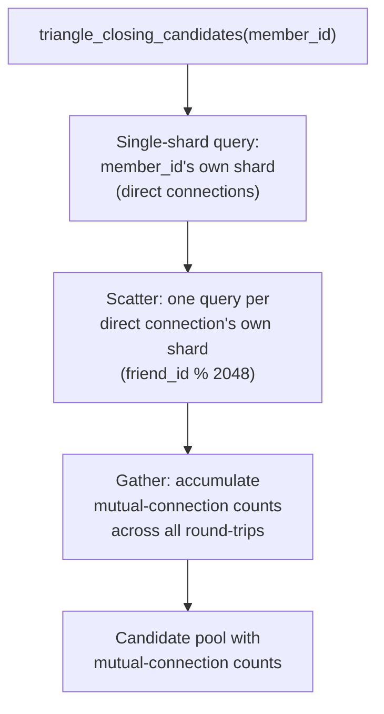

**Where the real-time path picks up.**

- The batch-computed candidate pool (triangle-closing plus the team page's other features — organizational overlap, age, geography) feeds Edge-FPR's offline scoring.
- Edge-FPR and SPR's calibrated, aggregated scores (Step 4) are what actually get read when a member opens the MyNetwork tab.
- Per-viewer impression guarantees are applied at request time — the 2020 post confirms these are enforced "at a per-viewer and per-edge-type level," explicitly rejecting a single global guarantee per cohort as "far too complex to operationalize" **(2020 post)**.
- i.e., real-time serving reads already-scored candidates and applies presentation constraints — it doesn't recompute triangle-closing or Edge-FPR per page load (diagrammed below).

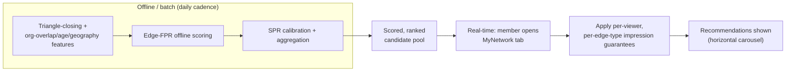

**Trade-offs considered:** Sharding the connection graph by `member_a_id` makes "give me X's own direct connections" a single-shard query, which is the lookup every traversal step needs most often — but it makes triangle-closing's second hop an unavoidable scatter-gather, since a friend's own connections live on a shard keyed by *their* ID, not the originating member's. An alternative sharding scheme that tried to colocate a member with their friends-of-friends would only move the problem, not remove it, since any member has friends spread across essentially the whole shard space once the graph is large enough — this is the direct cost Lesson 5 Concept 1 already names for any cross-shard query, now made concrete for a specific two-hop graph traversal rather than left abstract. Running triangle-closing as a recurring batch job (daily, per the team page) rather than live-per-request trades candidate-pool freshness (a connection formed an hour ago won't immediately ripple into fresh triangle-closing candidates for that member's own friends) for a workload that's actually schedulable within the sharded infrastructure's real throughput limits — the same batch-vs-real-time trade-off Lesson 5's caching material frames generally, applied here to graph traversal instead of a cache-population decision.

---

## Step 6: Evaluation, Monitoring, and Iteration

**What the sources confirm about offline evaluation — and the honest gap.** Neither the 2020 post, the 2021 post, nor the team page names a specific offline metric (no AUC, no precision@k, no NDCG) for PYMK's own model. This is a genuine gap relative to several other capstones in this repo (e.g. capstone #3's Holdout MAP, capstone #4's NDCG) and is reported here as a limitation of what these three sources confirm, not filled in with an invented metric name.

**Online evaluation — the 2020 post's own qualitative result.** The 2020 post reports that its heterogeneous recommender's A/B test produced "an increase in the number of engaged members and a significant increase in the downstream-interactions of members" **(2020 post)** — a confirmed, but entirely unquantified, directional result; no percentage or magnitude is given.

**Online evaluation — the 2021 equity post's quantified results, the sharpest numbers either source gives.**

- Impression-decay change (overloaded recipients) **(2021 post)**:
  - Overloaded recipients reduced by **50%**.
  - Connection requests sent fell by **1%**.
  - Recipient-side sessions rose by **1%**.
  - Sender-side session impact: neutral.
  - Net session result across both sides: a **1% win**.
- IM/FM fairness re-ranking **(2021 post)**:
  - Infrequent members: **5.44%** increase in invitations sent; **4.8%** increase in connections made.
  - Frequent members: both metrics neutral.
- The post frames the FM-neutral result as better than its own prior expectation — it states that shifting invitations from the FM group to the IM group would typically be expected to produce a metric increase for IMs and a corresponding decrease for FMs, and reports the observed FM-neutral outcome as evidence that overall recommendation quality improved, rather than that gains for IMs simply came at FMs' direct expense **(2021 post)**.

**The equity-metric monitoring the 2021 post introduces — named honestly as cohort-segmented metrics, not one formula-defined fairness score.**

- The post does not define a single named equity metric with an explicit formula the way, for example, NDCG is formally defined (capstone #4).
- What it does instead, confirmed directly by the structure of its own reported results above, is **segment its standard engagement metrics (invitations sent, connections made, sessions) by member-frequency cohort (IM vs. FM) and monitor both cohorts' numbers separately**, rather than reporting one platform-wide average that could hide a gain for one group masking a loss for the other.
- This is the concrete, if less formally named, monitoring practice this capstone's teaching point is built on: watching whether a change helps the disadvantaged cohort (IMs) without an outsized, uncorrected cost to the advantaged cohort (FMs) — exactly the comparison the post's own FM-neutral/IM-positive result reports.
- The post names its evaluation challenge directly too: recipient-side impact is harder to measure than sender-side, because a recipient can receive invitations from many different senders at once — which is why the team built a separate attribution framework specifically to credit a recipient-side session back to the sender whose invitation prompted it **(2021 post)**.

**The feedback loop back into Step 3.** Every new connection becomes a new positive training example (Step 1's link-prediction framing) — but, per Teaching point B, unevenly: a connection formed by an already-frequent member reinforces FM-overrepresentation (diagrammed below), the structural reason the 2021 post's interventions re-rank on top of the base model rather than wait for the next training cycle to self-correct.

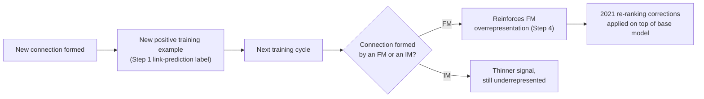

**Failure modes:**

- The cold-start gap named in Step 3 — a brand-new member has no direct connections for triangle-closing to expand from, so their early candidate pool is thin by construction (**this document's own inference**, not a claim either source states outright).
- The overloaded-recipient problem the 2021 post's decay re-ranker addresses directly.
- The IM/FM representation gap the same post's fairness re-ranking addresses directly.
- More generally: any production system trained on its own historical recommendation outcomes risks the same closed feedback loop Teaching point B names, in any domain, not just PYMK — this capstone's broader, portable lesson.

**Trade-offs considered:** Relying on live A/B results (both posts' own primary evidence) rather than a named offline metric means every iteration's real cost/benefit can only be confirmed after it's already live and affecting real members — slower and riskier than capstone #3's or #4's offline-metric-first discipline, but it's also the only way the 2021 post could have actually confirmed its central, counter-intuitive result (FM engagement staying neutral rather than dropping, when a naive zero-sum framing would have predicted a drop) — an offline metric computed against a static holdout set would have had no obvious way to measure a dynamic, platform-wide shift in *who* gets recommended to whom at all. Segmenting metrics by IM/FM cohort rather than reporting one platform-wide average costs real additional measurement and attribution infrastructure (the recipient-side attribution framework, confirmed above) — but a platform-wide average is exactly the kind of number that would have hidden the original FM-overrepresentation problem in the first place, since FMs' large absolute volume would dominate an unsegmented average and mask what was happening to IMs underneath it.

---

## Source(s) and Further Reading

- LinkedIn Engineering, *"Building a Heterogeneous Social Network Recommendation System,"* Oct. 6, 2020 — **primary**; source of every claim tagged (2020 post) above, including the CONNECTION/FOLLOW/SUBSCRIBE edge-type taxonomy, the Edge-FPR/SPR two-phase architecture, calibration and importance-factor mechanics, the horizontal-carousel presentation detail, the per-viewer impression-guarantee policy, and the qualitative A/B result. **Honesty note, repeated from the Confidence section above:** this post does not mention triangle-closing — triangle-closing is instead confirmed by the PYMK team page below, not by this post.
- LinkedIn Engineering, *"Optimizing People You May Know (PYMK) for Equity in Network Creation,"* Aug. 5, 2021 — **primary**; source of every claim tagged (2021 post) above, including the FM-overrepresentation feedback loop, the impression-decay re-ranker and its `newScore = score * df` mechanism, the LiFT-based IM/FM fairness re-ranking, and every quantified A/B result in Step 6 (50% overloaded-recipient reduction, 1% invitation/session shifts, 5.44%/4.8% IM gains, FM-neutral result).
- LinkedIn Engineering, PYMK team overview page (`engineering.linkedin.com/teams/data/artificial-intelligence/people-you-may-know`) — **primary**; the actual source of the triangle-closing definition, the logistic-regression model-family confirmation for PYMK specifically, the organizational-overlap/age/geography feature set, and the "100s of terabytes / 100s of billions of potential connections / billions of samples / hundreds of features" scale figures used throughout Step 2.
- VentureBeat, coverage of the 2021 equity post — **secondary**; cited only for the "rich getting richer" phrase attributed there to LinkedIn product manager Albert Cui, explicitly flagged above as not appearing in the primary 2021 post's own text.
- Lesson 5 (`lessons/lesson-5-data-layer.md`), Concept 1 — the sharding definition and this capstone's own case-study pointer (quoted and built out concretely in Step 5 above), and Concept 2 — the graph-database definition this capstone's "connection graph" is a direct application of, both referenced rather than re-derived.
- `case-studies/video-recommendation/README.md` (capstone #3) — referenced in Step 4 for the structural parallel between Edge-FPR (a per-type first-pass scorer) and that capstone's own two-stage retrieval-then-rank glossary entry, as a related but distinct architecture (cross-entity-type score calibration vs. corpus-scale funnel narrowing).
- `appendix/glossary.md` — new entries added for **heterogeneous network**, **triangle-closing**, and **equity re-ranking (equality of opportunity / equalized odds)**; this capstone defines all three in full on first use above rather than assuming familiarity. **Edge-FPR / SPR two-phase ranking** and **calibration (cross-model-type score calibration)** are also defined in full on first use (Step 4), but, as a judgment call consistent with capstone #3's own precedent for naming a related-but-distinct architecture inline rather than boxing it, were not given their own Sidebar or glossary entry — they're LinkedIn's own internal terminology for a variant of the already-glossaried two-stage retrieval-then-rank pattern, not a genuinely new architectural idea this repo hasn't touched at all.
