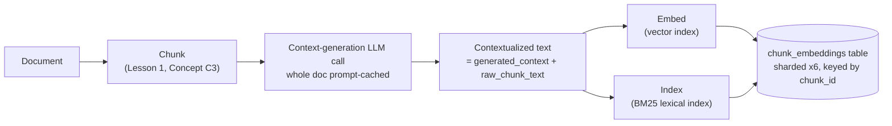
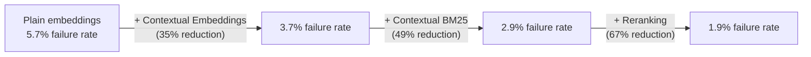
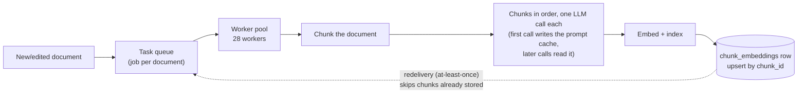
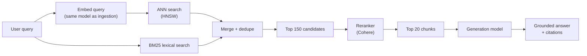

# Capstone #9: RAG System Design — Enterprise Knowledge-Base Chatbot (Contextual Retrieval)

## At a glance

| Topic | Summary |
|---|---|
| Source | Anthropic, "Introducing Contextual Retrieval," Sep. 19, 2024 (anthropic.com/news/contextual-retrieval) |
| Problem | An internal chatbot answers employee questions from 400,000 documents (2,000,000 chunks) *(illustrative)*. A chunk such as "the warranty period is 12 months" loses the fact that says which product it is about, so retrieval misses it and the model answers from context that does not contain the answer. |
| Core idea | Before embedding and BM25-indexing each chunk, an LLM reads the whole document and writes a 50-100 token note that situates the chunk. The note is prepended to the chunk. Retrieval runs embeddings and BM25 over the same contextualized text, fuses the two result lists, and a reranker narrows 150 candidates to 20. |
| Metric | Retrieval failure rate = 1 − recall@20: the share of queries for which none of the relevant chunks is among the 20 given to the model. |
| Headline results | 5.7% plain → 3.7% with contextual embeddings (−35%) → 2.9% adding contextual BM25 (−49%) → 1.9% adding reranking (−67%), using Gemini text-embedding-004 embeddings *(source-confirmed)*. |
| Ingestion cost (one time) | The post reports \$1.02 per million document tokens on Claude 3 Haiku, a model retired on 2026-04-20. For this corpus on Claude Haiku 5.5: about \$550 if prompt caching works, about \$1,270 if parallel chunk jobs defeat it. On Claude Haiku 4.5: about \$10,700, because 4,000-token documents fall below its caching minimum. |
| Storage | 22.6 GB of rows for 2,000,000 chunks, plus about 8.5 GB of HNSW index held in RAM (vectors plus graph links). |
| Ingestion capacity | 28 workers clear 2,000,000 chunks in 4 hours, provided all chunks of one document run in sequence on one worker. |
| Per-query cost | Dominated by generation: 16,500 prompt tokens per query is about \$740/day on Claude Sonnet 5.5 or about \$37/day on Claude Haiku 5.5, at 20,000 queries/day. |
| First to break at 10× | Generation tokens and reranker throughput under 10× traffic. Worker count, index memory and re-embedding time under a 10× corpus. |
| Easy-to-miss traps | One task per chunk silently defeats prompt caching. A fusion step can bury an exact-match hit. A reranker cannot recover a chunk that first-stage retrieval left out. Context written from a whole document can leak across section-level permissions. |
| Practice PDFs | [Study edition](../../capstone-study-and-mock/rag-contextual-retrieval/capstone9_rag_contextual_retrieval_study.pdf) · [Mock interview](../../capstone-study-and-mock/rag-contextual-retrieval/capstone9_rag_contextual_retrieval_mock.pdf) |

### Concepts this case study builds on

| Concept | Where it is taught | One-line recap |
|---|---|---|
| Embeddings, vector databases (HNSW), chunking, RAG end to end, keeping a knowledge base fresh (C1-C5) | [Lesson 1, Group C](../../lessons/lesson-1-ai-fundamentals-refresher.md#c-retrieval-and-knowledge) | Text becomes vectors; an index finds the nearest ones; documents are split into chunks, retrieved and handed to the model; the index must follow changes to the documents. |
| NoSQL types: a vector database is a fixed-width value keyed by an ID plus a similarity index (K2) | [Lesson 5, Concept 2](../../lessons/lesson-5-data-layer.md#concept-2-nosql-types) | Choose the storage shape by how the data is read and written. |
| Caching strategies: pay once on a write, read many times (K3) | [Lesson 5, Concept 3](../../lessons/lesson-5-data-layer.md#concept-3-caching-strategies) | Write-through and cache-aside trade freshness against read cost. |
| Prompt caching and semantic caching (K4) | [Lesson 5, Concept 4](../../lessons/lesson-5-data-layer.md) | Reusing a repeated prompt prefix is billed far below the base input rate. |
| Task queues, at-least-once delivery, idempotency (L1) | [Lesson 6, Concept 1](../../lessons/lesson-6-async-and-communication.md#concept-1-message-queues-vs-task-queues) | Work is delivered at least once, so every task must be safe to run twice. |
| Back pressure | [Lesson 6, Concept 2](../../lessons/lesson-6-async-and-communication.md#concept-2-back-pressure) | When producers outrun consumers, bound the queue and slow or shed load. |
| Prompt injection (F1) | [Lesson 8, Concept 1](../../lessons/lesson-8-safety-and-isolation.md#concept-1-prompt-injection) | Text the model reads, including retrieved text, can carry instructions. |
| Multi-tenant isolation (F5) | [Lesson 8, Concept 5](../../lessons/lesson-8-safety-and-isolation.md#concept-5-multi-tenant-isolation) | One user must never retrieve another's data. |
| Offline evaluation: golden sets, LLM-as-judge, regression suites (G2) | [Lesson 9, Concept 2](../../lessons/lesson-9-evaluation-and-observability.md#concept-2-offline-evaluation--golden-datasets-llm-as-judge-regression-suites) | Gate every change on a fixed labeled set. |

---

## Step 1: Clarify Requirements & Frame the ML/AI Objective

### What the system does

An employee types a natural-language question into an internal chatbot. The system retrieves the most relevant passages from a corpus of enterprise documents (product specs, internal wikis, support tickets, policy PDFs) and hands them, as context, to an LLM. The LLM writes a grounded answer that cites its sources.

This capstone covers retrieval accuracy only: the chunking, context, embedding, retrieval and reranking pipeline, end to end. Base RAG mechanics (what an embedding, a vector database or chunking is) are taught in Lesson 1's Concepts C1-C5 and linked here, not re-taught.

### The metric

The objective is retrieval accuracy, not the fluency of the final answer. Given a query, did retrieval surface the chunks that contain the answer, within the top *k* chunks handed to the model?

- **recall@k:** of all chunks relevant to a query, the fraction that appear in the top *k* results.
- **Retrieval failure rate:** the complementary quantity the post reports, 1 − recall@k at k = 20. It is the fraction of queries for which none of the relevant chunks reached the top 20.

A high failure rate means the model is asked to answer from context that does not contain the answer. No prompt or model quality can fix that downstream, because the information is not in front of the model.

### Ground truth

A labeled evaluation set of (query, correct-chunk-ID) pairs: real or representative employee questions, each hand-labeled with the chunks that contain the answer. It is the text-retrieval counterpart of capstone #1's held-out evaluation corpora (described in Step 6 there).

Building the set is ongoing work. New document types and new question phrasings keep appearing, so the labels need the same freshness discipline that Lesson 1's Concept C5 names for the corpus.

### Out of scope

- Generation-quality evaluation of the final answer (Lesson 9, G1-G2).
- Per-user document access control (Lesson 8, F5), except where Step 6 notes a leak that this design introduces.
- The chat UI and conversation memory (Lesson 1, Group E).
- Fine-tuning the embedding or generation model. The design uses off-the-shelf models throughout.

### Trade-offs considered

Optimizing recall@20 is the right target here, and it is the number the post reports. A production system also cares about precision: irrelevant chunks still consume context-window tokens (Lesson 1, Concept A2) and can distract the generation model even when the correct chunk is present. Precision is a related but separate concern, and Step 6's monitoring has to watch it.

---

## Step 2: Back-of-Envelope Constraints

### Corpus size

Assumptions *(illustrative)*: 400,000 enterprise documents averaging 4,000 tokens each, chunked at 800 tokens per chunk. The 800-token size is the one the post uses in its cost estimate; it is an assumption in that calculation, not a recommendation.

```text
total_chunks = 400,000 documents × 5 chunks/document = 2,000,000 chunks
```

The total matches the 2,000,000-chunk figure in Lesson 6's Concept 1 worked example, so this capstone and that lesson describe the same system.

### Context-generation cost: the post's rate

The post gives the one-time cost of generating contextualized chunks as \$1.02 per million document tokens *(source-confirmed)*. Its assumptions: 800-token chunks, 8,000-token documents, 50 tokens of instructions, 100 tokens of generated context per chunk, and prompt caching for the repeated whole-document prefix.

The post gives no per-token breakdown. Claude 3 Haiku's list prices reproduce its figure: \$0.25 input, \$0.30 five-minute cache write, \$0.03 cache read and \$1.25 output, per million tokens.

```text
one 8,000-token document = 10 chunks of 800 tokens
  cache write                       8,000 × $0.30/M  = $0.002400
  each of 10 chunk calls:
    cache read                      8,000 × $0.03/M  = $0.000240
    chunk + instructions              850 × $0.25/M  = $0.000213
    generated context out             100 × $1.25/M  = $0.000125
                                                       $0.000578 per call
  total = $0.002400 + 10 × $0.000578 = $0.008175 per 8,000 tokens
        = $1.022 per million document tokens
```

This accounting charges every call a cache read on top of the one cache write, which is what reproduces the post's number. A stricter count, where the first call only writes, gives \$0.99, about 3% lower. The cost table below uses the post-matching accounting, so its cached rows are slightly conservative.

### Re-pricing for this corpus

Two things change the answer.

1. **The rate depends on document size.** \$1.02 is an 8,000-token-document rate: one cache write is spread over 10 chunk calls. This corpus has 4,000-token documents with 5 chunks each, so the write is spread over fewer calls and the rate is \$0.872 per million tokens.
2. **The post's model is gone.** Claude 3 Haiku was retired on 2026-04-20, according to Anthropic's deprecations page (read 2026-10-17). The useful question is what ingestion costs on a model you can call today.

```text
total_document_tokens = 400,000 × 4,000 = 1,600,000,000 tokens
Claude 3 Haiku prices, 4K documents: 1,600 × $0.872 ≈ $1,395
```

| Model and scheduling (4,000-token documents, 1.6 billion tokens) | \$ per million document tokens | Corpus total |
|---|---|---|
| Claude 3 Haiku, caching works (historical, retired) | 0.872 | about \$1,395 |
| Claude Haiku 5.5, caching works | 0.344 | about \$550 |
| Claude Haiku 5.5, no caching at all | 0.669 | about \$1,070 |
| Claude Haiku 5.5, parallel chunk jobs: every call writes the cache and none reads it | 0.794 | about \$1,270 |
| Claude Haiku 4.5: 4,000-token documents are below its 4,096-token minimum cacheable length, so there is no caching and no error | 6.688 | about \$10,700 |

List prices read on 2026-10-17 from Anthropic's pricing page, per million tokens (input, cache write, cache read, output):

- Claude Haiku 5.5: \$0.10, \$0.125, \$0.01, \$0.50, for prompts up to 100,000 tokens.
- Claude Haiku 4.5: \$1, \$1.25, \$0.10, \$5.

The spread between \$550 and \$10,700 comes from scheduling and cache hygiene, not from the model family. Token counts also depend on each model's tokenizer, so "4,000 tokens" is model-specific and should be re-counted on the model you pick.

This is a one-time cost. It is paid again only when the corpus is re-chunked, the context-generation prompt changes, or the context-generation model changes. It is not a per-query cost, which is why Step 5 treats it as a cache write and not a cache lookup.

### Embedding and row storage

Assume a 1,024-dimension embedding model *(illustrative)*. The post's benchmark used Gemini text-embedding-004 for its comparison, but it does not mandate one model or dimension.

```text
float32 embeddings = 2,000,000 chunks × 1,024 dims × 4 bytes
                   = 8,192,000,000 bytes ≈ 8.2 GB

text per chunk (about 4 bytes per token):
  raw_chunk_text       800 tokens  ≈ 3,200 B
  generated_context    100 tokens  ≈   400 B
  contextualized_text  raw + context ≈ 3,600 B

row as Step 5's schema stores it = 4,096 + 3,200 + 400 + 3,600 = 11,296 B
2,000,000 rows × 11,296 B ≈ 22.6 GB
```

Dropping the derived `contextualized_text` column and concatenating on read gives 7,696 B per row, or 15.4 GB.

The ANN index sits on top. An HNSW index with M = 16 keeps each vector plus about 2 × M × 4 = 128 bytes of layer-0 links. For 2,000,000 vectors that is about 8.2 GB of vectors plus about 0.3 GB of links, so roughly 8.5 GB, held in RAM for search. The BM25 index is extra and is not sized here.

### Query volume and latency budget

Assumptions *(illustrative)*:

- 50,000 employees, 20% daily-active, 2 queries per active user per day gives 20,000 queries/day, an average of about 0.23 queries/sec.
- A 10× business-hours peak-to-average ratio gives a peak of about 2.3 queries/sec. Capstone #1's Step 2 uses the same kind of planning assumption.
- End-to-end p50 latency under 3 seconds for retrieval, reranking and generation combined. p50 is the median: half of requests finish faster. Lesson 9's Concept 2 defines percentile latency in full. The target is loose compared with capstone #10's serving targets, because a person is reading a chat response.

### Trade-offs considered

A smaller chunk (400 tokens instead of 800) gives finer-grained retrieval. It doubles the chunk count and the embedding storage. It raises context-generation cost by about 1.35×, not 2×, because the one cache write per document does not double, only the per-chunk calls do (Claude Haiku 5.5 prices). It also makes it more likely that one relevant passage is split across two chunks.

A larger chunk lowers both costs but can dilute the embedding with unrelated text, so a narrowly phrased query matches it less well. The design follows the post's 800-token assumption as a middle ground. Lesson 1's Concept C3 covers the general trade-off.

---

## Step 3: Data / Knowledge Pipeline

Lesson 1's Concept C3 covers how a document is split into chunks, and Concept C5 covers how the corpus stays fresh. This capstone takes both as given and focuses on what happens to each chunk between chunking and indexing.

### The problem Contextual Retrieval fixes

The post states the failure mode directly *(source-confirmed)*: "traditional RAG solutions remove context when encoding information."

A chunk like "the warranty period is 12 months from purchase" means something different depending on which product's documentation it came from. A naive pipeline embeds that sentence with no sign of which product it is about. A query such as "what's the warranty on the X200 model" can then miss the exact right passage, because nothing in the chunk or its embedding ties it to "X200."

### Sidebar: Contextual Retrieval

Lesson 1's Concept C3 mentions "prepend extra context to each chunk" as one chunking approach among several. This is the first full treatment in the repo.

- **Why:** An embedding model can only encode the text it is given. If the context that disambiguates a chunk (which document, section or product) is not in the chunk's text, no embedding quality can recover it. The information was discarded before embedding ran.
- **What:** Contextual Retrieval is Anthropic's name for prepending a short, chunk-specific blurb to the chunk's text before it is embedded and before it is indexed lexically *(source-confirmed)*. An LLM writes the blurb from the whole document plus that one chunk. The post names two sub-techniques: Contextual Embeddings (the context-prepended chunk is embedded) and Contextual BM25 (it is also indexed for keyword search).
- **How:** The post's prompt wraps the whole document in `<document>` tags and the chunk in `<chunk>` tags. It asks the model for "a short succinct context to situate this chunk within the overall document for the purposes of improving search retrieval of the chunk," and for "only the succinct context and nothing else" *(source-confirmed)*. The result is roughly 50-100 tokens per chunk. The post used Claude 3 Haiku, which has since been retired. It also notes that a domain-specific prompt can do better, for example one that names the product, version and document type.

**BM25** (Best Matching 25) is a classic lexical ranking algorithm, not an embedding technique. It scores a document against a query using three ingredients:

- how often the query's exact terms appear in the document (term frequency);
- how rare those terms are across the corpus (inverse document frequency, which down-weights words like "the");
- a length adjustment, so long documents are not favored for containing more words.

It finds exact or near-exact keyword matches (a part number, an acronym, a SKU) that an embedding can miss when the query's wording does not match the chunk's meaning-space phrasing. That is why Contextual Retrieval runs an embedding index and a BM25 index over the same contextualized text and combines the results.

### A chunk-with-context record

As it would be written at indexing time *(illustrative)*:

```json
{
  "chunk_id": "doc-00482-chunk-17",
  "document_id": "doc-00482",
  "document_title": "X200 Service Manual v3",
  "raw_chunk_text":
    "The warranty period is 12 months.",
  "generated_context":
    "From the X200 manual, Warranty section.",
  "contextualized_text":
    "From the X200 manual, Warranty section.\n\nThe warranty period is 12 months.",
  "embedding_model": "text-embedding-004",
  "embedding_version": "2025-01-ingest-v2",
  "token_count": 19,
  "indexed_at": "2026-01-14T09:32:11Z"
}
```

- `contextualized_text` (context plus raw chunk) is what gets embedded and indexed into BM25, not `raw_chunk_text` alone.
- `raw_chunk_text` and `generated_context` stay separate columns, so the raw chunk, without the generated preamble, is what the end user sees and what the generation step receives.
- `embedding_version` serves the same purpose as capstone #1's column of that name (Step 5 there): it lets a re-embedding rollout be staged and rolled back without ambiguity about which model produced which row.



### Freshness

An added, edited or deleted document goes through the re-chunk, re-embed, re-index cycle that Lesson 1's Concept C5 describes. Contextual Retrieval adds one step: the context-generation call must re-run for every chunk of an edited document, because `generated_context` depends on the document's current content. It can go stale (wrong section reference, wrong version number) even if chunking and embedding were somehow skipped.

### Trade-offs considered

Each chunk's context-generation call is its own parallelizable unit of work, which is good for throughput (Step 5). It also means two chunks of one document each pay for an LLM call.

Prompt caching, the mechanism named in Lesson 5's Concept 4, is what makes this affordable. The whole document is loaded into the cache once, and each chunk's call reuses it instead of reprocessing the document. Without caching, the post's 8,000-token-document cost would be \$2.92 per million tokens instead of \$1.02, 2.9× as much.

---

## Step 4: Model/Agent Core Design

### Embedding model choice

The design does not commit to one embedding model. The post benchmarked the technique across several embedding model families, and the headline figures below use Gemini text-embedding-004 *(source-confirmed)*. That is evidence the benefit is not tied to one vendor: Contextual Retrieval is preprocessing applied before whichever embedding model is chosen (Lesson 1, Concept C1).

For this design: a general-purpose, commercially available embedding model at 1,024 dimensions *(illustrative)*, chosen as Lesson 1's Concepts C1 and C2 describe.

### Trade-off 1: Contextual Retrieval vs. plain chunking

This is the central modeling decision, and the post's numbers make it concrete. All figures are the post's retrieval failure rate (1 − recall@20, as defined in Step 1) with Gemini text-embedding-004 *(source-confirmed)*.

| Configuration | Retrieval failure rate | Reduction vs. baseline |
|---|---|---|
| Plain embeddings (baseline) | 5.7% | — |
| Contextual Embeddings alone | 3.7% | 35% |
| Contextual Embeddings + Contextual BM25 | 2.9% | 49% |

Prepending the context before embedding, with no BM25 and no reranking, cuts the failure rate by more than a third. Adding BM25 over the same contextualized text catches the exact-keyword cases that embeddings can miss, and takes the reduction to 49%.

The cost side is Step 2's ingestion bill. Contextual Retrieval is not a free accuracy win: it has to be budgeted for at ingestion time.

### Trade-off 2: reranking as a separate technique

Reranking is a second, separable step. The post's pipeline *(source-confirmed)*:

1. Run initial retrieval (the combined embedding + BM25 pool) and take the top 150 chunks.
2. Pass those 150 chunks plus the query through a reranker, a model that scores each (query, chunk) pair jointly. The post uses Cohere's reranker.
3. Keep the top 20 reranked chunks and hand them to the generation model.

A reranker costs more per comparison than a vector lookup, because it runs a fresh forward pass over each pair. That is why it only sees the narrowed pool of 150, not the 2,000,000 chunks. Initial retrieval's job is to cut the corpus down to 150 cheaply.

| Configuration | Retrieval failure rate | Reduction vs. baseline |
|---|---|---|
| Contextual Embeddings + Contextual BM25, no reranking | 2.9% | 49% |
| The same, plus reranking | 1.9% | 67% |

Reranking takes roughly another third off the already-reduced failure rate. It costs one more model call per query. That cost scales with query volume, not corpus size, which is a different shape from the per-chunk context-generation cost.



### Trade-offs considered

- **Without reranking** (the 49% configuration): cheaper per query, one retrieval call, no second model to operate. It may be enough for a lower-stakes internal tool.
- **With reranking** (the 67% configuration): adds a second model dependency, a second per-query cost and a second thing that can be slow or down. Step 6's monitoring has to track it.
- **Reranking alone** is not a real option. Its marginal gain (49% to 67%) is smaller than Contextual Retrieval's (0% to 49%), and it can only reorder what first-stage retrieval found. A relevant chunk that never reached the top 150 cannot be recovered by a reranker.

### Decision table

| Decision | Default in this design | Choose the alternative when |
|---|---|---|
| Where the chunk's context comes from | An LLM writes it at ingestion from the whole document, prepended before embedding and BM25 indexing | The knowledge base is under about 200,000 tokens: skip retrieval and put it all in the prompt (the post's own advice; larger context windows move this line). Or chunks already name their subject, so the gain shrinks. |
| Embeddings only, or embeddings plus BM25 | Both, over the same contextualized text | Questions are almost all natural language with no identifiers: embeddings alone may do. With part numbers, error codes or SKUs, keep BM25, since dense retrieval can miss exact tokens. |
| How the two result lists are merged | Reciprocal rank fusion with constant 60 *(illustrative)*; the post does not specify one | See "Why fusion can bury an exact match" below. Add a reranker after fusion, or weight the lexical list. |
| Rerank or not | Rerank the top 150 down to 20 | Low-stakes tool, or tight latency or cost: skip it and accept the 49% reduction instead of 67%. Never expect it to repair recall. |
| Chunks handed to the model | 20 | The post tried 5, 10 and 20 and found 20 best, while warning that too much can distract the model *(source-confirmed)*. Twenty 800-token chunks is 16,000 prompt tokens per query, 4× the input of five. Re-test on your own eval set. |
| Who supplies the context | A prompt-cached LLM call per chunk | A long-context embedding model that embeds each chunk with document awareness (late chunking, contextualized-embedding APIs) avoids the per-chunk LLM call. See "What has changed since the post." |
| Metadata filter instead of, or with, generated context | Generated context, so retrieval does not depend on parsing the query | Every chunk carries reliable metadata (product, version) and queries name it unambiguously: a filter costs nothing at ingestion. Real filters need the entity extracted from the query correctly, return an empty or wrong set when it is not, and do nothing for identifier lookups. Use both: filter when the entity is detected with confidence, context for the rest. |

### Why fusion can bury an exact match

Reciprocal rank fusion (RRF) gives each chunk 1 / (60 + rank) from each list it appears in, and sums the scores.

- A chunk ranked first in only one list scores 1/61 = 0.01639.
- A chunk ranked r in both lists scores 2/(60 + r). That beats 0.01639 for any r up to 61.

So a chunk that is mid-ranked in both lists outranks an exact-match chunk that one list put first and the other did not rank at all. For identifier queries, the fix is a reranker after fusion or a heavier weight on the lexical list.

### Why a reranker cannot repair recall

The reranker sees only the 150 candidates the first stage passes it. If the relevant chunk is outside that pool, it is never scored. The ceiling on the final result is the first-stage recall at pool size 150. That is the argument for fixing the first stage (Contextual Retrieval) before adding a reranker.

---

## Step 5: Serving Architecture

This step delivers three promises that earlier lessons made about this capstone: Lesson 6's Concept 1 (L1), Lesson 5's Concept 2 (K2) and Lesson 5's Concept 3 (K3).

### The async ingestion pipeline (Lesson 6, L1)

Lesson 6's Concept 1 sized a worker pool for this capstone as a worked example, flagged there as a reasoned inference. This design confirms it. Chunking, context generation and embedding are a bursty workload that is independent from one document to the next, which is the shape a task queue exists for. The numbers below are Lesson 6's own.

```text
corpus: 2,000,000 chunks (Step 2); ingestion window: 4 hours = 14,400 s

required_throughput   = 2,000,000 / 14,400 ≈ 138.9 chunks/sec
throughput_per_worker = 5 chunks/sec
                        (bound by the context-generation LLM round trip)
workers_needed        = ceil(138.9 / 5) = 28 workers
```

### Task granularity decides whether the cache works

An earlier version of this design queued one task per chunk. That is a trap.

The context-generation prompt is the whole document followed by one chunk. The document prefix is billed at the cheap cache-read rate only if an earlier request has already written it. Anthropic's documentation (read 2026-10-17) states three rules:

- A cache entry becomes available only after the first response begins.
- The default lifetime is 5 minutes.
- A prompt shorter than the model's minimum cacheable length (4,096 tokens on Claude Haiku 4.5; 512 on Claude Haiku 5.5) is processed without caching and without an error.

If a document's five chunk tasks fan out across 28 workers, they run at the same moment and none finds the entry. Every call pays the cache-write premium instead of the read rate: \$0.794 against \$0.344 per million document tokens on Claude Haiku 5.5, 2.3× as much.

### The fix: one task per document

A worker chunks the document and generates context for its chunks one after another. The first call writes the cache and the rest read it. This matches the 5 chunks/sec/worker figure, which already assumed a sequential loop, so the 28-worker sizing does not change.

To finish a document sooner, send the first call, wait for its response to begin, then fan the remaining chunks out concurrently. This is the pattern the documentation recommends when parallel requests need cache hits.

Idempotency stays at the chunk level:

- Every chunk is written by upsert on `chunk_id`.
- A redelivered document task (at-least-once delivery, Lesson 6's Concept 1) skips chunks already stored for the current prompt and embedding version, so a redelivery does not pay for the same context twice.
- This departs from Lesson 6's per-chunk job schema in one field. The task is keyed on `document_id`, and `chunk_id` becomes the idempotency key of the write.

To confirm the cache is working, track the cache-read token count the API reports on each response, and do not assume it.



### The embedding storage format (Lesson 5, K2)

Lesson 5's Concept 2 says this capstone "depends on exactly this same storage-and-retrieval layer to hold its chunk embeddings," with a key/wide-column shape underneath. Following capstone #1's sharded-table pattern, the shard count is derived from this capstone's own totals, as in Lesson 5's `pins` example and capstone #1's `pin_embeddings` table.

```text
Step 2 total: 22.59 GB of rows
target_max_per_shard = 5 GB

shards_needed (bare minimum)        = ceil(22.59 / 5) = 5 shards
required_capacity_with_20%_headroom = 22.59 × 1.20 = 27.11 GB
shards_needed_with_headroom         = ceil(27.11 / 5) = 6 shards
```

The 5 GB target is deliberately small. At 22.6 GB a single unsharded table fits comfortably on one modern node, and a real deployment of this size would be well served by one. The target is chosen so the generated-shard-key pattern has something to show. Sharding becomes load-bearing only after roughly two more orders of magnitude of growth, the regime capstone #1's roughly 1.28 TB index lives in.

```sql
-- Following Lesson 5's generated-shard-key pattern.
-- 6 shards; illustrative at this scale. The SQL has not been run.
CREATE TABLE chunk_embeddings (
    chunk_id             VARCHAR(64)   NOT NULL,
    shard_key            SMALLINT
        GENERATED ALWAYS AS (CRC32(chunk_id) % 6) STORED,
    document_id          VARCHAR(64)   NOT NULL,
    embedding            BINARY(4096)  NOT NULL,
    embedding_version    VARCHAR(32)   NOT NULL,
    raw_chunk_text       TEXT          NOT NULL,
    generated_context    TEXT          NOT NULL,
    contextualized_text  TEXT          NOT NULL,
    indexed_at           TIMESTAMP     NOT NULL
        DEFAULT CURRENT_TIMESTAMP,
    PRIMARY KEY (shard_key, chunk_id)
);
```

| Column | What it holds |
|---|---|
| `embedding` | The 1,024-dimension float32 vector as a fixed-width 4,096-byte blob. |
| `embedding_version` | Which embedding-model generation produced the row. |
| `raw_chunk_text` | The chunk's own text, with no preamble. Shown to the user and passed to generation. |
| `generated_context` | The LLM-written preamble. Never shown to the user directly. |
| `contextualized_text` | Context plus raw chunk, precomputed and stored redundantly so the embedding step and the BM25 index can each read one column. |

The shard key spreads rows only if the identifiers hash evenly. Check the spread on real identifiers before trusting the key.

`embedding` is a fixed-width binary value keyed by `chunk_id`, which is the "fixed-width value, sharded by key" shape Lesson 5's Concept 2 says every vector database reduces to under its similarity index. It is not a separate category of database with its own rules.

### The retrieval cache framing (Lesson 5, K3)

Lesson 5's Concept 3 says Contextual Retrieval computes its context prefix once, at indexing time, so the expensive step is not repeated for every query: a one-time write read many times, the workload that cache-aside and write-through exist to serve.

This design makes that structural. `generated_context` is computed once at ingestion by one LLM call per chunk and stored in the row. Every later query that retrieves the chunk, about 20,000 queries/day for as long as the chunk stays in the corpus, reads the stored value at zero marginal LLM cost. The "cache" here is the persistent table itself, not a short-TTL layer in front of it.

### The query-time path

Embedding search (HNSW, Lesson 1's Concept C2) and BM25 search run in parallel against the table, merge into one candidate pool, and narrow through the reranker before generation.



### Per-query cost and latency

Everything above is ingestion. The recurring cost is in the query path. Assumptions *(illustrative)*: 20,000 queries/day, each with 20 raw chunks of 800 tokens plus about 500 tokens of instructions (16,500 prompt tokens) and 400 output tokens.

| Stage | Volume | Cost or time |
|---|---|---|
| Query embedding | 20,000 short texts/day | Negligible next to every other line. |
| ANN + BM25 search | 2.3 queries/sec at peak | Small. One node can hold the roughly 8.5 GB HNSW index. |
| Reranking | 150 (query, chunk) pairs per query, 345 pairs/sec at peak | A cross-encoder needs one forward pass per pair, so this volume calls for a hosted or GPU-served reranker, or a smaller pool. Cost depends on the vendor's pricing; get a current quote. |
| Generation | 16,500 prompt tokens + 400 output per query, 330 million prompt tokens/day | About \$0.037/query and \$740/day on Claude Sonnet 5.5 (\$2 and \$10 per million tokens). About \$0.0019/query and \$37/day on Claude Haiku 5.5. Prices read 2026-10-17. |

Two consequences:

- **Generation dominates.** It is the largest recurring cost and most of the latency, since the model must read 16,500 prompt tokens before its first output token. The number of chunks handed over is therefore a cost lever as well as a quality lever: five chunks instead of 20 cuts prompt tokens about 4×. The post found 20 best of 5, 10 and 20, so test on your own eval set before cutting.
- **The 3-second p50 is a budget.** It has to be allocated across retrieval, reranking and generation, and end-to-end latency has to be measured on the real system. A fixed system prompt can be cached on the generation side, but the retrieved chunks differ every query, so the cacheable share of a 16,500-token prompt is small.

### Trade-offs considered

Running ingestion as 28 parallel workers clears the 4-hour window, but a worker crash mid-task depends on the queue's retry policy (Lesson 6, Concept 1) to avoid silently losing a chunk. That is a real operational dependency.

Storing the three text fields in the same row as the embedding is the denormalization Lesson 5's Concept 1 describes. One row fetch returns the vector, the user-facing text and the BM25-indexed text. The cost is that `contextualized_text` is a derived copy that must stay in sync with the other two on any re-contextualization, and the embedding must stay in sync with whichever text last produced it.

---

## Step 6: Evaluation, Monitoring, and Iteration

### Offline evaluation

Before shipping any change to chunking, the context-generation prompt, the embedding model or the reranker, re-run the labeled eval set from Step 1 and measure retrieval failure rate (1 − recall@20), computed the same way as the post's 5.7%, 3.7%, 2.9% and 1.9% progression. A change that regresses this number is a regression against the Step 1 objective, even if it cuts cost or latency. Accept it only as an explicit decision.

### Online monitoring

- **Per-query latency by stage:** embedding, ANN search, BM25 search and reranking, so a regression can be traced to one stage.
- **Reranker cost and latency:** a slow or down reranker degrades the whole request even if initial retrieval succeeded.
- **"No chunk above a confidence threshold" signal:** the live-traffic counterpart of the offline failure rate, since production has no labeled ground truth in real time.
- **User feedback:** thumbs up or down, or escalation to a human, as a noisy proxy for retrieval quality.
- **Cache-read share and ingestion cost per million tokens:** the Step 5 scheduling mistake and the Step 2 minimum-length cliff both raise cost with no error and no change in quality. These two numbers are where they show up first.
- **Exact-match queries as their own eval slice** (part numbers, error codes, SKUs): dense and lexical retrieval fail on different queries, and an average over all queries hides a regression in either.

### The feedback loop into Step 3

Queries with a thumbs-down, an escalation or no confident retrieval are the candidates for new (query, correct-chunk) labels in the Step 1 eval set. Routing production failures back into the set keeps it from freezing at what it looked like on launch day.

### Failure modes that show up at scale

- **A new document type.** Onboarding a very different source, such as raw support-ticket transcripts instead of structured manuals, can produce poor generated context that the prompt was never validated against. Retrieval degrades silently for that slice until it is evaluated on its own.
- **An embedding-model upgrade.** Old and new embeddings are not comparable in one similarity space, so the whole corpus must be re-embedded, not just new documents. Step 3's `embedding_version` field exists for this. Capstone #1's Step 3 names the same backfill cost.
- **Reranker cost scales with query volume.** A traffic spike that the embedding and BM25 stages absorb can still make reranking the bottleneck. That is why latency is monitored per stage.
- **Scheduling that defeats the prompt cache** (Step 5). Ingestion costs 2.3× as much with no error and no quality change, visible only in the cost report or the cache-read counter.
- **A retired or swapped context-generation model.** The post's Claude 3 Haiku was retired on 2026-04-20. Pin model IDs and watch the provider's deprecation notices; the docs promise at least 60 days' notice for publicly released models. Treat a model change as a re-ingestion decision: contexts differ by model, so run the Step 1 eval set before and after, and re-contextualize if it regresses.

### What breaks first at 10×

| Dimension | Today | At 10× | What gives way first |
|---|---|---|---|
| Corpus: 2,000,000 → 20,000,000 chunks | 28 workers; 22.6 GB of rows; about 8.5 GB HNSW index; about \$550 to contextualize (Claude Haiku 5.5, caching works) | 278 workers for the same 4-hour window; about 226 GB of rows; about 85 GB HNSW index; about \$5,500 | One node can no longer hold the index in RAM: shard the ANN index or quantize the vectors. A full re-embedding takes ten times as long at the same worker count, about 40 hours instead of 4. Provider rate limits arrive before hardware does, at 1,389 context-generation calls per second. |
| Traffic: 2.3 → 23 queries/sec at peak | 345 reranker pairs/sec; about 38,000 prompt tokens/sec into generation | 3,450 pairs/sec; about 380,000 prompt tokens/sec; about \$7,400/day on Claude Sonnet 5.5 | Generation spend and rate limits first, then the reranker. Retrieval barely moves. Apply back pressure (Lesson 6, Concept 2): bound in-flight queries, and drop the rerank stage or cut 20 chunks to 10 before refusing answers. |

### Security and abuse cases

- **Documents are untrusted input to two LLMs.** The context-generation model and the answering model both read text an author controls, so an indexed document can carry instructions (Lesson 8, Concept 1). Treat `generated_context` as data: cap its length, never place it in the instruction channel, and scan documents for instruction-like text at ingestion. Handing only `raw_chunk_text` to the answering model keeps generated text out of the prompt, but does nothing about a poisoned chunk that gets retrieved.
- **Knowledge-base poisoning is a published attack.** PoisonedRAG reports a 90% attack success rate with five malicious texts per target question injected into a knowledge database of millions (arXiv:2402.07867). Control who can write to the corpus, keep provenance on every chunk, and show citations so a reader can see where an answer came from.
- **Context can leak across permission boundaries.** `generated_context` is written from the whole document. If permissions apply to sections, a chunk visible to one reader can carry facts from a section that reader may not see. Give each chunk the strictest label in its document, or generate context only from the permitted span, and filter on permissions before reranking and generation (Lesson 8, Concept 5).
- **Deletion has to reach the derived data.** Removing a document must remove its chunk rows, embeddings, BM25 postings and cached copies. The generated contexts may themselves hold personal data lifted from the document.
- **Data leaves the building twice.** Whole documents go to the context-generation API and every candidate chunk goes to the reranker. Check the provider's data terms, or use a self-hosted reranker for sensitive corpora.

### Trade-offs considered

Gating every change behind a full offline eval run is slower than shipping and watching online metrics. For a knowledge-base chatbot it is worth the slower cycle, because a wrong or missing answer in an internal tool can cause a costly downstream mistake.

Thumbs up or down is cheap to collect but indirect: a bad answer can come from good retrieval and bad generation, or the reverse. It is treated here as an input for growing the eval set, not as a replacement for the offline recall@20 metric.

---

## What has changed since the post

As of 2026-10-17. The post is dated 2024-09-19. The failure-rate figures above are the post's own.

| Topic | In the post (2024) | Today | Consequence for this design |
|---|---|---|---|
| Context-generation model | Claude 3 Haiku | Retired 2026-04-20. The deprecations page names Claude Haiku 4.5 as the replacement, and Claude Haiku 5.5 is also listed as active. Haiku 4.5's tentative retirement date is "not sooner than October 15, 2026." | Pin model IDs, track deprecations, re-price (Step 2), and re-run the eval set when the model changes. |
| Price and caching rules | \$1.02 per million document tokens | \$0.34 to \$6.69 per million for 4,000-token documents, depending on model and scheduling. Minimum cacheable prefix: 512 tokens on Claude Haiku 5.5, 4,096 on Claude Haiku 4.5. | Measure cache-read tokens; do not assume the post's figure. |
| "Small knowledge base" advice | Under about 200,000 tokens, put it all in the prompt | Claude 4.6 and later models other than Haiku 5.5 include a 1,000,000-token context window at standard pricing. Haiku 5.5 charges higher rates above 100,000 prompt tokens. | The no-retrieval threshold moves up, but sending a very large prompt on every query is still a cost and latency decision. |
| Alternatives to LLM-written context | Contextual Retrieval | Late chunking embeds a long text first and splits it afterward (Günther et al., arXiv:2409.04701). A 2025 ECIR workshop comparison found contextual retrieval better at preserving semantic coherence but more compute-hungry, and late chunking more efficient but less relevant and complete (Merola and Singh, arXiv:2504.19754). A Feb. 2026 study found contextualized chunking improved in-corpus retrieval but reduced in-document retrieval (Zhou et al., arXiv:2602.16974). | Treat LLM-written context as one option, and run the same eval set across the options on your own corpus. |
| Threat model | Not discussed | Knowledge-base poisoning is a published attack (PoisonedRAG, arXiv:2402.07867). | See "Security and abuse cases" in Step 6. |

---

## Sources and Further Reading

Labels used above: *(source-confirmed)* means the figure or quotation is stated in the cited source. *(illustrative)* means it is an assumption made for this design.

- Anthropic, "Introducing Contextual Retrieval," Sep. 19, 2024 (anthropic.com/news/contextual-retrieval). The primary source for the Contextual Embeddings and Contextual BM25 technique, the context-generation prompt and model (Claude 3 Haiku), the reranking pipeline (top 150, Cohere reranker, top 20), the failure-rate figures, and the \$1.02 ingestion cost.
- Anthropic, Pricing (platform.claude.com/docs/en/about-claude/pricing), Prompt caching (platform.claude.com/docs/en/build-with-claude/prompt-caching) and Model deprecations (platform.claude.com/docs/en/about-claude/model-deprecations), read 2026-10-17. The source for model prices, cache lifetime, the minimum cacheable lengths, the Claude 3 Haiku retirement date and context-window pricing.
- Günther et al., "Late Chunking: Contextual Chunk Embeddings Using Long-Context Embedding Models," arXiv:2409.04701.
- Merola and Singh, "Reconstructing Context: Evaluating Advanced Chunking Strategies for Retrieval-Augmented Generation," arXiv:2504.19754.
- Zhou, Wang, Koopman and Zuccon, "Beyond Chunk-Then-Embed: A Comprehensive Taxonomy and Evaluation of Document Chunking Strategies for Information Retrieval," arXiv:2602.16974.
- Zou, Geng, Wang and Jia, "PoisonedRAG: Knowledge Corruption Attacks to Retrieval-Augmented Generation of Large Language Models," arXiv:2402.07867.
- Lesson 1, Concepts C1-C5 (`lessons/lesson-1-ai-fundamentals-refresher.md`): embeddings, vector databases, HNSW, chunking, RAG end to end, freshness.
- Lesson 5, Concepts 2, 3 and 4 (`lessons/lesson-5-data-layer.md`): NoSQL types, caching strategies, prompt caching. Step 5 delivers on the first two.
- Lesson 6, Concept 1 (`lessons/lesson-6-async-and-communication.md`): the task-queue worker sizing that Step 5 reuses.
- `appendix/glossary.md`: entries for Contextual Retrieval, BM25 and reranker.
