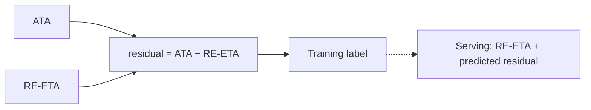
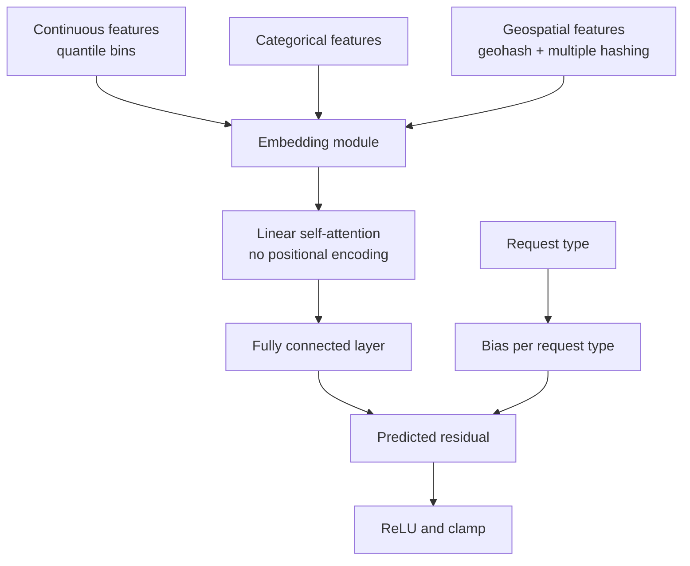
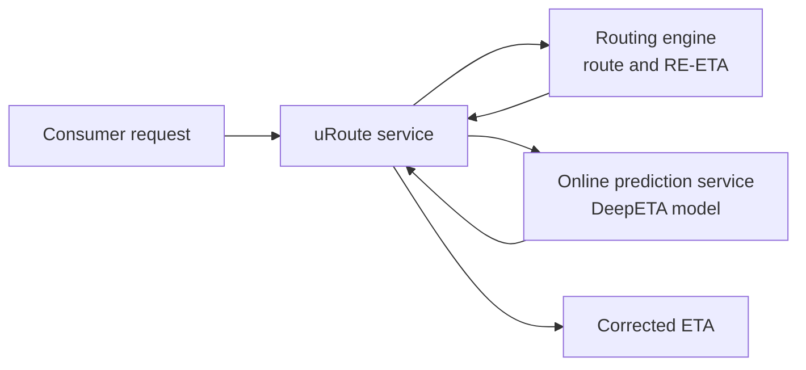

# Capstone #7: ETA / Arrival-Time Prediction — Uber's DeepETA

## At a glance

| Topic | Summary |
|---|---|
| Sources | Hu, Binaykiya, Frank and Cirit, "DeeprETA: An ETA Post-processing System at Scale," arXiv:2206.02127 (June 2022). Uber Engineering blog, "DeepETA: How Uber Predicts Arrival Times Using Deep Learning," February 10, 2022 (Hu, Cirit, Binaykiya and Hora). |
| Problem | Give a fast, accurate arrival time for rides and deliveries, when the route a driver will take is not known in advance and different consumers need different kinds of error. |
| Core idea | A routing engine produces a first ETA by summing segment times along the best path. A neural network predicts the residual between that ETA and the observed arrival time and adds it back. This is called post-processing. |
| Model | DeeprETANet: every feature is turned into a discrete bin and embedded, one linear-attention layer learns feature interactions, and a decoder with a bias term per request type outputs the residual. Total 141.2 million parameters, 0.5 million outside the embeddings *(source-confirmed)*. |
| Loss | An asymmetric Huber loss with two parameters, delta for robustness to outliers and omega for how much more underprediction costs than overprediction. The paper publishes neither value *(source-confirmed)*. |
| Latency | Median 3.25 ms and 95th percentile 4 ms in production. The blog sets the requirement at a few milliseconds at most *(source-confirmed)*. |
| Results | Against the routing engine ETA, MAE improves 7.83% (Table 2). Against the production XGBoost model in a two-week online test, MAE improves 2.91% for delivery and 2.66% for rides (Table 7) *(source-confirmed)*. |
| Not published | The values of delta and omega, the number of features, the latency budget the 3.25 ms sits in, and the production request rate. |
| First to break | Serving time and embedding memory, not arithmetic. The dense part of the model is about 0.5 million weights. |
| Easy-to-miss traps | Two parameter figures in the sources do not agree. By multiply-add counts the quadratic attention the paper dropped is small. Hashing helped here after the CTR paper rejected it. The 4-city table is a share of training data, not the request rate. |
| Practice PDFs | [Study edition](../../capstone-study-and-mock/uber-eta-prediction/capstone7_uber_eta_prediction_study.pdf) · [Mock interview](../../capstone-study-and-mock/uber-eta-prediction/capstone7_uber_eta_prediction_mock.pdf) |

Evidence labels used below: *(source-confirmed)* means the figure or claim is in the paper or the blog post. *(illustrative)* means it is this document's planning assumption. The model is called DeepETA in the blog and DeeprETA in the paper, and the two describe one system.

### Concepts this case study builds on

| Concept | Where it is taught | One-line recap |
|---|---|---|
| Back-of-envelope estimation and latency numbers | [Lesson 7, Concept 4](../../lessons/lesson-7-application-architecture-and-security.md#concept-4-back-of-envelope-estimation-technique--latency-numbers) | State assumptions, convert to rates and sizes, find the binding resource. |
| Transformers and attention | [Lesson 1, Group B](../../lessons/lesson-1-ai-fundamentals-refresher.md#b-serving-and-running-models) | Weigh how much each item should attend to every other one. |
| Residual and base estimate | [Glossary](../../appendix/glossary.md) | Predict the gap between a base estimate and the truth, and add it back. |
| Feature hashing | [Capstone #2](../ctr-prediction/README.md) | Map a feature value to a bucket with a hash function. |

---

## Step 1: Clarify Requirements & Frame the ML/AI Objective

### The setting

A routing engine, also called a route planner, divides the road network into small segments, finds the best path with a shortest-path algorithm, and adds up the segment times to get an ETA. It uses real-time traffic, accidents and weather for each segment. The paper lists four ways such an ETA falls short *(source-confirmed)*:

- Route uncertainty: the route a driver or courier will choose is not known in advance.
- Human error: drivers make mistakes in difficult stretches, and a shortest-path algorithm cannot account for that.
- Distribution shift: arrival times differ markedly between tasks, such as driving to a restaurant and driving to pick up a rider, even on the same shortest path.
- Uncertainty estimation: fare estimation needs a mean ETA, while user-facing ETAs may need a set of quantiles or expectiles.

The routing engine's objective is the best path. The paper says that this differs from estimating an end-to-end ETA, and that its accuracy suffers from re-routing and noisy data. The ends of a trip add noise, for example a driver looking for parking. The routing engine ETA sidesteps this by estimating travel time between neighborhoods and not between the exact start and end points.

### Post-processing

The paper's approach treats the routing engine ETA as a noisy estimate of the true arrival time and predicts the difference. The blog adds a practical reason: it is generally easier to take in new data sources and changing business requirements by updating the post-processing model than by refactoring the routing engine. The paper says the approach can sit on top of any routing engine. It was evaluated only with Uber's own.

### Ground truth

The label is the actual time of arrival (ATA). Its definition depends on the request type. For a pickup, it is the time from the driver accepting the request to the start of the ride or delivery trip. For a drop-off, it is the time from the start of the trip to its end. Every completed trip yields a label.

### Why it matters

The paper says that, because of the volume of decisions informed by ETAs, reducing error by low single-digit percentages unlocks tens of millions of dollars a year by improving marketplace efficiency. Uber uses ETAs to calculate fares, estimate pickup times, match riders to drivers and plan deliveries.

### Different consumers, different errors

For fares the mean error matters. For delivery ETAs, the paper says the mean absolute error and the 95th percentile both matter, because extreme errors give a bad experience. A single point estimate cannot serve every use, which is why the loss has two parameters (Step 4). Rides and deliveries have quite different distributions, and one shared model serves both.

### Out of scope

- The routing engine, taken as an input.
- The pricing and matching systems that consume the ETA.

### Trade-offs considered

One shared model for rides and deliveries gives one training and serving pipeline and gives up some specialization. A bias term per request type recovers part of it.

---

## Step 2: Back-of-Envelope Constraints

### What the sources say

The paper says that a ride-hailing platform like Uber has billion-level requests to process on a weekly basis, and that this post-processing system has the highest QPS at Uber. No exact rate is given.

### The training data gives a second anchor

The paper's dataset covers September 13 to October 1, 2021, split sequentially: 14 days for training and validation (90% and 10%) and 7 days for testing. The training data has approximately 1.4 billion ETA requests. Requests with a travel time over 2 hours were removed *(source-confirmed)*. If those are all requests in the window:

```text
1,400,000,000 ÷ (14 × 86,400) = about 1,160 requests a second
```

The paper does not say whether the data is a sample, so this is a lower bound on the production rate. It also implies fewer than a billion requests a week, so either the data is a sample or "billion-level" is loose. An alternative anchor is 2 billion requests a week *(illustrative)*:

```text
2,000,000,000 ÷ 604,800 = about 3,300 a second on average
at an assumed peak ratio of 4: about 13,200 a second
```

The four cities in Table 5 add up to 71.8 million delivery and 480.2 million ride requests in the training data, 552 million in all, about 39% of the 1.4 billion. That table is a share of training data and not a request rate.

### Latency

In production the median latency was 3.25 ms and the 95th percentile 4 ms, and the latency was stable across different loads (Figure 8, shown as a chart). The blog says the model must return an ETA within a few milliseconds at most. The paper does not say what total budget this sits inside.

### What a request costs

DeeprETANet has 141.2 million parameters, of which 0.5 million are outside the embeddings (Table 4). In float32 *(assumed)*, the model is 565 MB. The dense part is small:

```text
0.5 million weights = about 1 million FLOPs per request
at an assumed 20 billion FLOPs a second per core = about 0.05 ms
```

So most of the 3.25 ms is not the dense arithmetic. It is feature assembly, the call to the prediction service and queueing, which is this document's reading and is not stated in the sources.

### Sizing the fleet

By Little's law, requests in flight equal the rate times the time each takes. The paper says servers have 4 cores each. At the illustrative peak of 13,200 a second and 3.25 ms:

```text
requests in flight = 13,200 × 0.00325 = about 43
hosts at full use  = 43 ÷ 4 cores = about 11
hosts at 30% use   = about 36
```

Each ETA call may come from several model calls per user request, which would multiply this *(illustrative)*.

### Two parameter figures that disagree

The blog says any one prediction touches only roughly 0.25% of the model's parameters. Table 4 says 0.5 million parameters are outside the embeddings, which is 0.35% of 141.2 million. A prediction cannot touch less than the dense part. The two statements may describe different model configurations, and neither source reconciles them.

### Trade-offs considered

The qualitative scale is the load-bearing fact, and the rate is an assumption. Treating the latency as a hard bound rules out a mixture-of-experts head and a multi-head output, which the paper says it tried and found too slow.

---

## Step 3: Data / Knowledge Pipeline

### Sidebar: residual and base estimate

A base estimate is an existing prediction from a separate system, here the routing engine ETA. A residual is the difference between what happened and that estimate:

```text
residual = ATA − RE-ETA        final ETA = RE-ETA + predicted residual
```

The paper writes the final estimate as the routing engine ETA plus a residual that is a function of the request and that ETA. Predicting only the gap means the model does not have to relearn road structure and basic traffic that the routing engine already captures. The paper notes that the RE-ETA and its residual are both skewed with long tails.



### Raw features

Table 1 of the paper lists the raw features in one ping *(source-confirmed)*:

| Group | Examples |
|---|---|
| Temporal | minute of day, day of week |
| Geospatial | latitude and longitude of the begin and end locations |
| Trip | trip type, route type, request type, routing engine ETA, estimated distances |
| Traffic | real-time and historical speed |
| Context | country, region and city IDs |

The paper says the spatial and temporal features are the most important.

### Discretize everything

All features are pre-processed into discrete bins before the embedding module. The paper found that discretizing and embedding all features gave a significant accuracy lift over using continuous features directly.

- Categorical features are looked up in an embedding table. Minute of week has a vocabulary of 10,080 and an embedding size of 8, which is 80,640 parameters.
- Continuous features go through a quantile bucketizing function and then an embedding table. Speed is bucketized into 256 quantiles, which led to better accuracy than using speed directly.
- Quantile buckets beat equal-width buckets. The explanation offered: for any fixed number of buckets, quantile buckets convey the most information in bits about the original value. The blog adds that a network with bucketized features does not spend parameters learning to partition the input space.

### Geospatial features

Locations are mapped to geohashes at several resolutions, with u in 4, 5, 6 and 7. A geohash of length u carries 5u bits, so the number of grid cells grows exponentially:

```text
u = 4: 2^20 =          1,048,576 cells
u = 5: 2^25 =         33,554,432
u = 6: 2^30 =      1,073,741,824
u = 7: 2^35 =     34,359,738,368
```

The paper tried exact indexing, one embedding per cell, which takes the most space. It chose multiple feature hashing: each cell is mapped to bins by two independent hash functions (MurmurHash3 with different seeds), and each bin has its own embedding. The origin, the destination and the pair are hashed separately, at every resolution. Using several resolutions helps with the sparsity of the finest grid.

### The result goes against the CTR paper

In the ablation, removing feature hashing, which means indexing the geohash string directly, lowered MAE improvement from 7.83% to 7.41%. The blog says that single-hash feature hashing saved space with the same or slightly worse accuracy, and that multiple hashing gave the best accuracy and latency while still saving space. The network can combine independent buckets to undo the harm of a single collision. The [CTR case study](../ctr-prediction/README.md) reports that Google rejected hashing for its own features. Both can be true: the right choice depends on how sparse the data is and whether sharing statistics between rare cells helps.

### Training data and retraining

Table 5 gives requests by city and type, in millions:

| City | Delivery | Rides |
|---|---|---|
| New York City | 19.94 | 138.62 |
| Los Angeles | 17.46 | 58.32 |
| London | 18.33 | 102.84 |
| Mexico City | 16.11 | 180.39 |

The model is retrained and validated weekly with an automatic workflow. The blog lists continuous, incremental training on fresher data as future work.

### Trade-offs considered

Training on the residual ties the model to the routing engine. If the routing engine changes, the residual distribution changes and the model needs retraining. Bucketizing loses precision inside a bucket and gains a fixed-size embeddable form.

---

## Step 4: Model/Agent Core Design

### The architecture

DeeprETANet has an embedding module and a two-layer module. The paper calls it a wide and shallow network with two layers besides the embeddings: a linear transformer layer, and a fully connected layer with calibration. The blog says the team tried 7 architectures: MLP, NODE, TabNet, sparsely gated mixture of experts, HyperNetworks, a Transformer and a linear Transformer. An encoder-decoder with self-attention gave the best accuracy.



### Sidebar: self-attention over features

In a language model each vector is a word token. Here each vector is one feature, such as the origin or the time of day. Self-attention learns interactions between features, so the model can scale the importance of distance given the time, the place and the traffic. Feature order carries no meaning, so there is no positional encoding.

The paper first tried the original Transformer attention, which computes an L by L matrix of pairwise dot products for L features. It gave good accuracy and was too slow for online serving. It switched to the linear transformer, whose cost grows with L times d squared, against L squared times d, where d is the embedding dimension. Linear attention is much faster when L is much larger than d.

```text
the blog's example: 40 features of dimension 8
L^2 × d = 12,800 multiply-adds      L × d^2 = 2,560      5 times fewer
```

At an assumed 20 billion multiply-adds a second per core, 12,800 operations take under a microsecond. By operation count, standard attention at that size is not what makes a 3 ms model slow, and the dense layer is larger. The paper reports no timings that separate these costs. The slowdown may come from implementation overheads or from larger shapes than the blog's example, and the sources do not say. Treat the claim as the authors' finding and measure on your own shapes.

### The calibration layer

The decoder is a fully connected layer with bias parameters per request type. The bias comes from a linear layer over a one-hot encoding of the request type, and it adjusts the raw prediction for mean shifts between types. The paper tried two ways of handling heterogeneity, embedding the request type so that the interaction layer sees it, and the calibration layer, and also tried a multi-head structure and mixture of experts, which did not meet the latency requirement. The blog says the bias layer beat adding segment features to the model, and was chosen over a multi-task decoder for latency. Removing it lowered MAE improvement from 7.83% to 7.73%.

### The loss

The asymmetric Huber loss uses a base Huber loss with parameter delta: squared error for errors under delta, and a linear penalty beyond it. A second parameter omega weights errors by direction, omega on overprediction and one minus omega on underprediction. The paper says it lets the team tune the point estimate to business goals, where being a minute late is worse than being a minute early.

With delta = 60 seconds and omega = 0.3 *(illustrative, since the paper gives no values)*, an error of 120 seconds costs:

```text
base loss = delta × error − delta^2 ÷ 2 = 60 × 120 − 1,800 = 5,400
underprediction (arrival later than predicted): 0.7 × 5,400 = 3,780
overprediction  (arrival earlier than predicted): 0.3 × 5,400 = 1,620      2.3 times less
```

Omega is a business judgment and the model optimizes whatever asymmetry it is given.

### Offline results

Table 2 reports relative improvement over the routing engine ETA, in percent:

| Model | MAE | p50 | p95 |
|---|---|---|---|
| XGBoost | 5.07 | 1.79 | 5.98 |
| ResNet | 7.39 | 6.19 | 7.27 |
| HammockNet | 7.58 | 6.12 | 7.56 |
| DeeprETANet | 7.83 | 6.25 | 7.99 |
| without calibration | 7.73 | 6.12 | 7.85 |
| without feature hashing | 7.41 | 5.10 | 7.99 |

The relative improvement is the drop in mean absolute error divided by the routing engine's own. For example, with a routing engine MAE of 100 seconds *(illustrative)*, a 7.83% improvement gives 92.2 seconds. DeeprETANet has the lowest MAE and p50. For p95, the versions with and without hashing tie, which the paper reads as richer geospatial embeddings helping typical cases and not extreme errors.

Table 3 splits DeeprETANet's gains by request type:

| Type | MAE | p50 | p95 |
|---|---|---|---|
| Delivery | 7.46 | 2.26 | 11.05 |
| Rides | 7.86 | 6.25 | 7.62 |

Rides have much lower p50 error, and deliveries have much lower p95 error.

### The baselines

The XGBoost baseline is the group of XGBoost models, one per mega-region, that was the production ETA model before DeeprETA, with maximum depth 15, up to 250 trees and a learning rate of 0.1. ResNet had 4 residual blocks with hidden size 512. HammockNet used quantized one-hot inputs and two layers of sizes 800 and 100. DeeprETANet's linear transformer uses key, query and value dimensions of 4, and its fully connected layer has 2048 units. The paper does not say whether each baseline predicts the residual or the ETA directly. It reports all of them on the same improvement measure against the routing engine ETA.

### Why not a single end-to-end model

The paper does not compare against a model that ignores the routing engine, so the sources give no evidence either way on correcting versus replacing. The argument for correcting is practical: the base estimate keeps working if the model is absent, a residual is easier to debug, and the post-processing model is easier to update than the routing engine. The argument for replacing is that it removes the coupling to the routing engine's changes. Both are reasoning.

### Trade-offs considered

Linear attention gives up some capacity for speed on the authors' account. A discretized input gives a fixed-size lookup and loses precision within a bucket. A calibration bias is cheap and handles only mean shifts.

---

## Step 5: Serving Architecture

### The request path

The blog describes the serving path *(source-confirmed)*: consumer requests are routed through various services to the uRoute service, the front end for all routing lookups. It asks the routing engine for route lines and ETAs, then uses that ETA and other model features to call the Michelangelo online prediction service for the DeepETA model. Periodic auto-retraining workflows retrain and validate the model.



The model's raw output is the residual. It is added to the routing engine ETA, passed through a ReLU to force the ETA to be positive, and clamped to reduce the effect of extreme values.

```python
def final_eta(re_eta_seconds: float, residual: float, cap: float = 10_800.0) -> float:
    return min(max(0.0, re_eta_seconds + residual), cap)   # ReLU, then clamp
```

The cap of 3 hours is an illustrative choice.

### Training and serving hardware

The paper trained on Nvidia Quadro RTX 5000 GPUs and ran its offline experiments on two of them. Production requests are served by a fleet of servers with 4 cores per host, with no GPU. A model that is 99% embedding lookups and about 0.5 million dense weights runs well on CPU.

### Why embedding lookups are cheap

The paper says that although the embeddings are 99% of the parameters, they contribute minimally to latency because an embedding table lookup takes constant time. The blog says that mapping a latitude and longitude takes a quantization and a hash lookup, O(1), against O(log N) for a tree and O(N^2) for fully connected layers learning the same mapping. Each prediction touches only the rows its features index into.

### What the sources do not say

- How features are assembled and fetched, or the latency budget of the whole ETA call.
- What happens if the prediction service is down. A fallback to the routing engine ETA is possible and is this document's inference.
- The request rate, or how many model calls one user request makes.

### Decision table

| Decision | This system's choice | Choose differently when |
|---|---|---|
| Base estimate | Routing engine ETA plus a learned residual | An end-to-end model if the base estimate is unreliable and the system can afford the coupling to retraining |
| Features | Discretize and embed everything | Raw continuous values for a tiny model |
| Geospatial encoding | Multi-resolution geohash with two independent hashes | Exact indexing if memory is plentiful and data per cell is dense |
| Interaction layer | Linear self-attention | Standard attention if the measured cost fits the budget |
| Heterogeneity | A bias per request type | A multi-head or expert model if latency allows |
| Loss | Asymmetric Huber | A quantile loss if one quantile is the only target |
| Serving | CPU hosts with 4 cores | GPU if the dense part grows a lot |

### Trade-offs considered

The model needs the routing engine ETA first, so its availability depends on the routing engine. That dependency exists anyway because the route is shown to the user. CPU serving fits this model and would be revisited if the dense layers grew.

---

## Step 6: Evaluation, Monitoring and Iteration

### Metrics

The paper uses mean absolute error (MAE), the 50th percentile absolute error and the 95th percentile absolute error, each as a relative improvement over the routing engine ETA. For latency it uses offline batch inference time to pre-screen models and an online test of latency, queries per second and CPU use.

### Online shadow tests

Shadow experiments ran globally for 2 weeks. The launch criterion was to improve ETA accuracy over the online XGBoost model, measured by MAE, p50 and p95 across mega-regions. Table 7 reports improvement over XGBoost, aggregated from multiple launches:

| Type | MAE | p50 | p95 |
|---|---|---|---|
| Delivery | 2.91 | 4.74 | 3.92 |
| Rides | 2.66 | 4.15 | 3.23 |

Tables 2 and 7 use different baselines, the routing engine ETA and the production XGBoost model, and cannot be compared directly. The paper says DeeprETA is launched and now serves all 4-wheel ETA prediction requests at Uber.

### Regional results

Table 6 gives relative MAE improvement over the routing engine ETA by city:

| City | XGBoost | ResNet | HammockNet | DeeprETANet |
|---|---|---|---|---|
| New York City | 4.09 | 7.02 | 7.13 | 7.20 |
| Los Angeles | 4.84 | 6.29 | 6.41 | 6.80 |
| London | 1.39 | 4.09 | 4.28 | 4.80 |
| Mexico City | 3.93 | 5.86 | 6.31 | 6.60 |

New York City improves the most. London is lowest for every model, so the gap is not specific to DeeprETANet. The paper offers no cause. The gain of DeeprETANet over XGBoost is largest in London, 3.4 points against 3.1 in New York City, 2.0 in Los Angeles and 2.7 in Mexico City. All models were trained and evaluated on global data.

### Residuals after correction

Figure 7 shows, for each city on a 1% sample, the bivariate distribution of the routing engine's residuals and the predicted residuals. The paper notes that rides and delivery have quite different residual distributions, and that after post-processing the mean residual is closer to 0. Tracking the mean residual over time is a reasonable monitor of drift between the model and the routing engine. That use is this document's suggestion.

### The paper's own limitation

It evaluated the hybrid approach only with Uber's proprietary routing engine. It expects similar gains with others and did not test it.

### Failure modes

- Re-routing and noisy data, the sources' own reason the routing engine ETA is off.
- Drift between weekly retraining cycles if the routing engine changes.
- Regional variance, as in London.
- A single loss asymmetry that is wrong for an individual rider who needs a safe estimate in the other direction. This is reasoned.

### What breaks first at 10×

| Quantity | At 10× | Reason |
|---|---|---|
| Request rate | 10 times | Scales with demand |
| Hosts | About 10 times | One short CPU call per request |
| Embedding memory | Grows with vocabulary and hash bins, not traffic | Fixed-size tables |
| Training data | 10 times the requests per week | Weekly retraining reads more |
| Metric noise | Falls with the square root of the sample | Easier to see small gains |

### Trade-offs considered

Reporting against the routing engine shows total value over doing nothing, and reporting against the old model shows the increment from replacing it. A two-week shadow test costs time and avoids exposing riders to an unproven model. Splitting results by city keeps a global average from hiding a weak region.

---

## Sources and Further Reading

- Hu, Binaykiya, Frank and Cirit, "DeeprETA: An ETA Post-processing System at Scale," arXiv:2206.02127 (June 5, 2022). The source of the formulation, the architecture, the loss, the tables and the latency figures marked source-confirmed.
- Uber Engineering, "DeepETA: How Uber Predicts Arrival Times Using Deep Learning," February 10, 2022. The source of the 7 architectures tried, the latency requirement, the 0.25% figure, the O(1) lookup comparison, the complexity example and the serving path.
- Katharopoulos et al., "Transformers are RNNs: Fast Autoregressive Transformers with Linear Attention," ICML 2020, the linear attention the model uses. Cited by the paper and not read for this document.
- [Lesson 7](../../lessons/lesson-7-application-architecture-and-security.md), Concept 4: the estimation method used in Step 2.
- [Capstone #2, CTR Prediction](../ctr-prediction/README.md): a contrasting result on feature hashing.
- [Glossary](../../appendix/glossary.md): residual and base estimate.

Labels: *(source-confirmed)* is in the paper or the blog post. *(illustrative)* is a planning assumption of this document.
