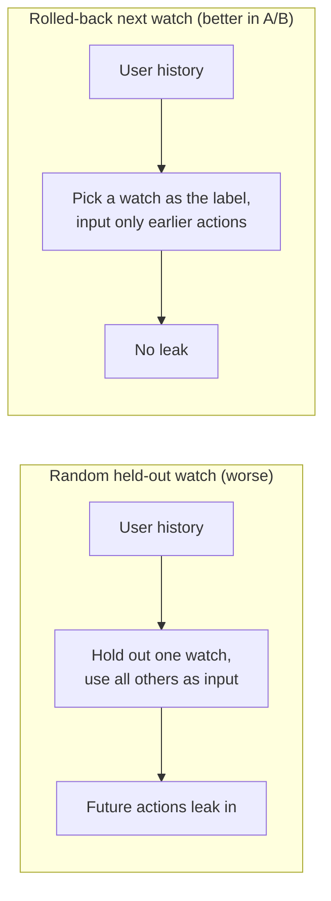
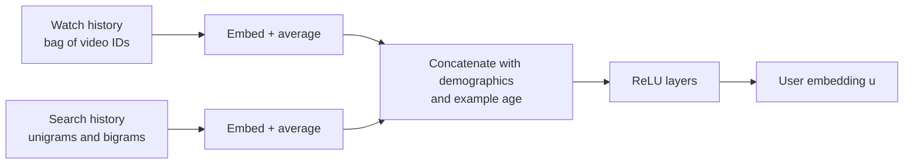
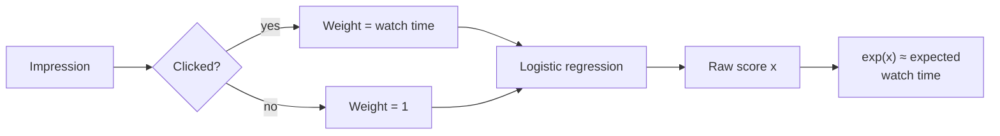

# Capstone #3: Video Recommendation — YouTube's Candidate Generation + Ranking Split

## At a glance

| Topic | Summary |
|---|---|
| Source | Covington, Adams and Sargin, "Deep Neural Networks for YouTube Recommendations," RecSys 2016 (DOI 10.1145/2959100.2959190). |
| Problem | Recommend videos to over a billion users from a corpus of millions, with a corpus that changes every hour and with labels that are noisy proxies for satisfaction. |
| Core idea | Two neural networks. Candidate generation narrows millions of videos to hundreds using coarse features. Ranking scores only those hundreds with a rich feature set and sorts them by expected watch time. |
| Candidate generation | Extreme multiclass classification: predict the next watched video among millions. Training samples several thousand negatives, which the paper reports as a more than 100 times speedup over a full softmax *(source-confirmed)*. |
| Ranking | Logistic regression where each clicked impression is weighted by its watch time and each unclicked one by 1. Its learned odds approximate expected watch time *(source-confirmed)*. |
| Label choices | Predict the next watch, not a random held-out one. Train on all watches, not only watches of recommended videos. Add the age of each example as a feature, and set it to zero when serving *(source-confirmed)*. |
| Results the paper gives | Ranking loss falls from 41.6% with no hidden layers to 34.6% with a 1024, 512, 256 tower. Weighting positives and negatives equally raises it by 4.1% *(source-confirmed)*. |
| First to break | Compute and memory at retrieval, then ranking CPU. A brute-force dot product over 10 million 256-dimensional videos reads 10.24 GB per request, and costs about 3 times the ranking stage *(illustrative)*. |
| Easy-to-miss traps | Ranking is weighted classification, not regression. Scoring the whole corpus with the ranking network would need millions of cores. A random held-out label leaks the future. A raw watch-time weight can favor long videos. |
| Practice PDFs | [Study edition](../../capstone-study-and-mock/video-recommendation/capstone3_video_recommendation_study.pdf) · [Mock interview](../../capstone-study-and-mock/video-recommendation/capstone3_video_recommendation_mock.pdf) |

Evidence labels used below: *(source-confirmed)* means the figure or claim is in the paper. *(illustrative)* means it is this document's planning assumption, chosen to sit inside the paper's qualitative scale.

### Concepts this case study builds on

| Concept | Where it is taught | One-line recap |
|---|---|---|
| Embeddings, vector databases, nearest-neighbor search (C1, C2) | [Lesson 1, Group C](../../lessons/lesson-1-ai-fundamentals-refresher.md#c-retrieval-and-knowledge) | A learned vector places similar items close together, and an index finds the nearest ones. |
| NoSQL types: a vector store is a fixed-width value keyed by an ID | [Lesson 5, Concept 2](../../lessons/lesson-5-data-layer.md#concept-2-nosql-types) | Choose the storage shape by how the data is read. |
| Offline evaluation | [Lesson 9, Concept 2](../../lessons/lesson-9-evaluation-and-observability.md#concept-2-offline-evaluation--golden-datasets-llm-as-judge-regression-suites) | Gate changes on a fixed measurement, and know what it cannot tell you. |
| Two-stage retrieval, sampled softmax, example age | [Glossary](../../appendix/glossary.md) | Retrieve cheaply, rank carefully; sample negatives; tell the model how old an example is. |

---

## Step 1: Clarify Requirements & Frame the ML/AI Objective

### The three difficulties

The paper names what makes the problem hard *(source-confirmed)*:

- Scale: algorithms that work on small problems fail here, and the corpus and the user base are both enormous.
- Freshness: many hours of video are uploaded every second, so the system must model new content and the user's latest actions. Balancing new against established videos is an exploration and exploitation question.
- Noise: behavior is hard to predict because of sparsity and unobservable factors. The system rarely obtains ground truth about satisfaction, and models noisy implicit feedback instead. Video metadata is also poorly structured.

### Ground truth: implicit feedback

Implicit feedback is a label inferred from what users do, here which videos they watch, instead of asking them. YouTube also has explicit signals such as thumbs up and surveys. The paper trains on watches anyway, where a user completing a video is a positive example. Its reason: orders of magnitude more implicit history exists, which allows recommendations deep in the tail where explicit feedback is extremely sparse.

### One system, two objectives

The two networks are trained for different jobs.

| Stage | Training problem | What it optimizes |
|---|---|---|
| Candidate generation | Classify the next watched video among millions | Broad relevance, with high precision in a small set |
| Ranking | Logistic regression on impressions, positives weighted by watch time | Expected watch time per impression |

The paper explains the ranking choice directly: ranking by click-through rate often promotes deceptive videos that users do not complete, while watch time better captures engagement. It adds that the final ranking objective is constantly tuned with live A/B tests and is generally a simple function of expected watch time per impression *(source-confirmed)*.

Ranking has other jobs besides picking the best of the set. It specializes and calibrates candidate predictions for the particular interface: a user may often watch a video but be unlikely to click its homepage thumbnail. It also combines candidate sources whose scores are not directly comparable.

### What a watch-time objective can reward

Weighting by watch time rewards long watches. A click on a 60-minute video watched to the end counts for 20 times a 3-minute video watched to the end. The paper does not discuss this, and it says the production objective is a tuned function of expected watch time, so the raw sum is not necessarily what ships. Treat length bias as a risk to measure, for example by slicing results by video length.

### Out of scope

- The presentation layer: thumbnails, row layout, the app screen of Figure 1.
- The other candidate sources the paper says can be blended in, a separate earlier system.
- Monetization. This is an organic recommendation paper with no auction.

### Trade-offs considered

Watch labels give far more data than explicit ratings and reach the tail. They remain a proxy for a satisfied, returning user, and a completed watch is stronger evidence than a click without being the same as satisfaction. Splitting the objective gives each stage a formulation that suits its job, at the cost of never optimizing one loss end to end.

---

## Step 2: Back-of-Envelope Constraints

### What the paper says about scale

- More than a billion users.
- A corpus of millions of videos, narrowed to hundreds of candidates, then to dozens shown (Figure 2).
- Models that learn approximately one billion parameters, trained on hundreds of billions of examples.
- A strict serving latency of tens of milliseconds for scoring candidates.

All are qualitative. The arithmetic below picks anchors inside them *(illustrative)*.

### The funnel

```text
corpus                 = 10,000,000 videos
after candidate gen    =        500 candidates       20,000× fewer
after ranking          =         20 shown                25× fewer
corpus to screen       = 10,000,000 ÷ 20 = 500,000×
requests per day       = 1,000,000,000 users × 2 loads = 2,000,000,000
average rate           = 2,000,000,000 ÷ 86,400 = 23,148 requests/s
peak rate (3×)         = 69,444 requests/s
```

The paper's experiments use a 1-million-video vocabulary. That is the size of one experiment, not the production corpus.

### What each step costs

Cost is counted in multiply-adds (MACs). The tower sizes are the paper's 1024, 512 and 256 layers. The input widths are assumptions: 520 for candidate generation and 1,000 for ranking.

```text
candidate-gen tower   = 520×1,024 + 1,024×512 + 512×256 = 1.19 million MACs per request
ranking tower         = 1,000×1,024 + 1,024×512 + 512×256 = 1.68 million MACs per candidate
ranking, 500 cands    = 1.68 million × 500 = 840 million MACs per request
ranking, whole fleet  = 840 million × 23,148 = 19.4 trillion MACs/s
at 20 billion MACs/s per core  ≈ 972 cores on average, about 2,900 at peak
```

The rate of 20 billion MACs a second per core is an assumption. Two alternatives show why the funnel is built as it is.

| Design | Work per request | At 23,148 requests/s |
|---|---|---|
| Brute-force dot product, 10 million videos × 256 dimensions | 2.56 billion MACs, 10.24 GB read in float32 | 59 trillion MACs/s, about 3 times the ranking stage |
| Ranking network on every video | 1.68 million × 10 million = 16.8 trillion MACs | 3.9 × 10^17 MACs/s, about 19 million cores |

Scoring the whole corpus with the ranking network is out of the question. That is the case for two stages. A brute-force dot product for retrieval is expensive but not absurd, and reading 10.24 GB takes about 0.1 s at an assumed 100 GB/s on one machine, which is more than the tens-of-milliseconds budget. An index that visits only part of the vectors cuts both costs, which is the case for approximate search (Step 5).

### A parameter check

The experiments embed 1 million videos, 1 million search tokens and 1 million output classes at 256 floats each. That is 768 million parameters, about 3.1 GB in float32. It is the same order as the paper's production figure of about a billion. The paper does not say how many parameters the experimental models had.

### Trade-offs considered

A bigger candidate set raises the ceiling on recall and doubles the ranking cost, since ranking runs once per candidate. A larger corpus changes the ratios and not the shape: most of the narrowing still happens in candidate generation.

---

## Step 3: Data / Knowledge Pipeline

### Training examples

Two choices shape the training data *(source-confirmed)*:

- Examples come from all YouTube watches, even those embedded on other sites, not only from watches of recommended videos. Otherwise new content would struggle to surface and the recommender would be biased toward exploitation. Discovery by other means should propagate through collaborative filtering.
- A fixed number of examples is generated per user, which weights users equally in the loss. This stops a small cohort of heavy users from dominating.

### Label and context

Many collaborative filtering systems hold out a random watch and predict it from the rest of the history. The paper found this performs worse, and gives the reason: natural consumption is asymmetric. Episodes are watched in order, and users discover a genre by its most popular items before moving to niches. A random held-out watch lets the model see actions that came after the label, which leaks future information.

The paper's alternative rolls back the history. It picks a random watch as the label and uses only the actions taken before it as input. This performed better in live A/B tests. The paper says the choice has an outsized effect on live results and is very difficult to measure offline.



### Withholding information

A user has just searched for "taylor swift". A classifier predicting the next watch learns that it will probably be a video from that search results page, and reproducing the last search page as homepage recommendations performs very poorly. The paper discards the order of searches and represents them as an unordered bag of tokens, so the classifier does not know where the label came from.

### Sidebar: example age

Models trained on history are biased toward the past. A model trained over a window of several weeks reflects the average watch likelihood of that window, and video popularity is highly non-stationary. A fresh video would be underrated.

The paper feeds the age of each training example as a feature. Age is measured back from the end of the training data. At serving time the feature is set to zero, or slightly negative, to say that the model is predicting at the very end of the training window. Figure 4 shows, for one video, that the model with the feature follows the video's upload time and popularity curve and the model without it predicts roughly the window average. The paper reports improved offline holdout precision and a dramatic increase in watch time on recently uploaded videos in A/B tests *(source-confirmed)*.

The feature carries an assumption. Zero means "now is the end of the training window". If the served model is old, "now" is later than the window's end, and the feature quietly understates how fresh things are. That follows from the design and is not a claim of the paper.

### Trade-offs considered

Training on all watches reduces the filter-bubble risk and means part of the signal comes from paths the system cannot attribute. The next-watch label is harder to build than a random holdout and, per the paper, better online. Example age is one scalar doing real work, so a wrong serving value degrades results quietly.

---

## Step 4: Model/Agent Core Design — Two Stages and Extreme Multiclass Classification

### Sidebar: two-stage retrieval then ranking

A single model that applied rich per-candidate features to a corpus of millions would pay that cost millions of times per request. Step 2 priced it at about 19 million cores. The paper's two stages answer this:

- Candidate generation takes the user's history and context and retrieves hundreds of videos with high precision. It gives broad personalization through collaborative filtering, and similarity between users is expressed in coarse features such as video IDs watched, search tokens and demographics.
- Ranking assigns a score to each candidate with a rich set of features describing the video and the user's relationship to it, and sorts. It can do this because only a few hundred videos are scored *(source-confirmed)*.


The price is a ceiling. Ranking can only order what candidate generation retrieved, so a video missed at stage one cannot be recovered.

### Sidebar: extreme multiclass classification

Candidate generation predicts which video a user will watch next, among millions of classes. The paper writes this as a softmax *(source-confirmed)*:

```text
P(watch = i | user U, context C) = exp(v_i · u) ÷ sum over all videos j of exp(v_j · u)
```

Here u is a learned embedding of the user and context, and each v_j is a learned embedding of video j. The sum in the denominator runs over every video. Computing it for every example is the cost to avoid.

The paper uses candidate sampling. For each example it samples negative classes from the background distribution, minimizes cross-entropy for the true label and the sampled negatives, and corrects for the sampling by importance weighting. Figure 3's caption calls the result the sampled softmax. In practice several thousand negatives are sampled, which the paper reports as more than 100 times faster than a traditional softmax.

The cost per example, in the output layer alone and with 256 dimensions *(illustrative)*:

```text
full softmax over 1,000,000 videos  = 1,000,000 × 256 = 256 million MACs
sampled, 5,000 negatives            =     5,000 × 256 =   1.28 million MACs      200× fewer
per pass over 200 billion examples  = 5.1 × 10^19 against 2.6 × 10^17 MACs
at 10^12 MACs/s, one accelerator    = about 593 days against 3 days
```

The paper states only "more than 100 times", so 200 is consistent with that figure and not a quotation. With a vocabulary of millions the ratio is larger.

The paper also tried the popular alternative, hierarchical softmax, and did not reach comparable accuracy. Each node in the tree has to separate groups of classes that are often unrelated, which makes the problem harder and degrades performance.

### The candidate generation network

The design follows continuous bag of words language models *(source-confirmed)*:

- Watch history is a variable-length list of video IDs, mapped through learned embeddings and averaged. Averaging performed best among several options, including sum and component-wise max.
- Search history is tokenized into unigrams and bigrams, embedded and averaged the same way.
- Geographic region and device are embedded. Gender, logged-in state and age enter as values normalized to between 0 and 1. Example age is added.
- Everything is concatenated into a wide first layer, then fully connected ReLU layers produce the user embedding u.



In the experiments, 1 million videos and 1 million search tokens were embedded with 256 floats each, with at most 50 recent watches and 50 recent searches. The towers halve in width at each layer. Depth 0 is one linear layer. Depths 1 to 4 use 256; 512 then 256; 1024, 512, 256; and 2048, 1024, 512, 256 ReLU units. Adding features and depth significantly improved holdout MAP (Figure 6). Depth zero behaves like a linear factorization and performed very similarly to the matrix-factorization system it replaced.

### The ranking network

Ranking uses a similar network and gives each impression an independent score from logistic regression *(source-confirmed)*:

- Features number in the hundreds, roughly half categorical and half continuous. The strongest describe the user's past interaction with the item and similar items, such as how many videos they watched from this channel and when they last watched one on this topic. Which sources nominated a candidate, and with what scores, are also fed in.
- Each ID space has its own embedding, with dimension roughly proportional to the logarithm of the number of unique values. Large spaces keep only the top N by frequency in clicked impressions, and unknown values map to a zero embedding.
- Features in the same ID space share one embedding. That improves generalization, speeds training and cuts memory.
- A continuous feature is rescaled through its cumulative distribution to between 0 and 1, and its square and square root are fed too. Dropping the powers raised the loss by 0.2%.

### Modeling expected watch time

Ranking uses weighted logistic regression. The model is trained with logistic regression under cross-entropy loss, but each clicked impression is weighted by its watch time and each unclicked one by 1. With N examples, k positives and watch time T_i, the learned odds are the sum of the T_i divided by N − k. When positives are rare, this is approximately E[T] × (1 + P), where P is the click probability and E[T] the expected watch time of the impression, so it is close to E[T]. At inference the paper applies the exponential function to the model's raw score to produce these odds.

A worked case *(illustrative)*: 1,000 impressions, 20 clicks, each clicked impression watched 5 minutes.

```text
sum of weights on positives = 20 × 5 = 100 minutes
sum of weights on negatives = 980 × 1 = 980
odds                        = 100 ÷ 980 = 0.1020
E[T] = 100 ÷ 1,000          = 0.1000;   E[T] × (1 + P) = 0.1 × 1.02 = 0.1020
```

The output is a score in watch-minutes per impression. It is not a click probability.



### Trade-offs considered

Candidate sampling is a biased approximation corrected by weighting. It was faster than a full softmax and, in the paper's account, more accurate than hierarchical softmax. Splitting the two objectives lets each stage be shaped by its own job and means no shared loss.

---

## Step 5: Serving Architecture

### Candidate generation at serving time

The paper says scoring millions of items in tens of milliseconds requires an approximate scheme that is sublinear in the number of classes *(source-confirmed)*. Previous systems at YouTube relied on hashing, and the described classifier uses a similar approach. Calibrated probabilities are not needed at serving time, so the problem reduces to a nearest neighbor search in the dot product space, for which general purpose libraries can be used. A/B results were not particularly sensitive to the choice of algorithm.

The reduction works because exp is strictly increasing. The video with the largest dot product also has the largest softmax probability, so only the order of dot products matters.

### What an exact scan costs

Using the Step 2 figures, one request against 10 million float32 vectors of 256 dimensions reads 10.24 GB and does 2.56 billion MACs. At 23,148 requests a second that is 59 trillion MACs a second, about 3 times the ranking stage. Batching several requests lets one pass over the embeddings serve them all, at the cost of waiting for the batch to fill. An index that visits about 1% of the vectors would cut the work about 100 times, with a recall loss that has to be measured against the exact result *(illustrative)*.

### A sketch of the funnel

This sketch is for clarity and not for scale. It stands in for an approximate index with an exact dot product over every video, which is the design Step 2 priced out.

```python
import numpy as np

def generate_candidates(u: np.ndarray, video_vecs: np.ndarray,
                        video_ids: list[int], top_n: int = 500) -> list[int]:
    scores = video_vecs @ u                       # exact scan over the corpus
    top = np.argpartition(scores, -top_n)[-top_n:]
    top = top[np.argsort(-scores[top])]
    return [video_ids[i] for i in top]

def recommend(user_id, u, video_vecs, video_ids, ranker, shown: int = 20):
    candidates = generate_candidates(u, video_vecs, video_ids)
    scored = [(v, ranker.expected_watch_time(user_id, v)) for v in candidates]
    scored.sort(key=lambda pair: pair[1], reverse=True)
    return [v for v, _ in scored[:shown]]
```

### Ranking at serving time

Because ranking scores only a few hundred videos, it can afford hundreds of features per candidate. Query features are computed once per request, and impression features once per item scored. The paper says shared embeddings matter for memory: one million IDs embedded in 32 dimensions have 7 times more parameters than fully connected layers 2,048 units wide. Check: 1,000,000 × 32 = 32,000,000 against 2,048 × 2,048 = 4,194,304, a ratio of 7.6. Most parameters sit in the embedding tables, not the hidden layers.

### Fresh features and churn

Features such as time since the last watch on this topic, and the number of previous impressions of this video, depend on the last few seconds. The paper calls serving up-to-the-second impression and watch history an engineering feat of its own, outside its scope, and vital for responsive recommendations. A video shown but not watched is demoted on the next page load, which creates churn: successive requests do not return identical lists. A feature pipeline that refreshed rarely would keep recommending just-rejected videos.

### Decision table

| Decision | This system's choice | Choose differently when |
|---|---|---|
| Retrieval | Approximate nearest neighbors in dot product space | An exact scan if the corpus is small enough to fit the budget |
| Stages | Retrieve cheaply, rank a few hundred | A single stage if the corpus is thousands, not millions |
| Candidate set size | Hundreds | Larger if recall at stage one is the measured limit and ranking CPU allows |
| Ranking objective | Expected watch time per impression | Click probability if clickbait is not a problem and completion is not the goal |
| Embeddings | Shared across features in one ID space | Separate if features must not influence each other |
| Feature freshness | Up to the second for impression and watch history | Periodic if churn is not wanted |

### Trade-offs considered

Approximate retrieval buys latency and gives up exactness. The paper found A/B results insensitive to the algorithm. Sharing embeddings cuts memory and entangles a table across feature roles, and each feature still has its own path above it. Real-time history is expensive and is what makes churn possible.

---

## Step 6: Evaluation, Monitoring and Iteration

### Offline metrics

The two stages are scored differently *(source-confirmed)*:

- Candidate generation uses holdout mean average precision (MAP). The paper shows it only in Figure 6, where adding search history, demographics and example age, and adding depth, each improved it. The text gives no values.
- Ranking uses a weighted, per-user loss. For one user's page with a clicked and an unclicked impression, if the unclicked one scores higher, the clicked impression's watch time counts as mispredicted. The loss is the mispredicted watch time as a share of total watch time over held-out pairs, on next-day data.

| Hidden layers in ranking | Weighted per-user loss |
|---|---|
| None | 41.6% |
| 256 ReLU | 36.9% |
| 512 ReLU | 36.7% |
| 1024 ReLU | 35.8% |
| 512 then 256 | 35.2% |
| 1024 then 512 | 34.7% |
| 1024, 512, 256 | 34.6% |

The last configuration gave the best result while staying within the serving CPU budget, which is an accuracy against cost trade-off the paper names. Two ablations on that tower: feeding continuous features without their powers raised the loss by 0.2%, and weighting positives and negatives equally raised it by a dramatic 4.1%. The first row to the last is a fall of 7.0 points, 16.8% in relative terms.

### Why offline is not the last word

The paper states its policy. Offline metrics guide development, and the final determination of effectiveness is by live A/B tests, because live results are not always correlated with offline ones. In a live test it can measure click-through, watch time and other engagement metrics. The next-watch against random-holdout choice is its example: nearly invisible offline and large online.

The example-age feature shows both kinds of evidence agreeing in this case: a better-fitting curve offline and a dramatic watch-time increase on recent uploads online. The paper's own policy says agreement is not guaranteed.

### Failure modes

- A model that overfits the surrogate problem, such as reproducing the last search page. More depth does not fix it. Withholding information does.
- A click-optimized ranker that promotes clickbait.
- Retrieval misses. A video absent from the candidates cannot be ranked.
- A stale model with example age set to zero, which quietly understates freshness.

### What breaks first at 10×

| Quantity | At 10× | Reason |
|---|---|---|
| Requests | 231,481/s average | Scales with users and loads |
| Ranking CPU | About 9,700 cores on average | One ranking pass per candidate per request |
| Retrieval, exact scan | About 590 trillion MACs/s | Scales with requests, and with the corpus if it grows |
| Embedding memory | Grows with the vocabulary | Depends on the number of videos and tokens, not on traffic |
| Freshness | Same demand per upload | The upload rate, not user traffic, drives it |

The figures follow the Step 2 assumptions. Ranking and retrieval cost scale with requests and yield to machines up to a point. An approximate index and a cap on candidates are design levers that cut the cost per request.

### Risks the paper does not discuss

- Length bias from a watch-time weight, as in Step 1. Slice results by video length.
- Feedback loops: what is recommended shapes what is watched, which shapes the next training set. Training on all watches softens this.
- Content that is popular and not good for the user. Watch time is a proxy.

### Trade-offs considered

Live A/B tests are slower and expose users to every candidate change, and the paper chose them because offline numbers can mislead. Offline metrics still guide fast iteration. The rule is that offline numbers steer the search and live tests decide what ships.

---

## Sources and Further Reading

- Covington, Adams and Sargin, "Deep Neural Networks for YouTube Recommendations," RecSys 2016 (DOI 10.1145/2959100.2959190). The primary source for every figure, formula and quotation marked source-confirmed.
- [Lesson 1](../../lessons/lesson-1-ai-fundamentals-refresher.md), Group C: embeddings, vector databases and nearest-neighbor search.
- [Lesson 5](../../lessons/lesson-5-data-layer.md), Concept 2: the storage shape of a vector-keyed store.
- [Capstone #1, Visual Search](../visual-search/README.md): the same retrieval problem solved with binary codes and Hamming distance.
- [Capstone #2, CTR Prediction](../ctr-prediction/README.md): implicit labels and calibration for a different ranking problem.
- [Glossary](../../appendix/glossary.md): two-stage retrieval, extreme multiclass classification with candidate sampling, example age.

Labels: *(source-confirmed)* is in the paper. *(illustrative)* is a planning assumption of this document.
