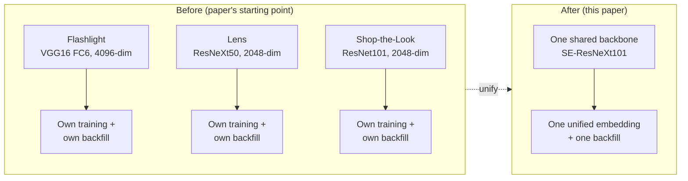
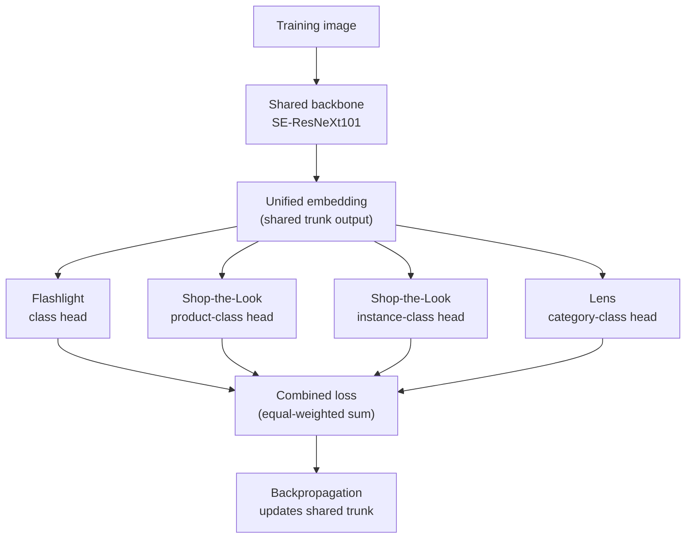
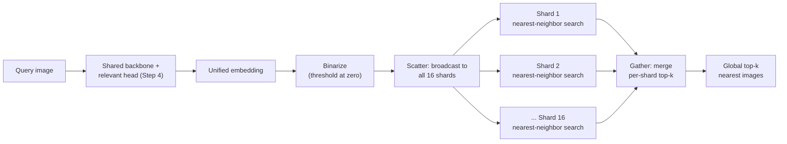

# Capstone #1: Visual Search — Pinterest's Unified Embedding (Flashlight / Lens / Shop-the-Look)

## At a glance

| Topic | Summary |
|---|---|
| Source | Zhai, Wu, Bai, Lan, Feiszli, et al., "Learning a Unified Embedding for Visual Search at Pinterest," KDD 2019 (arXiv:1908.01707). |
| Problem | Three visual search products, Flashlight, Lens and Shop-the-Look, each ran its own embedding model with its own training pipeline and its own backfill. Each model improvement meant re-embedding billions of images, three times over. |
| Core idea | One shared SE-ResNeXt101 backbone, trained jointly on all three products' labeled data through four classification heads, produces one unified embedding. The embedding is binarized to make it cheap to store and compare. |
| Metric | Retrieval precision on each product's own evaluation set: P@1 for Shop-the-Look, average P@20 for Flashlight and Lens. The question is whether one embedding can match or beat three specialists while collapsing three pipelines into one. |
| Headline results | Unified embedding vs. the old specialized ones: Shop-the-Look P@1 52.8 vs. 33.0, Flashlight avg P@20 60.2 vs. 53.4, Lens avg P@20 18.4 vs. 17.8 *(source-confirmed)*. |
| What multi-task alone adds | Against the same architecture trained on one dataset, the multi-task model gains +3.6 on Shop-the-Look, +6.8 on Flashlight and +0.2 on Lens *(source-confirmed)*. The rest of the jump over the old models came from the new architecture and data. |
| Binarization | A naive binary embedding lost 5.6, 4.5 and 0.9 points against float. Four architecture changes recovered the loss, and the final binary model is at or above the float baseline on two products and 0.2 below on the third *(source-confirmed)*. |
| Scale | Over 600 million visual searches a month, over 250 million monthly active users, billions of Pins *(source-confirmed)*. About 231 searches/s on average, about 926 at peak *(illustrative)*. |
| Storage | 5 billion images × 2,048 dimensions: 40.96 TB as float32, 1.28 TB binarized, 16 shards of at most 100 GB *(illustrative)*. |
| First to break | Query compute, not storage. Scanning one 80 GB shard takes about 0.8 s per query at an assumed 100 GB/s, so a brute-force scan needs about 740 replicas per shard at peak. |
| Easy-to-miss traps | Comparing against old models mixes architecture and multi-task effects. Binarization costs accuracy until the architecture adapts. Shard count by capacity is not shard count by throughput. Plain modulo sharding remaps 94% of rows when it goes from 16 to 17 shards. |
| Practice PDFs | [Study edition](../../capstone-study-and-mock/visual-search/capstone1_visual_search_study.pdf) · [Mock interview](../../capstone-study-and-mock/visual-search/capstone1_visual_search_mock.pdf) |

### Concepts this case study builds on

| Concept | Where it is taught | One-line recap |
|---|---|---|
| Embeddings, vector databases, nearest-neighbor search (C1, C2) | [Lesson 1, Group C](../../lessons/lesson-1-ai-fundamentals-refresher.md#c-retrieval-and-knowledge) | A learned vector places similar items close together; an index finds the nearest ones. |
| Sharding, consistent hashing | [Lesson 5, Concept 1](../../lessons/lesson-5-data-layer.md#concept-1-rdbms-scaling) | Split one table across nodes by a key; consistent hashing moves few rows when the node count changes. |
| NoSQL types: a vector store is a fixed-width value keyed by an ID | [Lesson 5, Concept 2](../../lessons/lesson-5-data-layer.md#concept-2-nosql-types) | Choose the storage shape by how the data is read and written. |
| Offline evaluation and golden sets | [Lesson 9, Concept 2](../../lessons/lesson-9-evaluation-and-observability.md#concept-2-offline-evaluation--golden-datasets-llm-as-judge-regression-suites) | Gate every change on a fixed labeled set. |

---

## Step 1: Clarify Requirements & Frame the ML/AI Objective

### The situation before this work

Pinterest ran three separate embedding models, one per product *(source-confirmed)*:

| Product | What it does | Old embedding |
|---|---|---|
| Flashlight | Search by a photo or screenshot | 4096-dimensional, from the FC6 layer of a VGG16 network |
| Lens | Point a phone camera at an object to find similar Pins | 2048-dimensional, pooled from a ResNeXt50 network |
| Shop-the-Look | Clickable dots on a Pin's image link to similar, purchasable products | 2048-dimensional, pooled from a ResNet101 network |

Each model had its own training pipeline and its own backfill, meaning re-computing and re-indexing embeddings for the whole Pin corpus whenever the model changed. The paper names this as the pain point: "Each improvement in embedding requires a full back-fill for deployment, which can be prohibitively expensive."



### The metric is a comparison

Unlike a capstone with one target metric, the objective here is relative. Can one shared embedding, trained jointly on all three products' labels, match or beat each product's specialized embedding on that product's own retrieval metric, while collapsing three training, serving and backfill pipelines into one? Both halves matter. A shared embedding that wins on cost but loses on quality is a weaker result.

### Ground truth

Three human-labeled datasets, one per product *(source-confirmed)*:

- **Flashlight:** about 800K images in 15K semantic classes.
- **Lens:** 540K images in 2K semantic classes, including camera, product and Pinterest images under the same label.
- **Shop-the-Look:** 340K images with 189 product classes (for example "Bar Stools") and 50K instance labels. An instance label groups images of the same product, or very close matches by an internal guide covering design, color and material.

Two things the paper keeps separate from these datasets:

- **Domain challenges, not training signal:** camera photos, high-quality web images and clean catalog images are the kinds of image the system must handle.
- **One engagement-based training signal:** pin-to-pin click data trains the Flashlight head. Camera-photo engagement was "too noisy for training" and was left out. Clicks, repins and close-ups are used afterward as online A/B metrics (Step 6).

### Out of scope

The ranking model applied to retrieved candidates, the mobile camera UX, and Shop-the-Look's catalog-ingestion pipeline (mapping a visually similar match back to a purchasable, in-stock item).

### Trade-offs considered

Three specialized embeddings let each team optimize its own metric with no risk that another product's labels pull the shared representation the wrong way. That risk is **negative transfer**: training on an extra task hurts another task instead of helping it. Unifying means every future improvement must be validated on three products' metrics at once, a harder bar. It divides the backfill and maintenance cost by about the same factor.

---

## Step 2: Back-of-Envelope Constraints

### Scale

Pinterest reports over 600 million visual searches a month, over 250 million monthly active users and "billions" of Pins, with no exact count *(source-confirmed)*.

```text
average_qps = 600,000,000 ÷ (30 × 24 × 3,600 s) = 600,000,000 ÷ 2,592,000 ≈ 231.5 searches/s
peak_qps    ≈ 231.5 × 4 ≈ 926 searches/s   (a 4× peak-to-average ratio, illustrative)
```

### Why binarize

The paper gives three reasons for compact embeddings at billions of images: lower cold-storage cost, less bandwidth for downstream consumers that read the embeddings in bulk, and faster real-time scoring when computing the similarity of two embeddings for ranking *(source-confirmed)*. It also reports from prior work that, for the same storage cost, a learned binary embedding performed better than a learned low-dimensional float one.

**Binarized embeddings** replace each dimension's 32-bit float with a single bit. The paper cites thresholding at zero, with "little drop in performance" in prior work, and treats everything after global pooling and before the task heads as the "binarization module" *(source-confirmed)*. The paper does not give Pinterest's index design, so the storage figures below are illustrative.

### Storage

The paper does not state the unified embedding's dimension or Pinterest's corpus size. Assume 5 billion images and 2,048 dimensions, the size of two of the embeddings it replaced *(illustrative)*.

```text
float32 per image = 2,048 × 4 bytes = 8,192 bytes
binary  per image = 2,048 ÷ 8 bits  =   256 bytes     → 32× smaller

float32 index = 5,000,000,000 × 8,192 B = 40.96 TB
binary index  = 5,000,000,000 × 256 B   =  1.28 TB
```

The 32× comes from the bit width, so it holds at any corpus size. A 10-billion-image corpus would simply double both totals.

### Binarization costs accuracy until the model adapts

The paper's Table 1 compares a float baseline with binary versions of the same model on Shop-the-Look P@1, Flashlight avg P@20 and Lens avg P@20 *(source-confirmed)*:

| Model | Shop-the-Look P@1 | Flashlight avg P@20 | Lens avg P@20 |
|---|---|---|---|
| Baseline, float | 47.5 | 60.1 | 18.6 |
| Baseline, binary | 41.9 | 55.6 | 17.7 |
| + softmax, GroupNorm (binary) | 48.4 | 59.3 | 17.8 |
| + softmax, GroupNorm, ReLU (binary) | 49.7 | 61.1 | 17.6 |
| + softmax, GroupNorm, ReLU, dropout (binary, final) | 52.8 | 60.2 | 18.4 |

The paper reports "a significant drop in performance between raw float and binary features" for the baseline. Removing the L2-normalization constraint (softmax), adding GroupNorm, ReLU and dropout closed the gap, and the final binary model beats the float baseline on Shop-the-Look (+5.3) and Flashlight (+0.1) and is 0.2 below it on Lens. The paper says it "performs favorably." Binarization worked here because the architecture was adapted to it, not because thresholding at zero is free.

### Shards

```text
shards_needed (bare minimum)  = ceil(1.28 TB ÷ 100 GB) = ceil(12.8) = 13
with 20% headroom             = ceil(1.28 TB × 1.20 ÷ 100 GB) = ceil(15.36) = 16 shards
```

16 shards by capacity. Step 5 shows that capacity is not what limits the query path.

### Backfill cost

The backfill is the cost that motivated unification. Assume one GPU embeds 1,000 images a second and costs \$2.50 an hour *(illustrative)*:

```text
one full backfill = 5,000,000,000 ÷ 1,000 = 5,000,000 GPU-seconds = 1,389 GPU-hours ≈ $3,472
three specialized models refreshed together = 3 × $3,472 ≈ $10,417
one unified model = $3,472
```

Time your own model before trusting the throughput figure. The ratio does not depend on it: three pipelines cost three backfills.

### Trade-offs considered

The paper confirms the real risk of binarization is retrieval quality, not storage, and Table 1 above is where it shows. A larger corpus scales both totals and leaves the 32× ratio unchanged.

---

## Step 3: Data / Knowledge Pipeline

### What data exists

- Three product-specific labeled datasets (Step 1).
- Domain-challenge image sources: camera photos, web images and catalog images. They show what the model must handle, not what it trains on.
- Pin-to-pin click data for the Flashlight head only.

The datasets label different things. Flashlight and Lens label broad categories ("chair," "shoe"). Shop-the-Look also labels fine-grained instances, such as one specific chair, because its job is to link to a purchasable item.

### How it is embedded and indexed

Every image in the corpus passes through the shared backbone, becomes one unified embedding, is binarized and is written to the sharded index (Step 5).


### Freshness and backfill

The Pin corpus grows continuously, and Shop-the-Look's catalog changes as retailers add, remove and restock items. Every new or edited Pin needs its embedding computed and its index row written before search can reach it. A model improvement still needs one full backfill, now for one model and not three (see the cost in Step 2).

### When the data is wrong or stale

- A mislabeled Shop-the-Look class pollutes that head's signal and, because the trunk is shared, can pull the shared embedding toward the wrong category for every product.
- A Pin that was edited but not yet re-embedded keeps serving results based on its old image. It is the stale-index problem of Lesson 1's Concept C5, applied to images.

### Trade-offs considered

Sharing a training run means one noisy or skewed label set can leak into the shared trunk and degrade the other products. A fully separate pipeline structurally cannot have that. The paper's results (Step 4) show it did not materialize badly enough to offset the gains, but the design accepts the risk and does not remove it.

---

## Step 4: Model/Agent Core Design — One Shared Multi-Task Embedding

### Sidebar: multi-task learning

- **Why:** training three models for three related tasks throws away a signal. A network that has learned what a chair looks like for one task has learned something a second task could reuse.
- **What:** **multi-task learning** trains one model on several tasks at once. Most layers are shared (the **shared backbone**, or trunk), and each task adds a small output layer (a **head**). The expensive feature learning happens once.
- **How:** this paper's architecture is an instance: one backbone, four heads, one combined loss.

### The architecture

A single shared backbone, **SE-ResNeXt101**, pretrained on ImageNet ILSVRC-2012, is shared by all tasks "until the embedding is generated" *(source-confirmed)*. ResNeXt-101 is a deep convolutional network with grouped convolutions, and the Squeeze-and-Excitation blocks let it weight its own channels by importance. Four heads sit on top: Flashlight class, Shop-the-Look product class, Shop-the-Look instance class and Lens category class.

Each head is a fully connected layer whose weights act as **proxies**, one reference vector per class, followed by a softmax cross-entropy loss. This is classification-based, or proxy-based, metric learning. Instead of comparing pairs or triples of examples as a triplet loss does, each head is an ordinary classifier. The shared embedding layer learns a general similarity structure because it must serve all four heads.

- The four losses carry equal weights and are summed. The paper tried GradNorm to learn the weights, and found the simple equal weighting gave the best balance.
- Each dataset has its own tasks, so an image contributes no gradient to tasks it has no label for.
- For the two heads with very many classes (Flashlight's, and the instance head), the proxies are **subsampled** each batch, so training stays tractable.



### What the results show

The expectation going in is "jack of all trades, master of none": a model trained on three things should be a worse specialist than one trained on a single thing. The paper tests it two ways, and they answer different questions.

**Against the old production embeddings** (Table 4, binary embeddings) *(source-confirmed)*:

| Model | Shop-the-Look P@1 | Flashlight avg P@20 | Lens avg P@20 |
|---|---|---|---|
| Old specialized embedding | 33.0 | 53.4 | 17.8 |
| Generic ImageNet SE-Net baseline | 5.6 | 33.1 | 15.0 |
| Unified embedding | 52.8 | 60.2 | 18.4 |

**Against the same architecture trained on one dataset** (Table 3, binary embeddings) *(source-confirmed)*:

| Training data | Shop-the-Look P@1 | Flashlight avg P@20 | Lens avg P@20 |
|---|---|---|---|
| Shop-the-Look only | 49.2 | 42.1 | 14.7 |
| Flashlight only | 11.0 | 53.4 | 16.1 |
| Lens only | 26.2 | 47.8 | 18.2 |
| All three (multi-task) | 52.8 | 60.2 | 18.4 |

P@1 is the share of queries whose single top result is relevant. Avg P@20 averages, over queries, the share of the top 20 results that are relevant. Both are retrieval metrics, not training losses.

Table 4 shows the unified embedding beating each old embedding on its own metric. But the old embeddings used older architectures (VGG16, ResNeXt50, ResNet101), and the paper itself notes that, so the gap mixes three things: a new backbone, new data and multi-task training. Table 3 isolates the last one. Multi-task gains +3.6 on Shop-the-Look, +6.8 on Flashlight and +0.2 on Lens over a single-dataset model of the same architecture. The gain is real for two products and negligible for Lens.

The paper suggests why: Flashlight accepts crops as input while its engagement-derived training images are whole images, and Shop-the-Look's crop-based data helps bridge that gap. For Lens, whose corpus is all Pinterest content, adding Flashlight's Pinterest-content training data can help. The gain was small. This is an empirical finding about these three similar tasks, not a general law that multi-task training wins.

### Trade-offs considered

- **Specialized embeddings** guarantee no cross-task interference and let teams iterate independently, at the cost of three pipelines. The paper calls the engineering simplification of "iterating only one model architecture" an additional win.
- **Unified multi-task** accepts the negative-transfer risk, and here did not give up quality.
- **A middle path the paper did not take:** freeze the trunk and train small per-product adapter heads. It reduces negative transfer further, at the cost of a weaker shared representation, because the trunk never adapts to all three tasks together.

---

## Step 5: Serving Architecture

The paper describes the model and its evaluation, not Pinterest's index or serving system. The sharding, schema and scan below are this document's illustrative design, built to deliver on two promises Lesson 5 makes about this capstone: that the index is sharded by a key over the image id space (Concept 1), and that binarized embeddings are fixed-width values keyed by id (Concept 2).

### Sharding the index

The 16 shards come from Step 2's capacity arithmetic. A plain modulo of the image id places each row:

```sql
-- Sharded binarized-embedding index, following Lesson 5's generated-shard-key
-- pattern. Illustrative; the SQL has not been run.
CREATE TABLE pin_embeddings (
    image_id            BIGINT       NOT NULL,
    shard_key           SMALLINT
        GENERATED ALWAYS AS (image_id % 16) STORED,
    embedding_binary    BINARY(256)  NOT NULL,
    embedding_version   VARCHAR(16)  NOT NULL,
    product_class_label SMALLINT,
    updated_at          TIMESTAMP    NOT NULL
        DEFAULT CURRENT_TIMESTAMP,
    PRIMARY KEY (shard_key, image_id)
);
```

| Column | What it holds |
|---|---|
| `embedding_binary` | The 2048-dimension embedding, 1 bit per dimension, packed into 256 bytes. |
| `embedding_version` | Which model backfill produced the row, so a rollout can be staged shard by shard. |
| `product_class_label` | Shop-the-Look only; null for Flashlight and Lens rows. |

`embedding_binary` is a fixed-width value keyed by `image_id`, the shape Lesson 5's Concept 2 says every vector store reduces to under its similarity search.

**Modulo versus consistent hashing.** With plain modulo, going from 16 to 17 shards leaves a row in place only if its id gives the same remainder both ways, so about 16 ÷ 17 = 94% of rows move. Pinterest faces recurring backfills and growth, not a one-time migration, so a real deployment would use consistent hashing (Lesson 5, Concept 1), where adding one shard moves about 1 ÷ 17 = 6%.

### The query path

A query image is embedded and binarized the same way as the index, then sent to all 16 shards at once: a **scatter-gather** query. Any image's nearest neighbors can sit on any shard. Each shard returns its own top k, and the coordinator merges the 16 lists into the global top k. This is exact: the global top k is always among the union of the shards' top k.



### Hamming distance

For two binary strings of equal length, the **Hamming distance** is the number of positions where they differ: `1010` and `1001` differ in 2 positions. A smaller distance means more similar images, the binary counterpart of the cosine similarity in Lesson 1's Concept C1. It is cheap: XOR the strings, then count the 1 bits (a **popcount**, one fast instruction), instead of a floating-point dot product. The paper does not say Hamming distance is what Pinterest uses. It is this document's choice of distance for binary codes.

A reference sketch of an exact scan within one shard:

```python
import numpy as np

def hamming_distance_batch(query_bits, corpus_bits):
    """query_bits: (256,) uint8, one binarized embedding (2048 bits).
    corpus_bits: (N, 256) uint8, the N embeddings on this shard.
    Returns an (N,) array of Hamming distances."""
    xor = np.bitwise_xor(corpus_bits, query_bits)    # 1 where bits differ
    return np.unpackbits(xor, axis=1).sum(axis=1)    # popcount per row

def shard_top_k(query_bits, corpus_bits, k=20):
    """This shard's k nearest candidates, smallest distance first."""
    return np.argsort(hamming_distance_batch(query_bits, corpus_bits))[:k]
```

The sketch is for clarity, not scale. Unpacking every byte into 8 makes a temporary array 8 times the size of the data, which for a full 312.5-million-row shard would be about 640 GB, and sorting every distance to keep 20 is wasteful. A real scan works in chunks, counts bits with a lookup table or a hardware popcount, and selects the top k without a full sort.

### An exact scan does not fit at this scale

Each shard holds 5 billion ÷ 16 = 312.5 million codes of 256 bytes, which is 80 GB. An exact scan reads all of it for every query.

```text
scan time per query per shard = 80 GB ÷ 100 GB/s = 0.8 s     (100 GB/s is illustrative)
queries per second per replica = 1 ÷ 0.8 = 1.25
replicas needed at 926 queries/s = 926 ÷ 1.25 = about 740 per shard
nodes in total = 740 × 16 = about 11,850
```

Computation is no better. A 2,048-bit comparison is about 100 simple operations. At an assumed 3 billion operations a second per core, one core handles roughly 30 million comparisons a second, and one query over a shard costs about 10 core-seconds. So the 16 shards sized by capacity are not the bottleneck. Throughput is, because every query touches every shard. A production system needs an approximate nearest-neighbor index over the binary codes, or a coarse filter that skips most of each shard. The paper does not say which Pinterest uses. The brute-force scan above is a correctness reference, and it is also a sensible way to re-rank a short candidate list.

Binarization still helps the serving side. The float codes would be 32 times larger (2.56 TB per shard), so any scan or index over them is far more expensive.

### Decision table

| Decision | Default in this design | Choose the alternative when |
|---|---|---|
| One embedding or three | One shared multi-task embedding | Tasks conflict: if a head's metric falls when others are added, split it or use adapter heads. |
| Embedding format | Binarized, with an architecture adapted to it | Float or low-dimensional float if an evaluation shows binary loses too much on your data. |
| Shard key | Consistent hashing | Plain modulo only if the shard count will never change. |
| Per-shard search | Approximate index over binary codes | Exact scan for small shards or for re-ranking a short list. |
| Query fan-out | Scatter-gather to all shards | Route to a subset only with a pre-filter whose recall you have measured. |
| Shard count | Sized by both capacity and query throughput | Capacity alone only if one replica per shard can serve the peak. |

### Trade-offs considered

Scatter-gather across all shards guarantees the true global top k, but every query pays for 16 lookups. Routing to a subset cuts per-query cost and risks skipping the shard that holds the answer. An exact scan has no approximation error, and it is the reason binarization matters for serving, but at billions of images it needs far more machines than an index would.

---

## Step 6: Evaluation, Monitoring and Iteration

### Offline evaluation

Held-out evaluation sets, kept separate per product *(source-confirmed)*:

- **Shop-the-Look:** 600 human-curated query objects with 1,421 ground-truth product matches, searched in a corpus of 51,421 product images (50K sampled plus the ground-truth matches). Metric: P@1.
- **Flashlight:** 807 queries against 42,881 corpus images, sampled from a random subset of the training data's classes. Metric: avg P@20.
- **Lens:** about 1K query camera images against about 49K corpus images, derived from user engagement and filtered to camera queries with human judgment. Metric: avg P@20.

The Table 4 numbers in Step 4 come from these sets.

### Human judgment

A second independent offline signal before any online exposure. Raters compare new and old results for the same queries, and each (query, result) pair is a question measuring P@5 *(source-confirmed)*:

| Product | Win / lose / draw (unified vs. old) | P@5 change | Worker consistency |
|---|---|---|---|
| Flashlight | 41.3% / 13.9% / 44.8% | +22.2% | 98.0% |
| Lens | 54.0% / 7.9% / 38.0% | +110.1% | 92.9% |
| Shop-the-Look | P@5 of 37.3% old, 64.2% unified | +72.1% | not reported |

Worker consistency is the paper's measure of how often the same question was answered the same way across jobs, a test-retest check on the judging process and not agreement between different raters.

### Online A/B tests

- **Lens** (the one product with concrete online numbers): the share of users who close up a Pin, repin and click through rose +16.3%, +26.7% and +24.3%, and the raw counts rose +32.7%, +46.7% and +35.0% *(source-confirmed)*.
- **Flashlight:** results are shown as a figure, with and without ranking enabled, and no exact numbers appear in the text. The deployment decision used the ranking-enabled group.
- **Shop-the-Look:** it had not launched to users, so no A/B test could be run. Human judgment was the evidence.

### When the offline and the human numbers disagree

For Lens, the offline avg P@20 moved only from 17.8 to 18.4, a 0.6-point gain (3.4% relative). The human P@5 change was +110.1% and online clickthroughs rose 35%. The offline Lens set is built from noisy engagement data, so it understates what people judge. No single signal is enough. Use the offline set to iterate quickly, human judgment to check relevance, and an online test where traffic and risk allow it.

### The feedback loop

The confirmed engagement signal that returns to training is pin-to-pin click data for Flashlight. Clicks, repins and close-ups are online evaluation metrics, not training inputs.


### Failure modes that show up at scale

- **Binarization after a retrain.** A threshold or normalization that worked for one model's outputs does not necessarily transfer to the next, and Table 1 shows how large the loss can be. Re-run the offline evaluation, with the binary embedding, before any backfill ships.
- **A cold-start gap.** New Pins are unsearchable between upload and the completion of their embedding job.
- **Taxonomy drift.** A drifting product taxonomy in Shop-the-Look degrades retrieval in a way that looks like a model regression and is a data problem (Step 3).
- **Negative transfer after adding a task.** A new head or dataset can lower another product's metric. Track each product's metric separately, not an average.

### What breaks first at 10×

| Dimension | Today (illustrative) | At 10× | What gives way first |
|---|---|---|---|
| Corpus | 5 billion images; 1.28 TB binary; 16 shards by capacity | 50 billion; 12.8 TB; 154 shards by capacity | Per-query compute: an exact scan of each shard would take ten times as long. An approximate index becomes mandatory. |
| Traffic | 926 searches/s at peak | 9,259 searches/s | Replicas per shard, since every query touches every shard. |
| Backfill | 1,389 GPU-hours, about \$3,472 | 13,889 GPU-hours, about \$34,722 | The time and cost of every model improvement. This is why a single backfill matters. |

### Risks

- **Query images are personal.** Lens queries are camera photos and can show people, places and documents. Decide how long query images and their embeddings are kept, and who can read them.
- **Spam and near-duplicate images** can crowd results. Deduplicate before indexing and monitor result diversity.
- **A stale evaluation set** stops reflecting what users search for. Refresh it from real traffic.

### Trade-offs considered

Gating Shop-the-Look on human judgment alone was cheaper and avoided exposing users to a possibly worse experience, but it is a weaker causal signal than an A/B test, since raters judging results do not always predict real engagement. A true A/B test for every product, as for Lens, gives a stronger read at the cost of exposure risk and a longer launch. The paper made different choices for different products.

---

## Sources and Further Reading

Labels used above: *(source-confirmed)* means the figure or quotation is stated in the cited source. *(illustrative)* means it is an assumption made for this design.

- Zhai, Wu, Bai, Lan, Feiszli, et al., "Learning a Unified Embedding for Visual Search at Pinterest," KDD 2019 (arXiv:1908.01707). The source of the architecture, the training-data sizes, the binarization results, and the offline, human-judgment and A/B results.
- Lesson 1 (`lessons/lesson-1-ai-fundamentals-refresher.md`), Concepts C1 and C2: embeddings, cosine similarity, vector databases and HNSW.
- Lesson 5 (`lessons/lesson-5-data-layer.md`), Concepts 1 and 2: sharding and consistent hashing, and NoSQL types, the two concepts that Step 5 delivers on.
- Aminian and Xu, *Machine Learning System Design Interview* (ByteByteGo), which includes this case study as a chapter.
