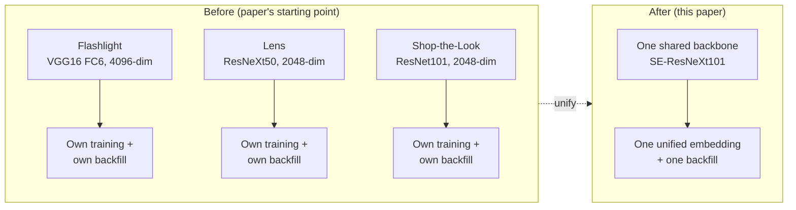
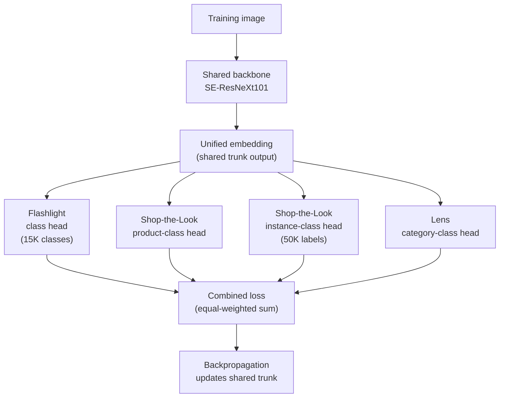
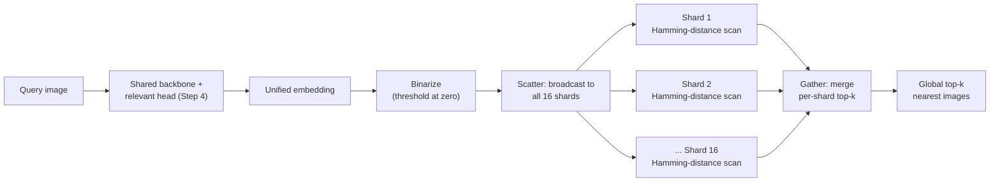

# Capstone #1: Visual Search — Pinterest's Unified Embedding (Flashlight / Lens / Shop-the-Look)

**Source(s):** Primary — Zhai, Wu, Bai, Lan, Feiszli, et al., *"Learning a Unified Embedding for Visual Search at Pinterest,"* KDD 2019 (arXiv:1908.01707). Secondary — the same case study appears as a chapter in *Machine Learning System Design Interview* (Aminian & Xu, ByteByteGo), used here only as confirmation that this is recognized interview-canon material, not as a source of any specific number below.

**Confidence:** Strong, primary source. Every specific figure below tagged **(paper)** was confirmed by directly reading the paper itself (fetched from arXiv:1908.01707's full text, not just its abstract) — not secondhand coverage. Figures tagged **(illustrative)** are this document's own worked assumptions, used because the paper itself doesn't publish them (e.g. the unified embedding's exact dimensionality, Pinterest's exact index size, its production sharding scheme, or its query latency/QPS) — they're clearly separated from the paper's own numbers throughout, never blended into them.

**Scope note:** This capstone covers the shared-embedding retrieval system backing three of Pinterest's visual search products — **Flashlight** (search by photo/screenshot), **Lens** (point a phone camera at a real object to find visually similar Pins), and **Shop-the-Look** (STL — clickable dots on a Pin's image that link to visually similar, purchasable products). It does **not** cover the ranking/re-ranking stage after retrieval, the camera UI itself, or Shop-the-Look's separate product-catalog-ingestion pipeline — all out of scope, per the paper's own focus on the embedding and retrieval layer.

---

## Step 1: Clarify Requirements & Frame the ML/AI Objective

**The situation before this work (paper):** Pinterest ran three separate, independently-trained embedding models, one per product:
- **Flashlight** — a 4096-dimensional embedding from a VGG16 network's FC6 layer
- **Lens** — a 2048-dimensional embedding pooled from a ResNeXt50 network
- **Shop-the-Look** — a 2048-dimensional embedding pooled from a ResNet101 network

Each was its own model, its own training pipeline, and its own backfill (re-computing and re-indexing embeddings for the entire Pin corpus whenever the model changed) — the paper names this as the pain point driving the redesign: *"Each improvement in embedding requires a full back-fill for deployment, which can be prohibitively expensive."*



**The metric being optimized is a comparison, not a single number.** Unlike a from-scratch ML capstone where Step 1 picks one target metric (CTR, precision@k) to maximize, this capstone's objective is relative: can **one shared embedding**, trained jointly across all three products' labeled data, match or beat each product's own specialized embedding on that product's own retrieval-quality metric — while collapsing three separate training/serving/backfill pipelines into one? Both halves matter; a shared embedding that wins on cost but loses on quality is a weaker result than one that wins on both, which is what Step 4 works through.

**What counts as ground truth / feedback signal (paper):** three separate human-labeled datasets, one per product:
- Flashlight: ~800K images across 15K semantic classes
- Lens: 540K images, 2K semantic classes
- Shop-the-Look: 340K images, 189 product classes, plus 50K further images with fine-grained instance labels (distinguishing, e.g., *this specific chair* from *a visually similar but different chair*)

Two further things the paper keeps distinct from the labeled datasets above:
- **Domain challenges, not training signal:** the paper's abstract separately names camera photos, high-quality web images, and clean product-catalog images as domain **challenges** the system has to perform well across — not as training-signal components.
- **The one confirmed engagement-based training signal:** **pin-to-pin click data**, used to train the Flashlight head; camera-photo engagement data, by contrast, was *"too noisy for training"* and excluded. Clicks, repins, and close-ups appear elsewhere in the paper as metrics for **online A/B evaluation** (Step 6) after training, not as training-signal inputs.

**Explicitly out of scope:** the ranking model applied to retrieved candidates before they're shown to a user, the mobile-app camera capture UX, and Shop-the-Look's product-catalog matching/ingestion pipeline (a separate problem: mapping a visually-similar embedding match back to an actually-purchasable, in-stock catalog item).

**Trade-offs considered:** Keeping three specialized embeddings lets each one hill-climb purely on its own product's metric, with no risk of one product's labels or loss pulling the shared representation in a direction that hurts another product (a risk called **negative transfer** below, in Step 3) — a real ceiling-on-quality argument in favor of specialization, not just inertia. Unifying into one unavoidably means every future embedding improvement now has to be validated against *three* products' metrics simultaneously, not one — a harder bar to clear on any single retrain — but it multiplies the backfill/maintenance cost down by the same factor it multiplies the validation cost up, which is exactly the trade this capstone's Step 4 confirms Pinterest found worthwhile in practice.

---

## Step 2: Back-of-Envelope Constraints

**Confirmed production scale (paper):** Pinterest reports **over 600 million visual searches per month**, a user base of **over 250 million monthly active users**, and a Pin/image corpus the paper describes only as **"billions of Pins/images"** (no exact count given).

**Average QPS from the confirmed monthly figure (illustrative arithmetic on a paper-confirmed number):**

```
average_qps = 600,000,000 searches/month ÷ (30 days × 24 h × 3,600 s)
            = 600,000,000 ÷ 2,592,000
            ≈ 231.5 searches/sec, averaged across the month
```

Visual search traffic, like most consumer product usage, isn't flat across the day — applying an illustrative peak-to-average ratio of 4x (a reasonable, not paper-confirmed, planning assumption for a globally-distributed consumer app):

```
peak_qps (illustrative) ≈ 231.5 × 4 ≈ 926 searches/sec at peak
```

**Embedding storage volume — the calculation that makes Lesson 5's binarized-embedding promise concrete.** The paper doesn't publish the unified embedding's own dimensionality or Pinterest's exact corpus size, so this section picks explicit, clearly-labeled illustrative values *within* the paper's own confirmed scale: a corpus of **5 billion images** (illustrative — consistent with the paper's own "billions of Pins/images"), and a unified-embedding dimensionality of **2048** (illustrative — chosen to match the dimensionality of two of the three specialized embeddings it replaced, Lens and Shop-the-Look, since the paper doesn't state the unified embedding's own dimensionality).

**Sidebar — binarized embeddings.**
- **Why?** A learned embedding (Lesson 1, Concept C1) is normally stored as a vector of 32-bit floating-point numbers — one float per dimension. At billions-of-images scale, that per-image storage cost, multiplied across the whole corpus, becomes a real infrastructure line item, and float-vector comparison (computing a distance or similarity between two float vectors) is more expensive per comparison than comparing simpler data.
- **What?** A **binarized embedding** is an embedding where each dimension has been collapsed down to a single bit (commonly 0/1 or -1/+1) instead of a 32-bit float, typically by **thresholding** each float value against zero (any dimension ≥ 0 becomes a 1-bit, any dimension < 0 becomes a 0-bit — the method the paper cites from prior work (Zhai and Wu, 2018) as viable with little performance drop: *"thresholding at zero with little drop in performance"*. The paper doesn't state that this is exactly the method used for its own deployed system — treat this doc's own description of the binarization step as a reasonable inference consistent with how the paper frames binarization generally, not a directly paper-confirmed implementation detail specific to Pinterest's production system). This cuts the storage required per embedding by roughly 32x (32 bits per float dimension collapsing to 1 bit per dimension) and makes similarity comparison between two embeddings reduce to a cheap bitwise operation (Step 5 defines exactly which one — Hamming distance) instead of floating-point arithmetic.
- **How?** Applied to this step's illustrative 2048-dimensional embedding: a float32 embedding costs `2048 dims × 4 bytes/dim = 8,192 bytes` (8 KB) per image; a binarized embedding costs `2048 dims ÷ 8 bits/byte = 256 bytes` per image — a **32x** reduction, computed directly from the bit-width ratio (32-bit float ÷ 1-bit binary = 32x), not a number the paper states outright but one that follows mechanically from its own thresholding method.

**Total index storage, float vs. binarized, at the illustrative 5-billion-image scale:**

```
float32 index size      = 5,000,000,000 images × 8,192 bytes/image
                         = 40,960,000,000,000 bytes
                         ≈ 40.96 TB

binarized index size    = 5,000,000,000 images × 256 bytes/image
                         = 1,280,000,000,000 bytes
                         ≈ 1.28 TB

storage reduction       = 40.96 TB ÷ 1.28 TB = 32x   (same ratio as the per-image calculation above)
```

Going from ~41 TB to ~1.3 TB is the concrete number behind Lesson 5's claim that Pinterest "binarizes its learned embeddings specifically to make them cheap to store and search at the scale its visual-search system operates at" — at billions-of-images scale, a 32x storage reduction is the difference between an index that comfortably fits across a modest shard count (Step 5) and one that doesn't.

**Trade-offs considered:** A larger illustrative corpus assumption (say, 10 billion images instead of 5 billion) would simply double both totals above — the 32x binarization ratio itself doesn't depend on corpus size, only on bit-width, so the conclusion ("binarization buys roughly 32x") is robust to exactly which illustrative corpus size is picked, which is why this document is explicit about treating the corpus size as illustrative while treating the 32x ratio as load-bearing math, not a guess. The real, paper-confirmed risk binarization carries isn't storage — it's retrieval quality, which Step 4's confirmed evaluation numbers address directly rather than leaving as a hand-wave.

---

## Step 3: Data / Knowledge Pipeline

**What data exists and how it's collected (paper):**
- Three product-specific labeled datasets (sizes given in Step 1).
- Domain-challenge image sources — camera photos, scraped high-quality web images, clean product-catalog images — that the model has to perform well across, not training-signal inputs (per Step 1).
- The one confirmed engagement-based training signal: pin-to-pin click data, used to train the Flashlight head (camera-photo engagement data, by contrast, was too noisy for training and excluded).

The three labeled sets also differ in *what* they label — Flashlight and Lens label broad semantic/visual categories (is this a "chair," a "shoe"), while Shop-the-Look additionally labels fine-grained product *instances* (not just "a chair," but *this specific chair SKU*), because its job is to link back to a purchasable catalog item, not just a visually similar category.

**How it's embedded and indexed:** every image in the corpus (the training sets above, plus the full Pin corpus) is passed through the shared backbone (Step 4) to produce one unified embedding per image, binarized (Step 2's Sidebar), and written into the sharded index (Step 5).


**Freshness, inherited from Step 1's motivation.** Pinterest's Pin corpus grows continuously, and Shop-the-Look's product catalog changes as retailers add, remove, and restock items. Every new or edited Pin needs its embedding computed and its index row written before it's reachable by search. The paper names "a full back-fill" as the expensive operation this redesign was meant to reduce the *frequency* of, not eliminate — a model improvement still requires re-embedding the whole corpus once, just for one model instead of three — so this remains a real, recurring operational cost.

**What happens when the data is wrong or stale:**
- A mislabeled Shop-the-Look product class pollutes that head's training signal and can cause the shared embedding to retrieve the wrong product category at serving time (since Step 4's architecture means all three heads influence the same shared trunk during training).
- A Pin that's been edited but not yet re-embedded continues to serve search results based on its old image content until the next backfill reaches it — a stale-embedding failure mode structurally identical to the "keeping a knowledge base fresh" problem Lesson 1's Concept C5 already names for RAG corpora, just applied to an image index instead of a text one.

**Trade-offs considered:** Combining three products' labels into one shared training run means a single noisy or biased label set (say, a skewed Shop-the-Look product taxonomy) can leak into the shared trunk and subtly degrade Flashlight's or Lens's retrieval quality too — a risk called **negative transfer** (when training on an additional task actively hurts performance on another task, rather than merely not helping it) that a fully separate per-product pipeline structurally cannot have, since each pipeline's data never touches another's model. The paper's own confirmed results (Step 4) show this risk didn't materialize badly enough to offset the unification's benefits in practice, but it's a real risk the single-pipeline design accepts, not one it eliminates by construction.

---

## Step 4: Model/Agent Core Design — One Shared Multi-Task Embedding vs. Three Specialized Ones

**Sidebar — multi-task (embedding) learning.**
- **Why?** Training three separate models to solve three related-but-distinct tasks (classify by broad category, classify by product type, classify by specific instance) throws away a real signal: a network that's already learned to represent "what does a chair look like" for one task has learned something a second, related task could reuse directly, instead of re-learning it from scratch in a second, fully independent model.
- **What?** **Multi-task learning** is a training setup where a single model is trained to perform more than one task at once, typically by sharing most of the network's layers across all tasks (a **shared backbone** or **shared trunk**) and attaching a small, task-specific output layer (a **head**) for each individual task on top of that shared representation — so the expensive, general-purpose feature-learning work happens once and is reused by every head, while each head only has to learn the comparatively small, task-specific mapping from that shared representation to its own task's labels.
- **How?** This paper's own architecture (below) is a concrete instance: one shared backbone, four task-specific heads, trained together with one combined loss.

**The architecture (paper):** a single shared backbone, **SE-ResNeXt101** (a ResNeXt-101 convolutional network — a deeper ResNet variant using grouped convolutions — augmented with "Squeeze-and-Excitation" blocks that let the network weight its own channels by importance; pretrained on ImageNet's ILSVRC-2012 classification task before this paper's own training begins), shared by **all tasks until the embedding is generated** — the unified embedding layer itself, not just early convolutional layers, is the one thing every task shares. On top of it sit **four task-specific heads** (shown in the diagram below):
- Flashlight class head (15K classes)
- Shop-the-Look product-class head
- Shop-the-Look instance-class head (50K labels)
- Lens category-class head

Each head is a fully-connected layer whose weights act as **proxies** (per-class reference vectors standing in for "what a typical example of this class's embedding looks like") followed by a softmax cross-entropy loss — this is **classification-based (proxy) metric learning**: instead of the more familiar triplet-loss approach (which directly compares pairs/triples of same-class vs. different-class examples), each head is trained as an ordinary classifier, and the *shared embedding layer feeding every head* learns a general-purpose similarity structure as a side effect of being useful to all four tasks at once. The four heads' losses are weighted equally and summed into one combined loss for backpropagation; for the two heads with very large class counts (Flashlight's 15K classes, Shop-the-Look's 50K instance labels), the paper **subsamples proxies per batch** rather than computing every class's proxy loss on every batch, to keep training tractable.



**The explicit trade-off, stated against the paper's own confirmed results.** The naive expectation going in is that a model trained to be good at three things simultaneously should be a worse specialist at any one of them than a model trained only on that one thing — the classic "jack of all trades, master of none" risk. The paper's own confirmed offline evaluation (Table 4, binary embeddings, reported as the relevant retrieval metric per product) directly tests this:

| Model | Shop-the-Look P@1 | Flashlight Avg P@20 | Lens Avg P@20 |
|---|---|---|---|
| Old specialized embedding | 33.0 | 53.4 | 17.8 |
| Generic ImageNet SE-Net baseline | 5.6 | 33.1 | 15.0 |
| **Unified embedding (this paper)** | **52.8** | **60.2** | **18.4** |

*(P@1 — precision at 1: of the single top-ranked retrieved result, the fraction of queries for which it's actually relevant. Avg P@20 — average precision at 20: averaged, across a query set, of what fraction of the top 20 retrieved results are relevant per query. Both are retrieval-quality metrics, not training losses — defined in full here since this is this document's first use, rather than assuming familiarity.)*

The unified embedding **beats** each old specialized embedding on that product's *own* metric, not just on average — the shared training signal from the other two products turned out to help, not hurt, each individual task in this case, which is the opposite of the naive "jack of all trades" expectation and is exactly the paper's own stated headline result. This is also the clearest answer this capstone can give to the plan's framing question of "when one shared embedding beats several specialized ones": when the tasks are similar enough (all three are fundamentally "is this image visually/semantically similar to that one," just applied to different downstream products) that a shared representation generalizes rather than conflicts — which is an empirical finding specific to this paper's three tasks, not a general law that multi-task training always wins.

**Trade-offs considered:** A fully specialized, per-product embedding (the pre-existing design) guarantees no cross-task interference by construction and lets each team iterate on its own model independently, at the cost of three full training/backfill/serving pipelines and the compounding engineering burden the paper names directly: *"the engineering simplification of iterating only one model architecture is an additional win."* The unified multi-task design accepted the negative-transfer risk named in Step 3 in exchange for that engineering collapse — and in this specific case, per the table above, didn't even have to trade away quality to get it. A middle-ground alternative this paper didn't take — freezing a shared trunk and only fine-tuning small per-product adapter heads on top of frozen features, rather than training the whole trunk jointly — would reduce negative-transfer risk further at the cost of a weaker shared representation, since the trunk itself never gets to adapt based on all three tasks' signal together.

---

## Step 5: Serving Architecture

**This capstone has to deliver on two promises Lesson 5 already made to the reader.** Lesson 5's Concept 1 (RDBMS scaling) states: *"capstone #1 (Pinterest's visual-search/Flashlight-Lens-Shop-the-Look system) serves an embedding/image-metadata index at a scale — hundreds of millions to billions of images — that requires exactly the sharding pattern above: the index is partitioned by a shard key over the item/image identifier space, so that no single node has to hold the entire index or absorb its entire query load."* Lesson 5's Concept 2 (NoSQL types) states: *"capstone #1 (Pinterest) binarizes its learned embeddings specifically to make them cheap to store and search at the scale its visual-search system operates at — a storage-format decision that only makes sense once a vector database is understood as sitting on this KV/wide-column spectrum (fixed-width value blobs, sharded by key), not as some entirely separate kind of database with its own rules."* The following subsections make those two sentences concrete.

**Sharding the index (delivering on Lesson 5's K1 promise).** Using Step 2's illustrative binarized-index total (≈1.28 TB at 5 billion images), and a target maximum shard size of 100 GB (illustrative — chosen, as in Lesson 5's own worked example, to leave headroom for each shard node's own replication overhead and growth):

```
shards_needed (bare minimum)        = ceil(1.28 TB / 100 GB) = ceil(12.8) = 13 shards

required_capacity_with_20%_headroom = 1.28 TB × 1.20 = 1.536 TB
shards_needed_with_headroom         = ceil(1.536 TB / 100 GB) = ceil(15.36) = 16 shards
```

16 shards, sharded by a plain modulo of `image_id` (`image_id % 16`) — a simpler, illustrative scheme shown here for readability, matching Lesson 5's own generated-shard-key DDL pattern rather than inventing a different convention.

- **Plain modulo (shown below):** simpler to read, but changing the shard count remaps nearly every row's target shard — reintroducing the "full back-fill" cost this redesign is trying to reduce the *frequency* of.
- **Consistent hashing (what a real deployment would use instead):** defined in full in Lesson 5's Concept 1. A production system facing Pinterest's actual situation — recurring embedding-model backfills, not a one-time migration (Step 1) — would reach for this to avoid plain modulo's full-reshuffle cost on every resharding event. Swapping it in means replacing the generated `shard_key` column's modulo expression with a hash-ring lookup — a genuine implementation difference, not just a relabeling of the same formula.

The schema below shows the plain-modulo version since it's simpler to read:

```sql
-- Sharded binarized-embedding index, following Lesson 5's generated-shard-key pattern
CREATE TABLE pin_embeddings (
    image_id           BIGINT        NOT NULL,
    shard_key           SMALLINT      GENERATED ALWAYS AS (image_id % 16) STORED,
    embedding_binary     BINARY(256)   NOT NULL,  -- 2048-dim embedding, 1 bit/dim (sign-thresholded), packed into 256 bytes
    embedding_version    VARCHAR(16)   NOT NULL,  -- which model backfill produced this row; lets a rollout be staged shard-by-shard
    product_class_label  SMALLINT,                -- Shop-the-Look only: nullable, since Flashlight/Lens rows don't use it
    updated_at           TIMESTAMP     NOT NULL DEFAULT CURRENT_TIMESTAMP,
    PRIMARY KEY (shard_key, image_id)
);
```

`embedding_binary` is a fixed-width 256-byte value keyed by `image_id` — precisely the "fixed-width value blob, sharded by key" shape Lesson 5's Concept 2 says this storage format has to be understood as, not a bespoke "vector database" category with its own rules.

**Query-time retrieval path** (diagrammed below): a query image is embedded and binarized the same way the index was, then broadcast to all 16 shards in parallel — a **scatter-gather** query, where the coordinator sends the same query to every shard that might hold a relevant result (since a single image's nearest neighbors could be stored on any shard) and merges each shard's local top-k into one final top-k. Each shard finds its own local nearest neighbors by **Hamming distance**; the coordinator merges all 16 shards' results into one global top-k and returns it (ranking, out of scope per this doc's Scope note, happens after this).



**Hamming distance, defined on first use.** For two binary strings of equal length, the **Hamming distance** is the number of bit positions at which they differ (e.g. `1010` and `1001` differ at 2 positions, so their Hamming distance is 2). For binarized embeddings, a smaller Hamming distance between a query's embedding and a candidate's means the two images are more similar — the binary analog of the float-vector cosine-similarity comparison Lesson 1's Concept C1 defines. Computing it is cheap: `XOR` the two strings (the result has a 1 at every position where they differed), then count the 1-bits (a **popcount**, a single fast CPU/GPU instruction) — a few bitwise operations per comparison, versus a full floating-point dot product for the float-vector equivalent.

A real, runnable sketch of the per-shard nearest-neighbor scan (illustrative — brute-force within one shard, not vLLM-style or any specific vendor's production code):

```python
import numpy as np

def hamming_distance_batch(query_bits: np.ndarray, corpus_bits: np.ndarray) -> np.ndarray:
    """
    query_bits:  shape (256,)   uint8 array, one query's binarized embedding (256 bytes = 2048 bits)
    corpus_bits: shape (N, 256) uint8 array, N candidate embeddings held on this one shard
    Returns: shape (N,) array of Hamming distances, one per candidate on this shard.
    """
    xor_result = np.bitwise_xor(corpus_bits, query_bits)          # 1-bit wherever query and candidate differ
    # unpackbits expands each byte into its 8 individual bits so popcount can sum them directly
    return np.unpackbits(xor_result, axis=1).sum(axis=1)           # per-row popcount = Hamming distance


def shard_top_k(query_bits: np.ndarray, corpus_bits: np.ndarray, k: int = 20) -> np.ndarray:
    """Return this shard's own top-k nearest candidate indices, smallest Hamming distance first."""
    distances = hamming_distance_batch(query_bits, corpus_bits)
    return np.argsort(distances)[:k]   # the coordinator merges this shard's top-k with the other 15 shards'
```

**Trade-offs considered:** Scatter-gather across all 16 shards guarantees the true global top-k (every shard is actually checked), but means every single query pays the cost of 16 parallel lookups instead of one — versus routing a query to only a subset of shards (e.g. via a coarser pre-filter), which would cut per-query cost but risks missing a genuinely relevant result that happens to live on a shard that got skipped. Brute-force Hamming-distance scanning within a shard is simple and exact (no approximation, unlike Lesson 1's HNSW over float embeddings), and is only viable here *because* binarization already cut each shard's per-image cost down to a cheap bitwise comparison — the same brute-force approach over the 32x-larger float embeddings from Step 2 would be far more expensive per shard, which is itself a second, serving-side reason (beyond the pure storage savings) that binarization is attractive at this scale, not just a storage optimization on paper.

---

## Step 6: Evaluation, Monitoring, and Iteration

**Offline evaluation (paper-confirmed):** held-out evaluation corpora, kept separate per product:
- Shop-the-Look: 51,421 product images
- Flashlight: 42,881 corpus images evaluated against 807 held-out queries
- Lens: ~49,000 corpus images evaluated against ~1,000 held-out queries

Retrieval quality on these sets is measured with **precision@k** (defined in full in Step 4 — the fraction of the top-k retrieved results that are actually relevant to the query), reported as P@1 for Shop-the-Look and Avg P@20 for Flashlight and Lens — the exact numbers in Step 4's table.

**Human judgment (paper-confirmed) — used as a second, independent offline signal before any online exposure:** paired comparisons where human raters judge the new unified-embedding results against the old specialized-embedding results for the same query, recorded as win/lose/draw:
- Flashlight: 41.3% win / 13.9% lose / 44.8% draw for the unified embedding, a reported +22.2% delta in P@5 (precision at 5), with 98.0% worker consistency (the paper's Table 5 "WC" metric, defined by the paper as "what percent of the questions were answered the same across jobs" — i.e. the *same* rater shown the same comparison again gives the same answer 98.0% of the time; a test-retest reliability check on the judgment process itself, not agreement between different raters).
- Lens: 54.0% win / 7.9% lose / 38.0% draw, a reported +110.1% delta in P@5, 92.9% worker consistency (the same test-retest metric, not inter-rater agreement).
- Shop-the-Look: 64.2% judged relevant for the unified embedding vs. 37.3% for the old specialized embedding, a +72.1% delta — and notably, Shop-the-Look was **not** A/B tested online at all; this human-judgment comparison served as its sole launch criterion.

**Online A/B testing (paper-confirmed, Lens only — the one product the paper reports concrete online numbers for):**
- Statistically significant lifts in the *share of users* taking each action (the paper's own terms): Closeuppers +16.3%, Repinners +26.7%, Clickthroughers +24.3%.
- Lifts in the *raw counts* of the same actions: close-ups +32.7%, repins +46.7%, clickthroughs +35.0%.
- Flashlight's online results are reported only as a figure showing engagement and volume lifts, with no exact numbers in the text — flagged here as a real limit on how precisely this document can report that result, rather than inventing a number the paper doesn't state.

**The feedback loop back into Step 3:** the confirmed engagement-based signal flowing back into the next training run is pin-to-pin click data (for Flashlight specifically) — clicks, repins, and close-ups named above are the paper's *online A/B evaluation* metrics, not training-signal inputs. Every new Pin and catalog update (Step 3) needs its embedding computed and its sharded index row (Step 5) written before it's retrievable, and every future model improvement still requires one full corpus backfill — now across one shared model instead of three, Step 4's unification payoff materializing operationally.


**Failure modes that show up only at scale:**
- A binarization threshold (Step 2's Sidebar: thresholding at zero) tuned for one model's output distribution doesn't necessarily transfer to a retrained model — a threshold well-calibrated before a retrain can silently degrade precision/recall after one, which is why Step 4's offline P@k evaluation has to be re-run before any new backfill ships.
- Newly uploaded Pins are unsearchable during the window between upload and their embedding job completing (a cold-start gap).
- Shop-the-Look's retrieval quality is only as good as its catalog's taxonomy — a drifting or inconsistent product-class taxonomy degrades retrieval in a way that looks like a model regression but is actually a Step 3 data problem.

**Trade-offs considered:** Gating Shop-the-Look's launch on human judgment alone, rather than a true online A/B test, was cheaper and faster to run and avoided exposing a possibly-worse experience to live users during a test — but it's a weaker causal signal than an actual A/B test, since human raters judging result quality offline don't necessarily predict real-world engagement behavior with the same fidelity a live experiment would. Running a true A/B test for every product (as was done for Lens) gives a stronger causal read on real user behavior, at the cost of real exposure risk and longer time-to-launch — neither choice is uniformly correct, and the paper itself made different choices for different products based on traffic volume and risk tolerance.

---

## Source(s) and Further Reading

- Zhai, Wu, Bai, Lan, Feiszli, et al., *"Learning a Unified Embedding for Visual Search at Pinterest,"* KDD 2019 (arXiv:1908.01707) — **primary**; the source of every figure in this document tagged (paper), including the architecture, training-data sizes, binarization method, offline/human-judgment/A/B results, and the paper's own stated motivation for unifying three specialized embeddings into one.
- *Machine Learning System Design Interview* (Aminian & Xu, ByteByteGo) — **secondary**; cited only to confirm this case study's standing as recognized ML-interview-canon material, not as a source of any specific figure in this document.
- Lesson 1 (`lessons/lesson-1-ai-fundamentals-refresher.md`), Concepts C1 and C2 — the original full definitions of embeddings, cosine similarity, vector databases, and HNSW, referenced rather than re-derived throughout this document.
- Lesson 5 (`lessons/lesson-5-data-layer.md`), Concept 1 (RDBMS scaling / sharding, including consistent hashing) and Concept 2 (NoSQL types, including the KV/wide-column framing of a vector-shaped store) — the two Concepts this capstone's Step 5 is built specifically to deliver on, quoted directly above rather than re-derived.
