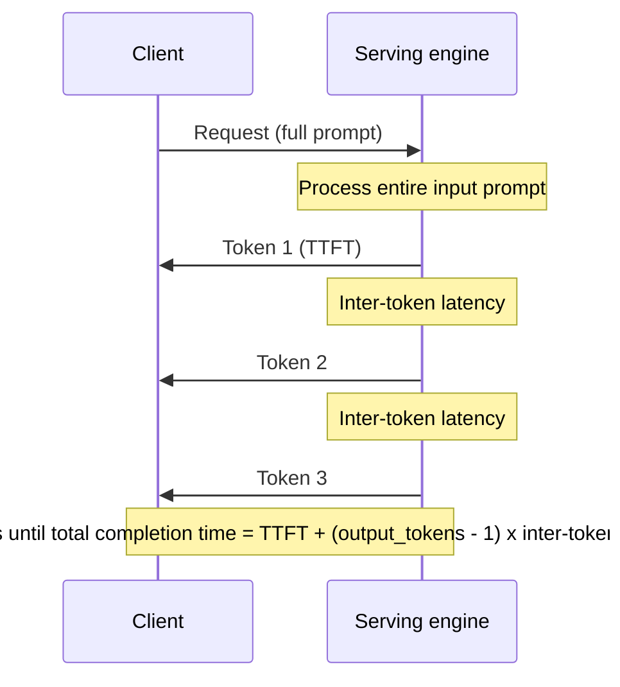
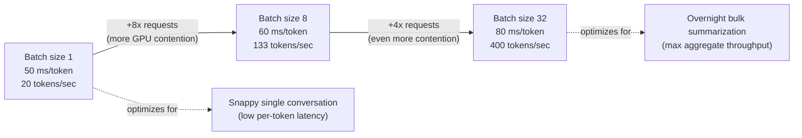
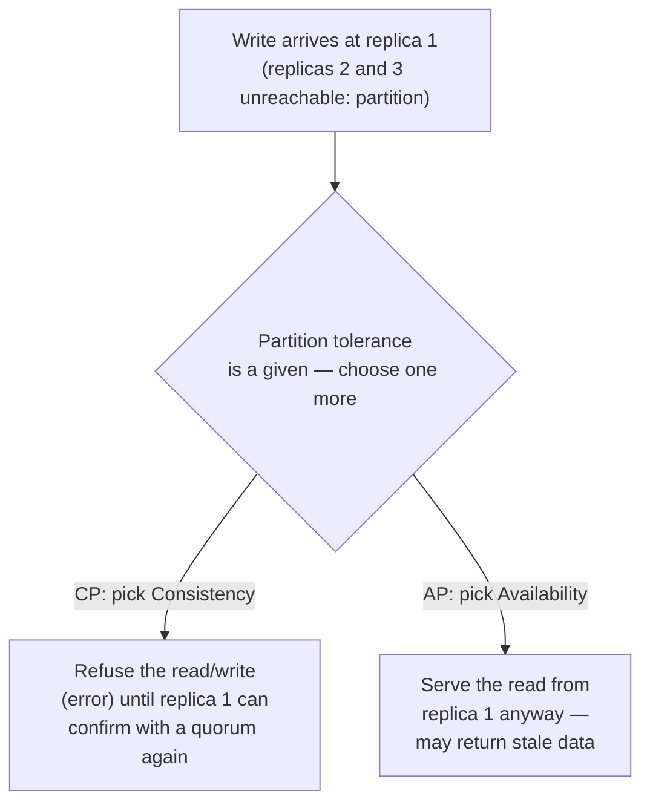
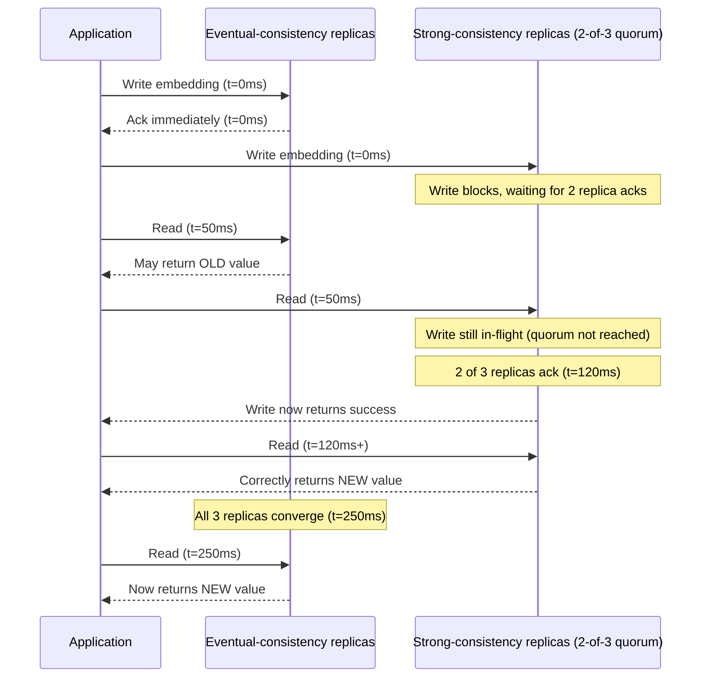
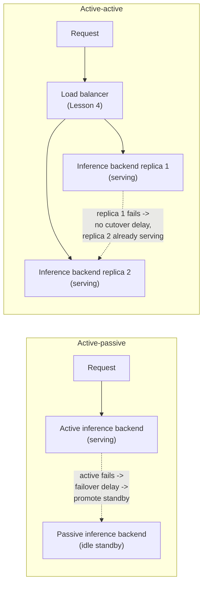
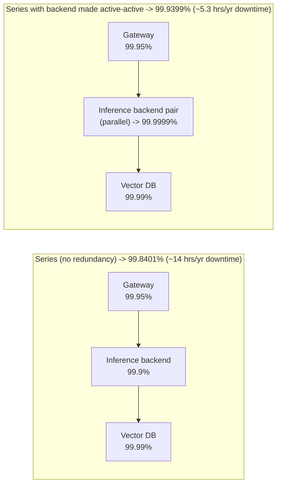

# Lesson 3: Scalability and Availability

**Time:** 60-90 minutes
**Tool(s):** Conceptual (no single verified CLI) — worked numeric examples and a runnable Python snippet instead

## Learning Objectives

By the end of this lesson, you will:

- Distinguish performance from scalability and latency from throughput, and explain why those differ for an LLM-serving app vs. a typical CRUD app
- Understand the CAP theorem and name a system as weakly, eventually, or strongly consistent, with a concrete example of what each means for a write-then-read sequence
- Compute combined availability for a multi-component serving chain, in series and with parallel redundancy, and explain what active-passive and active-active failover each actually buy you
- Point to exactly where capstone #10 (`case-studies/llm-inference-serving`) and capstone #15 (`case-studies/llm-api-gateway`) each exercise these ideas, and where Lesson 1's retrieval/memory concepts tie into CAP theorem

---

## Concept 1: Performance vs. Scalability; Latency vs. Throughput

### Why?

Every system has a notion of "how fast" and "how much," and it's tempting to treat those as the same question. They aren't, and for an LLM-serving application the gap is wider than for a typical CRUD (Create/Read/Update/Delete — the standard pattern of a web app backed by a database) app, because an LLM request isn't one unit of work finishing at one moment — it's a stream of individual tokens (the model's sub-word unit of text, introduced in Lesson 1) generated one at a time, so "fast" has to be measured at the token level, not just the request level.

### What?

**Performance** is how quickly a *single* unit of work completes under a *given* load — e.g. how long one request takes right now, at the system's current size. **Scalability** is a system's ability to keep performance acceptable as load grows, typically by adding more resources (more servers, more GPUs) — a system is scalable if more hardware actually relieves the pressure, rather than hitting a wall where adding resources stops helping.

**Latency** is the time between sending a request and receiving (some or all of) its response — a duration, measured in time units. **Throughput** is the rate at which a system completes units of work — a count per unit time (requests per second, tokens per second). These two don't move together: a system can have high throughput and high latency at once (lots of work getting done, but each piece takes a while), which is exactly what happens inside an LLM-serving engine under load.

For an LLM-serving app specifically, latency splits into pieces that don't exist for a typical API call:

- **Time to first token (TTFT)** — the delay between sending a request and receiving the *first* generated token, dominated by how long the model takes to process the entire input prompt before it can start producing output.
- **Inter-token latency** — the delay between each subsequent generated token, since tokens are produced one at a time, sequentially, each one depending on all the ones before it.
- **Total completion time** — TTFT plus (number of output tokens − 1) × inter-token latency; the full time until the last token of the response arrives.

**Token-generation throughput** is the aggregate rate, across all requests a serving system is currently handling, at which it produces output tokens (tokens/sec) — the AI-world equivalent of **QPS** (queries per second, the classic system-design-primer measure of requests handled per second), except measured at the token level because that's the unit the GPU is actually spending its compute on.

The sequence below shows where TTFT and inter-token latency each fall within a single request's timeline:



This is also why "scalable" means something subtly different here than for a CRUD app: a CRUD app is usually scalable if it keeps response times flat as more *users* connect — mostly a matter of adding web servers and database read replicas. An LLM-serving app must also scale along a second, AI-specific axis: it needs to keep *generating tokens* at an acceptable rate as more concurrent requests compete for the same fixed pool of GPU memory, most of which is consumed by the **KV cache** (the per-request memory Lesson 1's Concept B1 defines, which grows with every token generated) — so "add more hardware" has a harder ceiling here than for a stateless web server.

### How?

**Worked example — batch size as the throughput/latency knob.** A serving engine using **continuous batching** (Lesson 1, B1: grouping multiple in-flight requests into the same GPU forward pass, letting new requests join an in-progress batch rather than waiting for it to finish) faces a direct trade-off as batch size grows:

| Batch size | Per-token latency (inter-token) | Aggregate throughput |
|---|---|---|
| 1 request | 50 ms/token | 1 request × (1000 ms / 50 ms) = **20 tokens/sec** |
| 8 requests | 60 ms/token (more GPU contention) | 8 × (1000 ms / 60 ms) = **133 tokens/sec** |
| 32 requests | 80 ms/token (even more contention) | 32 × (1000 ms / 80 ms) = **400 tokens/sec** |

Going from batch size 1 to 32 increases per-token latency by 60% (50ms → 80ms) — each request's stream gets slightly slower — but increases total system throughput by 20x (20 → 400 tokens/sec). Neither number is "the" answer: a chat product optimizing for a snappy single conversation wants small batches and low per-token latency; a backend summarizing a million documents overnight wants maximum aggregate throughput and doesn't care that any one summary takes slightly longer.

The same trade-off, laid out as the batch-size knob moving in one direction while two outcomes move in opposite directions:



**Trade-offs considered:** Larger batch sizes raise aggregate throughput but raise every request's latency, and push GPU memory pressure up (more concurrent KV caches resident at once) — there's no batch size that's simply "better," only one that matches a given product's actual latency SLA (service-level agreement — a committed maximum response time) and GPU budget.

**Case-study pointer:** capstone #10 (`case-studies/llm-inference-serving`) is built directly around this trade-off — the vLLM/PagedAttention paper and Character.AI's reported ~33x serving-cost reduction both hinge on managing the KV cache (the same per-request memory this Concept's batch-size table trades against), not raw FLOPs. This Concept's batch-size/throughput table is the exact mechanism capstone #10's Step 5 (serving architecture) has to tune.

**Source(s) and further reading:**

- `system-design-primer`'s own "Performance vs scalability" and "Latency vs throughput" sections (the classic framing this Concept reframes for AI)
- Kwon et al., *"Efficient Memory Management for LLM Serving with PagedAttention"* (vLLM paper, SOSP 2023, arXiv:2309.06180) — real continuous-batching throughput numbers
- Anthropic and OpenAI API documentation on streaming responses and time-to-first-token metrics

---

## Concept 2: CAP Theorem and Consistency Patterns

### Why?

Any system that keeps more than one copy of data — every AI application with a vector database, a replicated model gateway, or a long-term agent memory store — eventually has to answer: "what happens when a network partition means two copies can't talk, and a request shows up?" Pretending this can't happen is how systems silently return stale or contradictory answers in production.

### What?

**CAP theorem** (first stated by Eric Brewer in a 2000 keynote, later formally proven by Gilbert and Lynch in 2002) says a distributed data system can guarantee at most two of the following three properties at once, during an actual network partition:

- **Consistency** — every read receives the most recent write, or an error; there's never a read that returns stale data.
- **Availability** — every request receives a (non-error) response, even if it isn't guaranteed to be the most recent data.
- **Partition tolerance** — the system keeps operating correctly even if network messages between its nodes are delayed or dropped (a **partition**: a break in network communication between two groups of nodes that are each still running, just unable to talk to each other).

In practice, partitions happen (networks are unreliable), so the real-world choice is between **CP** (consistent but may refuse to answer during a partition) and **AP** (available but may return stale data during a partition) — "choosing C over A" vs. "choosing A over C," not a free selection of all three.

The diagram below shows the same write-then-read request hitting a partitioned 3-replica vector database under each choice:



That choice shows up as a **consistency pattern**, describing how far behind a read is allowed to be from the most recent write:

- **Strong consistency** — after a write completes, every subsequent read, from any replica, sees that write immediately. Achieved by making a write wait for acknowledgment from enough replicas before it's considered "done" (a **quorum write** — e.g. requiring 2 of 3 replicas to confirm before telling the client the write succeeded).
- **Eventual consistency** — after a write, if no further writes happen, all replicas *will* converge to the same value, but there's no guarantee about how long that takes. A read immediately after a write may still see the old value.
- **Weak consistency** — no guarantee at all about when, or whether, a given read will reflect a given write; common in systems optimized purely for speed (e.g. certain real-time multiplayer/VoIP state) where a stale or missing value is an acceptable cost for never blocking.

### How?

**Worked example — a timeline for the same write under two consistency models.** Say an application writes a new embedding into a 3-replica vector database at t = 0ms, and replication between nodes takes 200ms to fully propagate.

| Time | Read under eventual consistency | Read under strong consistency (2-of-3 quorum write) |
|---|---|---|
| t = 0ms (write issued) | — | Write blocks, waiting for 2 replica acks |
| t = 50ms (a read arrives) | May return the *old* value — replication hasn't finished | Write is still in-flight (quorum not yet reached); a concurrent read is only guaranteed fresh once the write itself returns |
| t = 120ms | Write acknowledged to 2 of 3 replicas; strong-consistency write now returns success | Reads from any of the 2 acked replicas now correctly return the new value |
| t = 250ms | All 3 replicas have converged; reads everywhere now return the new value | (already consistent since t = 120ms) |

The strong-consistency write took until t = 120ms to be considered complete (the client-perceived latency cost of waiting for a quorum) — the eventual-consistency write returned to the client immediately at t = 0ms, but any read in the 50-250ms window had a real chance of seeing stale data.

The same timeline as a sequence of events, contrasting both models side by side:



**Trade-offs considered:** Strong consistency removes the "did I just get stale data" question but adds real latency to every write (and sometimes to reads too, if reads also require a quorum) — eventual consistency is faster and simpler to scale but pushes the "is this fresh enough" question onto the application. Neither is strictly correct; a vector database backing a RAG system updated nightly can tolerate eventual consistency easily (nobody notices a few hundred milliseconds of staleness), while a system where an agent writes a fact and immediately needs to read it back in the same turn cannot.

**Case-study / cross-lesson pointer:** This trade-off resurfaces in two places from Lesson 1: Concept C2 (vector databases), where most production vector databases default to eventual consistency between replicas for write throughput, and Concept E2 (long-term memory), where an agent that writes a memory and reads it back moments later — within the same multi-step run — can be silently bitten by this gap if its memory store is only eventually consistent, appearing to "forget" something it just stored. capstone #12 (`case-studies/multi-agent-customer-support`) Step 3 applies this exact choice to its per-customer context store: a specialist agent that just processed a refund needs the *very next* turn in that conversation to read back a state that already reflects it, so that store needs strong consistency for at least the fields a just-completed action touches (e.g. `last_updated_at`, `recent_orders[].last_action`), even while the rest of the store tolerates eventual consistency — the same "write it, read it back moments later" failure shape as the E2 cross-reference above, now with concrete field names behind it.

**Source(s) and further reading:**

- Brewer, *"Towards Robust Distributed Systems"* (PODC 2000 keynote — the original statement of CAP)
- Gilbert & Lynch, *"Brewer's Conjecture and the Feasibility of Consistent, Available, Partition-Tolerant Web Services"* (2002) — the formal proof
- `system-design-primer`'s "Consistency patterns" and "Availability patterns" sections

---

## Concept 3: Availability Patterns

### Why?

An LLM-serving application is rarely one component — it's typically a chain: a gateway, an inference backend, and often a vector database or other retrieval store behind it. Each component has its own uptime, and the way those uptimes combine isn't obvious. You might intuitively guess "the system is about as available as its least-available piece," but the real math is less forgiving than that — and it's exactly the math that tells you where redundancy actually pays off.

### What?

**Availability** is the percentage of time a system is capable of correctly handling requests, usually expressed in **"nines"**:

| Availability | Nines | Downtime per year |
|---|---|---|
| 99% | "two nines" | ~3.65 days |
| 99.9% | "three nines" | ~8.77 hours |
| 99.99% | "four nines" | ~52.6 minutes |
| 99.999% | "five nines" | ~5.26 minutes |

**Replication** is keeping more than one live copy of a service or its data across separate nodes, so that one node's failure doesn't take the whole system down. Two failover patterns built on replication:

- **Active-passive failover** — one replica (the "active") handles all live traffic; one or more standby ("passive") replicas sit idle, ready to take over only if the active one fails. There's a **failover delay** — the time to detect the failure and promote a standby — during which requests may fail.
- **Active-active failover** — multiple replicas handle live traffic *simultaneously*, all the time; if one fails, the others are already serving, so there's no cutover delay, only reduced total capacity until the failed node is replaced.

The two patterns applied to the inference-backend component from the worked example below:



How individual component availabilities combine into a *system's* availability depends on whether components are chained or redundant:

- **Availability in series** (a request must pass through component A, then B, then C, in sequence — if any one fails, the whole request fails): combined availability = A × B × C (each expressed as a fraction, e.g. 99.9% = 0.999). Chaining components in series always makes the combined system *less* available than its weakest link, never more.
- **Availability in parallel** (two or more replicas of the *same* component, where the request only fails if *all* of them fail at once — the active-active pattern above): combined availability = 1 − [(1 − A₁) × (1 − A₂) × ...]. Redundant parallel components make the combined availability *higher* than any single one of them.

### How?

**Worked example — a 3-component LLM-serving chain, series vs. parallel.** Take a realistic chain: Gateway (99.95% available) → Inference backend (99.9% available) → Vector DB (99.99% available).

*Series (no redundancy):*
```
combined = 0.9995 × 0.999 × 0.9999
         = 0.9985005 × 0.9999
         ≈ 0.998401   →  99.8401% available
```
That's roughly **14 hours of downtime per year** (0.0016 × 525,600 minutes/year ≈ 840 minutes ≈ 14 hours) — notably *worse* than any single component's own number, because a failure in *any* link breaks the whole chain.

*Adding active-active redundancy to just the inference backend* (the component with the weakest availability at 99.9%, now running as two independent replicas, each still 99.9% on its own):
```
backend_parallel = 1 - (1 - 0.999) × (1 - 0.999)
                 = 1 - 0.001 × 0.001
                 = 1 - 0.000001
                 = 0.999999   →  99.9999% available ("six nines")
```
Re-running the series calculation with this redundant backend in place of the single one:
```
combined = 0.9995 × 0.999999 × 0.9999
         ≈ 0.999399   →  99.9399% available
```
That's roughly **5.3 hours of downtime per year** (0.000601 × 525,600 minutes/year ≈ 316 minutes ≈ 5.3 hours) — making just the single weakest component redundant took the whole chain from ~14 hours/year of downtime down to ~5.3 hours/year, nearly a 3x improvement, without touching the gateway or the vector DB at all.

Both chains, series vs. the one component made parallel, side by side:



A small runnable Python snippet for this arithmetic:

```python
def series_availability(*components: float) -> float:
    """Combined availability of components that must ALL succeed (a chain)."""
    result = 1.0
    for a in components:
        result *= a
    return result

def parallel_availability(*components: float) -> float:
    """Combined availability of redundant components where only ONE must succeed."""
    failure = 1.0
    for a in components:
        failure *= (1 - a)
    return 1 - failure

gateway, backend, vector_db = 0.9995, 0.999, 0.9999

no_redundancy = series_availability(gateway, backend, vector_db)
backend_pair = parallel_availability(backend, backend)
with_redundancy = series_availability(gateway, backend_pair, vector_db)

print(f"No redundancy:   {no_redundancy:.6%}")      # 99.840065%
print(f"Backend redundant: {with_redundancy:.6%}")  # 99.939905%
```

**Trade-offs considered:** Active-passive is cheaper to run (the standby isn't doing real work, so it can often be a smaller/cheaper instance) but has a real failover delay during which requests fail outright — unacceptable for a latency-sensitive gateway. Active-active eliminates that delay but costs roughly double the running infrastructure for the redundant component, and requires a load balancer (Lesson 4) in front of it to distribute traffic — and if the redundant replicas also hold state (not just stateless compute), it reintroduces Concept 2's consistency question: now you have to decide how those replicas stay in sync.

**Case-study pointer:** capstone #15 (`case-studies/llm-api-gateway`) is built specifically around multi-region model-serving failover — its Step 5 (serving architecture) has to decide which pattern above to apply to its inference-backend pool, and the series-vs-parallel arithmetic above is the exact tool for justifying that decision with numbers instead of intuition.

**Source(s) and further reading:**

- `system-design-primer`'s "Availability patterns" section (the "nines" table and series/parallel formulas, in their original non-AI framing)
- Google's *Site Reliability Engineering* book, chapter on availability targets and SLOs
- Public cloud SLA pages (AWS, GCP, Azure) for real-world examples of published nines commitments on managed services

---

## Hands-On Walkthrough

There's no single CLI for this lesson — work through these two calculations yourself, by hand or with the Python snippet above, before moving on.

**1. Throughput/latency trade-off.** Using Concept 1's batch-size table, confirm: at batch size 8, what is the aggregate throughput, and what's the percentage increase in per-token latency compared to batch size 1? *(Aggregate throughput: 8 × (1000/60) ≈ 133 tokens/sec. Latency increase: (60-50)/50 = 20%.)*

**2. Availability chain, with your own numbers.** Pick three availability numbers for a gateway, an inference backend, and a vector DB (e.g. 99.9%, 99.5%, 99.95%). Run `series_availability()` on all three, then pick the weakest, run `parallel_availability()` on two copies of it, and re-run `series_availability()` with that pair substituted in. Confirm the combined number went up, and compute how many fewer minutes of downtime per year that represents.

---

## Summary

| Concept | One-line takeaway |
|---|---|
| Performance vs. scalability; latency vs. throughput | For LLM apps, latency splits into TTFT and inter-token latency, and batch size is the direct knob trading per-request latency for aggregate token throughput — neither is "better," only matched to the product's SLA. |
| CAP theorem and consistency patterns | During a network partition you can have consistency or availability, not both — and most vector DBs and agent memory stores default to eventual consistency, which can make an agent appear to "forget" something it just wrote. |
| Availability patterns | Combining components in series multiplies their availabilities down (worse than the weakest link); combining redundant replicas in parallel multiplies failure probabilities down (better than any single replica) — the exact math behind when active-active redundancy is worth its extra cost. |

## Key Formulas Reference

```
Throughput               = completed units of work / time elapsed
Total completion time    = TTFT + (output_tokens - 1) × inter_token_latency

Nines table:
  99%      → ~3.65 days downtime/year
  99.9%    → ~8.77 hours downtime/year
  99.99%   → ~52.6 minutes downtime/year
  99.999%  → ~5.26 minutes downtime/year

Series availability (chain, all must succeed):
  A_combined = A1 × A2 × ... × An

Parallel availability (redundant, only one must succeed):
  A_combined = 1 - [(1 - A1) × (1 - A2) × ... × (1 - An)]
```

**Next:** Checkpoint 3, then Lesson 4 — DNS, CDNs, load balancers, and reverse proxies.
