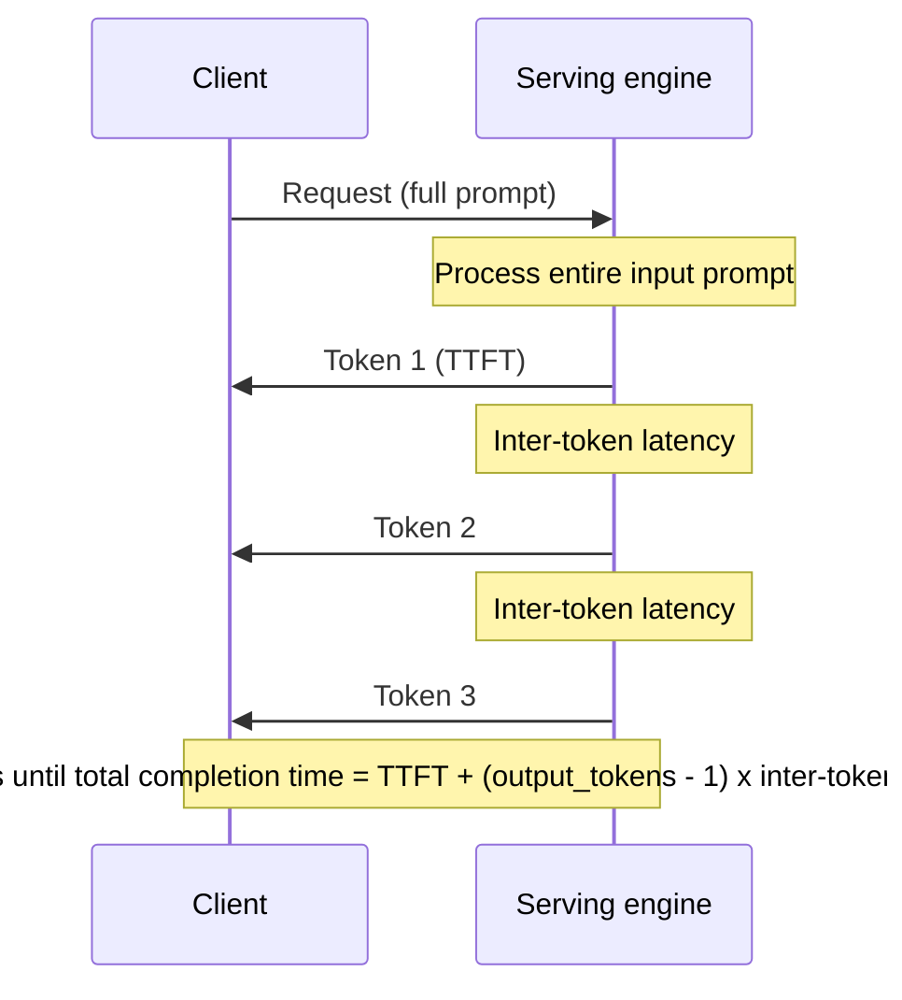
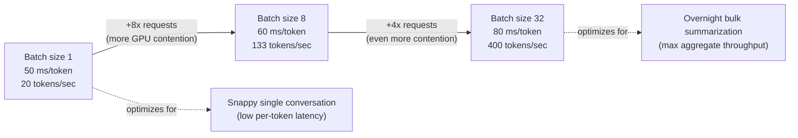
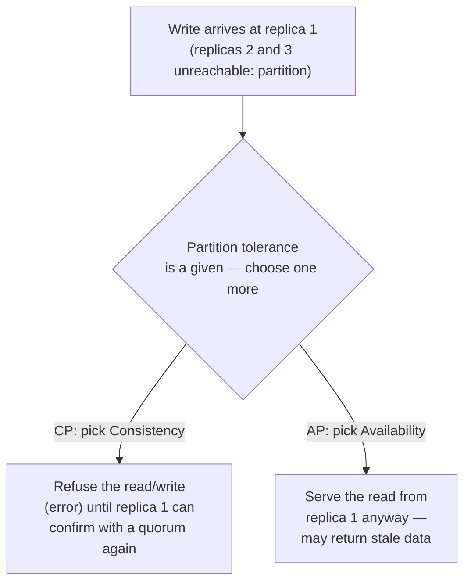
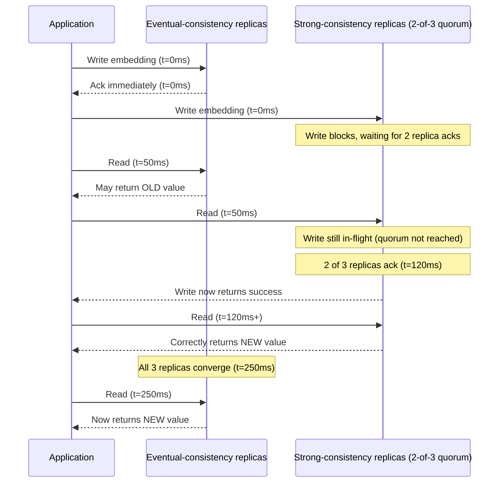
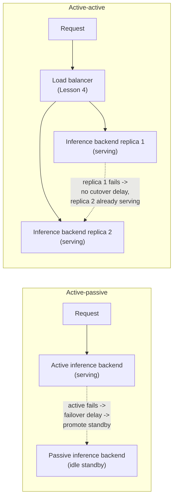
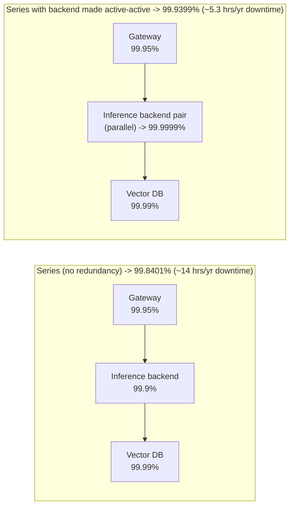

# Lesson 3: Scalability and Availability

**Time:** 60-90 minutes
**Tool(s):** Conceptual (no single verified CLI) — worked numeric examples and a runnable Python snippet instead

## Learning Objectives

By the end of this lesson, you will:

- Distinguish performance from scalability and latency from throughput, and explain why those differ for an LLM-serving app vs. a typical CRUD app
- Understand the CAP theorem and name a system as weakly, eventually, or strongly consistent, with a concrete example of what each means for a write-then-read sequence
- Compute combined availability for a multi-component serving chain, in series and with parallel redundancy, and explain what active-passive and active-active failover each actually buy you
- Point to exactly where capstone #10 (`case-studies/llm-inference-serving`) and capstone #15 (`case-studies/llm-api-gateway`) each exercise these ideas, and where Lesson 1's retrieval/memory concepts tie into CAP theorem

---

## Concept 1: Performance vs. Scalability; Latency vs. Throughput

### Why?

Every system has a notion of "how fast" and "how much". They sound like one question, but they are two.

- In a typical CRUD app (Create/Read/Update/Delete — the standard pattern of a web app backed by a database), a request is one unit of work that finishes at one moment.
- In an LLM-serving app, a request is a stream of tokens (the model's sub-word unit of text, introduced in Lesson 1), generated one at a time.
- So "fast" has to be measured at the token level, not just the request level.

### What?

**Performance vs. scalability**

- **Performance** — how quickly a *single* unit of work completes under a *given* load, such as how long one request takes right now at the system's current size.
- **Scalability** — the ability to keep performance acceptable as load grows, usually by adding resources (servers, GPUs).
- A system is scalable if more hardware actually relieves the pressure, rather than hitting a wall where adding resources stops helping.

**Latency vs. throughput**

- **Latency** — the time between sending a request and receiving (some or all of) its response. A duration.
- **Throughput** — the rate at which a system completes work. A count per unit time (requests/sec, tokens/sec).
- They don't move together. A system can have high throughput *and* high latency at once, which is exactly what happens inside an LLM-serving engine under load.

**LLM latency splits into three pieces**

- **Time to first token (TTFT)** — delay until the *first* generated token arrives, dominated by the model processing the entire input prompt first.
- **Inter-token latency** — delay between each later token, since tokens are produced sequentially, each depending on all the ones before it.
- **Total completion time** — TTFT + (output tokens − 1) × inter-token latency.

**Token-generation throughput** is the aggregate rate, across all current requests, at which the system produces output tokens (tokens/sec).

- It is the AI equivalent of **QPS** (queries per second, the classic system-design-primer measure).
- It is counted in tokens because that is the unit the GPU actually spends compute on.

The sequence below shows where TTFT and inter-token latency fall within one request's timeline:



**Why "scalable" means something different here**

- **CRUD app:** scalable if response times stay flat as more *users* connect. Mostly this means more web servers and database read replicas.
- **LLM-serving app:** must also keep *generating tokens* at an acceptable rate as concurrent requests compete for a fixed pool of GPU memory.
- Most of that memory goes to the **KV cache** (the per-request memory defined in Lesson 1, Concept B1, which grows with every token generated).
- So "add more hardware" has a harder ceiling here than for a stateless web server.

### How?

**Worked example — batch size as the throughput/latency knob.**

A serving engine using **continuous batching** (Lesson 1, B1: grouping in-flight requests into the same GPU forward pass, letting new requests join a batch already in progress) faces a direct trade-off as batch size grows:

| Batch size | Per-token latency (inter-token) | Aggregate throughput |
|---|---|---|
| 1 request | 50 ms/token | 1 request × (1000 ms / 50 ms) = **20 tokens/sec** |
| 8 requests | 60 ms/token (more GPU contention) | 8 × (1000 ms / 60 ms) = **133 tokens/sec** |
| 32 requests | 80 ms/token (even more contention) | 32 × (1000 ms / 80 ms) = **400 tokens/sec** |

Going from batch size 1 to 32:

- Per-token latency rises 60% (50 ms → 80 ms), so each request's stream gets slightly slower.
- Total system throughput rises 20x (20 → 400 tokens/sec).
- Neither number is "the" answer.
  - A chat product wants a snappy single conversation: small batches, low per-token latency.
  - A backend summarizing a million documents overnight wants maximum aggregate throughput and doesn't mind each summary being a bit slower.

The same trade-off, with the batch-size knob moving one way and the two outcomes moving opposite ways:



**Trade-offs considered:**

- Larger batches raise aggregate throughput but raise every request's latency.
- They also push GPU memory pressure up, because more concurrent KV caches stay resident at once.
- No batch size is simply "better". The right one matches the product's latency SLA (service-level agreement — a committed maximum response time) and GPU budget.

**Situation to reason through:**

- A support chatbot runs on a fleet tuned for cost: every GPU at batch size 32.
- Users say replies "crawl". The SLA: a 300-token reply finishes within 20 seconds. TTFT is a steady 0.6 seconds.
- The same fleet also runs a nightly job that summarizes a million documents.

<details>
<summary><b>Q1.</b> Is batch size 32 right for the chat traffic?</summary>

**How to think:** check against the metric the SLA is written in, not against throughput.

- The SLA is total completion time = TTFT + (tokens − 1) × inter-token latency.
- Budget per token: (20 − 0.6) / 299 ≈ 65 ms.
- Batch 32 runs at 80 ms: 0.6 + 299 × 0.080 ≈ 24.5 s. **Miss.**
- Batch 8 runs at 60 ms: 0.6 + 299 × 0.060 ≈ 18.5 s. **Pass**, at about 133 tokens/sec per GPU instead of 400.

<details>
<summary><b>Q1a.</b> So should the whole fleet drop to batch 8?</summary>

**How to think:** the SLA belongs to the chat traffic, not to the hardware.

- The overnight job has no per-reply deadline, so it should keep batch 32 and its 3x throughput per GPU.
- Run two pools (or two settings), each tuned to its own SLA.

<details>
<summary><b>Q1b.</b> What else changes when the chat batch shrinks, and what are you assuming?</summary>

- Fewer KV caches are resident at once, so GPU memory pressure eases too.
- You assumed TTFT stays flat as the batch changes. It can rise under load, so re-measure it after the change.
</details>
</details>
</details>

**Case-study pointer:**

- Capstone #10 (`case-studies/llm-inference-serving`) is built directly around this trade-off.
- Both the vLLM/PagedAttention paper and Character.AI's reported serving-cost reduction of at least 33x since 2022 hinge on managing the KV cache, not raw FLOPs.
  - Character.AI's figure is a bundle of changes, including KV-cache and inter-turn caching improvements.
- This Concept's batch-size table is the exact mechanism capstone #10's Step 5 (serving architecture) has to tune.

**Source(s) and further reading:**

- `system-design-primer`'s own "Performance vs scalability" and "Latency vs throughput" sections (the classic framing this Concept reframes for AI)
- Kwon et al., *"Efficient Memory Management for LLM Serving with PagedAttention"* (vLLM paper, SOSP 2023, arXiv:2309.06180) — real continuous-batching throughput numbers
- Anthropic and OpenAI API documentation on streaming responses and time-to-first-token metrics

---

## Concept 2: CAP Theorem and Consistency Patterns

### Why?

Any system that keeps more than one copy of data eventually faces one question. That covers every AI application with a vector database, a replicated model gateway, or a long-term agent memory store.

- The question: when a network partition means two copies can't talk, and a request shows up, what happens?
- Pretending this can't happen is how systems silently return stale or contradictory answers in production.

### What?

**CAP theorem** (stated by Eric Brewer in a 2000 keynote, formally proven by Gilbert and Lynch in 2002) says a distributed data system can guarantee at most two of three properties during an actual network partition:

- **Consistency** — every read gets the most recent write, or an error. Never stale data.
- **Availability** — every request gets a (non-error) response, even if it isn't the most recent data.
- **Partition tolerance** — the system keeps working correctly even if messages between nodes are delayed or dropped.
  - A **partition** is a break in network communication between two groups of nodes that are each still running but can't talk to each other.

In practice, partitions happen because networks are unreliable. So the real choice is between two options, not a free pick of all three:

- **CP** — consistent, but may refuse to answer during a partition.
- **AP** — available, but may return stale data during a partition.

The diagram shows the same write-then-read request hitting a partitioned 3-replica vector database under each choice:



That choice shows up as a **consistency pattern**: how far behind a read may be from the most recent write.

- **Strong consistency** — after a write completes, every later read from any replica sees it immediately.
  - Achieved by making a write wait for acknowledgment from enough replicas (a **quorum write**, e.g. 2 of 3 replicas confirm before the client is told it succeeded).
- **Eventual consistency** — after a write, if no further writes happen, all replicas *will* converge, but with no guarantee how long that takes.
  - A read right after a write may still see the old value.
- **Weak consistency** — no guarantee about when, or whether, a read reflects a given write.
  - Common where speed matters most and a stale or missing value is acceptable (e.g. certain real-time multiplayer/VoIP state).

### How?

**Worked example — a timeline for the same write under two consistency models.**

An application writes a new embedding into a 3-replica vector database at t = 0 ms. Replication takes 200 ms to fully propagate.

| Time | Read under eventual consistency | Read under strong consistency (2-of-3 quorum write) |
|---|---|---|
| t = 0ms (write issued) | — | Write blocks, waiting for 2 replica acks |
| t = 50ms (a read arrives) | May return the *old* value — replication hasn't finished | Write is still in-flight (quorum not yet reached); a concurrent read is only guaranteed fresh once the write itself returns |
| t = 120ms | Write acknowledged to 2 of 3 replicas; strong-consistency write now returns success | Reads from any of the 2 acked replicas now correctly return the new value |
| t = 250ms | All 3 replicas have converged; reads everywhere now return the new value | (already consistent since t = 120ms) |

What the table shows:

- The strong-consistency write took until t = 120 ms to complete. That wait is the client-perceived latency cost of the quorum.
- The eventual-consistency write returned at t = 0 ms.
- But any read in the 50-250 ms window had a real chance of seeing stale data.

The same timeline as events, both models side by side:



**Trade-offs considered:**

- **Strong consistency**
  - Removes the "did I just get stale data" question.
  - Adds real latency to every write, and sometimes to reads if they also need a quorum.
- **Eventual consistency**
  - Faster and simpler to scale.
  - Pushes the "is this fresh enough" question onto the application.
- Neither is strictly correct.
  - A RAG vector database updated nightly tolerates eventual consistency easily.
  - A system where an agent writes a fact and must read it back in the same turn cannot.

**Situation to reason through:**

- A coding agent stores a fact in long-term memory (a 3-replica vector database, replication ≈ 200 ms).
- It reads the fact back on its very next step, about 80 ms later. Sometimes the read returns nothing and the agent "forgets" what it just stored.
- The nightly knowledge-base refresh uses the same database and has never shown a problem.

<details>
<summary><b>Q1.</b> What is happening?</summary>

**How to think:** lay the timeline against the replication delay.

- At 80 ms replication (≈ 200 ms) hasn't finished.
- The read hit a replica that never saw the write.
- That is eventual consistency doing what it promises, not a bug.

<details>
<summary><b>Q1a.</b> Why does the nightly refresh not suffer from the same thing?</summary>

**How to think:** ask what each workload needs from a read.

- The agent needs its own write visible on its very next read.
- The nightly refresh can tolerate a few hundred milliseconds of staleness, because nobody reads in that window.
- So consistency should be chosen per path, not per database.

<details>
<summary><b>Q1b.</b> What do you change for the agent path, and what does it cost?</summary>

- Writes wait for a 2-of-3 quorum (≈ 120 ms in the timeline above).
- Reads also consult a quorum (R + W > N, so 2 + 2 > 3). A quorum write plus a single-replica read can still hit the third, stale replica.
- Cost 1: every write takes ≈ 120 ms instead of returning at once.
- Cost 2 (CAP): during a partition this path now errors or waits instead of returning stale data, so the agent must retry or fail the step.
- Leave the nightly refresh eventually consistent.
</details>
</details>
</details>

**Case-study / cross-lesson pointer:**

This trade-off resurfaces from Lesson 1 in two places:

- **Concept C2 (vector databases):** most production vector databases default to eventual consistency between replicas, for write throughput.
- **Concept E2 (long-term memory):** an agent that writes a memory and reads it back moments later in the same run can be silently bitten by this gap. It appears to "forget" something it just stored.

Capstone #12 (`case-studies/multi-agent-customer-support`) Step 3 applies this exact choice to its per-customer context store:

- A specialist agent that just processed a refund needs the *very next* turn to read back state that already reflects it.
- So that store needs strong consistency for the fields a just-completed action touches (e.g. `last_updated_at`, `recent_orders[].last_action`).
- The rest of the store can tolerate eventual consistency.
- It is the same "write it, read it back moments later" failure shape as the E2 cross-reference, now with concrete field names behind it.

**Source(s) and further reading:**

- Brewer, *"Towards Robust Distributed Systems"* (PODC 2000 keynote — the original statement of CAP)
- Gilbert & Lynch, *"Brewer's Conjecture and the Feasibility of Consistent, Available, Partition-Tolerant Web Services"* (2002) — the formal proof
- `system-design-primer`'s "Consistency patterns" and "Availability patterns" sections

---

## Concept 3: Availability Patterns

### Why?

An LLM-serving application is rarely one component. It is usually a chain: a gateway, an inference backend, and often a vector database or other retrieval store.

- Each component has its own uptime, and how those uptimes combine isn't obvious.
- The intuitive guess is "about as available as the least-available piece".
- The real math is less forgiving, and it tells you where redundancy actually pays off.

### What?

**Availability** is the percentage of time a system can correctly handle requests, usually expressed in **"nines"**:

| Availability | Nines | Downtime per year |
|---|---|---|
| 99% | "two nines" | ~3.65 days |
| 99.9% | "three nines" | ~8.77 hours |
| 99.99% | "four nines" | ~52.6 minutes |
| 99.999% | "five nines" | ~5.26 minutes |

**Replication** means keeping more than one live copy of a service or its data on separate nodes, so one node's failure doesn't take the system down. Two failover patterns build on it:

- **Active-passive failover**
  - One replica (the "active") handles all live traffic. One or more standbys sit idle.
  - If the active fails, a standby takes over after a **failover delay** (time to detect the failure and promote a standby), during which requests may fail.
- **Active-active failover**
  - Multiple replicas handle live traffic *at the same time*.
  - If one fails, the others are already serving. No cutover delay, only reduced capacity until the failed node is replaced.

The two patterns applied to the inference-backend component from the worked example below:



How component availabilities combine into a *system's* availability depends on how they are arranged:

- **In series** (a request must pass through A, then B, then C; if any one fails, the request fails)
  - Combined availability = A × B × C, each as a fraction (99.9% = 0.999).
  - Chaining always makes the system *less* available than its weakest link, never more.
- **In parallel** (replicas of the *same* component; the request fails only if *all* fail at once, the active-active pattern)
  - Combined availability = 1 − [(1 − A₁) × (1 − A₂) × ...].
  - Redundancy makes the combined availability *higher* than any single replica.

### How?

**Worked example — a 3-component LLM-serving chain, series vs. parallel.**

Chain: Gateway (99.95%) → Inference backend (99.9%) → Vector DB (99.99%).

*Series (no redundancy):*
```
combined = 0.9995 × 0.999 × 0.9999
         = 0.9985005 × 0.9999
         ≈ 0.998401   →  99.8401% available
```
- That is roughly **14 hours of downtime per year** (0.0016 × 525,600 minutes/year ≈ 840 minutes).
- It is *worse* than any single component, because a failure in *any* link breaks the chain.

*Adding active-active redundancy to just the inference backend* (the weakest at 99.9%, now two independent replicas, each still 99.9%):
```
backend_parallel = 1 - (1 - 0.999) × (1 - 0.999)
                 = 1 - 0.001 × 0.001
                 = 1 - 0.000001
                 = 0.999999   →  99.9999% available ("six nines")
```
Re-running the series calculation with the redundant backend:
```
combined = 0.9995 × 0.999999 × 0.9999
         ≈ 0.999399   →  99.9399% available
```
- That is roughly **5.3 hours of downtime per year** (0.000601 × 525,600 minutes/year ≈ 316 minutes).
- Making just the weakest component redundant took the chain from ~14 hours/year to ~5.3 hours/year, nearly a 3x improvement, without touching the gateway or vector DB.

Both chains side by side:



A small runnable Python snippet for this arithmetic:

```python
def series_availability(*components: float) -> float:
    """Combined availability of components that must ALL succeed (a chain)."""
    result = 1.0
    for a in components:
        result *= a
    return result

def parallel_availability(*components: float) -> float:
    """Combined availability of redundant components where only ONE must succeed."""
    failure = 1.0
    for a in components:
        failure *= (1 - a)
    return 1 - failure

gateway, backend, vector_db = 0.9995, 0.999, 0.9999

no_redundancy = series_availability(gateway, backend, vector_db)
backend_pair = parallel_availability(backend, backend)
with_redundancy = series_availability(gateway, backend_pair, vector_db)

print(f"No redundancy:   {no_redundancy:.6%}")      # 99.840065%
print(f"Backend redundant: {with_redundancy:.6%}")  # 99.939905%
```

**Trade-offs considered:**

- **Active-passive**
  - Cheaper, because the standby isn't doing real work and can often be a smaller instance.
  - Has a real failover delay during which requests fail outright. Unacceptable for a latency-sensitive gateway.
- **Active-active**
  - Eliminates that delay.
  - Costs roughly double the infrastructure for the redundant component.
  - Needs a load balancer in front (Lesson 4).
  - If the replicas hold state, it reintroduces Concept 2's question: how do they stay in sync?

**Situation to reason through:**

- Sales promises a 99.99% availability SLA (about 52.6 minutes of downtime a year).
- The chain is gateway (99.95%) → inference backend (99.9%) → vector DB (99.99%).
- An engineer proposes making only the backend active-active, since it is the weakest link.

<details>
<summary><b>Q1.</b> Does that reach 99.99%?</summary>

**How to think:** compute it before arguing about it.

- Baseline in series: 99.84%, roughly 14 hours of downtime a year.
- With a backend pair: 99.9399%, about 5.3 hours a year.
- A big improvement, but far from 99.99%. **No.**

<details>
<summary><b>Q1a.</b> Why not? Isn't fixing the weakest link the right instinct?</summary>

**How to think:** work with a failure budget, not a weakest link.

- 99.99% allows a total failure probability of 0.0001.
- The vector DB alone already uses all of it (1 − 0.9999).
- The gateway alone uses 0.0005.
- Any chain with one un-replicated gateway or vector DB cannot reach the target, whatever you do to the backend.

<details>
<summary><b>Q1b.</b> What does reaching it take, and what does it cost?</summary>

- Replicate all three. Failure probabilities: gateway pair 0.0005² = 2.5e-7, backend pair 1e-6, vector DB pair 1e-8.
- Their sum is about 1.26e-6, so availability is about 99.99987% (under a minute of downtime a year).
- Leave the vector DB single and the total is about 1.0e-4 + 1.25e-6, so 99.9899% (about 53 minutes). Just misses.
- Cost: each pair roughly doubles that component's spend and needs a load balancer in front (Lesson 4).
- The vector DB pair is stateful, so Concept 2's consistency decision comes back.
- Caveat: the parallel formula assumes independent failures. Two replicas in one zone sharing power or network don't qualify, which is why replicas should be spread across regions.
</details>
</details>
</details>

**Case-study pointer:**

- Capstone #15 (`case-studies/llm-api-gateway`) applies this arithmetic in its Step 5.
- A single gateway in front of two providers caps the chain at the gateway's own availability.
- An active-active gateway pool, ideally across regions, removes that cap.
- The series-vs-parallel arithmetic is the tool for justifying that decision with numbers instead of intuition.

**Source(s) and further reading:**

- `system-design-primer`'s "Availability patterns" section (the "nines" table and series/parallel formulas, in their original non-AI framing)
- Google's *Site Reliability Engineering* book, chapter on availability targets and SLOs
- Public cloud SLA pages (AWS, GCP, Azure) for real-world examples of published nines commitments on managed services

---

## Hands-On Walkthrough

There's no single CLI for this lesson. Work through these two calculations yourself, by hand or with the Python snippet above, before moving on.

**1. Throughput/latency trade-off.** Using Concept 1's batch-size table, at batch size 8:

- What is the aggregate throughput?
- What is the percentage increase in per-token latency compared to batch size 1?

*(Aggregate throughput: 8 × (1000/60) ≈ 133 tokens/sec. Latency increase: (60-50)/50 = 20%.)*

**2. Availability chain, with your own numbers.**

- Pick three availability numbers for a gateway, an inference backend, and a vector DB (e.g. 99.9%, 99.5%, 99.95%).
- Run `series_availability()` on all three.
- Pick the weakest, run `parallel_availability()` on two copies of it, and re-run `series_availability()` with that pair substituted in.
- Confirm the combined number went up, and compute how many fewer minutes of downtime per year that represents.

---

## Summary

| Concept | One-line takeaway |
|---|---|
| Performance vs. scalability; latency vs. throughput | For LLM apps, latency splits into TTFT and inter-token latency, and batch size is the direct knob trading per-request latency for aggregate token throughput — neither is "better," only matched to the product's SLA. |
| CAP theorem and consistency patterns | During a network partition you can have consistency or availability, not both — and most vector DBs and agent memory stores default to eventual consistency, which can make an agent appear to "forget" something it just wrote. |
| Availability patterns | Combining components in series multiplies their availabilities down (worse than the weakest link); combining redundant replicas in parallel multiplies failure probabilities down (better than any single replica) — the exact math behind when active-active redundancy is worth its extra cost. |

## Key Formulas Reference

```
Throughput               = completed units of work / time elapsed
Total completion time    = TTFT + (output_tokens - 1) × inter_token_latency

Nines table:
  99%      → ~3.65 days downtime/year
  99.9%    → ~8.77 hours downtime/year
  99.99%   → ~52.6 minutes downtime/year
  99.999%  → ~5.26 minutes downtime/year

Series availability (chain, all must succeed):
  A_combined = A1 × A2 × ... × An

Parallel availability (redundant, only one must succeed):
  A_combined = 1 - [(1 - A1) × (1 - A2) × ... × (1 - An)]
```

**Next:** Checkpoint 3, then Lesson 4 — DNS, CDNs, load balancers, and reverse proxies.
