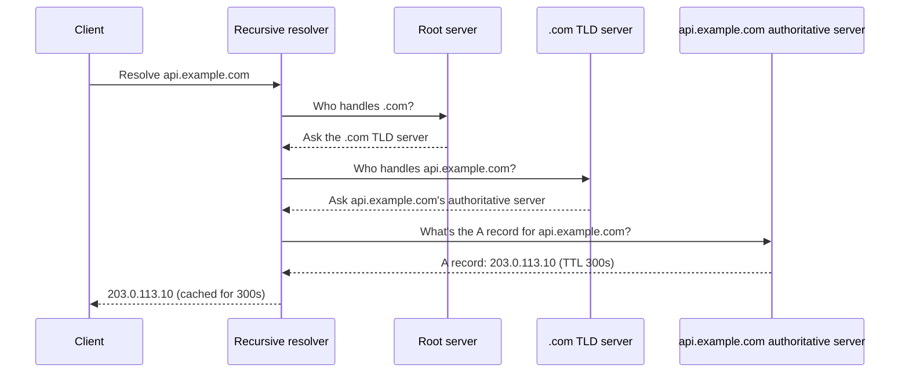
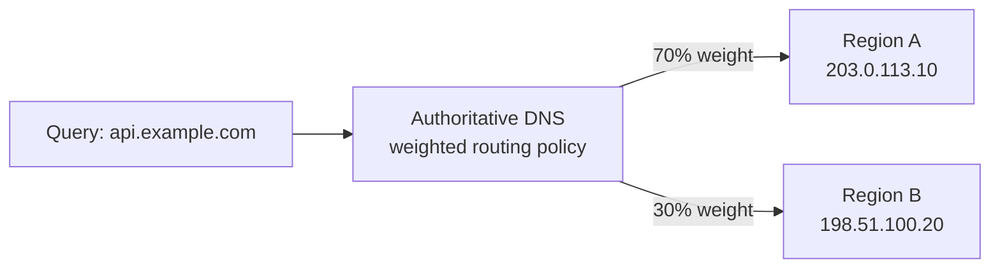
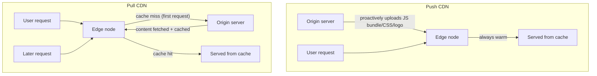
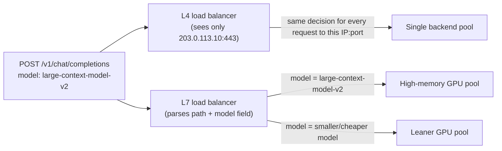
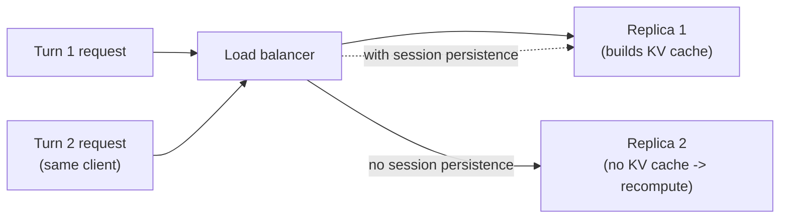
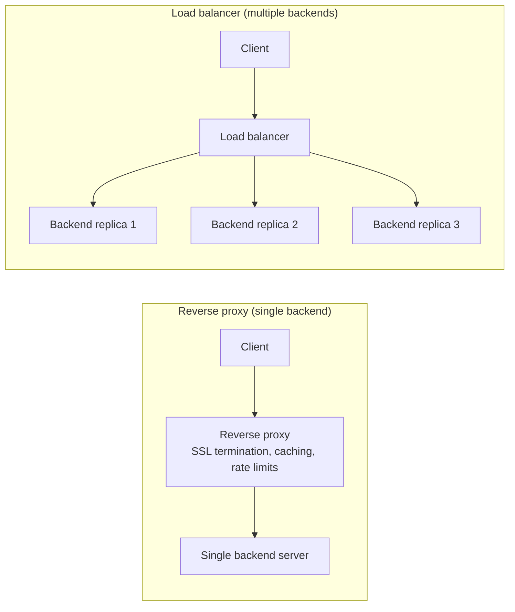

# Lesson 4: Network and Delivery

**Time:** 75-90 minutes
**Tool(s):** Conceptual (no single verified CLI) — worked numeric examples and real config/payload schemas instead

## Learning Objectives

By the end of this lesson, you will:

- Understand how DNS resolution and routing policies work, and be able to compute the real-world impact of a DNS TTL on failover speed
- Understand the push vs. pull CDN trade-off, and be able to explain specifically why model weights themselves are a poor fit for a CDN
- Be able to distinguish L4 from L7 load balancing, explain what SSL termination trades away, and know when session persistence matters for LLM traffic specifically
- Be able to distinguish a reverse proxy's job from a load balancer's job, and explain why a traditional API gateway's request-based rate limiting breaks down for LLM traffic
- Be able to point to exactly which capstone exercises each of these patterns

---

## Concept 1: DNS

### Why?

Every request starts with a domain name like `api.example.com`, not an IP address. Something has to resolve that name to an IP before anything else can happen.

- *Which* IP comes back can itself be a routing decision.
- For a multi-region AI-serving deployment, DNS is where "which region/replica handles this request" is decided first, at the coarsest grain, before any other layer is involved.

### What?

**DNS (Domain Name System)** is the distributed system that translates human-readable domain names into the IP addresses computers use to connect.

- No single server stores every domain's IP.
- A first lookup is handed hop by hop through a chain of servers, each knowing only "who to ask next", until one has the answer.

The chain:

1. The client asks a **recursive resolver** (usually run by your ISP, or a public service like 8.8.8.8).
2. The resolver queries a **root server**.
3. The root server points it to a **TLD (top-level domain) server**, e.g. the one responsible for all `.com` domains.
4. The TLD server points it to the domain's own **authoritative name server**.
5. That server returns the actual IP: an **A record**, the DNS record type that maps a name directly to an IPv4 address.

This chain, for a first-ever lookup of `api.example.com`:



Every DNS record is published with a **TTL (time to live)**: how many seconds a resolver may cache that answer before looking it up again.

- Short TTL: cached answers go stale and get re-checked quickly.
- Long TTL: fewer repeat lookups, but slower propagation of any change.

Beyond a plain A record, authoritative DNS services support **routing policies** that return a *different* answer depending on context:

- **Weighted round robin** — returns different IPs according to configured weights (e.g. 70% of queries get region A, 30% region B). Used for traffic splitting (e.g. a gradual rollout), not true failover.
- **Latency-based routing** — returns the registered endpoint with the lowest historical network latency from the resolver's location.
- **Geolocation-based routing** — returns the endpoint registered as closest to (or designated for) the resolver's geographic region, regardless of measured latency.

Weighted round robin applied to `api.example.com`:



### How?

**Worked example — TTL and failover speed.**

`api.example.com` has an A record with a 300-second (5-minute) TTL pointing at Region A. Region A fails at t = 0.

- DNS doesn't push updates to resolvers holding a cached answer. They keep using it until it expires.
- A resolver that cached the answer at t = −60 s (240 seconds left) keeps sending clients to the dead region for up to 240 more seconds, even if you repoint the record the instant Region A fails.
- Only resolvers that *haven't* cached an answer yet, or whose cache just expired, see the corrected record.

So the real worst-case client-visible outage is **detection-and-update time, plus up to one full TTL** for already-cached resolvers. At a 300-second TTL, that is up to 5 extra minutes of clients sent to a dead endpoint.

**Trade-offs considered:**

- **Short TTL (e.g. 30 s)**
  - Caps worst-case exposure at 30 seconds.
  - Resolvers re-query your authoritative DNS roughly 10x as often: more load on DNS infrastructure, plus a small repeated lookup cost for clients.
- **Long TTL (e.g. 3600 s)**
  - Cheaper to serve and caches better.
  - A real regional outage can keep traffic going to a dead endpoint for up to an hour after you fixed the record.
- Neither is "correct". It is a direct trade against how fast failover must take effect.

**Situation to reason through:**

- Region A fails at 2:00:00.
- Monitoring notices and repoints `api.example.com` to Region B at 2:00:45.
- The record has a 300-second TTL, yet some users keep hitting the dead region until about 2:05:45.

<details>
<summary><b>Q1.</b> Why do those users keep hitting the dead region?</summary>

**How to think:** apply the worst-case formula and see if it matches the symptom.

- Worst-case exposure = detection-and-update time + up to one full TTL = 45 + 300 = 345 s, which is 2:05:45.
- The affected users sit behind resolvers that cached the old answer, or fetched it just before the fix.

<details>
<summary><b>Q1a.</b> Can you shrink the window by lowering the TTL now?</summary>

**How to think:** ask what the cached copies already know.

- No. Cached answers keep the TTL they were issued with, so changing it mid-incident doesn't help.
- It has to be lowered beforehand.
- At 30 seconds the worst case becomes 45 + 30 = 75 s, at the price of roughly 10x more lookups against your authoritative DNS.

<details>
<summary><b>Q1b.</b> What else should cover the leftover window?</summary>

- Pick the policy for the job. Weighted routing splits traffic, it isn't a failover tool. Latency-based and geolocation routing choose by proximity. Either way, DNS only moves as fast as detection plus TTL.
- Cover the gap one layer down: an application-level gateway that retries another region or provider (capstone #15) handles requests DNS still sends to the wrong place.
- Cut detection time. Every second of delay adds directly to the window.
</details>
</details>
</details>

**Case-study pointer:**

- Best fit is capstone #15 (`case-studies/llm-api-gateway`). Its premise is multi-provider routing and fallback on provider outage.
- DNS-level geolocation/latency routing is the network layer underneath that gateway's own application-level routing logic.
  - It directs a client to the nearest healthy *region* before any request-level routing decision happens.
- This pairing is a reasoned judgment call, not a one-to-one mapping.

**Source(s) and further reading:**

- Cloudflare's "What is DNS?" learning-center explainer
- AWS Route 53 documentation on routing policies (weighted, latency-based, geolocation)
- `system-design-primer`'s own DNS section

---

## Concept 2: CDN

### Why?

Any part of an application that is identical for every user is wasteful to re-fetch from a single origin on every request. Examples: a JS bundle, a stylesheet, a logo.

- A CDN keeps a cached copy of that unchanging content physically close to each user.
- The interesting question: where does that idea extend to AI-specific content, and where does it not?

### What?

A **CDN (Content Delivery Network)** is a geographically distributed network of proxy servers (**edge nodes** or **points of presence**) that cache static content close to end users. A request is served from a nearby edge node instead of traveling to the origin server.

- **Push CDN** — the origin proactively uploads content to CDN nodes before any user asks.
  - Good for content that changes rarely and needs every edge primed in advance.
  - You pay to store everything you push, whether or not it is requested.
- **Pull CDN** — the CDN fetches content from the origin the first time *any* user requests it through a given edge node (a **cache miss**), then serves later requests from cache until the entry expires.
  - Good for content that changes often, and skips manual uploads.
  - The first request per edge node is slower (a round trip to the origin).
- **Cache hit ratio** — the percentage of requests an edge serves directly from cache, versus falling through to the origin.
  - A **cache miss** is either a first-ever request or an expired entry.
  - A higher hit ratio means less load reaching the origin.

Push and pull differ in when content first reaches the edge relative to when a user asks:



**Why model weights themselves are a poor CDN fit.**

It is tempting to treat a weight file like any large static file and cache it at the edge. Three things break the analogy:

1. **No "many clients, one file" pattern.**
   - A CDN pays off when many browsers fetch the *same* file.
   - Weights aren't fetched by browsers. The inference server is the only consumer, so there is no fan-out to amortize.
2. **The edge can't act on the file.**
   - Answering a request needs substantial GPU compute colocated with the weights.
   - An edge node serves static bytes cheaply. It doesn't run GPU inference, so even a perfectly cached weight file there can't produce an answer.
   - Think of an edge as a vending machine stocked with pre-made snacks near you: fast, because the cooking happened elsewhere. Serving a model is a live kitchen: the equipment must be on-site.
3. **Updates are enormous and total.**
   - Weights run multi-gigabyte to multi-hundred-gigabyte, and retraining or fine-tuning replaces them wholesale.
   - Pushing a new version means repeating that transfer across the whole CDN footprint, at a scale typical CDN workloads (small, frequently reused web assets) never face.

This is why model serving relies on object storage plus node-local disk caching on the inference hosts (Lesson 1, Concepts B1/B2), not a CDN.

### How?

**Worked example — cache hit ratio for a chatbot's static assets.**

A chat UI's static assets (JS bundle, CSS, logo images — *not* the model) receive 10,000 requests/day through a pull CDN. 9,500 are served from edge cache; 500 are misses that fall through to the origin.

```
cache_hit_ratio = hits / total_requests = 9,500 / 10,000 = 95%
origin_load_without_CDN  = 10,000 requests/day
origin_load_with_CDN     = 500 requests/day   (only the misses)
origin_load_reduction    = (10,000 - 500) / 10,000 = 95%
```

A 95% hit ratio means the origin handles only 5% of the volume it would otherwise see. The percentage of bandwidth and compute saved at the origin is the same number.

**Trade-offs considered:**

- **Push CDN**
  - Predictable, always-warm edges and a fast first byte for every user.
  - You manage every update actively, and pay for storage whether or not content is requested.
- **Pull CDN**
  - Hands-off, and only caches what is actually requested.
  - The first user at a cold edge after a deploy or expiry pays a cache-miss round trip to the origin.
  - Popular-but-frequently-expiring content can repeatedly flood the origin with near-identical "first" requests from different edges.

**Situation to reason through:**

- A team proposes a CDN for two things: the chat UI's JS, CSS and logo, and the 140 GB model weights.
- The idea for the weights: new GPU nodes in six regions download them from the nearest edge while autoscaling.

<details>
<summary><b>Q1.</b> Which of the two proposals is sound?</summary>

**How to think:** test each against the CDN's strengths, with numbers.

- **UI assets: yes.** Many browsers fetch the same bytes, and the edge serves them without any GPU.
- Say 2,000,000 requests a day at a 97% hit ratio: the origin sees 2,000,000 × 0.03 = 60,000, a 97% reduction (hit ratio and origin-load reduction are the same number).
- **Weights: no.** See Q1a.

<details>
<summary><b>Q1a.</b> Why exactly do the weights fail?</summary>

**How to think:** run the three tests from "What?".

- Many clients, one file? No. The only consumer is the inference node.
- Can the edge act on the file? No. It has no GPU.
- Are updates cheap? No. A new version replaces all 140 GB and would be pushed to every edge.

<details>
<summary><b>Q1b.</b> What is the real problem behind the proposal, and the right fix?</summary>

- The goal is faster node start, not edge caching.
- Keep weights in in-region object storage and cache them on each node's local disk. Only a node's first boot pays the transfer.
- At an assumed 10 Gbps link, 140 GB is 1,120 Gb / 10 Gb/s ≈ 112 seconds. Restarts read local disk.
- A small warm pool avoids making autoscaling wait at all.
- For the UI assets, pull is hands-off (cost: one cold request per edge after each deploy). Choose push only if every edge must be warm before a launch.
</details>
</details>
</details>

**Case-study pointer:**

- Best fit is capstone #12 (`case-studies/multi-agent-customer-support`).
- Its subject is a customer-support platform (grounded in the Sierra/Klarna case studies), implying a large, distributed, external user base.
  - That is exactly the audience that makes a CDN worth having in front of its chat UI's static front-end assets.
  - It is not about its multi-agent orchestration logic.
- Boundary: capstone #12's own write-up and sourcing cover orchestration and hand-off design, not asset delivery. This pointer connects to that capstone's necessary-but-unwritten-about front end, not its documented core lesson.
- This pairing is a reasoned judgment call, not a one-to-one mapping.

**Source(s) and further reading:**

- `system-design-primer`'s CDN section (push vs. pull, in its original non-AI framing)
- Cloudflare's and Akamai's own CDN product documentation
- vLLM and Ray Serve documentation on model weight loading, as a contrast case for how model artifacts actually get distributed to serving nodes

---

## Concept 3: Load Balancers

### Why?

DNS-level routing (Concept 1) is coarse and slow to change. It decides "which region/IP does this client's resolver get", cached for a whole TTL at a time.

- Once a request reaches a region, something still has to decide, per request and in real time, which inference-server replica or GPU pool handles it.
- That is a load balancer's job, and it must make the call on every request without becoming the bottleneck itself.

### What?

A **load balancer** distributes incoming requests across multiple backend instances. No single instance is overwhelmed while others sit idle, and a failed instance can be quietly routed around.

Load balancers work at one of two layers of the network stack. "Layer" here means how deep into a request the device is willing to look before deciding. Lower layers see less and decide faster. Higher layers see more and decide smarter, at the cost of reading more of the request.

- **L4 (Layer 4 / transport-layer)**
  - Routes using only TCP/UDP connection info (source/destination IP and port), without looking at the content.
  - Fast and protocol-agnostic. It needn't understand HTTP or gRPC (a binary RPC protocol built on HTTP/2, common for service-to-service calls).
  - Can't decide based on *what* a request asks for.
- **L7 (Layer 7 / application-layer)**
  - Inspects the request content (HTTP method, URL path, headers, sometimes the body) and routes on that.
  - E.g. sends `/v1/embeddings` to one pool and `/v1/chat/completions` to another, or routes on a `model` field in the body.
  - Costs more CPU and a little more latency per request, since it has to parse first.

The difference is visibility. L4 is a mail sorter who reads only the address on the envelope. L7 opens the envelope and reads the letter first.

L4 routes on connection info alone, while L7 can read the `model` field inside a `/v1/chat/completions` request:



**SSL/TLS termination**

- The load balancer decrypts incoming HTTPS itself (ending the encrypted connection there) and forwards plaintext to backends over an internal network.
- Benefit: offloads handshake-and-decryption cost from every backend.
- Cost: the internal hop is unencrypted, unless deliberately re-encrypted (**SSL bridging**).

**Session persistence** (also **sticky sessions**)

- Routes all requests from the same client to the *same* backend instance.
- Needed whenever a backend holds per-client state other replicas don't share.

Without it, a multi-turn conversation's follow-up can land on a replica that doesn't hold its KV cache, forcing a costly recompute:



### How?

**Worked example — what L4 can't see that L7 can.**

A (simplified) HTTP request body for an LLM completion endpoint:

```json
POST /v1/chat/completions HTTP/1.1
Host: api.example.com

{
  "model": "large-context-model-v2",
  "messages": [{"role": "user", "content": "Summarize this 80-page report..."}]
}
```

- An **L4** balancer sees only the destination IP and port (e.g. `203.0.113.10:443`). It has no visibility into the `model` field, the URL path, or anything inside the payload.
  - So it can't send "large-context-model-v2" to a higher-memory GPU pool and smaller models to a leaner one. Every request to that IP:port gets the same routing decision.
- An **L7** balancer parses far enough to see the `model` field and the path, and routes accordingly.
  - The cost is that parsing on every request: the extra CPU/latency noted above.

**Trade-offs considered:**

- **L4:** cheaper and faster per request, but blind to what the request contains. Fine when every backend behind it is truly interchangeable.
- **L7:** enables capacity-aware routing (e.g. large-context requests to replicas with more GPU memory), but adds parsing overhead to every request. If it also terminates SSL, add decryption overhead.
- **Session persistence**
  - Solves a real problem: a follow-up landing on a *different* replica than the one holding the conversation's KV cache (Lesson 1, Concept B1) forces a recompute from scratch, wasting the GPU memory and compute the cache existed to save.
  - But it can create uneven load, because the balancer loses freedom to redistribute a "sticky" client's traffic.

**Situation to reason through:**

- A chat service runs 3 inference replicas behind a plain L4 load balancer.
- Turn 1 of a conversation is fast. From turn 2 onward, time-to-first-token spikes.
- GPU utilization is higher than the traffic suggests.

<details>
<summary><b>Q1.</b> What is going wrong?</summary>

**How to think:** connect the symptom to the KV cache.

- The replica that served turn 1 holds the conversation's KV cache.
- If follow-ups spread evenly across 3 replicas, only 1 in 3 lands on it. The other 2 in 3 recompute the whole history.
- That explains both the TTFT spikes and the extra GPU work.
- Assumes even spreading, and that each request is routed independently.

<details>
<summary><b>Q1a.</b> What is the fix, and why does the layer matter?</summary>

**How to think:** the fix needs something that can see a conversation identifier.

- Use session persistence: send a conversation to the same replica.
- An L4 balancer sees only IP and port. The best it can do is stick by client address, and many users behind one NAT share an address, skewing load.
- An L7 balancer can read a conversation ID from a header or body field and stick on that.

<details>
<summary><b>Q1b.</b> What does stickiness cost, and what if the pinned replica dies?</summary>

- Cost: some even distribution. A long conversation pins to its replica, so watch per-replica KV-cache utilization and send only *new* conversations to the least-loaded replica.
- If the pinned replica dies, its cache is lost and the next turn recomputes once. That is acceptable.
- Keep the replicas active-active (Lesson 3) so the conversation can move.
</details>
</details>
</details>

**Case-study pointer:**

- Capstone #10 (`case-studies/llm-inference-serving`) is the confirmed fit.
- Frame this Concept as "routing across inference-server replicas/GPU pools".
- That is exactly what capstone #10's PagedAttention/KV-cache-management subject matter sits behind.

**Source(s) and further reading:**

- `system-design-primer`'s load-balancer section (L4 vs. L7, in its original non-AI framing)
- NGINX's documentation on L4 vs. L7 load balancing and SSL termination
- Kwon et al., *"Efficient Memory Management for LLM Serving with PagedAttention"* (vLLM paper, SOSP 2023) — the KV-cache-per-replica reasoning behind why session persistence matters for LLM traffic specifically

---

## Concept 4: Reverse Proxy, and Load-Balancer-vs-Reverse-Proxy

### Why?

"Load balancer" and "reverse proxy" get used interchangeably, and one component in a real LLM-serving stack often does both jobs.

- That makes it easy to lose track of which behavior comes from which role.
- It is also easy to miss that a role built for ordinary web traffic doesn't automatically fit LLM traffic.

### What?

A **reverse proxy** sits in front of one or more backends and forwards client requests to them on the backends' behalf. It hides the backends' existence and topology; the client only ever talks to the proxy.

- Think of a hotel front desk. Guests talk to the desk, never directly to housekeeping, even though the desk routes their requests to whoever handles them.
- Its defining job is being that intermediary, for reasons that may have nothing to do with spreading load.
- Classic responsibilities, all possible even in front of a *single* backend:
  - SSL termination
  - Caching responses
  - Compressing responses
  - Rewriting URLs
  - Enforcing rate limits

**Reverse proxy vs. load balancer**

- A **load balancer's** defining job is distributing traffic across *multiple* backends, for scale and availability.
- A reverse proxy needn't balance anything. It can sit in front of exactly one backend and still do useful work.
- In practice most products collapse both roles. NGINX, Envoy, and the LLM-gateway products below are reverse proxies, load balancers, L7 routers and rate limiters in the same box.

A **rate limit** caps how much traffic a client may send in a time window, to protect backends and enforce fair usage or billing tiers.

- The classic version is **request-based rate limiting** (e.g. "100 requests per minute per API key").

A reverse proxy's job (intermediary, even for one backend) vs. a load balancer's (distributing across many):



### How?

**Worked example — why request-based rate limiting doesn't bound LLM cost exposure.**

A gateway enforces 100 requests/minute per API key. The model supports a 128,000-token context window.

```
worst-case burst if every request maxes out context:
  100 requests/min × 128,000 tokens/request = 12,800,000 tokens/min

versus a token-based limit of, say, 500,000 tokens/min:
  500,000 tokens/min actually bounds total compute/cost exposure,
  regardless of whether that's spread across 3 huge requests
  or 5,000 tiny ones
```

- A "100/minute" limit is satisfied identically whether each request carries 50 tokens or 128,000.
- The GPU compute and cost behind those two cases differ by roughly 2,560x, and the request-based limit is blind to it.
- Every real LLM-gateway product examined for capstone #15 (LiteLLM, Portkey, Cloudflare AI Gateway) ran into this gap. A traditional API gateway rate-limits *requests*, and they had to add token-aware limiting on top.

**Trade-offs considered:**

- **Request-based limiting**
  - Simple to implement and cheap to check (just count requests).
  - Doesn't bound compute/cost exposure, since tokens per request vary by orders of magnitude.
- **Token-based limiting (or a hybrid)**
  - Actually bounds cost.
  - Needs the request tokenized or its token count estimated before deciding to allow it, adding a small amount of latency and complexity for the admission decision alone.

**Situation to reason through:**

- A gateway enforces 100 requests/minute per API key.
- One tenant sends exactly 100 requests a minute, each carrying about 120,000 tokens of context.
- Your model bill for that tenant triples. The limit never triggered.

<details>
<summary><b>Q1.</b> Why did the limit never trigger?</summary>

**How to think:** compute the exposure the limit actually allows.

- This tenant sends 100 × 120,000 = 12 million tokens a minute (worst case for a 128,000 window: 12.8 million).
- The same limit is satisfied by 100 requests of 50 tokens.
- So one request-based limit covers a spread of roughly 2,560x in real cost.

<details>
<summary><b>Q1a.</b> What do you change?</summary>

**How to think:** limit the thing that costs money.

- Add a token-aware limit, e.g. 500,000 tokens per minute per key.
- It bounds cost whatever the mix: 3 maximum-size requests (500,000 / 128,000 ≈ 3.9) or thousands of tiny ones.

<details>
<summary><b>Q1b.</b> What new problem does that create, and where does it live?</summary>

- **Admission problem:** input tokens can be counted up front, but output length isn't known yet. A common design reserves the request's max output tokens on admission and settles the difference afterward. It adds a small per-request cost.
- **Keep the request limit too.** It still protects the proxy's CPU and connection count. A hybrid covers both concerns.
- **Right role:** this is a reverse-proxy or gateway job. A load balancer only spreads traffic and wouldn't have caught it.
- A rejected request returns a 429, the signal Lesson 6's back pressure uses.
</details>
</details>
</details>

**Case-study pointer:**

- Capstone #15 (`case-studies/llm-api-gateway`) is the confirmed fit for this Concept.
- Its sourcing is explicitly secondary/product-documentation. No single company has published a primary engineering teardown of this pattern.
  - LiteLLM's open-source proxy docs: OpenAI-compatible multi-provider routing, retries, fallback, per-key/team/model rate limits.
  - Portkey's product docs: managed routing, load balancing, fallbacks, caching, guardrails, budget limits.
  - Cloudflare's AI Gateway docs: edge-hosted proxy with caching, rate limiting, analytics.
- Its stated lesson is the one this worked example shows: classic gateway patterns (rate limiting, load balancing, caching, failover) don't transfer to LLM traffic unchanged.

**Source(s) and further reading:**

- `system-design-primer`'s reverse-proxy section (the classic load-balancer-vs-reverse-proxy framing)
- LiteLLM, Portkey, and Cloudflare AI Gateway product documentation (secondary/product-documentation sourcing, as capstone #15 itself discloses)
- NGINX and Envoy documentation on combined reverse-proxy/load-balancer configurations

---

## Hands-On Walkthrough

There's no single CLI for this lesson's content. Work through these yourself, by hand, before moving on.

**1. DNS failover exposure.**

Your API's DNS record has a 120-second TTL. A region fails at 2:00:00pm and you update the record at 2:00:30pm (30 seconds to detect and react). What is the latest time a resolver that cached the old answer at 1:59:50pm could still send traffic to the dead region?

*Answer:*

- **That resolver specifically:** it had 110 seconds left on its TTL at the moment of failure. 1:59:50pm + 120 s = 2:01:50pm, so it stops being a problem by then.
- **But that is not the true worst case.** A resolver that does a fresh lookup just before the fix lands, say at 2:00:29pm (one second before the correction at 2:00:30pm), gets the stale answer and starts a new, full 120-second TTL on it. That exposes traffic until 2:02:29pm.
- **Applying the lesson's formula:** worst_case_delay = detection_and_update_time + ttl_remaining_at_moment_of_failure, with ttl_remaining at its maximum (the full TTL). That gives 30 s + 120 s = 150 s after the failure, so **2:02:30pm**.
- **It depends on how fast you react.** A slower fix widens the window, since every extra second before the record is corrected is another second a freshly-querying resolver could start a full new TTL on the stale answer.

**2. Cache hit ratio, with your own numbers.**

- Pick a daily request volume and a cache-miss count for a chat UI's static assets.
- Compute the cache hit ratio, and the percentage reduction in origin load.
- Confirm the two percentages come out equal, and explain in one sentence why they must.

**3. Request-based vs. token-based rate limits.**

- Pick your own requests/minute limit and your own model's context window size.
- Compute the worst-case tokens/minute burst under a pure request-based limit, and compare it against a token-based limit of your choosing.
- Note how large the gap is between "requests allowed" and "actual compute/cost bounded".

---

## Summary

| Concept | One-line takeaway |
|---|---|
| DNS | DNS routing policies (weighted, latency-based, geolocation-based) decide which region a client reaches before any other layer runs — and a record's TTL sets a hard floor on how fast a DNS-level failover can actually take effect. |
| CDN | Push vs. pull trades manual sync effort against cold-cache latency for ordinary static assets — but model weights fail the CDN fit entirely, since inference needs colocated GPU compute a CDN edge node doesn't have. |
| Load balancers | L4 is fast but content-blind; L7 can route on what's actually in the request (e.g. which model) at the cost of parsing every request — and session persistence protects a replica's KV cache at the cost of even load distribution. |
| Reverse proxy vs. load balancer | A reverse proxy's job (intermediary, caching, SSL termination, rate limiting) doesn't require balancing anything — and a classic request-based rate limit doesn't actually bound LLM cost exposure, since token count per request varies by orders of magnitude. |

## Key Formulas & Config Reference

```
DNS worst-case failover exposure:
  worst_case_delay = detection_and_update_time + ttl_remaining_at_moment_of_failure
  (ttl_remaining can be up to the full configured TTL)

CDN cache hit ratio:
  cache_hit_ratio = cache_hits / total_requests
  origin_load_reduction = cache_hit_ratio   (the two are numerically identical)

Token-based burst exposure under a request-only rate limit:
  worst_case_tokens_per_window = requests_per_window × max_tokens_per_request
```

```json
// Example weighted-routing-style DNS record set (illustrative, Route53-style)
{
  "Name": "api.example.com",
  "Type": "A",
  "TTL": 60,
  "SetIdentifier": "region-a",
  "Weight": 70,
  "ResourceRecords": [{ "Value": "203.0.113.10" }]
}
```

**Next:** Checkpoint 4, then Lesson 5 — RDBMS scaling, NoSQL types, and caching strategies for the data layer.
