# Lesson 5: Data Layer — Databases and Caching

**Time:** 75-90 minutes
**Tool(s):** Conceptual (no single verified CLI) — real SQL DDL, a runnable Python cache-aside/write-through snippet, and worked numeric examples instead

## Learning Objectives

By the end of this lesson, you will:

- Be able to name and distinguish the five classic RDBMS scaling techniques (replication, federation, sharding, denormalization, SQL tuning), and derive a shard count from a data-volume estimate
- Be able to name the four NoSQL database types (key-value, document, wide-column, graph), state the SQL-vs-NoSQL trade-off in terms of ACID vs. BASE, and explain why a vector database is architecturally closest to a KV/wide-column hybrid rather than a fifth category of its own
- Be able to name where in a request path caching can sit, and distinguish cache-aside, write-through, write-behind, and refresh-ahead by what each does on a read vs. a write and what each risks
- Be able to compute how a cache's hit rate directly determines the query load that reaches the underlying database, and explain why a small hit-rate drop can flip a database from comfortably under capacity to overloaded
- Be able to walk through, step by step, how a semantic cache (Lesson 1's B4) built on a vector database (Lesson 1's C2) is the same cache-aside algorithm as this lesson's K3, with similarity search standing in for exact-key lookup
- Be able to name the stages of a RAG pipeline where a cache can sit (query embedding, ingestion, retrieval result, reranker, provider prompt cache, semantic answer cache), say what makes each one stale, and choose between TTL, versioned keys, and explicit invalidation
- Be able to work out when provider-side prompt caching saves money and when it costs more than no caching at all
- Be able to point to exactly which capstones (#1 Pinterest, #6 LinkedIn, #9 RAG/Contextual Retrieval, #10 LLM inference serving) each Concept in this lesson overlays onto

---

## Concept 1: RDBMS Scaling

### Why?

Most applications start with an **RDBMS** (Relational Database Management System: a database of fixed-schema tables joined by foreign keys and queried with SQL). RDBMSes typically guarantee **ACID**:

- **Atomicity** — a transaction fully completes or fully rolls back; it never leaves partial effects.
- **Consistency** — a transaction never leaves the database violating its own constraints.
- **Isolation** — concurrent transactions don't see each other's uncommitted state.
- **Durability** — once a transaction commits, it survives a crash.

This works well until one server's reads, writes, or total data volume outgrow what a single machine can hold or serve.

- That isn't a "SQL is slow" problem. It is a hardware ceiling: one node has a hard limit on CPU, memory, disk I/O, and storage.
- Pinterest's embedding index (capstone #1) and LinkedIn's connection graph (capstone #6) are both this same problem under an AI-specific framing. A dataset and query rate outgrew any single RDBMS node, forcing a choice among the techniques below.

### What?

Five classic techniques, usually combined rather than used in isolation.

**1. Replication** — keep more than one live copy of the database on separate nodes.

- **Master-slave replication** is the common pattern.
  - One node (the "master" or "primary") accepts all writes.
  - One or more **read replicas** receive a continuous copy of those writes and serve read-only queries.
  - Reads spread across many nodes, while writes still funnel through the one primary.
- **Replication lag** is the delay between a write committing on the primary and becoming visible on a given replica.
  - Think of a group chat: one person posts the official update, but everyone else's phone has to sync, so for a moment readers see different "latest" states.
  - Because lag is real and variable, a replica is by construction an eventually consistent copy of the primary. (Lesson 3's Concept I2 defined eventual consistency; lag is the mechanism that produces it here.)
- **Master-master replication** (less common) lets more than one node accept writes.
  - It removes the single-primary write bottleneck.
  - It needs a conflict-resolution strategy for when two masters accept conflicting writes to the same row before either hears about the other's.

Master-slave replication's write/read split:

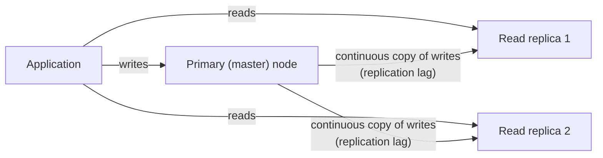

**2. Federation** (also **functional partitioning**) — split one database into several separate databases along domain lines.

- E.g. a `users` database and a separate `products` database, each with its own full schema.
- Think of splitting one general store into specialty shops, a bakery and a hardware store. Each gets more room and more of its own staff's attention, but a shopping list spanning both now means two trips.
- That extra trip lands on the application. A foreign key or JOIN that used to span two tables in one database must now be resolved in application code across two separate database connections, because the engine has no visibility across that boundary.

**3. Sharding** (also **horizontal partitioning**) — split the rows of a single logical table across multiple physical nodes (**shards**), each holding a disjoint subset.

- Rows are usually assigned by a **shard key**: the column, or a function of it, that decides which shard a row belongs on (e.g. `user_id % N`, or a hash of `user_id`).
- Think of splitting a phone book into volumes by last-name range. Each volume is smaller and faster to search, but "everyone born in 1990" is scattered across every volume, so you search all of them.
  - That is a **cross-shard query**, and it is the main cost of sharding.
- Federation splits by table/domain. Sharding splits *within* one table, scaling a single hot table's reads *and* writes across many nodes.
  - Any query needing rows from more than one shard must be assembled by the application from multiple round trips instead of one SQL query.
- A naive modulo shard key (`id % N`) adds a cost: changing N (adding or removing a shard) changes almost every row's target shard, forcing a massive reshuffle.
- **Consistent hashing** avoids that.
  - It maps both data items and nodes onto points on a circular hash space (a "ring").
  - Adding or removing one node only remaps the small slice of keys near it on the ring.
  - The price is slightly more complex routing than a plain modulo.

How a shard key routes rows across nodes, and why a spanning query becomes a cross-shard query:

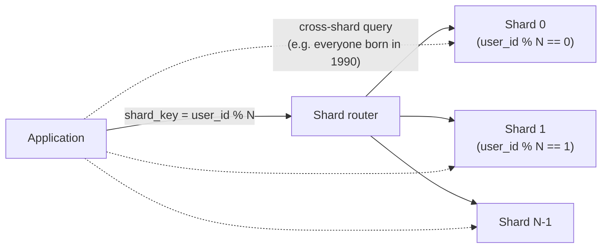

**4. Denormalization** — deliberately duplicate data across tables (or embed a related record's fields into a referencing row) to avoid an expensive JOIN at read time.

- Think of writing a friend's number on a sticky note by your phone instead of opening contacts every time. Faster, but if they change numbers and you forget the note, you dial the wrong one.
- Benefit: faster reads for the path that would need the join.
- Cost: extra storage, and the obligation (on the application, or database triggers) to keep every copy consistent when the original changes. Skip it and the duplicates silently drift apart.

**5. SQL tuning** — make a single node's own queries more efficient without changing the topology.

- An **index**: an auxiliary, separately maintained lookup structure (commonly a B-tree) that finds matching rows by a column's value without scanning every row.
  - Cost: extra storage and slightly slower writes, since the index must be updated too.
- **Query rewriting**, so queries actually use indexes that already exist.
  - Filtering on an expression derived from a column, rather than the column itself, often can't use an index sitting right there.
- **Connection pooling**: a fixed pool of already-open database connections that application threads borrow and return.
  - It avoids the measurable overhead of opening one per request (mostly the TCP handshake and per-connection authentication).

### How?

**Worked example — read-replica QPS headroom.**

A primary sustains 2,000 writes/sec at its write-capacity ceiling. Read load has grown to 45,000 reads/sec. One read replica on this hardware saturates at 9,000 reads/sec.

```
replicas_needed (bare minimum) = ceil(45,000 reads/sec / 9,000 reads/sec per replica)
                                = ceil(5.0) = 5 replicas

total capacity at 5 replicas    = 5 × 9,000 = 45,000 reads/sec   (exactly at the ceiling, zero headroom)
```

Running at exactly 100% of measured capacity means any spike queues requests and inflates latency. A real deployment targets headroom, e.g. 20%:

```
required_capacity_with_20%_headroom = 45,000 × 1.20 = 54,000 reads/sec
replicas_needed_with_headroom       = ceil(54,000 / 9,000) = 6 replicas
total capacity at 6 replicas        = 6 × 9,000 = 54,000 reads/sec  (20% headroom over current peak load)
```

Going from 5 to 6 replicas is the concrete cost of that 20% safety margin: one extra node.

**Trade-offs considered:**

- **Replication**
  - Scales reads cheaply, and each replica fails independently.
  - Every replica reintroduces Lesson 3's Concept I2 question: a lagging replica can return data milliseconds-to-seconds stale, so the application must accept that or force a read from the primary.
- **Federation:** avoids one node holding every domain's traffic, but gives up database-enforced referential integrity across the boundary.
- **Sharding**
  - Scales both reads and writes, not just reads.
  - Makes cross-shard queries expensive.
  - Makes resharding a real operational project unless consistent hashing was chosen from the start.
- **Denormalization:** a pure read-speed win paid for entirely in write complexity and consistency risk.
- None of the five is "the" answer. Production systems at this scale combine several, e.g. a sharded, replicated primary dataset with selective denormalization for the hottest read paths.

**Situation to reason through:**

- The pins service peaks at 1,900 writes/sec on a primary that tops out at 2,000. Reads are comfortably served by replicas.
- Launch plans double write traffic next quarter. The table is heading to 2 billion rows of about 300 bytes.
- A manager says "just add more read replicas".

<details>
<summary><b>Q1.</b> Does adding read replicas solve this?</summary>

**How to think:** match the fix to the bottleneck.

- Replicas add read capacity only. Every write still goes through the one primary.
- Doubled writes are 3,800/sec, past the 2,000 ceiling, no matter how many replicas exist.
- Each replica also adds more replication lag.

<details>
<summary><b>Q1a.</b> What do you do instead, and how many shards?</summary>

**How to think:** split the writes, then check the storage constraint too.

- Split writes by sharding (or master-master with conflict resolution).
- Writes alone: ceil(3,800 / 2,000) = 2 primaries, or ceil(4,560 / 2,000) = 3 with 20% headroom.
- Storage: 2 billion × 300 bytes = 600 GB. At a 60 GB target per shard that is 10 shards.
- Take the larger answer: 10 shards, about 380 writes/sec each, far under the ceiling.

<details>
<summary><b>Q1b.</b> How do you choose the shard key, and what stays on replicas?</summary>

- Shard on `user_id`. One user's pins stay on one shard.
- Cost: queries across users, like "everything created yesterday", become cross-shard.
- If you expect to resize, use consistent hashing. `id % N` remaps almost every row when N changes.
- Keep replicas per shard for reads. Decide which reads tolerate lag and which must go to the primary.
</details>
</details>
</details>

**Case-study pointer:**

- **Capstone #1 (Pinterest's visual-search / Flashlight-Lens-Shop-the-Look system)**
  - It serves an embedding/image-metadata index at a scale (hundreds of millions to billions of images) that requires exactly this sharding pattern.
  - The index is partitioned by a shard key over the item/image identifier space, so no single node holds the whole index or absorbs its whole query load.
- **Capstone #6 (LinkedIn's "People You May Know")**
  - It operates over a connection graph large enough to need the same treatment.
  - Order-of-magnitude illustration only (these exact figures aren't what the cited sources confirm): at hundreds of millions of members, a connection graph runs to hundreds of billions of stored edge halves (members times average degree).
  - That is only a few terabytes of rows, so capacity is not what forces sharding. The pressure is the throughput of triangle-closing (inferring a likely connection because two people share a mutual connection), whose second-degree expansion grows much faster than the site.
  - LinkedIn's team page names Voldemort, Hadoop workflows (Azkaban) and Kafka, and does not describe a sharded graph store, so the capstone's sharded design is a teaching illustration.

**Source(s) and further reading:**

- `system-design-primer`'s "Sharding," "Federation," and "Denormalization" sections (the classic, non-AI framing this Concept curates from)
- Zhai et al., *"Learning a Unified Embedding for Visual Search at Pinterest,"* KDD 2019 (arXiv:1908.01707) — capstone #1's primary source
- LinkedIn Engineering's posts on building a heterogeneous-network recommender and "Optimizing PYMK for Equity in Network Creation" — capstone #6's primary sources

---

## Concept 2: NoSQL Types

### Why?

Some data doesn't look like neat, uniform rows that join cleanly on foreign keys. For example:

- A social graph of users and their connections.
- A per-session blob with a different shape for every user.
- A catalog where one item has twenty attributes and another has two.

Forcing any of this into an RDBMS's fixed-schema, join-centric model costs real performance and real schema-migration pain, for no benefit.

**NoSQL** databases (historically "not only SQL", not a single technology) trade away some of an RDBMS's guarantees. In return they get a data model that matches a specific access pattern more directly, and scale horizontally with fewer structural compromises.

### What?

Four common NoSQL types, each matched to a different access pattern.

- **Key-value store**
  - Works like a coat-check ticket: hand over the key, get back the value, and the store never looks inside.
  - Only "get the value for this key" (and sometimes set/delete). No joins, no secondary indexes, no schema beyond key and value.
  - That simplicity makes it trivially shardable: the whole routing problem is "which node owns this key", the same shape as Concept 1's shard-key problem.
  - Examples: Redis, DynamoDB.
- **Document store**
  - Like a filing cabinet where every folder holds a different mix of papers, and unlike the key-value store you can search by what's written on any page inside a folder.
  - Stores semi-structured **documents** (nested, JSON-like objects, often physically stored as BSON, a binary-encoded superset of JSON).
  - Each document can have a different shape in the same collection, and the database can query and index fields *inside* it.
  - Example: MongoDB.
- **Wide-column store**
  - Like a spreadsheet with thousands of possible columns where most cells are blank.
  - Every row is indexed by a single **row key**, but rows can have hugely different sets of columns (mostly *sparse*).
  - Related columns are grouped into **column families** stored together on disk, so a query touching one family doesn't read the others.
  - Built for enormous, sparse datasets where a rigid schema would waste huge storage.
  - Examples: Cassandra, HBase, Google Bigtable.
- **Graph database**
  - Like a subway map: stations are **nodes** (entities), tracks are **edges** (relationships), and both can carry properties.
  - Built for traversal queries ("every node within 2 hops", "which stations are two stops from here"). They are cheap here and a chain of expensive self-joins in a relational model.
  - Example: Neo4j.

The four types, their access pattern and representative systems:

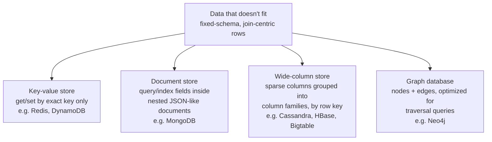

**SQL vs. NoSQL — a trade-off, not a verdict.**

- An RDBMS's ACID guarantees come from real engineering cost. Strict consistency and isolation on every transaction is work, and it gets harder to do cheaply the more nodes the data spans.
- Most NoSQL databases follow **BASE** instead:
  - **B**asically **A**vailable — stays responsive essentially all the time, even if some responses aren't the freshest data.
  - **S**oft state — stored state can change over time even with no new writes, as replicas converge in the background.
  - **E**ventual consistency — the guarantee Lesson 3's Concept I2 defined: given enough time with no new writes, replicas converge, with no bound on how long.
- This is the same CP-vs-AP tension from Lesson 3's CAP theorem, now as a database *design philosophy* rather than a runtime choice.
  - RDBMS defaults lean toward consistency.
  - Most NoSQL defaults lean toward availability and horizontal scalability, with strong consistency as an opt-in, costlier mode if at all.

### How?

**Why a vector database is a hybrid, not a fifth category.**

Lesson 1's Concept C2 defined a **vector database** as one built to store large numbers of embeddings and answer "find the k nearest vectors to this query vector", typically via an index like **HNSW** (Hierarchical Navigable Small World, a graph-based approximate-nearest-neighbor index, defined in Lesson 1). It is tempting to treat it as a fifth NoSQL category. Look at its storage shape piece by piece:

1. Each row is addressed by a row/vector ID — key-value's defining trait.
2. The "value" is almost always a fixed-width numeric array (the embedding) plus a sidecar of variable metadata — document-store-like, but secondary to the vector.
3. At scale it is sharded across nodes by vector ID, in the row-key-sharding shape of a wide-column store — not by any graph or relationship structure.

Why those three traits compose into a hybrid rather than a new category:

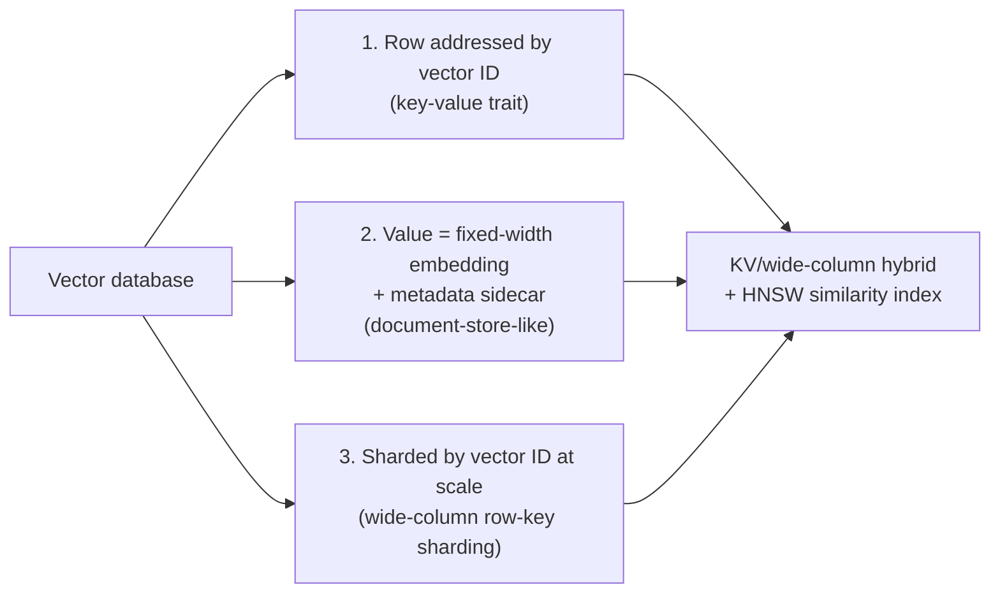

So a vector database is a **KV/wide-column hybrid with a specialized similarity index bolted onto the value side**. The innovation is the *index* (HNSW or similar), not the row/key storage model, which is architecturally ordinary.

**Trade-offs considered:**

- **Key-value:** the fastest lookups and simplest sharding, but only "get this exact key". No range queries, no filtering on value contents.
- **Document:** trades some simplicity for queryability on nested fields, and needs a real indexing strategy per queried field.
- **Wide-column:** handles sparse, massive-scale data efficiently but gives up most relational flexibility. You design the row key and column families around known access patterns up front.
- **Graph:** makes traversal cheap, but is usually wrong for mostly simple key lookups.

**Situation to reason through:**

- A new AI feature needs four kinds of data:
  - (a) per-session chat state, a different shape per session, looked up only by session ID;
  - (b) a product catalog whose items have 2 to 20 attributes, queried by attribute;
  - (c) "everyone within two hops of this user";
  - (d) embeddings for retrieval.
- A vendor pitches a "fifth category" database for (d).
- Separately, the agent must read back a memory it wrote 100 ms earlier.

<details>
<summary><b>Q1.</b> Which store type fits each of (a), (b), (c)?</summary>

**How to think:** match each access pattern to a type.

- (a) **Key-value.** Exact-key lookup, trivially shardable.
- (b) **Document store.** Varied shape and you can query inside the document, though each queried field needs an index.
- (c) **Graph database.** Two-hop traversal is cheap there and a chain of self-joins in a relational model.

<details>
<summary><b>Q1a.</b> How do you answer the vendor's "fifth category" pitch for (d)?</summary>

**How to think:** look at the storage shape, not the label.

- Rows are addressed by ID, the value is a fixed-width array plus metadata, and the data is sharded by ID. That is a KV/wide-column hybrid.
- What is new is the HNSW index.
- So sharding (Concept 1) and consistency (Lesson 3) reasoning carries over unchanged.
- Ask the vendor what is new in the index, and what its replication and consistency defaults are.

<details>
<summary><b>Q1b.</b> What about the memory read back 100 ms after the write?</summary>

- Most NoSQL defaults are BASE, so eventually consistent.
- The 100 ms read-back is exactly Lesson 3's "agent forgets" failure.
- For that path you need a stronger opt-in mode, or must confirm the product offers one.
- Don't force one store. Production systems combine these, choosing per access pattern and accepting that consistency settings differ per store.
</details>
</details>
</details>

**Case-study pointer:**

- **Capstone #1 (Pinterest)**
  - It binarizes its learned embeddings specifically to make them cheap to store and search at its scale.
  - That storage-format decision only makes sense once a vector database is understood as sitting on the KV/wide-column spectrum (fixed-width value blobs, sharded by key), not as a separate kind of database with its own rules.
- **Capstone #9 (RAG system grounded in Anthropic's Contextual Retrieval, Sept. 2024)**
  - It depends on this same storage-and-retrieval layer to hold its chunk embeddings.
  - The technique prepends LLM-generated context to each chunk *before* embedding and indexing, but the resulting embeddings still live in a database with this KV/wide-column shape underneath.

**Source(s) and further reading:**

- `system-design-primer`'s "SQL vs. NoSQL" section (the classic framing this Concept extends with the vector-database overlay)
- DynamoDB, MongoDB, Cassandra, and Neo4j product documentation, as representative sources for the key-value, document, wide-column, and graph shapes respectively
- Zhai et al., *"Learning a Unified Embedding for Visual Search at Pinterest,"* KDD 2019 (arXiv:1908.01707) — capstone #1's binarized-embedding storage detail
- Anthropic, *"Introducing Contextual Retrieval,"* Sept. 2024 — capstone #9's source
- Lesson 1 (`lesson-1-ai-fundamentals-refresher.md`), Concept C2 — the original full definition of vector databases and HNSW, referenced rather than re-derived here

---

## Concept 3: Caching Strategies

### Why?

Whether it's an RDBMS (Concept 1) or a NoSQL store (Concept 2), the database is almost always the slowest, most expensive-to-scale layer. So much real-world scaling work isn't "make the database faster". It is "don't ask the database in the first place."

A **cache** is a smaller, faster-to-access store holding a copy of data normally served by a slower source, so repeat requests don't pay the slower source's cost again.

- Think of snacks in your desk drawer instead of walking to the kitchen: faster to reach, but someone must restock it, and if it goes stale you might reach for something you shouldn't.
- Where you put a cache, and which strategy keeps it in sync with the underlying store, decides whether it relieves load or quietly serves wrong answers.

### What?

**Where to cache.** A request can be served from a cache at several points before reaching the database:

- Client-side (the calling application or browser itself).
- A CDN edge node (Lesson 4's Concept J2), for static content.
- The application/web-server layer: an in-process, local in-memory cache.
- A **distributed cache**: a dedicated service like Redis or Memcached, shared across every application instance, between the application and the database.
- The database's own internal query cache.

How a request can be served before it reaches the database:

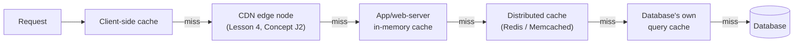

Each hop closer to the caller saves more latency on a hit. But a cache local to one server (rather than shared/distributed) can't be hit by a request that lands on a different server.

**Four caching strategies**, defined by what each does on a read vs. a write.

**1. Cache-aside** (also **lazy loading**) — the "check the fridge before the store" pattern.

- On a read, the application checks the cache first.
  - Hit: return the cached value.
  - Miss: read from the database, write the result into the cache (usually with a **TTL**, the time-to-live Lesson 4's Concept J1 defined for DNS records, here on a cache entry: after it the entry is stale and must be re-fetched), then return it.
- The cache is populated only by read misses. Nothing proactively pushes data in.
- Pros: simple and resilient. A dead cache makes reads slower, not wrong.
- Cons: every first read after a miss pays full database latency, and the cached copy can go stale for up to a full TTL before anyone notices.

Cache-aside's check-first, populate-on-miss sequence:

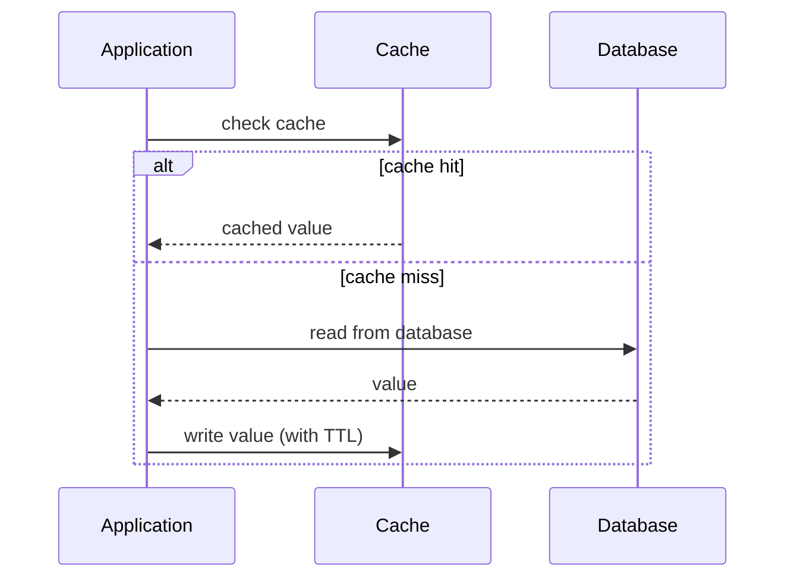

**2. Write-through** — every write is applied to the cache *and* the database together, synchronously, before the caller gets an acknowledgment.

- Like refusing to call a filing "done" until both the home and office copy are updated.
- Pro: the cache is consistent with the database immediately after a write. No window where a committed write hasn't reached the cache.
- Cons: doubles every write's latency, and the cache fills with entries that may never be read, since writing populates it regardless.

**3. Write-behind** (also **write-back**) — a write is applied to the cache and acknowledged immediately; the database write is deferred and done asynchronously (often batched).

- Like scribbling a note now and trusting you'll file it properly later.
- Pro: writes are fast from the caller's view.
- Cons: a real window where the cache is ahead of the database. If the cache fails before the deferred write completes, the write is lost outright, like the unfiled note.
- A direct trade of durability for write latency.

Write-through's synchronous dual-write vs. write-behind's deferred write:

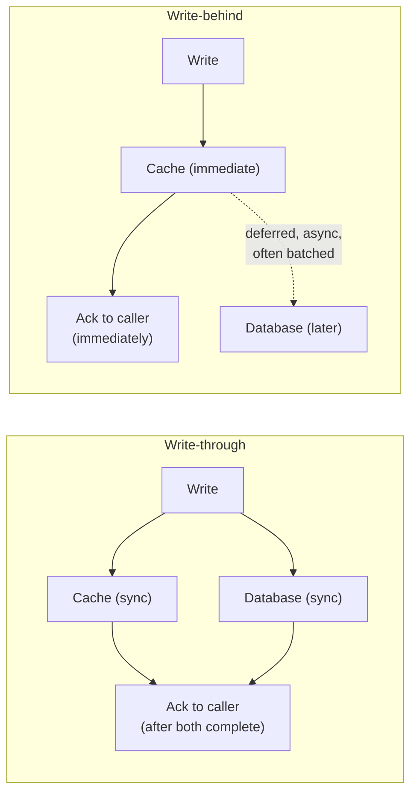

**4. Refresh-ahead** — the cache proactively re-fetches a soon-to-expire entry *before* its TTL runs out.

- Typically triggered once an active entry crosses some fraction of its TTL (e.g. 80%). Like refilling the coffee pot before it's empty.
- It exists to prevent a **thundering herd**: many concurrent requests all miss the cache for the same key at the same instant, because its TTL just expired as a traffic wave arrived. They all fall through to the database at once, which can look like a spike many times the real request rate.
- Cost: real background work refreshing entries that might never be requested again before they'd expire naturally.

Refresh-ahead's proactive re-fetch before a thundering herd can form:

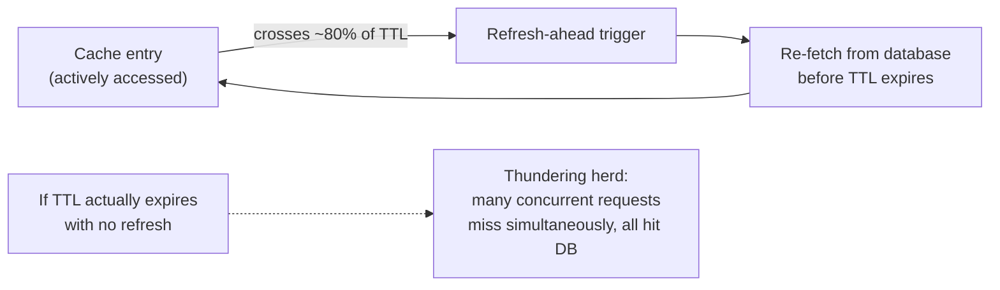

### How?

A cache's hit rate isn't just a nice metric. It is a capacity number, because the database only ever sees the fraction of traffic the cache *misses*.

**Worked example.** An application serves 40,000 reads/sec against a database that saturates at 5,000 queries/sec, with a cache-aside layer in front.

```
At a measured 92% cache hit rate:
  queries reaching the DB = total_queries × (1 - hit_rate)
                           = 40,000 × (1 - 0.92)
                           = 40,000 × 0.08
                           = 3,200 queries/sec

  headroom vs. DB's 5,000 qps ceiling = 5,000 - 3,200 = 1,800 qps spare (36% headroom)
```

Comfortably inside capacity. Now a cache-eviction storm (a burst of invalidations, or a restart that wipes it cold) drops the hit rate to 85%:

```
At 85% cache hit rate:
  queries reaching the DB = 40,000 × (1 - 0.85) = 40,000 × 0.15 = 6,000 queries/sec

  vs. DB's 5,000 qps ceiling: 6,000 - 5,000 = 1,000 qps over capacity (20% overloaded)
```

- A 7-point drop in hit rate (92% → 85%) swung the database from 36% headroom to 20% overloaded.
- The database only sees the *missed* fraction, which looks irrelevant at a high hit rate right up until it isn't.
- This is the same arithmetic as Lesson 4's Concept J2 CDN hit-ratio calculation, one layer lower in the stack.

**Trade-offs considered:**

- **Cache-aside:** simplest and most fault-tolerant, but every cold key pays full database latency on its first request. A wave of simultaneously expiring popular keys can itself cause a thundering herd.
- **Write-through:** the cache is never stale relative to the database, at the cost of doubled write latency and caching writes that may never be read.
- **Write-behind:** fastest for writes, but risks data loss and reintroduces Lesson 3's consistency concerns. A read-after-write from a path other than the cache can see state the database doesn't have yet.
- **Refresh-ahead:** avoids expiry spikes for genuinely hot keys, but spends background work refreshing speculatively. Wasted for any key not re-requested.

**Situation to reason through:**

- A product-page service handles 60,000 reads/sec.
- The database ceiling is 8,000 queries/sec. The cache-aside layer normally hits 93%.
- Ops plans to restart the cache fleet during business hours.

<details>
<summary><b>Q1.</b> Is a full cache restart safe?</summary>

**How to think:** find the break-even hit rate, then see where a cold cache lands.

- Baseline: 60,000 × (1 − 0.93) = 4,200 queries/sec, 52.5% of the ceiling. Fine.
- The database absorbs 8,000 / 60,000 ≈ 13.3% misses, so the hit rate must stay at or above about 86.7%.
- A full cold restart drops the hit rate to near 0%, so 60,000 queries/sec reach the database. That is 7.5x its ceiling, with a thundering herd on top. **Not safe.**

<details>
<summary><b>Q1a.</b> What about a rolling restart? How much can be cold at once?</summary>

**How to think:** model the hit rate as a function of the cold fraction f.

- With keys spread evenly, hit rate ≈ 0.93 × (1 − f).
- Staying above 86.7% needs f ≤ about 6.8%.
- 10% at a time: 83.7% hit rate, about 9,780 queries/sec. Over the ceiling.
- 5% at a time: 88.4% hit rate, about 6,990 queries/sec. Safe.

<details>
<summary><b>Q1b.</b> What else protects the database during the restart?</summary>

- Pre-warm replacement nodes from a hot-key list before they take traffic.
- Use refresh-ahead on the hottest keys to avoid a herd.
- Put a bounded queue or a 429 in front of the database (Lesson 6) so a miss storm degrades gracefully instead of toppling it.
- Cache-aside makes a dead cache slower, not wrong, so the risk here is capacity.
- Assumes cold nodes serve no hits at first and traffic is evenly spread.
</details>
</details>
</details>

**Case-study pointer:**

- **Capstone #10's KV-cache reuse** (`case-studies/llm-inference-serving`) is architecturally cache-aside applied to GPU compute state instead of database rows.
  - On each new request, the engine checks whether a matching prefix's key/value tensors are already in GPU memory (the cache check).
  - Miss: compute them from scratch via the forward pass (the equivalent of a database read).
  - Hit: reuse the tensors and skip that computation.
  - Same "check cache, fall through on a miss, populate for next time" shape. The expensive path is a GPU forward pass instead of a SQL query.
- **Capstone #9** (`case-studies/rag-contextual-retrieval`) shows the same shape one layer up the pipeline.
  - Contextual Retrieval computes an LLM-generated context prefix for each chunk once, at indexing time, so that step is never repeated per query.
  - A one-time write that's read many times: the workload cache-aside and write-through both exist to optimize.

**Source(s) and further reading:**

- `system-design-primer`'s "Caching" section (cache-aside/write-through/write-behind/refresh-ahead in their original, non-AI framing)
- Kwon et al., *"Efficient Memory Management for LLM Serving with PagedAttention,"* SOSP 2023 (arXiv:2309.06180) — capstone #10's source for KV-cache reuse as the mechanism this Concept overlays onto
- Anthropic, *"Introducing Contextual Retrieval,"* Sept. 2024 — capstone #9's source for the one-time-compute, many-times-reused chunk context this Concept overlays onto
- Redis and Memcached documentation, as representative distributed-cache product references

---

## Concept 4: Bridge — Semantic Caching and Vector Databases as This Lesson's AI-Native Cousins

### Why?

This Concept connects the classic patterns just taught (K1-K3) to their AI-native cousins from Lesson 1.

- It isn't a fifth new topic.
- It doesn't re-explain K1-K3 or Lesson 1's B4/C2 from scratch. It is the short synthesis that makes the connection explicit.

### What?

- Lesson 1's Concept B4 defined **semantic caching**: a caching strategy for LLM apps that stores past prompt/response pairs.
  - For a new prompt, it checks whether the prompt is *semantically* similar enough to a cached one (via embedding similarity) to reuse the response, instead of requiring an exact string match.
- Lesson 1's Concept C2 defined the **vector database** this depends on.

Put plainly: **semantic caching is Concept 3's cache-aside algorithm, with the cache-key lookup replaced by a nearest-neighbor similarity search.**

- It is the difference between a librarian who only finds a book if you recite its exact catalog title, and one who recognizes that "the one about the whale" and "Moby Dick" are the same request.
- Classic cache-aside asks "does this exact key exist?" (an equality check).
- Semantic caching asks "does a sufficiently *similar* key exist?" (a nearest-neighbor check within a similarity threshold), run against a vector database (Concept 2's KV/wide-column hybrid with a similarity index).
- Everything else is identical: check first, serve on a hit, fall through to the expensive path on a miss, populate the cache afterward.

### How?

**Step-by-step trace of a semantic cache's cache-aside logic:**

1. A new prompt arrives.
2. Embed the prompt (Lesson 1, Concept C1) into a vector.
3. Query the vector database for the nearest previously cached prompt embedding, and check whether its similarity (commonly cosine similarity, defined in Lesson 1's Concept C1) clears a configured threshold.
4. **Hit** (a sufficiently similar cached prompt exists): return the cached response. The LLM is never called.
5. **Miss** (nothing clears the threshold): call the LLM, then embed the new prompt-response pair and write it into the vector database for future hits.

The same cache-aside shape with similarity search in place of exact-key lookup:

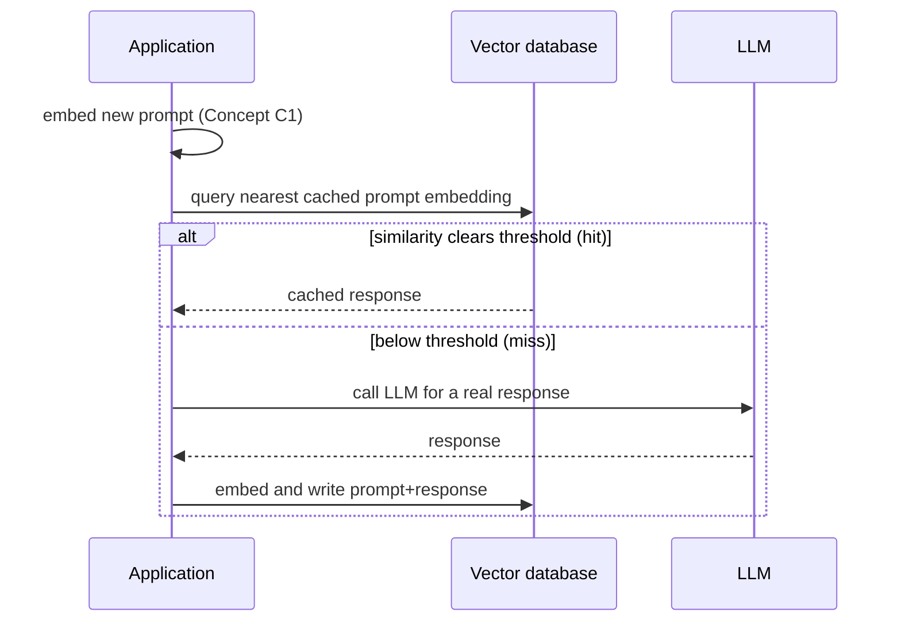

**Worked illustration — why the threshold matters, not just whether caching is "on".**

- A support chatbot's exact-match cache-aside layer (keying on the literal prompt string) measures only a 5% hit rate.
  - Unsurprising: real users phrase the same question many ways ("how do I reset my password", "I forgot my password, help", "password reset not working").
  - An exact-match cache sees none of those as the same question.
- A semantic cache at a similarity threshold of 0.95 (on a −1-to-1 cosine scale) raises the hit rate to roughly 40% on the same traffic, because it recognizes differently worded, same-intent prompts as hits.
- Lowering the threshold to 0.90 would raise the hit rate again (Concept 3's hit-rate math applies exactly as before: every extra hit reduces load on the LLM backend the way it reduced load on a database).
- But as the threshold falls, the risk of a **false-positive hit** rises: returning a cached answer to a question that was merely similar, not the same. An exact-match cache can't do this at all, right or wrong.

How lowering the threshold trades hit rate for false-positive risk:

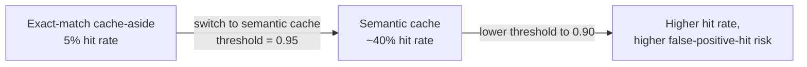

**Trade-offs considered:**

- A low threshold raises hit rate and cost savings (per Concept 3's arithmetic) but raises the odds of serving a subtly wrong answer.
- A high threshold is safer but converges toward exact-match caching's low hit rate, giving up most of the reason to build a semantic cache.
- Same shape as Lesson 3's CAP theorem: trading a guarantee (correctness for *this exact* question) for a resource win (hit rate, cost, latency), one layer higher in the stack than a database read.

**Situation to reason through:**

- A support bot makes 100,000 LLM calls a day.
- An exact-match cache hits 5% of prompts. A semantic cache at similarity 0.95 hits 40%.
- The PM wants a 0.90 threshold, which a test suggests lifts hits to about 55% (illustrative).
- Reviewers notice that "refund order 1234" and "refund order 4321" score above 0.90 against each other.

<details>
<summary><b>Q1.</b> What does moving to 0.90 actually save?</summary>

**How to think:** convert hit rates into calls, then compare steps.

- LLM calls per day: 95,000 (exact match), 60,000 (at 0.95), 45,000 (at 0.90).
- Moving from 0.95 to 0.90 saves 15,000 more calls, a 25% cut from the 0.95 level.

<details>
<summary><b>Q1a.</b> What does a false positive cost here?</summary>

**How to think:** ask what a wrong hit returns, and who it hurts.

- A false positive returns the cached answer for a *different* order, possibly another customer's details.
- An exact-match cache can never do this, because it only returns the literal answer to the literal key.

<details>
<summary><b>Q1b.</b> So what do you decide?</summary>

- **Don't use one global threshold.** Prompts that hinge on specific entities (order IDs, account data) should bypass the cache or be keyed on the extracted entity. Generic FAQ questions, like password reset, can use a lower threshold.
- **Scope entries.** Key the cache per tenant or per user so a hit can't cross that boundary.
- **Decide by measuring.** Sample hits at each threshold, have them reviewed, and estimate the false-positive rate before moving.
- This is the CAP bet again: trading a guarantee (the right answer for this exact question) for a resource win (hit rate and cost).
</details>
</details>
</details>

**Case-study pointer:**

- This Concept's anchor is Lesson 1's B4 (semantic caching) and C2 (vector databases), bridged directly here.
- Capstone #10's KV-cache reuse (`case-studies/llm-inference-serving`) is this idea's compute-level sibling: caching "have I already computed this state" rather than "have I already answered this question".
- Capstone #9's retrieval pipeline (`case-studies/rag-contextual-retrieval`) is the non-cache, full-knowledge-base use of the same vector-database infrastructure that a semantic cache applies narrowly in cache shape.

**Source(s) and further reading:**

- Lesson 1 (`lesson-1-ai-fundamentals-refresher.md`), Concepts B4 and C2 — the original full definitions of semantic caching and vector databases, bridged here rather than re-derived
- Anthropic's prompt-caching documentation — a confirmed primary source for the literal prompt-caching mechanism
- The general semantic-caching pattern as discussed in open-source tooling such as GPTCache — **unconfirmed as a specific-company primary source**: no single company's primary engineering teardown was confirmed for this pattern; included as the pattern-level reference, not as an Anthropic/OpenAI-documented feature
- Kwon et al., *"Efficient Memory Management for LLM Serving with PagedAttention,"* SOSP 2023 (arXiv:2309.06180) — capstone #10's KV-cache-reuse mechanism, cited here as the compute-level sibling pattern
- Anthropic, *"Introducing Contextual Retrieval,"* Sept. 2024 — capstone #9's source

---

## Concept 5: Caching in the RAG Pipeline

### Why?

Concept 4 put one cache at the very end of an LLM request: the whole answer. A RAG (retrieval-augmented generation) request has more steps than that, and most of them are repeatable.

- A RAG request runs a pipeline: embed the query → retrieve from the vector database (often plus keyword search) → rerank the candidates → assemble the prompt → call the LLM.
- Each stage costs latency or money, and several are deterministic: the same input gives the same output.
- So there are several places to cache, each with its own key, its own hit rate, and its own way of going stale.

Compared with a plain database cache, a RAG cache adds two new risks:

- **Staleness:** a cached stage output can outlive the data it was built from. A policy document changes and the cache keeps serving the old one.
- **Leakage:** a cached output can cross a permission boundary. Someone who can't see a document gets an answer built from it.

### What?

**Six places to cache in a RAG request**

| # | Cache | Key | Value | Goes stale when |
|---|---|---|---|---|
| 1 | Query-embedding cache | Hash of the normalized query text + embedding-model version | The query vector | The embedding model changes (never because documents change) |
| 2 | Ingestion cache | Hash of the chunk text + model version (+ context-prompt version, for Contextual Retrieval) | The chunk's embedding, or its generated context | The chunk text, the model, or the prompt changes |
| 3 | Retrieval-result cache | Query (or its vector) + metadata filters + permission scope + index version | An ordered list of chunk IDs | The index changes (documents added, edited, deleted) or permissions change |
| 4 | Reranker cache | Query + candidate chunk IDs with their versions | The reranked order | Any candidate chunk changes |
| 5 | Provider prompt cache | The exact prompt prefix | The provider's processed prefix (its KV state) | The prefix changes at all, or its lifetime runs out |
| 6 | Semantic answer cache (Concept 4) | Query embedding + permission scope | The final answer | Any document the answer drew on changes |

Where each one sits in the request path:

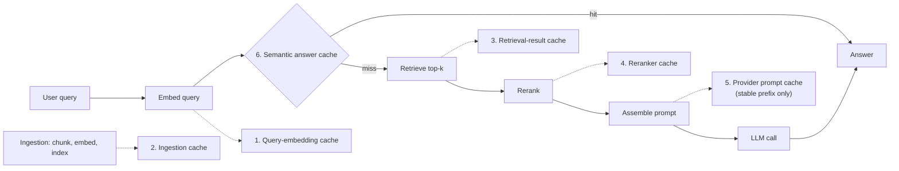

**Why the provider prompt cache (5) is different**

It caches the provider's processing of a prompt prefix, not an answer. The reply is still generated fresh, and it is the same reply you would get without caching.

- It saves input-token cost and prefill time, not generation time.
- This is the provider-side form of Lesson 1's prompt caching and KV-cache reuse.
- The mechanics below are from Anthropic's prompt-caching documentation, read 2026-10-19. Numbers differ by model and change over time, so check the current page before relying on them.

How it behaves:

- **Exact prefix:** a hit needs 100% identical content up to the marked point. The order is tools → system → messages, and a change at one level invalidates that level and everything after it.
- **Lifetime:** 5 minutes by default, refreshed at no extra charge each time the entry is used. A 1-hour lifetime is available at a higher price.
- **Price:** writing the entry costs 1.25x the base input price (2x for the 1-hour lifetime). Reading it costs about 0.1x on most models, and less on some newer ones.
- **Minimum length:** set per model (the current page lists 512 to 4,096 tokens). Below it the request runs uncached **with no error**. Check `cache_creation_input_tokens` and `cache_read_input_tokens` in the response to see what actually happened.
- **Timing:** the entry becomes available once the first response begins, so requests launched at the same moment can all miss.
- **Prefix order:** retrieved chunks change on every query, so they make a poor prefix. Put stable parts first (tool definitions, system prompt, fixed documents) and variable parts last (retrieved chunks, the user's question).

**Three ways to keep a cache honest**

- **TTL** — entries expire after a fixed time.
  - Simple, and staleness is bounded: the worst case is the TTL itself. (Lesson 4's DNS TTL works the same way.)
- **Versioned keys** — put the index or document version in the key.
  - A new version means a new key, so old entries are never read. Correct by construction.
  - Cost: the hit rate for affected keys drops to zero after each update.
- **Explicit invalidation** — on an update, delete every entry that used that document.
  - Precise, but needs a reverse map from document ID to cache entries. An entry you miss stays stale.

Choose by what a wrong answer costs. A stable FAQ can ride on a TTL. A policy or legal answer needs versioned keys or explicit invalidation.

**Permission scope**

- Put the permission scope (tenant, role, or group) in the key of every cache that stores retrieval output or answers: stages 3, 4 and 6.
- A cache shared across scopes is a data leak. This is Lesson 8's Concept F5 (multi-tenant isolation) applied to a cache: one missing filter becomes the incident.

### How?

**Worked example 1 — which cache actually pays? (illustrative latencies)**

A RAG request takes 30 ms to embed the query, 40 ms to retrieve, 120 ms to rerank, and 1,800 ms for the LLM call.

```
Uncached request = 30 (embed) + 40 (retrieve) + 120 (rerank) + 1,800 (LLM) = 1,990 ms

Stage caches only (hit rates 30% / 20% / 20% on embed / retrieve / rerank):
  saved = 0.30 × 30 + 0.20 × 40 + 0.20 × 120 = 9 + 8 + 24 = 41 ms   (about 2% of 1,990)

Semantic answer cache at a 40% hit rate
(every request pays the embed plus a 40 ms similarity lookup):
  hit  = 30 + 40                     = 70 ms
  miss = 30 + 40 + 40 + 120 + 1,800  = 2,030 ms
  expected = 0.4 × 70 + 0.6 × 2,030  = 28 + 1,218 = 1,246 ms   (about 37% below 1,990)
```

- The stage caches save about 41 ms because the stages they skip are cheap. The answer cache saves about 744 ms because it skips the LLM call.
- Cache where the expensive step is. Note the lookup adds 40 ms to every miss, which is the price of having the cache.

**Worked example 2 — when does prompt caching pay, and when does it cost more?**

A RAG assistant resends a stable 6,000-token prefix (system prompt, tool definitions, a fixed policy document) on every request. Let P be the base input price per token (kept symbolic, since prices change). Use the 5-minute lifetime, a write at 1.25P and a read at 0.1P.

```
No caching, 10 requests:  10 × 6,000 × P = 60,000 P

Caching, 10 requests all inside the 5-minute lifetime:
  first request writes:  6,000 × 1.25 P   =  7,500 P
  nine requests read:    9 × 6,000 × 0.1 P =  5,400 P
  total                                    = 12,900 P   (78.5% below 60,000 P)

Break-even:
  extra cost of the write  = 0.25 × 6,000 P         = 1,500 P
  saving per read          = 6,000 P - 600 P        = 5,400 P
  1,500 / 5,400 ≈ 0.28  →  the first reuse already repays the write

Same 10 requests, each more than 5 minutes apart (every one re-writes, none reads):
  10 × 7,500 P = 75,000 P    (25% MORE than no caching)

Same 10 requests on the 1-hour lifetime (write at 2P), all inside the hour:
  6,000 × 2 P + 9 × 600 P = 12,000 P + 5,400 P = 17,400 P   (71% below 60,000 P)
```

- This counts input tokens only. Output tokens cost the same either way.
- The risk is silent: a prefix that is too short, or requests spaced beyond the lifetime, give you the write premium and no reads.

**Trade-offs considered:**

- **Query-embedding cache:** tiny, safe, and rarely wrong, but the savings are small because embedding is cheap.
- **Retrieval and reranker caches:** save moderate latency, but go stale whenever the index changes, so they need versioned keys or invalidation.
- **Provider prompt cache**
  - The biggest cost cut for large repeated prefixes, with no change to the answer.
  - Needs an exact prefix, a minimum length, and requests inside the lifetime. When it fails, it fails silently, as a higher bill.
- **Semantic answer cache:** the biggest saving and the biggest correctness risk (Concept 4's false positives, plus staleness, plus permissions).
- Every cache you add is one more thing to invalidate. Add them one at a time, starting where measurement shows the cost.

**Situation to reason through:**

- An internal HR assistant answers from policy documents using RAG.
- It has two caches: a retrieval-result cache (TTL of 24 hours, keyed on the normalized query text) and a semantic answer cache (similarity 0.95, shared by all users).
- At 9:00, HR edits the parental-leave policy. At 11:00, employees still get the old policy.
- Separately, a contractor asks a benefits question and gets an answer that quotes a section only full-time employees may see.

<details>
<summary><b>Q1.</b> Why is the old policy still served at 11:00?</summary>

**How to think:** find which cached stage still holds the old data, and how long it can live.

- The retrieval cache returns the old chunk IDs for up to its TTL. An entry written at 8:59 lives until 8:59 the next day. Worst-case staleness equals the TTL.
- The semantic cache holds the finished answer. A hit skips retrieval entirely, so even a re-indexed corpus can't fix it.
- Neither key contains anything about the document's version, so the caches have no way to know the source changed.

<details>
<summary><b>Q1a.</b> How do you fix the staleness?</summary>

**How to think:** match the invalidation method to the cost of a wrong answer.

- A wrong policy answer is costly, so don't lean on a 24-hour TTL.
- **Versioned keys:** put the index (or document) version in the key. The 9:00 re-index makes every old key unreachable. The price is that the hit rate resets after each update.
- **Explicit invalidation:** on the edit, delete the entries that cite that document. This needs a document-to-entries map, and a missed entry stays stale.
- **TTL as a backstop:** keep a short TTL for volatile documents (minutes) and a long one only for stable FAQ content.

<details>
<summary><b>Q1b.</b> What went wrong with the contractor, and how do you prevent it?</summary>

**How to think:** a cache is a shortcut around the access check, so the check has to be part of the key.

- Retrieval ran for an employee and the answer was cached. A contractor's similar question then hit the shared semantic cache.
- Put the permission scope (role, tenant, or group) in the key of stages 3, 4 and 6, or skip caching for scoped content.
- Never let an answer cache serve across scopes with different access.
- This is Lesson 8's F5 principle: one missing filter turns a cache into a leak.
</details>
</details>
</details>

**Case-study pointer:**

- **Capstone #9** (`case-studies/rag-contextual-retrieval`) is the confirmed overlay for caches 2 and 5.
  - Contextual Retrieval has an LLM write a context for each chunk at indexing time. The whole document goes into the prompt cache once, and each chunk's call reuses it.
  - The source's cost figure is 1.02 dollars per million document tokens. The same README computes 2.92 dollars without caching, 2.9x as much.
- **The README's traps are the failure modes above, with prices.**
  - One task per chunk can silently defeat the cache: parallel jobs each write and none reads.
  - A document shorter than the model's minimum cacheable length gets no caching and no error.
  - For its example corpus the README prices these at about 550 dollars (caching works), about 1,270 (parallel jobs defeat it) and about 10,700 (below the minimum). Those prices were read on 2026-10-17.
- **Freshness:** when a document is edited, the context-generation call must re-run for every chunk of it, because the generated context depends on the document's current content. That is the ingestion cache's version of staleness.
- **Leakage:** the README notes that generated context can carry facts across section-level permissions. This is the permission-scope point above.
- **Link to Lesson 6:** a task queue that fans out one task per chunk (Concept 1) is the parallel pattern that can miss the prompt cache. The first call's cache write needs to be underway before the rest of that document's calls start. That is a reasoned fix, not something the source specifies.

**Source(s) and further reading:**

- Anthropic's prompt-caching documentation — lifetime, price multipliers, minimum lengths, exact-match rule and the invalidation order (read 2026-10-19; model-specific numbers change)
- Anthropic, *"Introducing Contextual Retrieval,"* Sept. 2024 — capstone #9's source for the one-time, prompt-cached context generation
- Lesson 1 (`lesson-1-ai-fundamentals-refresher.md`), Concept B4 — the original definitions of prompt caching, KV-cache reuse and semantic caching
- Lesson 8 (`lesson-8-safety-and-isolation.md`), Concept F5 — multi-tenant isolation, applied here to cache keys
- `case-studies/rag-contextual-retrieval/README.md` (capstone #9) — the cost table and the "easy-to-miss traps" referenced above
- `system-design-primer`'s "Caching" section (invalidation and cache-aside in their original, non-AI framing)

---

## Hands-On Walkthrough

There's no single CLI for "the data layer" in general. Work through this real schema and runnable code instead.

**1. Deriving a shard count from a data-volume estimate.**

A Pinterest-scale `pins` table needs to hold 2 billion rows, each averaging 300 bytes (a bigint ID, a bigint owner ID, a short embedding-reference string, and a timestamp):

```
total_table_size = 2,000,000,000 rows × 300 bytes/row
                  = 600,000,000,000 bytes
                  = 600 GB

target_max_per_shard = 60 GB   (chosen so each shard node has headroom for its own
                                 indexes, replication overhead, and future growth)

shards_needed = ceil(600 GB / 60 GB) = 10 shards
```

DDL for that sharded table (illustrative, using a computed `shard_key` column so every node applies the same deterministic sharding function):

```sql
CREATE TABLE pins (
    pin_id         BIGINT      NOT NULL,
    user_id        BIGINT      NOT NULL,
    shard_key      SMALLINT    GENERATED ALWAYS AS (user_id % 10) STORED,
    embedding_ref  VARCHAR(64) NOT NULL,   -- pointer into the vector DB, not the raw embedding itself
    created_at     TIMESTAMP   NOT NULL DEFAULT CURRENT_TIMESTAMP,
    PRIMARY KEY (shard_key, pin_id),
    INDEX idx_user (shard_key, user_id)
);
```

- `shard_key` is a **generated column**: a value the database computes from other columns in the same row (here `user_id % 10`) rather than one the application writes. A pin's shard assignment can never drift out of sync with its `user_id`.
- Sharding on `user_id` rather than `pin_id` deliberately colocates one user's pins on the same shard. "Get all pins by this user" stays a single-shard query instead of a 10-way fan-out.

**2. A real cache-aside read + write-through write, in Python, against that schema.**

```python
import json
import redis  # real client: pip install redis

cache = redis.Redis(host="localhost", port=6379, decode_responses=True)
CACHE_TTL_SECONDS = 300  # 5 minutes
NUM_SHARDS = 10

def get_pin(pin_id: int, user_id: int, db_connection) -> dict | None:
    """Cache-aside read: check cache first, fall through to the sharded DB on a miss."""
    cache_key = f"pin:{pin_id}"
    cached = cache.get(cache_key)
    if cached is not None:
        return json.loads(cached)  # cache hit — no DB round-trip at all

    # cache miss — route to the correct shard, by user_id (matching the DDL's
    # shard_key = user_id % 10 generated column), and read from the DB
    shard_key = user_id % NUM_SHARDS
    row = db_connection.execute(
        "SELECT pin_id, user_id, embedding_ref FROM pins WHERE shard_key = %s AND pin_id = %s",
        (shard_key, pin_id),
    ).fetchone()
    if row is None:
        return None

    result = {"pin_id": row[0], "user_id": row[1], "embedding_ref": row[2]}
    cache.set(cache_key, json.dumps(result), ex=CACHE_TTL_SECONDS)  # populate cache for next time
    return result


def update_pin_embedding(pin_id: int, user_id: int, new_embedding_ref: str, db_connection) -> None:
    """Write-through write: update the DB and the cache together, so a cache hit can never
    reflect a value older than the last committed write."""
    shard_key = user_id % NUM_SHARDS
    db_connection.execute(
        "UPDATE pins SET embedding_ref = %s WHERE shard_key = %s AND pin_id = %s",
        (new_embedding_ref, shard_key, pin_id),
    )
    cache_key = f"pin:{pin_id}"
    cache.set(
        cache_key,
        json.dumps({"pin_id": pin_id, "embedding_ref": new_embedding_ref}),
        ex=CACHE_TTL_SECONDS,
    )
```

Confirm for yourself:

- `get_pin` runs Concept 3's cache-aside sequence: check cache → miss → read DB → populate cache → return.
- `update_pin_embedding` runs write-through: write DB and cache together, synchronously, before returning.
- Both take `user_id` and compute `shard_key = user_id % NUM_SHARDS` to route to the DB. That matches the DDL's `shard_key SMALLINT GENERATED ALWAYS AS (user_id % 10) STORED` (`NUM_SHARDS = 10` mirrors the DDL's literal `% 10`).
- So the DB's shard routing (keyed by `user_id`, for the user-pin colocation in Part 1) and the cache keys (keyed by `pin_id`, since a single pin lookup needn't know its shard) never disagree about which shard owns a row.

---

## Summary

| Concept | One-line takeaway |
|---|---|
| RDBMS scaling | Replication scales reads (but reintroduces Lesson 3's consistency question via replication lag), federation splits by domain, sharding splits a single table across nodes by shard key (with consistent hashing avoiding a full reshuffle on resize), and denormalization trades write complexity for read speed — capstone #1 (Pinterest) and capstone #6 (LinkedIn) both operate at a scale that forces exactly these choices. |
| NoSQL types | Key-value, document, wide-column, and graph each match a different access pattern and trade ACID for BASE (basically available, soft state, eventually consistent) — and a vector database is a KV/wide-column hybrid with a similarity index bolted on, not a genuinely new fifth category. |
| Caching strategies | Cache-aside, write-through, write-behind, and refresh-ahead differ in what happens on a read vs. a write and what each risks (stale reads, double write latency, data loss on crash, or wasted speculative refresh) — and hit rate directly determines database load, so a small hit-rate drop can flip a database from comfortably under capacity to overloaded. |
| Bridge to Lesson 1 | Semantic caching (B4) is cache-aside with similarity search replacing exact-key lookup, and a vector database (C2) is the storage layer underneath it — the same hit-rate-vs-correctness trade-off from K3 reappears one layer up, trading exact correctness for a cost/latency win. |
| Caching in the RAG pipeline | A RAG request has six cache points (query embedding, ingestion, retrieval result, reranker, provider prompt cache, semantic answer), and the savings sit where the expensive step is — the LLM call. Each cache needs an invalidation plan (TTL, versioned keys, or explicit invalidation) and the permission scope in its key; provider prompt caching repays its write premium on the first reuse but costs more than no caching if requests fall outside its lifetime or the prefix is under the minimum length. |

## Key Formulas & Schema Reference

```
Series/parallel availability, consistency patterns: see Lesson 3.
DNS TTL mechanics, cache-hit-ratio identity: see Lesson 4.

Shard count from data volume:
  shards_needed = ceil(total_data_size / target_max_size_per_shard)

Read-replica capacity:
  replicas_needed = ceil(required_read_qps / qps_per_replica)
  replicas_needed_with_headroom = ceil((required_read_qps × (1 + headroom_fraction)) / qps_per_replica)

Cache load-shedding:
  queries_reaching_db = total_queries × (1 - cache_hit_rate)
  headroom_vs_db_capacity = db_capacity_qps - queries_reaching_db

Expected latency with an answer cache:
  expected = hit_rate × hit_path + (1 - hit_rate) × miss_path
  (the miss path includes the cache lookup itself)

Provider prompt cache (5-minute write at 1.25× base input price, read at 0.1×):
  extra_write_cost    = 0.25 × prefix_tokens × P
  saving_per_read     = 0.9 × prefix_tokens × P
  reads_to_break_even = 0.25 / 0.9 ≈ 0.28
  (requests spaced beyond the lifetime re-write every time: 1.25× the no-cache cost)

Worst-case staleness under a TTL = TTL
```

```sql
-- Sharded table pattern (generated shard_key column), from the Hands-On Walkthrough
CREATE TABLE pins (
    pin_id         BIGINT      NOT NULL,
    user_id        BIGINT      NOT NULL,
    shard_key      SMALLINT    GENERATED ALWAYS AS (user_id % 10) STORED,
    embedding_ref  VARCHAR(64) NOT NULL,
    created_at     TIMESTAMP   NOT NULL DEFAULT CURRENT_TIMESTAMP,
    PRIMARY KEY (shard_key, pin_id),
    INDEX idx_user (shard_key, user_id)
);
```

**Next:** Checkpoint 5, then Lesson 6 — message/task queues, back pressure, TCP vs. UDP, and RPC vs. REST.
