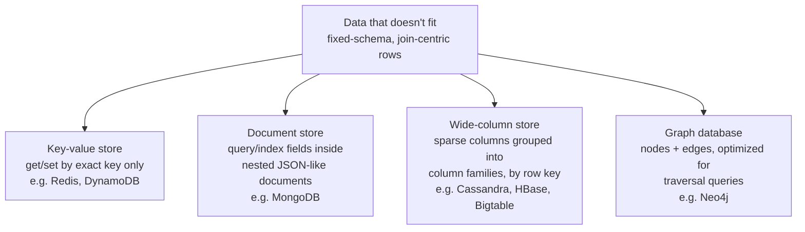
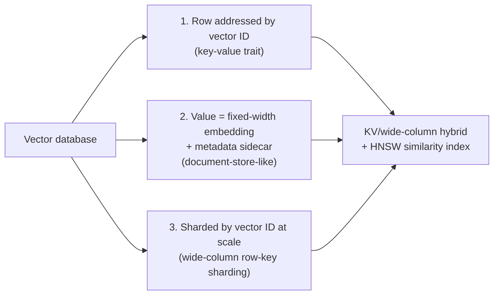
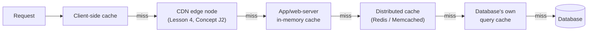
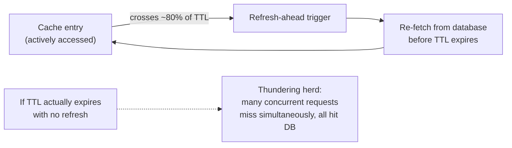
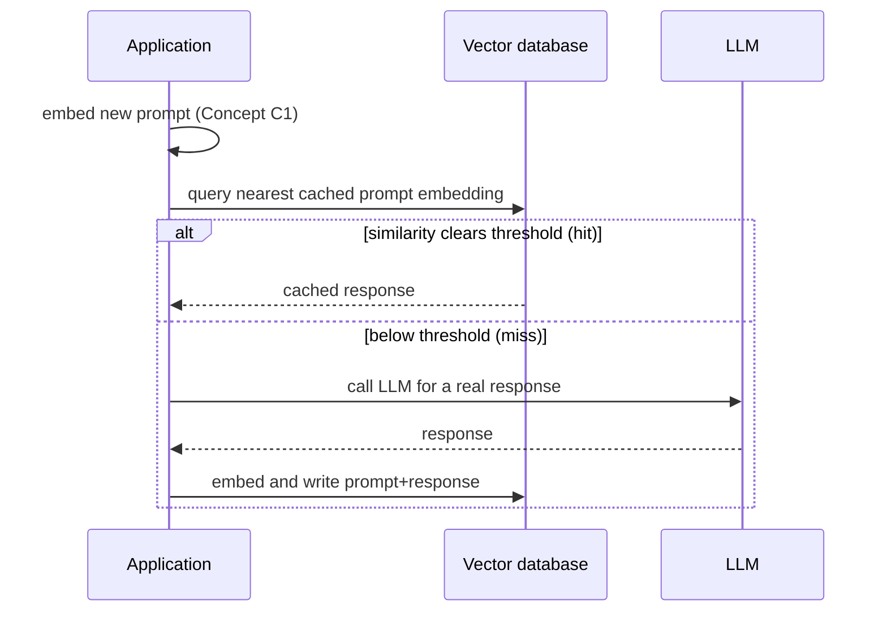
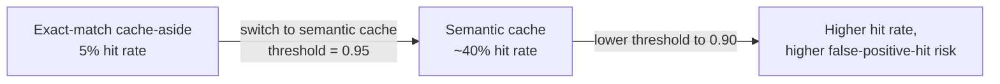

# Lesson 5: Data Layer — Databases and Caching

**Time:** 75-90 minutes
**Tool(s):** Conceptual (no single verified CLI) — real SQL DDL, a runnable Python cache-aside/write-through snippet, and worked numeric examples instead

## Learning Objectives

By the end of this lesson, you will:

- Be able to name and distinguish the five classic RDBMS scaling techniques (replication, federation, sharding, denormalization, SQL tuning), and derive a shard count from a data-volume estimate
- Be able to name the four NoSQL database types (key-value, document, wide-column, graph), state the SQL-vs-NoSQL trade-off in terms of ACID vs. BASE, and explain why a vector database is architecturally closest to a KV/wide-column hybrid rather than a fifth category of its own
- Be able to name where in a request path caching can sit, and distinguish cache-aside, write-through, write-behind, and refresh-ahead by what each does on a read vs. a write and what each risks
- Be able to compute how a cache's hit rate directly determines the query load that reaches the underlying database, and explain why a small hit-rate drop can flip a database from comfortably under capacity to overloaded
- Be able to walk through, step by step, how a semantic cache (Lesson 1's B4) built on a vector database (Lesson 1's C2) is the same cache-aside algorithm as this lesson's K3, with similarity search standing in for exact-key lookup
- Be able to point to exactly which capstones (#1 Pinterest, #6 LinkedIn, #9 RAG/Contextual Retrieval, #10 LLM inference serving) each Concept in this lesson overlays onto

---

## Concept 1: RDBMS Scaling

### Why?

Most applications start with an **RDBMS** (Relational Database Management System: a database of fixed-schema tables joined by foreign keys and queried with SQL). RDBMSes typically guarantee **ACID**:

- **Atomicity** — a transaction fully completes or fully rolls back; it never leaves partial effects.
- **Consistency** — a transaction never leaves the database violating its own constraints.
- **Isolation** — concurrent transactions don't see each other's uncommitted state.
- **Durability** — once a transaction commits, it survives a crash.

This works well until one server's reads, writes, or total data volume outgrow what a single machine can hold or serve. That's not a "SQL is slow" problem — it's a hardware ceiling: one node has a hard limit on CPU, memory, disk I/O, and storage.

Pinterest's embedding index (capstone #1) and LinkedIn's connection graph (capstone #6) are both this same problem under an AI-specific framing: a dataset and query rate that outgrew what any single RDBMS node could serve, forcing a choice among the techniques below.

### What?

Five classic techniques, usually combined rather than used in isolation:

- **Replication** — keep more than one live copy of the database on separate nodes. The common pattern, **master-slave replication**: one node (the "master," or "primary") accepts all writes; one or more **read replicas** receive a continuous copy of those writes and serve read-only queries, spreading read traffic across many nodes while writes still funnel through the single primary.

  **Replication lag** is the delay between a write committing on the primary and that write becoming visible on a given replica. It's similar to a group chat: one person posts the official update, but everyone else's phone has to sync before they see it — for a moment, different readers see different "latest" states. That lag, being real and variable, is exactly why a replica is, by construction, an eventually consistent copy of the primary (Lesson 3's Concept I2 defined eventual consistency; replication lag is the mechanism that produces it here).

  A less common alternative, **master-master replication**, lets more than one node accept writes directly — removing the single-primary write bottleneck, but requiring a conflict-resolution strategy for when two masters accept conflicting writes to the same row before either has heard about the other's.

  Visualizing master-slave replication's write/read split:

  ```mermaid
  flowchart LR
      APP["Application"] -->|writes| M["Primary (master) node"]
      APP -->|reads| R1["Read replica 1"]
      APP -->|reads| R2["Read replica 2"]
      M -->|"continuous copy of writes\n(replication lag)"| R1
      M -->|"continuous copy of writes\n(replication lag)"| R2
  ```

- **Federation** (also called **functional partitioning**) — split one database into several separate databases along domain lines (e.g., a `users` database and a separate `products` database, each with its own full schema, instead of all tables living in one database). Think of splitting one general store into separate specialty shops — a bakery, a hardware store — instead of cramming everything under one roof: each shop gets more room and more of its own staff's attention, but a shopping list that spans both now means two separate trips instead of one. That extra trip is the cost here, and it lands on the application: a foreign-key relationship or JOIN that used to span two tables in one database now has to be resolved in application code across two separate database connections, since the database engine itself has no visibility across that boundary.

- **Sharding** (also called **horizontal partitioning**) — split the rows of a single logical table across multiple physical database nodes (**shards**), each holding a disjoint subset of rows, usually selected by a **shard key** (the column, or a function of it, that decides which shard a given row belongs on — e.g., `user_id % N`, or a hash of `user_id`).

  A plain-language way to see it: imagine splitting a phone book into separate volumes by last-name range. Each volume is smaller and faster to search — but if you need everyone born in 1990, scattered across every volume, you now have to search all of them. That's a **cross-shard query**, and it's the main cost of sharding: unlike federation (which splits by table/domain), sharding splits *within* one table, scaling a single hot table's reads *and* writes across many nodes — but any query needing rows from more than one shard now has to be assembled by the application from multiple shard round-trips instead of one SQL query.

  A naive modulo-based shard key (`id % N`) adds a further cost: changing `N` (adding or removing a shard) changes almost every row's target shard, forcing a massive data reshuffle. **Consistent hashing** — mapping both data items and nodes onto points on a circular hash space (a "ring"), so adding or removing one node only remaps the small slice of keys that land near it on the ring — exists specifically to avoid that reshuffle cost, at the price of slightly more complex routing logic than a plain modulo.

  Visualizing how a shard key routes rows across nodes, and why a query spanning them becomes a cross-shard query:

  ```mermaid
  flowchart LR
      APP["Application"] -->|"shard_key = user_id % N"| ROUTER["Shard router"]
      ROUTER --> S0["Shard 0\n(user_id % N == 0)"]
      ROUTER --> S1["Shard 1\n(user_id % N == 1)"]
      ROUTER --> SN["Shard N-1"]
      APP -.->|"cross-shard query\n(e.g. everyone born in 1990)"| S0
      APP -.-> S1
      APP -.-> SN
  ```

- **Denormalization** — deliberately duplicate data across tables (or embed a related record's fields directly into a row that references it) specifically to avoid an expensive JOIN at read time. It's like writing a friend's number on a sticky note by your phone instead of looking it up in your contacts app every time: faster to check, but if your friend gets a new number and you forget to update the note, you're dialing the wrong one. Same trade in a database — denormalization speeds up the read that would otherwise need the join, at the cost of extra storage and the obligation (now on the application, or on database triggers) to keep every duplicated copy consistent whenever the original is updated. Skip that obligation and the duplicates silently drift out of sync.

- **SQL tuning** — making a single node's own queries more efficient without changing the topology above it:
  - An **index**: an auxiliary, separately-maintained lookup structure (commonly a B-tree) that lets the database find matching rows by a column's value without scanning every row — at the cost of extra storage and slightly slower writes, since the index itself has to be updated too.
  - Query rewriting, so queries actually use indexes that already exist — filtering on a non-indexed expression derived from a column, rather than the column itself, often can't use an index that's sitting right there.
  - **Connection pooling**: maintaining a fixed pool of already-open database connections that application threads borrow and return, instead of opening a new one per request — avoiding the real, measurable overhead (mostly the TCP handshake and per-connection authentication) of opening a connection each time.

### How?

**Worked example — read-replica QPS headroom.** A primary database node sustains 2,000 writes/sec at its write-capacity ceiling. The application's read load has grown to 45,000 reads/sec — far more than one node can serve. Benchmarking shows one read replica, on this hardware, saturates at 9,000 reads/sec.

```
replicas_needed (bare minimum) = ceil(45,000 reads/sec / 9,000 reads/sec per replica)
                                = ceil(5.0) = 5 replicas

total capacity at 5 replicas    = 5 × 9,000 = 45,000 reads/sec   (exactly at the ceiling, zero headroom)
```

Running at exactly 100% of measured capacity means any traffic spike at all pushes requests into a queue and inflates latency — so a real deployment targets some headroom, e.g., 20%:

```
required_capacity_with_20%_headroom = 45,000 × 1.20 = 54,000 reads/sec
replicas_needed_with_headroom       = ceil(54,000 / 9,000) = 6 replicas
total capacity at 6 replicas        = 6 × 9,000 = 54,000 reads/sec  (20% headroom over current peak load)
```

Going from 5 to 6 replicas is the concrete cost of that 20% safety margin: one extra node, so a traffic spike doesn't immediately saturate every replica at once.

**Trade-offs considered:**

- Replication scales reads cheaply, and each replica can fail independently without taking down the whole read path — but every replica reintroduces Lesson 3's Concept I2 consistency question: a read served by a lagging replica can return data that's milliseconds-to-seconds stale, and the application has to decide whether that's acceptable, or force a read from the primary instead.
- Federation avoids one node holding every domain's traffic, but gives up database-enforced referential integrity across the federation boundary.
- Sharding scales both reads and writes, not just reads, but makes any cross-shard query expensive and makes resharding itself a real operational project unless consistent hashing was chosen from the start.
- Denormalization is a pure read-speed win that's paid for entirely in write complexity and consistency risk.

None of the five is "the" answer — production systems at this scale typically combine several (e.g., a sharded, replicated primary dataset with selective denormalization for the hottest read paths).

**Case-study pointer:**

- Capstone #1 (Pinterest's visual-search/Flashlight-Lens-Shop-the-Look system) serves an embedding/image-metadata index at a scale — hundreds of millions to billions of images — that requires exactly the sharding pattern above: the index is partitioned by a shard key over the item/image identifier space, so no single node has to hold the entire index or absorb its entire query load.
- Capstone #6 (LinkedIn's "People You May Know") operates over a connection graph large enough to need the same treatment. As an order-of-magnitude illustration only (these exact figures aren't what the cited sources below confirm): at LinkedIn's member-base scale — hundreds of millions of members, by the company's own public figures — a one-to-one connection graph alone would run into many billions of edges, so graph data at that scale has to be federated/sharded across the underlying storage layer. That's the infrastructure PYMK's triangle-closing feature (LinkedIn's term for inferring a likely connection because two people already share a mutual connection) actually runs its queries against.

**Source(s) and further reading:**

- `system-design-primer`'s "Sharding," "Federation," and "Denormalization" sections (the classic, non-AI framing this Concept curates from)
- Zhai et al., *"Learning a Unified Embedding for Visual Search at Pinterest,"* KDD 2019 (arXiv:1908.01707) — capstone #1's primary source
- LinkedIn Engineering's posts on building a heterogeneous-network recommender and "Optimizing PYMK for Equity in Network Creation" — capstone #6's primary sources

---

## Concept 2: NoSQL Types

### Why?

Some data doesn't look like neat, uniform rows that join cleanly on foreign keys — for example:

- A social graph of users and their connections.
- A per-session blob with a different shape for every user.
- A catalog where one item has twenty attributes and another has two.

Forcing any of this into an RDBMS's fixed-schema, join-centric model costs real performance and real schema-migration pain, for no benefit.

**NoSQL** databases (the name is historical shorthand for "not only SQL," not a single technology) trade away some of an RDBMS's guarantees for a data model that matches a specific access pattern more directly, and scales horizontally with fewer structural compromises.

### What?

Four common NoSQL types, each matched to a different access pattern:

- **Key-value store** — works like a coat-check ticket: hand over the key, get back the value, and the store never looks inside it. There's no query capability beyond "get me the value for this key" (and sometimes "set/delete this key") — no joins, no secondary indexes, no schema at all beyond key and value. That simplicity is exactly what makes it trivially shardable: the entire routing problem is "which node owns this key," identical in shape to Concept 1's shard-key problem. Examples: Redis, DynamoDB.
- **Document store** — like a filing cabinet of folders where every folder can hold a different mix of papers, and — unlike the key-value store above — you can search by what's written on any page inside a folder, not just the label on its tab. It stores semi-structured **documents** (nested, JSON-like objects, physically often stored as BSON — Binary JSON, a binary-encoded superset of the JSON format): each document can have a different internal shape from every other document in the same collection, and the database can query and index on fields *inside* the document. Example: MongoDB.
- **Wide-column store** — like a spreadsheet with thousands of possible columns where most cells in most rows are simply left blank. Every row is indexed by a single **row key**, but different rows can have a hugely different number and set of columns (most columns are *sparse* — present on some rows, absent on most), and related columns are grouped into **column families** that are physically stored together on disk, so a query touching only one column family doesn't have to read the others. Purpose-built for enormous, sparse datasets where a fully rigid schema (every row must have every column) would waste huge amounts of storage. Examples: Cassandra, HBase, Google Bigtable.
- **Graph database** — think of a subway map, where stations are **nodes** (entities) and the tracks between them are **edges** (relationships), both of which can carry their own properties. Purpose-built for traversal queries ("find every node within 2 hops of this one" — "which stations are two stops from here") that are cheap to express this way but become a chain of expensive self-joins in a relational model. Example: Neo4j.

Comparing the four NoSQL types' access pattern and representative systems:



**SQL vs. NoSQL — an explicit trade-off, not a verdict.** A relational database's ACID guarantees (Concept 1) come from real engineering cost: enforcing strict consistency and isolation on every transaction is work, and that work gets harder to do cheaply the more nodes the data is spread across. Most NoSQL databases instead follow **BASE**:

- **B**asically **A**vailable — the system stays responsive to requests essentially all the time, even if some responses aren't the freshest possible data.
- **S**oft state — the system's stored state can change over time even with no new writes, as replicas keep converging toward each other in the background.
- **E**ventual consistency — the same guarantee Lesson 3's Concept I2 defined: given enough time with no new writes, all replicas converge to the same value, but there's no bound on exactly how long that takes.

This is the same CP-vs-AP tension from Lesson 3's CAP theorem, now expressed as a database *design philosophy* rather than a one-time runtime choice: an RDBMS's defaults lean toward consistency; most NoSQL databases' defaults lean toward availability and horizontal scalability, with strong consistency available only as an opt-in, costlier mode if at all.

### How?

**Why a vector database is a hybrid, not a fifth category.** Lesson 1's Concept C2 defined a **vector database** as a database purpose-built to store large numbers of embeddings and answer "find the k nearest vectors to this query vector" efficiently, typically via an index like **HNSW** (Hierarchical Navigable Small World — a graph-based approximate-nearest-neighbor index, already defined in full in Lesson 1). It's tempting to treat that as a fifth NoSQL category alongside the four above — but look at its actual storage shape, piece by piece:

1. Each row is addressed by a row/vector ID — key-value's defining trait.
2. The "value" is almost always a fixed-width numeric array (the embedding) plus a sidecar of variable metadata fields — document-store-like, but secondary to the vector itself.
3. At real scale, that data is sharded across many nodes by vector ID, in the same row-key-sharding shape a wide-column store uses — not by any graph-traversal or relationship structure.

Visualizing why those three traits compose into a hybrid rather than a new category:



So a vector database is a **KV/wide-column hybrid with a specialized similarity index bolted onto the value side**, not a new storage paradigm: the actual innovation is the *index* (HNSW, or similar structures), not the underlying row/key storage model, which is architecturally ordinary.

**Trade-offs considered:**

- Key-value: the fastest possible lookups and the simplest possible sharding story, but can answer only "get this exact key" — no range queries, no filtering on value contents.
- Document: trades some of that simplicity for queryability on nested fields, at the cost of needing a real indexing strategy per field you want to query on.
- Wide-column: handles sparse, massive-scale data efficiently but gives up most relational query flexibility — you design the row-key and column-family layout around known access patterns up front, not after the fact.
- Graph: makes traversal queries cheap but is usually the wrong choice for workloads that are mostly simple key lookups — graph-traversal engines optimize for a different access shape.

**Case-study pointer:**

- Capstone #1 (Pinterest) binarizes its learned embeddings specifically to make them cheap to store and search at the scale its visual-search system operates at — a storage-format decision that only makes sense once a vector database is understood as sitting on this KV/wide-column spectrum (fixed-width value blobs, sharded by key), not as some entirely separate kind of database with its own rules.
- Capstone #9 (the RAG system grounded in Anthropic's Contextual Retrieval, Sept. 2024) depends on exactly this same storage-and-retrieval layer to hold its chunk embeddings. Anthropic's technique prepends LLM-generated context to each chunk *before* embedding and indexing it, but the resulting embeddings still live in a database with precisely this KV/wide-column shape underneath.

**Source(s) and further reading:**

- `system-design-primer`'s "SQL vs. NoSQL" section (the classic framing this Concept extends with the vector-database overlay)
- DynamoDB, MongoDB, Cassandra, and Neo4j product documentation, as representative sources for the key-value, document, wide-column, and graph shapes respectively
- Zhai et al., *"Learning a Unified Embedding for Visual Search at Pinterest,"* KDD 2019 (arXiv:1908.01707) — capstone #1's binarized-embedding storage detail
- Anthropic, *"Introducing Contextual Retrieval,"* Sept. 2024 — capstone #9's source
- Lesson 1 (`lesson-1-ai-fundamentals-refresher.md`), Concept C2 — the original full definition of vector databases and HNSW, referenced rather than re-derived here

---

## Concept 3: Caching Strategies

### Why?

Whether it's an RDBMS (Concept 1) or a NoSQL store (Concept 2), the database is almost always the slowest, most expensive-to-scale layer in a system. So a disproportionate amount of real-world scaling work isn't "make the database faster" — it's "don't ask the database in the first place."

A **cache** is a smaller, faster-to-access store that holds a copy of data normally served by a slower source, specifically so repeat requests for the same data don't pay that slower source's cost again. It's the same idea as keeping a few snacks in your desk drawer instead of walking to the kitchen every time you're hungry: the drawer is faster to reach, but someone has to remember to restock it, and if it goes stale, you might reach for something you shouldn't.

Where you put a cache, and which strategy governs how it's kept in sync with the underlying store, determines whether it actually relieves load or quietly starts serving wrong answers.

### What?

**Where to cache** — a request can be served from a cache at several points before it ever reaches the database:

- Client-side (the calling application or browser itself).
- A CDN edge node (Lesson 4's Concept J2), for static content.
- The application/web-server layer — an in-process, local in-memory cache.
- A **distributed cache** — a dedicated caching service like Redis or Memcached, shared across every application server instance, sitting between the application layer and the database.
- The database's own internal query cache.

Visualizing how a request can be served before it ever reaches the database:



Each hop closer to the caller saves more latency on a hit — but a cache local to one server (rather than shared/distributed) can't be hit by a request that lands on a different server.

Four caching strategies, defined by what each does on a read vs. a write:

- **Cache-aside** (also called **lazy loading**) — the classic "check the fridge before going to the store" pattern. On a read, the application checks the cache first; on a hit, it returns the cached value directly; on a **cache miss**, it reads from the underlying database, then writes that result into the cache (usually with a **TTL** — time-to-live, the same concept Lesson 4's Concept J1 defined for DNS records, here applied to a cache entry: a duration after which the entry is considered stale and must be re-fetched rather than trusted) before returning it to the caller. The cache is only ever populated by read misses — nothing proactively pushes data into it. This is simple and resilient — a dead cache just makes reads slower, not wrong — but every first read after a miss pays full database latency, and the cached copy can go stale for up to a full TTL before anyone notices.

  Tracing cache-aside's check-first, populate-on-miss sequence:

  ```mermaid
  sequenceDiagram
      participant App as Application
      participant Cache
      participant DB as Database
      App->>Cache: check cache
      alt cache hit
          Cache-->>App: cached value
      else cache miss
          App->>DB: read from database
          DB-->>App: value
          App->>Cache: write value (with TTL)
      end
  ```

- **Write-through** — every write is applied to the cache *and* the underlying database together, synchronously, before the write is considered complete and the caller gets an acknowledgment — like refusing to call a filing "done" until both the home copy and the office copy are updated. The cache is always consistent with the database immediately after a write (there's no window where a committed write hasn't yet reached the cache), at the direct cost of doubling every write's latency — and the cache ends up holding entries that may never be read again, since writing populates it regardless of whether that data will ever be requested.
- **Write-behind** (also called **write-back**) — a write is applied to the cache immediately and acknowledged to the caller right away, while the actual write to the underlying database is deferred and performed asynchronously afterward (often batched with other pending writes) — like scribbling a note now and trusting you'll file it properly later. Writes are fast from the caller's perspective, but there's a real window where the cache is ahead of the database, and if the cache fails before that deferred write completes, it's lost outright — like the unfiled note. A direct trade of durability for write latency.

  Contrasting write-through's synchronous dual-write with write-behind's deferred write:

  ```mermaid
  flowchart LR
      subgraph "Write-through"
          W1["Write"] --> C1["Cache (sync)"]
          W1 --> D1b["Database (sync)"]
          C1 --> ACK1["Ack to caller\n(after both complete)"]
          D1b --> ACK1
      end
      subgraph "Write-behind"
          W2["Write"] --> C2b["Cache (immediate)"]
          C2b --> ACK2["Ack to caller\n(immediately)"]
          C2b -.->|"deferred, async,\noften batched"| D2b["Database (later)"]
      end
  ```

- **Refresh-ahead** — the cache proactively re-fetches a soon-to-expire entry from the underlying database *before* its TTL actually runs out, typically triggered once an entry crosses some fraction of its TTL (e.g., 80% of the way to expiry) while it's still being actively accessed — like refilling the coffee pot before it's empty rather than waiting until the last cup to start brewing. This exists specifically to prevent a **thundering herd**: a burst of many concurrent requests that all miss the cache for the same key at the same instant — because its TTL just expired right as a wave of traffic arrived — and all fall through to the database simultaneously, which can look like a traffic spike many times larger than the real request rate. Cost: refresh-ahead does real background work refreshing entries that might not actually be requested again before they'd otherwise have expired naturally.

Visualizing refresh-ahead's proactive re-fetch before a thundering herd can form:



### How?

A cache's hit rate isn't just a nice-to-have metric — it's a real capacity number, because the database only ever sees the fraction of traffic the cache *misses*.

**Worked example.** An application serves 40,000 reads/sec against data backed by a database that can sustain at most 5,000 queries/sec before it saturates. A cache-aside layer sits in front of it.

```
At a measured 92% cache hit rate:
  queries reaching the DB = total_queries × (1 - hit_rate)
                           = 40,000 × (1 - 0.92)
                           = 40,000 × 0.08
                           = 3,200 queries/sec

  headroom vs. DB's 5,000 qps ceiling = 5,000 - 3,200 = 1,800 qps spare (36% headroom)
```

That's comfortably inside the database's capacity. Now say a cache-eviction storm (a burst of cache invalidations, or a cache restart that wipes it cold) drops the measured hit rate to 85%:

```
At 85% cache hit rate:
  queries reaching the DB = 40,000 × (1 - 0.85) = 40,000 × 0.15 = 6,000 queries/sec

  vs. DB's 5,000 qps ceiling: 6,000 - 5,000 = 1,000 qps over capacity (20% overloaded)
```

A 7-percentage-point drop in hit rate (92% → 85%) swung the database from 36% headroom to being overloaded by 20% — because the database only ever sees the *missed* fraction of total traffic, and that missed fraction is small enough at a high hit rate to look irrelevant right up until it isn't. This is the same arithmetic shape as Lesson 4's Concept J2 CDN cache-hit-ratio calculation, applied one layer lower in the stack (database caching instead of static-asset caching).

**Trade-offs considered:**

- Cache-aside is the simplest and most fault-tolerant option (a dead cache degrades to "just slower," not "wrong"), but every cold key pays full database latency on its first request, and a sudden wave of simultaneously-expiring popular keys can itself cause a thundering herd.
- Write-through guarantees the cache is never stale relative to the database, at the cost of doubling every write's latency and caching writes that may never be read.
- Write-behind is the fastest option for writes, but genuinely risks data loss and reintroduces Lesson 3's consistency concerns — a read-after-write from a different path than the cache can see state the database doesn't have yet.
- Refresh-ahead avoids thundering-herd expiry spikes for genuinely hot keys, but spends real background work refreshing entries speculatively — wasted effort for any key that turns out not to be re-requested.

**Case-study pointer:**

- Capstone #10's KV-cache reuse (`case-studies/llm-inference-serving`) is architecturally a cache-aside pattern applied to GPU compute state instead of database rows: on each new request, the serving engine checks whether a matching prefix's key/value tensors are already resident in GPU memory (the cache check); on a miss, it computes them from scratch via the model's forward pass (the equivalent of a database read); on a hit, it reuses the already-computed tensors directly, skipping that computation entirely. Same "check cache, fall through on a miss, populate for next time" shape as cache-aside — just with "the expensive path" being a GPU forward pass instead of a SQL query.
- Capstone #9 (`case-studies/rag-contextual-retrieval`) exhibits the same shape one layer up the pipeline: Anthropic's Contextual Retrieval technique computes an LLM-generated context prefix for each document chunk once, at indexing time, so that expensive step never has to be repeated for every future query against that chunk — a one-time write that's then read many times, precisely the workload cache-aside and write-through both exist to optimize for.

**Source(s) and further reading:**

- `system-design-primer`'s "Caching" section (cache-aside/write-through/write-behind/refresh-ahead in their original, non-AI framing)
- Kwon et al., *"Efficient Memory Management for LLM Serving with PagedAttention,"* SOSP 2023 (arXiv:2309.06180) — capstone #10's source for KV-cache reuse as the mechanism this Concept overlays onto
- Anthropic, *"Introducing Contextual Retrieval,"* Sept. 2024 — capstone #9's source for the one-time-compute, many-times-reused chunk context this Concept overlays onto
- Redis and Memcached documentation, as representative distributed-cache product references

---

## Concept 4: Bridge — Semantic Caching and Vector Databases as This Lesson's AI-Native Cousins

### Why?

This Concept connects the classic patterns just taught (K1-K3) to their AI-native cousins from Lesson 1. It's not a fifth new topic, and it doesn't re-explain K1-K3 or Lesson 1's B4/C2 from scratch — just the short synthesis that makes the connection explicit.

### What?

Lesson 1's Concept B4 defined **semantic caching**: a caching strategy for LLM applications that stores past prompt/response pairs and, for a new incoming prompt, checks whether it's *semantically* similar enough to a cached prompt (via embedding similarity) to reuse the cached response, instead of requiring an exact string match. Lesson 1's Concept C2 defined the **vector database** this depends on.

Put plainly: **semantic caching is Concept 3's cache-aside algorithm, with the cache-key lookup replaced by a nearest-neighbor similarity search.** It's the difference between a librarian who only finds a book if you recite its exact catalog title, versus one who recognizes that "the one about the whale" and "Moby Dick" are the same request. Classic cache-aside asks "does this exact key already exist in the cache?" — an equality check. Semantic caching asks "does a sufficiently *similar* key already exist?" — a nearest-neighbor check within some similarity threshold, run against a vector database (Concept 2's KV/wide-column hybrid with a similarity index). Everything else about the algorithm's shape — check first, serve on a hit, fall through to the expensive path on a miss, populate the cache afterward — is identical.

### How?

**Step-by-step trace of a semantic cache's cache-aside logic:**

1. A new prompt arrives.
2. Embed the prompt (Lesson 1, Concept C1) into a vector.
3. Query the vector database for the nearest previously-cached prompt embedding, and check whether its similarity (commonly cosine similarity, defined in Lesson 1's Concept C1) clears a configured threshold.
4. **Hit** (a sufficiently similar cached prompt exists): return the cached response directly — the underlying LLM is never called for this request at all.
5. **Miss** (nothing clears the threshold): call the LLM to generate a real response, then embed this new prompt-response pair and write it into the vector database, so a future, similar-enough prompt can hit on it.

Tracing the same cache-aside shape with similarity search in place of exact-key lookup:



**Worked illustration — why the threshold matters, not just whether caching is "on."** A support chatbot's exact-match cache-aside layer (keying on the literal prompt string) measures only a 5% hit rate in practice — unsurprising, since real users phrase the same question many different ways ("how do I reset my password," "I forgot my password, help," "password reset not working"), and an exact-match cache can't see any of those as "the same question." Switching to a semantic cache with a similarity threshold of 0.95 (on a -1-to-1 cosine-similarity scale) raises the measured hit rate to roughly 40% on the same traffic, because it now recognizes differently-worded, same-intent prompts as hits. Lowering the threshold further to 0.90 would raise the hit rate again (Concept 3's hit-rate math applies exactly as before: every additional hit reduces load on the LLM backend the same way it reduced load on a database) — but at a falling threshold, the risk of a **false-positive hit** rises too: returning a cached answer to a question that was merely similar, not actually the same — something an exact-match cache (which can only ever return the literal answer to the literal same key) can't do at all, right or wrong.

Visualizing how lowering the threshold trades hit rate for false-positive risk:



**Trade-offs considered:** A low similarity threshold raises the semantic cache's hit rate and cost savings (per Concept 3's arithmetic), but raises the odds of serving a subtly wrong answer. A high threshold is safer but converges toward classic exact-match caching's low hit rate, giving up most of the reason to build a semantic cache at all. Same shape of trade-off as Lesson 3's CAP theorem — trading a guarantee (answer correctness for *this exact* question) for a resource win (hit rate, cost, latency) — one layer higher in the stack than a database read, but structurally the identical bet.

**Case-study pointer:** this Concept's anchor is Lesson 1's B4 (semantic caching) and C2 (vector databases), bridged directly here. Capstone #10's KV-cache reuse (`case-studies/llm-inference-serving`) is this idea's compute-level sibling — caching "have I already computed this state" rather than "have I already answered this question" — while capstone #9's retrieval pipeline (`case-studies/rag-contextual-retrieval`) is the non-cache, full-knowledge-base use of the same underlying vector-database infrastructure that a semantic cache is a narrower, cache-shaped application of.

**Source(s) and further reading:**

- Lesson 1 (`lesson-1-ai-fundamentals-refresher.md`), Concepts B4 and C2 — the original full definitions of semantic caching and vector databases, bridged here rather than re-derived
- Anthropic's prompt-caching documentation — a confirmed primary source for the literal prompt-caching mechanism
- The general semantic-caching pattern as discussed in open-source tooling such as GPTCache — **unconfirmed as a specific-company primary source**: no single company's primary engineering teardown was confirmed for this pattern specifically; included here as the pattern-level reference, not as an Anthropic/OpenAI-documented feature
- Kwon et al., *"Efficient Memory Management for LLM Serving with PagedAttention,"* SOSP 2023 (arXiv:2309.06180) — capstone #10's KV-cache-reuse mechanism, cited here as the compute-level sibling pattern
- Anthropic, *"Introducing Contextual Retrieval,"* Sept. 2024 — capstone #9's source

---

## Hands-On Walkthrough

There's no single CLI for "the data layer" in general — work through this real schema and runnable code instead.

**1. Deriving a shard count from a data-volume estimate.** A Pinterest-scale `pins` table needs to hold 2 billion rows, each row averaging 300 bytes (a bigint ID, a bigint owner ID, a short embedding-reference string, and a timestamp):

```
total_table_size = 2,000,000,000 rows × 300 bytes/row
                  = 600,000,000,000 bytes
                  = 600 GB

target_max_per_shard = 60 GB   (chosen so each shard node has headroom for its own
                                 indexes, replication overhead, and future growth)

shards_needed = ceil(600 GB / 60 GB) = 10 shards
```

DDL for that sharded table (illustrative, using a computed `shard_key` column so every node applies the same deterministic sharding function):

```sql
CREATE TABLE pins (
    pin_id         BIGINT      NOT NULL,
    user_id        BIGINT      NOT NULL,
    shard_key      SMALLINT    GENERATED ALWAYS AS (user_id % 10) STORED,
    embedding_ref  VARCHAR(64) NOT NULL,   -- pointer into the vector DB, not the raw embedding itself
    created_at     TIMESTAMP   NOT NULL DEFAULT CURRENT_TIMESTAMP,
    PRIMARY KEY (shard_key, pin_id),
    INDEX idx_user (shard_key, user_id)
);
```

`shard_key` is a **generated column** — a value the database computes automatically from other columns in the same row (here, `user_id % 10`) rather than one the application writes directly — so a pin's shard assignment can never drift out of sync with its `user_id`. Sharding on `user_id` rather than `pin_id` deliberately colocates all of one user's pins on the same shard, so "get all pins by this user" stays a single-shard query instead of a 10-way fan-out.

**2. A real cache-aside read + write-through write, in Python, against that schema.**

```python
import json
import redis  # real client: pip install redis

cache = redis.Redis(host="localhost", port=6379, decode_responses=True)
CACHE_TTL_SECONDS = 300  # 5 minutes
NUM_SHARDS = 10

def get_pin(pin_id: int, user_id: int, db_connection) -> dict | None:
    """Cache-aside read: check cache first, fall through to the sharded DB on a miss."""
    cache_key = f"pin:{pin_id}"
    cached = cache.get(cache_key)
    if cached is not None:
        return json.loads(cached)  # cache hit — no DB round-trip at all

    # cache miss — route to the correct shard, by user_id (matching the DDL's
    # shard_key = user_id % 10 generated column), and read from the DB
    shard_key = user_id % NUM_SHARDS
    row = db_connection.execute(
        "SELECT pin_id, user_id, embedding_ref FROM pins WHERE shard_key = %s AND pin_id = %s",
        (shard_key, pin_id),
    ).fetchone()
    if row is None:
        return None

    result = {"pin_id": row[0], "user_id": row[1], "embedding_ref": row[2]}
    cache.set(cache_key, json.dumps(result), ex=CACHE_TTL_SECONDS)  # populate cache for next time
    return result


def update_pin_embedding(pin_id: int, user_id: int, new_embedding_ref: str, db_connection) -> None:
    """Write-through write: update the DB and the cache together, so a cache hit can never
    reflect a value older than the last committed write."""
    shard_key = user_id % NUM_SHARDS
    db_connection.execute(
        "UPDATE pins SET embedding_ref = %s WHERE shard_key = %s AND pin_id = %s",
        (new_embedding_ref, shard_key, pin_id),
    )
    cache_key = f"pin:{pin_id}"
    cache.set(
        cache_key,
        json.dumps({"pin_id": pin_id, "embedding_ref": new_embedding_ref}),
        ex=CACHE_TTL_SECONDS,
    )
```

Confirm for yourself: `get_pin` runs Concept 3's exact cache-aside sequence (check cache → miss → read DB → populate cache → return), and `update_pin_embedding` runs write-through (write DB and cache together, synchronously, before returning). Both take `user_id` as a parameter and compute `shard_key = user_id % NUM_SHARDS` to route to the DB — matching the DDL's `shard_key SMALLINT GENERATED ALWAYS AS (user_id % 10) STORED` column above (`NUM_SHARDS = 10` mirrors that DDL's literal `% 10`). So the DB's shard routing (keyed by `user_id`, for the user-pin colocation Part 1 explained) and the cache keys (keyed by `pin_id`, since a single pin lookup doesn't need to know which shard it came from) never disagree about which shard owns a given row.

---

## Summary

| Concept | One-line takeaway |
|---|---|
| RDBMS scaling | Replication scales reads (but reintroduces Lesson 3's consistency question via replication lag), federation splits by domain, sharding splits a single table across nodes by shard key (with consistent hashing avoiding a full reshuffle on resize), and denormalization trades write complexity for read speed — capstone #1 (Pinterest) and capstone #6 (LinkedIn) both operate at a scale that forces exactly these choices. |
| NoSQL types | Key-value, document, wide-column, and graph each match a different access pattern and trade ACID for BASE (basically available, soft state, eventually consistent) — and a vector database is a KV/wide-column hybrid with a similarity index bolted on, not a genuinely new fifth category. |
| Caching strategies | Cache-aside, write-through, write-behind, and refresh-ahead differ in what happens on a read vs. a write and what each risks (stale reads, double write latency, data loss on crash, or wasted speculative refresh) — and hit rate directly determines database load, so a small hit-rate drop can flip a database from comfortably under capacity to overloaded. |
| Bridge to Lesson 1 | Semantic caching (B4) is cache-aside with similarity search replacing exact-key lookup, and a vector database (C2) is the storage layer underneath it — the same hit-rate-vs-correctness trade-off from K3 reappears one layer up, trading exact correctness for a cost/latency win. |

## Key Formulas & Schema Reference

```
Series/parallel availability, consistency patterns: see Lesson 3.
DNS TTL mechanics, cache-hit-ratio identity: see Lesson 4.

Shard count from data volume:
  shards_needed = ceil(total_data_size / target_max_size_per_shard)

Read-replica capacity:
  replicas_needed = ceil(required_read_qps / qps_per_replica)
  replicas_needed_with_headroom = ceil((required_read_qps × (1 + headroom_fraction)) / qps_per_replica)

Cache load-shedding:
  queries_reaching_db = total_queries × (1 - cache_hit_rate)
  headroom_vs_db_capacity = db_capacity_qps - queries_reaching_db
```

```sql
-- Sharded table pattern (generated shard_key column), from the Hands-On Walkthrough
CREATE TABLE pins (
    pin_id         BIGINT      NOT NULL,
    user_id        BIGINT      NOT NULL,
    shard_key      SMALLINT    GENERATED ALWAYS AS (user_id % 10) STORED,
    embedding_ref  VARCHAR(64) NOT NULL,
    created_at     TIMESTAMP   NOT NULL DEFAULT CURRENT_TIMESTAMP,
    PRIMARY KEY (shard_key, pin_id),
    INDEX idx_user (shard_key, user_id)
);
```

**Next:** Checkpoint 5, then Lesson 6 — message/task queues, back pressure, TCP vs. UDP, and RPC vs. REST.
