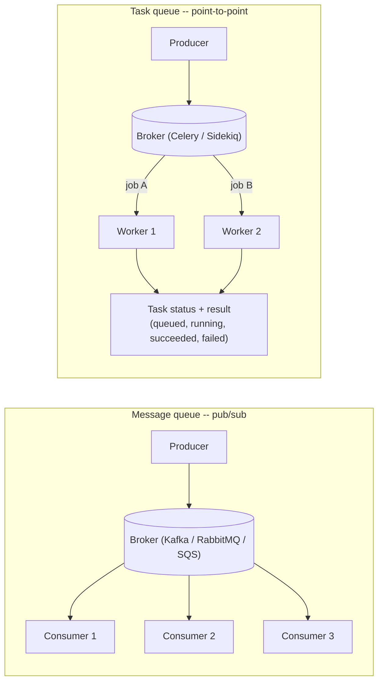
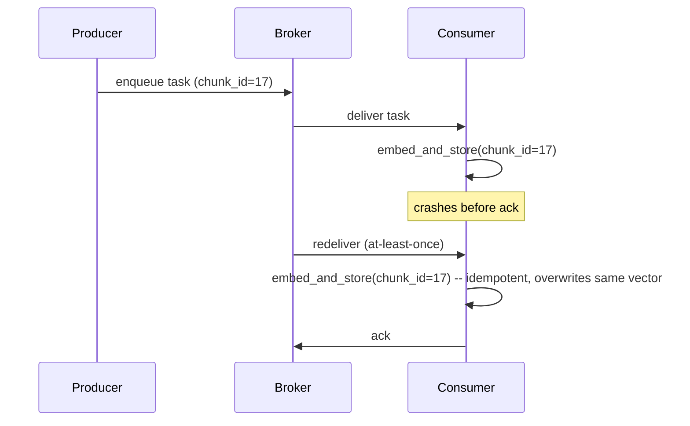
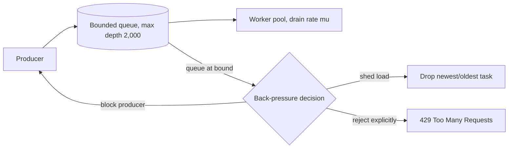
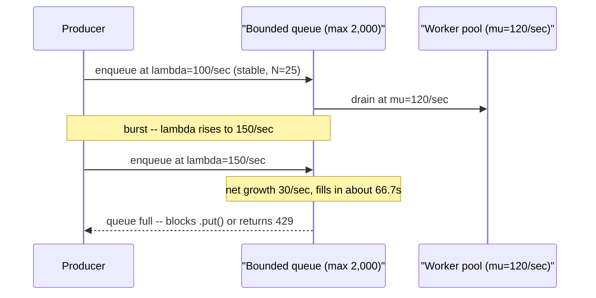
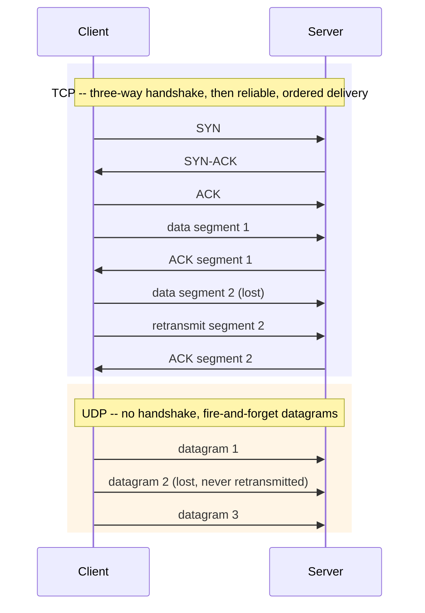
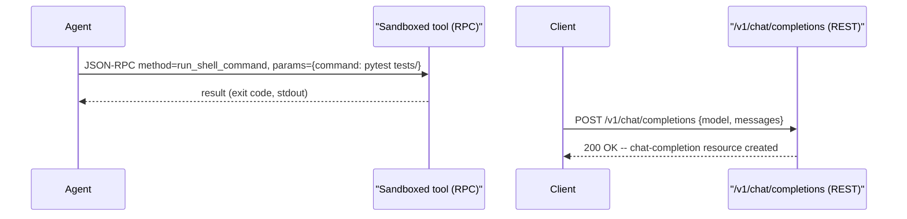
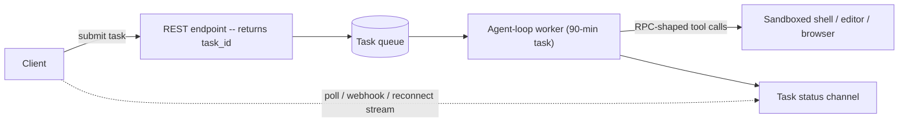

# Lesson 6: Async and Communication

**Time:** 75-90 minutes
**Tool(s):** Conceptual (no single verified CLI) — a real task-queue job schema, a runnable Python bounded-queue/backpressure snippet, and RPC-vs-REST payload comparisons instead

## Learning Objectives

By the end of this lesson, you will:

- Be able to distinguish a message queue from a task queue by what each adds on top of the other, name the three delivery guarantees (at-most-once, at-least-once, exactly-once), and explain why at-least-once delivery requires idempotent consumers to be safe
- Be able to compute, from an arrival rate and a drain rate, how long a bounded queue takes to fill, apply Little's Law to a stable queue, and explain what back pressure actually does once a queue hits its bound
- Be able to distinguish TCP from UDP by what each guarantees, compute the real latency cost of a TCP handshake, and explain why that cost is still worth paying for streamed LLM token responses
- Be able to distinguish RPC from REST by their calling shape (actions vs. resources), and compute concretely why a long-running agentic task cannot be served as a single synchronous REST request
- Be able to point to exactly which capstones (#9 RAG/contextual-retrieval ingestion, #10 LLM inference serving, #13 autonomous coding agent, #15 LLM API gateway) each Concept in this lesson overlays onto — and why capstone #4 (Airbnb search ranking) does not belong in that list, despite appearing paired with #13 in an earlier draft of this repo's plan

---

## Concept 1: Message Queues vs. Task Queues

### Why?

A synchronous request/response call couples the caller's fate to the callee's: the caller blocks until the callee responds, so a slow, overloaded, or down callee becomes the caller's problem too.

This hurts AI workloads more than a typical CRUD app, for two reasons already established in Lesson 1:

- Per-unit cost and latency scale with tokens processed (Lesson 1, Concept A1), so a single unit of work — embedding a chunk, running an agent's next tool call — can legitimately take seconds to minutes.
- A long-running, multi-step agent task (Lesson 1, Concept E3 — checkpointing across multi-step runs) can run far longer than any caller should reasonably stay blocked on one HTTP connection.

Asynchronous communication exists specifically to decouple a producer's pace from a consumer's pace, so neither side's availability or speed directly determines the other's.

### What?

A **message queue** is a durable, ordered (or orderable) channel: one or more **producers** write discrete **messages** into it, and one or more **consumers** read and acknowledge them. A **broker** — the server process that actually stores and routes messages (e.g. Apache Kafka, RabbitMQ, Amazon SQS) — sits between them and mediates both sides.

A message queue comes in one of two shapes:

- **Point-to-point** — each message is delivered to and processed by exactly one consumer, even if several are listening. Used to spread discrete units of work across a worker pool.
- **Publish/subscribe (pub/sub)** — each message is delivered to *every* currently-subscribed consumer. Used to broadcast an event to several independent listeners that each need to know it happened, not just one of them.

A **task queue** is a message queue specialized for distributing units of work ("**tasks**"/"**jobs**") to a pool of worker processes that execute them asynchronously. It's usually built on top of a message-queue broker, adding job-specific semantics the broker alone doesn't provide:

- tracking each task's status (queued, running, succeeded, failed)
- a configurable retry policy on failure
- a way to fetch the task's eventual result once it completes

Examples: Celery (Python, commonly backed by Redis or RabbitMQ), Sidekiq (Ruby, backed by Redis).

One-line distinction: a message queue moves messages; a task queue moves *jobs*, and additionally tracks what happened to each one.

The diagram below lines up a pub/sub message queue's fan-out against a task queue's point-to-point worker pool:



**Delivery guarantees — and why they're hard.** Every queue (message or task) has to commit to one of three **delivery guarantees**: how many times a given message actually reaches a consumer. Think of phoning a restaurant to confirm a reservation:

1. **At-most-once delivery** — you call once and hang up, confirmed or not: never duplicated, but it can be silently lost if the line drops before you get through and nobody calls back. A message is delivered zero or one times (e.g. the broker crashes after removing a message from the queue but before a consumer finishes processing it).
2. **At-least-once delivery** — if you don't hear "confirmed," you call again. You're never left un-booked, but you might double-book if your first call actually succeeded and only the confirmation got cut off. A message is delivered one or more times (e.g. a consumer processes a message, then crashes or times out before acking it, so the broker — never having received that ack — redelivers it to another consumer).
3. **Exactly-once delivery** — the call always connects and you always hear the confirmation, with no retries and no duplicates. No real phone system offers this, and neither does any real distributed system: it would require the broker's delivery and the consumer's own processing-and-acknowledgment to happen as one indivisible step. In practice, systems that advertise "exactly-once" are almost always doing at-least-once delivery *plus deduplication on the consumer side* — not a true protocol-level guarantee.

Because at-least-once is both the easiest guarantee to implement and the most common default, consumers built against it must be **idempotent** — performing an operation multiple times has exactly the same effect as performing it once:

- Idempotent: an embedding-and-store operation keyed on a stable `chunk_id` — re-embedding the same chunk overwrites its existing stored vector.
- Not idempotent: "increment this document's processed-chunk counter by one" — redelivering the same message double-counts it.

The sequence below shows at-least-once redelivery in action, and why keying the retry on `chunk_id` keeps it safe:



### How?

**Worked example — sizing a task-queue worker pool for a RAG ingestion job.** Say a RAG system's indexing pipeline (the kind capstone #9's design depends on — see the case-study pointer below) needs to chunk, generate context for, and embed 2,000,000 chunks before a 4-hour ingestion window closes. Benchmarking shows one worker — bottlenecked on the network round-trip to the LLM used for context generation — processes 5 chunks/sec.

```
ingestion_window = 4 hours × 3,600 sec/hour = 14,400 seconds

required_throughput = total_chunks / ingestion_window
                     = 2,000,000 / 14,400
                     ≈ 138.9 chunks/sec

workers_needed = ceil(required_throughput / throughput_per_worker)
               = ceil(138.9 / 5)
               = 28 workers
```

28 workers, each pulling chunk-embedding tasks off the same task queue, are the minimum needed to clear the backlog inside the 4-hour window — the same "divide required throughput by per-unit capacity, round up" arithmetic Lesson 5's Concept 1 used for sizing read replicas, applied here to task-queue workers instead.

**Trade-offs considered:**

- A plain message queue (point-to-point) is simpler to operate and sufficient when "deliver this unit of work to exactly one of several interchangeable workers" is all that's needed — but it has no built-in task status, retries, or results, so any of that must be built by hand.
- A task queue costs more operational complexity (a heavier abstraction, usually with its own result-storage backend) but gives retry policy, task status, and result retrieval for free — worth it the moment a failed unit of work needs retrying rather than silently dropping.
- At-least-once delivery (the common default) is cheap to implement on the broker side but pushes the idempotency burden onto every consumer; exactly-once removes that burden but is expensive or outright impractical to implement correctly at the broker level alone.

**Case-study pointer:** capstone #9 (`case-studies/rag-contextual-retrieval`, grounded in Anthropic's *"Introducing Contextual Retrieval,"* Sept. 2024) is the primary overlay for this Concept — though the pairing is inferred, not documented. What's documented: context generation happens before embedding/indexing and costs tokens. What's not documented: that it runs as an async task-queue pipeline — that's a reasoned inference, since indexing-time work over millions of independently-embeddable chunks, each costing a real LLM call, is structurally the bursty, parallelizable workload a task queue exists for. Treat the worker-pool sizing above as this lesson's own worked example built on that inference, not a documented detail of capstone #9's design.

Capstone #13 (`case-studies/autonomous-coding-agent`, Devin-style) is this Concept's sibling pattern one layer up: its "plan-then-execute loop" naturally decomposes into a task queue of individual agent steps (a shell command, a file edit, a test run), each a discrete, retryable, idempotency-sensitive unit of work shaped like an embedding task. See Concept 4 below for this pairing's full, confirmed-fit treatment under capstone #13.

**Source(s) and further reading:**

- `system-design-primer`'s "Asynchronism" section, specifically its "Message queues" and "Task queues" subsections (the classic, non-AI framing this Concept curates from)
- Apache Kafka documentation (pub/sub message-queue semantics) and Celery documentation (task-queue semantics, retries, result backends)
- Anthropic, *"Introducing Contextual Retrieval,"* Sept. 2024 — capstone #9's source for the context-generation-before-embedding step this Concept's worked example is built around
- Cognition Labs, *"Introducing Devin,"* March 2024 — capstone #13's source for the plan-then-execute loop this Concept's sibling pattern points at

---

## Concept 2: Back Pressure

### Why?

Picture a kitchen during a dinner rush: tickets (work) arrive faster than the cooks (consumers) can plate them. If the expediter just keeps spiking tickets onto the rail with no limit, nothing fails loudly at first — the backlog simply grows until the kitchen seizes up completely. A software queue with no size limit has the same failure mode; it's just invisible until something breaks.

Concept 1's queues decouple a producer's pace from a consumer's pace — but only up to a point. If a producer *sustainably* sends work faster than consumers can drain it, an unbounded queue doesn't solve that problem, it just hides it: the backlog grows quietly in memory until either

- the process runs out of memory and crashes outright, or
- every queued task's wait time grows without bound, and the system becomes unusably slow long before anyone sees a single explicit error.

Back pressure exists to make that failure mode explicit and bounded instead of invisible.

### What?

**Back pressure** is how a system signals its upstream producer(s) to slow down, pause, or have new work rejected outright — once a downstream consumer or queue can no longer keep up with the arrival rate — instead of letting work accumulate without limit.

The name is literal, borrowed from plumbing: back pressure is what builds up when flow can't drain as fast as it arrives, pushing back against the inflow instead of just vanishing. The real design question is always the same: once a queue hits its limit, where does the excess go? Three common answers:

- **Block the producer** — a bounded queue's "add" operation simply doesn't return until space frees up, forcing the producer to slow to the consumer's actual drain rate (e.g. Python's `queue.Queue(maxsize=N)`, whose `.put()` call blocks once the queue holds `N` items).
- **Shed load** — drop the newest or oldest item rather than queue it, accepting data loss in exchange for a queue that never grows past its bound.
- **Reject explicitly** — return an error the caller can react to, rather than silently blocking or dropping (e.g. HTTP **429 Too Many Requests**, the standard code telling a client it sent too much traffic and should retry later; or TCP's own flow-control window, which throttles a sender automatically once the receiver's buffer is full).

The flowchart below lays out those three answers as the branches a bounded queue takes once it hits its limit:



Back pressure is a distinct idea from **rate limiting**, even though both cap how much traffic gets through. In short: rate limiting asks whether a request is *allowed*; back pressure asks whether the system can *actually handle it right now*.

- **Rate limiting** decides, in advance, how much traffic a given caller is *allowed* to send, based on a configured policy or budget (the **token bucket algorithm**, already defined in this repo's `appendix/glossary.md` from capstone #15's gateway — not re-derived here) — independent of whether the backend is actually under load right now.
- **Back pressure** is reactive — triggered by the consumer's real, current capacity, regardless of what any policy says is "allowed."

A system can have either without the other, or both: a generously-sized rate limit can still leave room for a real traffic burst that only back pressure catches.

### How?

**Worked example — Little's Law for a stable queue, then what changes once it isn't stable.** **Little's Law** is a queueing-theory identity that holds for any stable queueing system: the long-run average number of items in the system (N) equals the long-run average arrival rate (λ) multiplied by the average time an item spends in the system (W) — `N = λ × W`. Intuitively: if a coffee shop has an average of 20 customers in it at any moment (N), and new customers walk in at a steady 4 per minute (λ), then each customer must be spending an average of 5 minutes inside (W) — the three numbers constrain each other, for any queue that's actually keeping up with what arrives.

Say a task queue (Concept 1) feeding a pool of embedding workers is observed, under normal load, receiving tasks at λ = 100 tasks/sec, with workers draining them at μ = 120 tasks/sec (the **service rate**, the maximum rate the consumer side can sustain) — since λ < μ, the queue is stable, and a monitoring dashboard shows an average of N = 25 tasks resident in the queue at any moment.

```
Little's Law:  N = λ × W   →   W = N / λ = 25 / 100 = 0.25 seconds

Every task spends, on average, a quarter of a second in the queue before a worker picks it up.
```

Now say an ingestion burst pushes the arrival rate up to λ = 150 tasks/sec while the worker pool's drain rate stays fixed at μ = 120 tasks/sec:

```
net growth rate = λ - μ = 150 - 120 = 30 tasks/sec
```

The queue is no longer stable — Little's Law's own steady-state assumption no longer holds, and queue length grows without bound for as long as this imbalance continues. This is exactly the regime back pressure exists to catch. If the queue is bounded at a maximum depth of 2,000 tasks (Concept 1's architecture, with this threshold Concept 2's own back-pressure bound):

```
time_to_full = max_queue_depth / net_growth_rate = 2,000 / 30 ≈ 66.7 seconds
```

About 67 seconds after the burst starts, the queue hits its bound, and back pressure has to engage — a blocking `.put()` call stalls the producer, or the system starts returning 429s, or it sheds load outright. Once engaged, the effective arrival rate the queue actually accepts is capped at whatever the consumer can drain, so the queue stops growing further; it stays pinned near its bound until the burst subsides and λ drops back below μ, at which point it drains at rate `μ - λ`.

The sequence below walks through this same burst, from stable queue to the moment back pressure engages:



**Trade-offs considered:**

- **Blocking** is the simplest mechanism and loses no data, but if the producer is also serving a live human-facing request (not a background batch job), that request's own latency now absorbs however long it's blocked — the back-pressure cost has simply moved one layer upstream.
- **Load shedding** keeps the queue's own latency bounded and the producer unblocked, at the direct cost of silently losing whatever gets dropped — acceptable for some workloads (a real-time metrics stream that can tolerate gaps) and unacceptable for others (a task tied to a user's paid request).
- **Explicit rejection** (429, or a queue-full error) puts the decision back in the caller's hands — retry later, surface an error to the end user — at the cost of needing the caller to actually handle that signal, rather than it being invisible plumbing.

**Case-study pointer:** capstone #10 (`case-studies/llm-inference-serving`) is the confirmed overlay for this Concept — its own Step 5 and Step 6 describe exactly this shape: a scheduler admits waiting requests into the running batch only as free KV-cache blocks exist (admission gated on real, current capacity, not a fixed count, matching the back-pressure definition above), and under memory pressure it applies **preemptive scheduling** (already defined in this repo's glossary) rather than letting the queue grow unbounded, swapping a lower-priority request's blocks out to free room for a higher-priority one. The same README's Step 6 names "KV-cache utilization near 100% with a growing queue depth" as the real capacity-exhaustion signal — precisely the λ > μ condition this Concept's worked example computes a time-to-full for. Capstone #15's token-bucket rate limiting (`case-studies/llm-api-gateway`) is this Concept's related-but-distinct sibling: a *proactive* policy cap, not a reactive signal tied to real-time downstream load, as the "What?" section above draws out.

**Source(s) and further reading:**

- Little, J.D.C., *"A Proof for the Queuing Formula: L = λW,"* Operations Research, 1961 — the original proof of the identity this Concept's worked example applies
- Kwon et al., *"Efficient Memory Management for LLM Serving with PagedAttention,"* SOSP 2023 (arXiv:2309.06180) — capstone #10's source for the preemptive-scheduling-under-memory-pressure mechanism this Concept overlays onto
- `case-studies/llm-api-gateway/README.md` (capstone #15) and this repo's `appendix/glossary.md` — the token-bucket algorithm referenced, not re-derived, above
- Python standard library `queue` module documentation — the real, runnable `Queue(maxsize=N)` blocking-backpressure mechanism used in this lesson's Hands-On Walkthrough

---

## Concept 3: TCP vs. UDP

### Why?

Every queue in Concept 1, every back-pressure signal in Concept 2, and every RPC or REST call in Concept 4 ultimately rides over one of two transport-layer protocols — and which one is chosen determines what guarantees the application gets for free versus what it has to build itself. This is the one genuinely foundational-networking Concept in this lesson rather than an AI-specific pattern, so its case-study grounding (below) is more a general infrastructure point than a capstone-specific mechanic. It's still concrete, though: it directly explains a real design choice every one of this repo's streaming LLM systems has already made.

### What?

**TCP (Transmission Control Protocol)** is a connection-oriented transport protocol: before any application data can be sent, the two sides perform a **three-way handshake** (SYN, SYN-ACK, ACK — three messages establishing the connection) to agree the connection exists and to synchronize initial sequence numbers — much like a phone call's opening "hello?" / "hello, go ahead" / "okay, here I am" before either side says anything that matters. Once established, TCP guarantees:

- **reliable, ordered delivery** — every byte sent arrives exactly once and in the order it was sent, with lost segments automatically retransmitted and out-of-order segments buffered and reassembled before being handed to the application
- **flow control** — throttling the sender so it never overwhelms the receiver's buffer (the same mechanism underlying one of Concept 2's back-pressure signals)
- **congestion control** — throttling the sender based on inferred network congestion, independent of the receiver's own buffer state

**UDP (User Datagram Protocol)** is connectionless: there is no handshake, no setup cost, and no persistent connection state at all — a sender just sends a discrete **datagram** (a self-contained packet), the way dropping a postcard in the mail works: no confirmation it arrived, no setup before sending, and it either gets there or it doesn't. UDP gives up every guarantee TCP provides:

- no ordering guarantee — datagrams can arrive out of the order they were sent
- no reliability guarantee — a lost datagram is simply gone; nothing retransmits it automatically
- no flow or congestion control built in

What it buys in exchange is lower overhead and lower latency for anything that doesn't need TCP's guarantees: DNS queries (Lesson 4, Concept 1) are typically single-datagram UDP exchanges specifically because they're short enough that a full TCP handshake would cost more than the query itself.

A direct consequence of TCP's ordered-delivery guarantee is **head-of-line (HOL) blocking**: because TCP enforces strict in-order delivery, if one segment is lost, every byte sent *after* it — even bytes that have already physically arrived at the receiver — waits until the lost segment is retransmitted. The data isn't gone, it's just stuck behind the one piece that is — like a single-file checkout line where one jammed register stalls every customer behind it, even the ones already standing there ready to pay.

The sequence below contrasts TCP's handshake-then-reliable-delivery flow with UDP's fire-and-forget datagrams:



### How?

**Worked example — TCP handshake cost, amortized over a token stream.** Say a client and a regional inference gateway (Lesson 4's load-balanced serving stack) have a measured network round-trip time (RTT) of 40ms. Establishing a brand-new TCP connection costs one full RTT before any application data can move:

```
TCP three-way handshake cost = 1 RTT = 40ms   (SYN → SYN-ACK → ACK, before any app data moves)
```

If the connection is also TLS-encrypted (as essentially all production LLM API traffic is), a TLS 1.3 handshake adds one more RTT on top (can be combined with the TCP handshake in practice, but shown separately here for clarity):

```
total handshake cost (TCP + TLS 1.3) ≈ 2 RTT = 80ms, paid once per new connection
```

Now say that connection is used to stream a chat-completion response of 500 output tokens (capstone #10's own "streamed sequence of generated tokens out," per its Step 1 functional scope) over a single, kept-alive connection rather than opening a new one per token:

```
amortized handshake cost per token = 80ms / 500 tokens = 0.16ms/token
```

That's negligible next to the 40-120ms-per-token inter-token latency capstone #10's README (`case-studies/llm-inference-serving`) establishes as its p50/p99 (the 50th- and 99th-percentile latency — the value below which 50%, respectively 99%, of requests fall; defined in full in Lesson 9's Concept 2) inter-token-latency target (Step 1: p50 < 40ms/token, p99 < 120ms/token) — the 80ms handshake cost is real, but it's paid once per connection, not once per token, so connection reuse (HTTP keep-alive) makes it disappear into the noise for any reasonably long stream.

**Why UDP's lower setup cost still doesn't win here.** UDP would skip that 80ms entirely — no handshake, no setup cost. But if even one UDP datagram carrying part of the token stream were lost somewhere on the network, there is no automatic retransmission to recover it, and no guarantee the next datagram to arrive is actually the next one in sequence — the application itself would have to detect the gap and decide what to do about missing or out-of-order tokens mid-stream. TCP's ordered, reliable delivery (at the cost of HOL blocking if a segment is lost, and the one-time handshake cost above) guarantees a token stream arrives complete and in the order the model actually generated it — non-negotiable for response text, unlike, say, a dropped video frame in a live call.

**Trade-offs considered:**

- TCP's reliability and ordering are exactly the guarantees a token stream needs, but they come with the one-time handshake cost above and with HOL blocking as a structural property — a single lost segment can stall an entire multiplexed set of logical streams riding over one TCP connection (relevant for HTTP/2, which multiplexes multiple logical request/response streams over a single TCP connection — the second major version of HTTP, succeeding the one-request-per-connection-at-a-time model of HTTP/1.1) until that one segment is retransmitted.
- UDP has near-zero setup cost and no HOL blocking (a lost datagram only affects itself, not everything after it), which is exactly why it's the right choice for traffic that can tolerate loss or reordering (DNS queries, real-time voice/video where a dropped frame is better than a stalled stream) — but it would be the wrong choice for an LLM token stream, where "tolerate loss" would mean silently returning corrupted or truncated text to a user with no way to notice.

**Case-study pointer:** this Concept's strongest grounding is a general infrastructure point rather than a capstone-specific mechanic — it explains *why* virtually all LLM-serving traffic, including token streaming, rides over TCP and never UDP, rather than exercising a capstone's own documented design decision. The concrete anchor is capstone #10 (`case-studies/llm-inference-serving`), whose Step 1 explicitly scopes its functional requirement as serving "a streamed sequence of generated tokens out" — the ordered-delivery requirement this Concept's worked example is built around.

**Source(s) and further reading:**

- `system-design-primer`'s "Communication" section, TCP and UDP subsections (the classic framing this Concept curates from)
- RFC 793 (TCP) and RFC 768 (UDP) — the original IETF protocol specifications
- RFC 9113 (HTTP/2) — the multiplexed-streams-over-one-TCP-connection framing referenced above
- `case-studies/llm-inference-serving/README.md` (capstone #10), Step 1 — the streamed-token-output requirement this Concept's worked example overlays onto

---

## Concept 4: RPC vs. REST

### Why?

Lesson 1's Concept D already established **tool use / function calling**: the mechanism by which a model generates a structured request to invoke a named function with specific arguments, which the surrounding application then executes. That mechanism already has a calling *shape* — a named action plus arguments, not a resource being read or modified. This Concept names that shape explicitly (RPC) and contrasts it with the shape a public-facing API almost always uses instead (REST) — it isn't re-teaching function calling itself. The distinction matters because the same agentic product typically uses both shapes at once, for different parts of its own request path, and conflating them obscures why one part of the system behaves so differently from the other under load.

### What?

**RPC (Remote Procedure Call)** is an API style built around invoking a named action: a client calls a method (e.g. `run_shell_command(cmd, cwd)`, `get_embedding(text)`) that executes on a remote server, with the RPC framework handling serialization, the network call, and deserializing the result — from the caller's point of view, it looks and feels like calling a local function. The API surface is organized around *verbs* (actions the system can perform), not data. gRPC (already fully defined in Lesson 4, Concept 3, as a binary RPC protocol built on HTTP/2 — referenced here, not re-derived) is one concrete, widely-used RPC framework; **JSON-RPC 2.0** is a lighter-weight, text-based RPC specification that encodes a procedure call as a plain JSON object carrying a method name, a parameters object, and a request ID used to match the eventual response to it.

**REST (REpresentational State Transfer)** is an API style built around *resources* (nouns — a user, a conversation, a document) addressed by URLs, manipulated through a small, fixed set of standard HTTP verbs (GET to read, POST to create, PUT/PATCH to update, DELETE to remove) with **stateless requests** — each request carries everything the server needs to process it, so the server doesn't have to remember anything about the client between calls. A REST API's shape is organized around *data*, not actions: there's no `run_shell_command` endpoint; there's a `/v1/chat/completions` resource you POST a new completion request to.

One way to hold the distinction: RPC is like phoning a specific extension and saying "do this now"; REST is like mailing a labeled package to an address and letting a small, standard set of verbs (GET/POST/PUT/DELETE) say what to do with what's inside.

The sequence below puts an RPC-shaped internal tool call side by side with a REST-shaped public API call:



### How?

**Worked example — the same system, two different calling shapes, side by side.** An internal agent-to-tool call (RPC-shaped — an action, with arguments), using JSON-RPC 2.0:

```json
{
  "jsonrpc": "2.0",
  "method": "run_shell_command",
  "params": {"command": "pytest tests/", "cwd": "/workspace/repo"},
  "id": "tool-call-482"
}
```

The same agentic product's public-facing chatbot API (REST-shaped — a resource being created, reusing the exact `/v1/chat/completions` JSON shape from Lesson 4 Concept 3's illustrative load-balancer worked example):

```
POST /v1/chat/completions HTTP/1.1
Host: api.example.com

{
  "model": "large-context-model-v2",
  "messages": [{"role": "user", "content": "Fix the failing test in tests/test_auth.py"}]
}
```

The public call asks for a *resource* (a chat completion) to be created; the internal call asks for an *action* (run this command) to be taken. Same product, two different shapes, chosen for two different audiences — the public endpoint prioritizes a predictable, cacheable, widely-understood interface (REST, per capstone #15's own design, built to be OpenAI-API-compatible); the internal tool call prioritizes direct, low-overhead procedure invocation between the agent's own reasoning loop and the sandboxed execution environment running its commands (Lesson 8's territory for the sandboxing itself).

**Worked example — why a long-running agentic task can't be a single synchronous REST request.** A typical load balancer or reverse proxy (Lesson 4, Concepts 3-4) enforces a default **idle timeout** — a maximum duration a single request/connection is allowed to sit waiting for a response before it's forcibly closed. AWS's Application Load Balancer, for one concrete example, defaults to a 60-second idle timeout. Capstone #13's autonomous coding agent (`case-studies/autonomous-coding-agent`, Devin-style) is capable of "multi-hour autonomous task completion" — take a conservative 90-minute (5,400-second) task as an illustrative example:

```
timeout_ratio = task_duration / typical_gateway_idle_timeout
              = 5,400 seconds / 60 seconds
              = 90x
```

A task running 90 times longer than a typical gateway's idle timeout cannot be served as one synchronous REST request held open end to end — the gateway itself would kill the connection long before the task finishes, regardless of what the agent or the backend wants to do. This is the concrete reason agentic systems lean on async queues far more than typical request/response apps: the task has to be decomposed into

- a REST-shaped call that *submits* the task and immediately returns a task ID (a fast, ordinary REST exchange, well under any timeout)
- a task queue (Concept 1) running the actual multi-step agent loop as a background job, entirely decoupled from any one held-open connection
- a separate channel — polling the task's status, a webhook callback, or a streamed connection the client can reconnect to — for continuous progress reporting

The RPC-shaped tool calls inside that background loop (the shell/editor/browser actions in the first worked example above) are themselves just as prone to taking longer than a request-timeout window, which is exactly why they run inside the task queue's worker, not behind a synchronous gateway call either.

The flowchart below traces that decomposition end to end, from the REST submit call down to the RPC-shaped tool calls inside the worker:



**A note on this Concept's sourcing:** capstone #13 is the autonomous coding agent described above, and the only capstone that fits this point — long-running coding-agent tasks, async queues, agent loops. By contrast, capstone #4, Airbnb's search-ranking system (Haldar et al., *"Applying Deep Learning to Airbnb Search,"* KDD 2019), is a listing-search-ranking model-architecture capstone with no connection to any of that, so it isn't cited here.

**Trade-offs considered:**

- RPC's direct action-calling shape is a natural fit for an agent's own tool-use loop (it's quite literally the same shape Lesson 1's function-calling mechanism already uses), but it tightly couples caller and callee to a specific set of named methods — adding a new capability means defining a new method, and every caller needs to know that method's exact name and signature.
- REST's resource-oriented, stateless shape is a better fit for a broad, stable, externally-consumed public API (predictable, cacheable, easy for any HTTP client to integrate against, as capstone #15's OpenAI-API-compatible design demonstrates) but is an awkward fit for expressing "run this specific action right now" — which is why even REST-shaped public APIs, like the chat-completions endpoint above, are really just a thin REST wrapper around what's fundamentally still a procedure call ("generate a completion") dressed up as a resource creation.

**Case-study pointer:** capstone #13 (`case-studies/autonomous-coding-agent`) is the confirmed overlay for both halves of this Concept — the RPC-shaped internal tool calls (sandboxed shell/editor/browser access) and the async-queue-over-synchronous-REST argument worked through numerically above. Capstone #15 (`case-studies/llm-api-gateway`) is the concrete source for this Concept's REST-shaped public-API side more broadly — its README documents an OpenAI-compatible interface as the gateway's whole premise — but the exact `/v1/chat/completions` JSON shape reused in this Concept's first worked example isn't itself shown there; it's reused directly from Lesson 4 Concept 3's own illustrative load-balancer worked example, which is this payload's actual source.

**Source(s) and further reading:**

- `system-design-primer`'s "Communication" section, RPC and REST subsections, including its "RPC and REST at a glance" comparison (the classic framing this Concept curates from)
- JSON-RPC 2.0 specification (jsonrpc.org) — the real spec this Concept's internal tool-call example is written against
- gRPC documentation (grpc.io) — a production RPC framework, referenced rather than re-derived from Lesson 4's existing definition
- AWS Application Load Balancer documentation — the 60-second default idle timeout cited in this Concept's worked example
- Cognition Labs, *"Introducing Devin,"* March 2024 — capstone #13's source for the multi-hour task duration and continuous-progress-reporting requirement this Concept's worked example is built around
- Lesson 1 (`lesson-1-ai-fundamentals-refresher.md`), Concept D — the original full definition of tool use/function calling, referenced rather than re-derived here
- Lesson 4 (`lesson-4-network-and-delivery.md`), Concept 3 — the actual source of the exact `/v1/chat/completions` JSON shape (including the `"model": "large-context-model-v2"` example value) reused directly in this Concept's worked example
- `case-studies/llm-api-gateway/README.md` (capstone #15) — the broader REST-shaped, OpenAI-API-compatible public-API concept this Concept's worked example illustrates, though not the source of the specific JSON payload above

---

## Hands-On Walkthrough

There's no single CLI for "async communication" in general — work through this real job schema and runnable code instead.

**1. A real task-queue job schema.** Here's the JSON shape of one embedding task from Concept 1's RAG-ingestion worked example, exactly as it would be enqueued:

```json
{
  "task_id": "3f2a9e1c-8b7d-4e5a-9c6f-1a2b3c4d5e6f",
  "document_id": "doc-00482",
  "chunk_id": 17,
  "chunk_text": "The quarterly report shows revenue growth of...",
  "status": "queued",
  "attempt_count": 0,
  "max_attempts": 3
}
```

`task_id` is a unique identifier for this enqueued job (generated fresh per task, not tied to `chunk_id`); `chunk_id` identifies *which* chunk this task processes, and is the field that makes retrying it idempotent — re-running it re-embeds and overwrites the same `chunk_id`'s stored vector instead of creating a duplicate. `status` and `attempt_count` are the job-tracking fields Concept 1 said a task queue adds on top of a plain message queue.

**2. A runnable Python bounded queue, demonstrating back pressure and idempotent retries.**

```python
import queue
import threading
import time
import uuid

MAX_QUEUE_DEPTH = 2000  # the back-pressure bound from Concept 2's worked example

task_queue: "queue.Queue[dict]" = queue.Queue(maxsize=MAX_QUEUE_DEPTH)


def submit_task(document_id: str, chunk_id: int, chunk_text: str) -> str:
    """Producer side: build a task matching the schema above and enqueue it.
    queue.Queue.put() BLOCKS once the queue already holds MAX_QUEUE_DEPTH tasks --
    that block IS the back pressure (Concept 2): the producer is forced to slow
    down to the consumer's drain rate instead of the queue growing without bound."""
    task_id = str(uuid.uuid4())
    task = {
        "task_id": task_id,
        "document_id": document_id,
        "chunk_id": chunk_id,
        "chunk_text": chunk_text,
        "status": "queued",
        "attempt_count": 0,
        "max_attempts": 3,
    }
    task_queue.put(task)  # blocks here once the queue is at MAX_QUEUE_DEPTH
    return task_id


def embed_chunk_worker() -> None:
    """Consumer side: drain tasks and process them, keyed on chunk_id so
    reprocessing the same chunk_id (an at-least-once redelivery, Concept 1) is
    idempotent rather than corrupting -- it just overwrites the same stored vector."""
    while True:
        task = task_queue.get()
        try:
            task["status"] = "running"
            embed_and_store(task["chunk_id"], task["chunk_text"])  # keyed on chunk_id: idempotent
            task["status"] = "succeeded"
        except Exception:
            task["attempt_count"] += 1
            if task["attempt_count"] < task["max_attempts"]:
                task["status"] = "queued"
                task_queue.put(task)  # requeue for retry, same chunk_id
            else:
                task["status"] = "failed"
        finally:
            task_queue.task_done()


def embed_and_store(chunk_id: int, chunk_text: str) -> None:
    """Illustrative stand-in for a real embedding-model call + vector-DB upsert
    (Lesson 1, Concept C1/C2; Lesson 5, Concept 2) keyed on chunk_id."""
    time.sleep(0.2)  # stand-in for the real network/model latency
```

Confirm for yourself: `submit_task` builds exactly the schema from Part 1 — the dict's keys match the JSON fields field-for-field. `task_queue.put(task)` is where back pressure from Concept 2 actually lives in this code: with `MAX_QUEUE_DEPTH = 2000`, the 2,001st concurrently-queued task's `put()` call blocks the calling thread until a worker's `get()` frees a slot — the same mechanism behind this Concept's `time_to_full` calculation, now as runnable code instead of a formula. `embed_chunk_worker`'s retry path requeues the *same* task (same `chunk_id`) rather than creating a new one, which is only safe because `embed_and_store` is idempotent on `chunk_id` — swap in a non-idempotent operation (e.g. an unconditional counter increment) and this exact retry logic would silently double-count on every redelivery.

---

## Summary

| Concept | One-line takeaway |
|---|---|
| Message queues vs. task queues | A message queue moves point-to-point or pub/sub messages; a task queue adds job status, retries, and results on top — and at-least-once delivery (the common default) requires idempotent consumers to be safe, as capstone #9's ingestion pipeline and capstone #13's agent-step loop both illustrate. |
| Back pressure | A bounded queue's fill time is `max_depth / (arrival_rate − drain_rate)`, and once it fills, back pressure (blocking, load-shedding, or an explicit 429/flow-control signal) is what keeps an overload from becoming an invisible, unbounded backlog — capstone #10's KV-cache-gated admission is this pattern in production. |
| TCP vs. UDP | TCP's reliable, ordered delivery costs a one-time handshake (and risks head-of-line blocking) but is non-negotiable for a token stream that must arrive complete and in order; UDP skips that cost but tolerates loss in a way response text cannot. |
| RPC vs. REST | RPC's action-shaped calls fit an agent's internal tool-use loop; REST's resource-shaped calls fit a stable public API — and a task running 90x longer than a typical 60-second gateway timeout cannot be a single synchronous REST call, which is exactly why capstone #13's long-running agent runs behind a task queue, not a held-open HTTP connection. |

## Key Formulas & Queue/Payload Reference

```
Task-queue worker sizing:
  workers_needed = ceil(required_throughput / throughput_per_worker)

Bounded-queue time to fill (back pressure):
  net_growth_rate = arrival_rate - drain_rate         (only grows if arrival > drain)
  time_to_full    = max_queue_depth / net_growth_rate

Little's Law (stable queue only, i.e. arrival_rate < drain_rate):
  N = λ × W   →   average_wait = N / arrival_rate

TCP/TLS handshake cost, amortized:
  handshake_cost_per_unit = (handshake_RTTs × RTT) / units_sent_over_that_connection

Async-vs-sync timeout ratio:
  timeout_ratio = task_duration / gateway_idle_timeout
```

```json
// Task-queue job schema, from the Hands-On Walkthrough
{
  "task_id": "3f2a9e1c-8b7d-4e5a-9c6f-1a2b3c4d5e6f",
  "document_id": "doc-00482",
  "chunk_id": 17,
  "chunk_text": "...",
  "status": "queued",
  "attempt_count": 0,
  "max_attempts": 3
}
```

```json
// RPC-shaped internal tool call (JSON-RPC 2.0) vs. REST-shaped public API call, from Concept 4
{"jsonrpc": "2.0", "method": "run_shell_command", "params": {"command": "pytest tests/"}, "id": "tool-call-482"}
```
```
POST /v1/chat/completions HTTP/1.1
{"model": "large-context-model-v2", "messages": [{"role": "user", "content": "..."}]}
```

**Next:** Checkpoint 6, then Lesson 7 — monolith vs. microservices, service discovery, core security, and back-of-envelope estimation.
