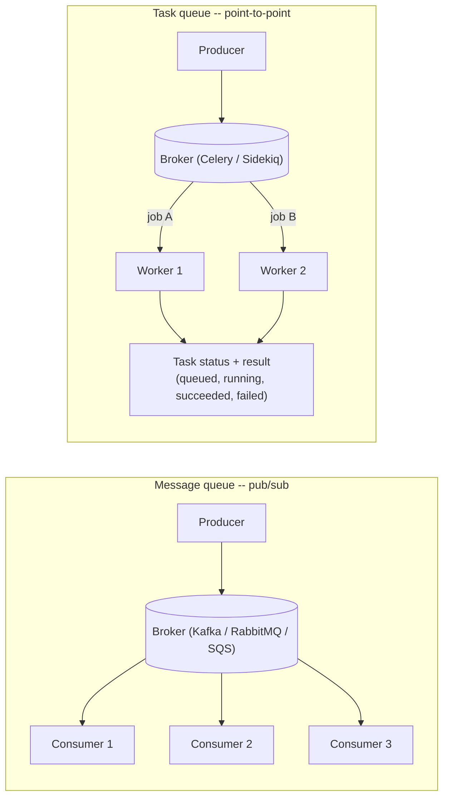
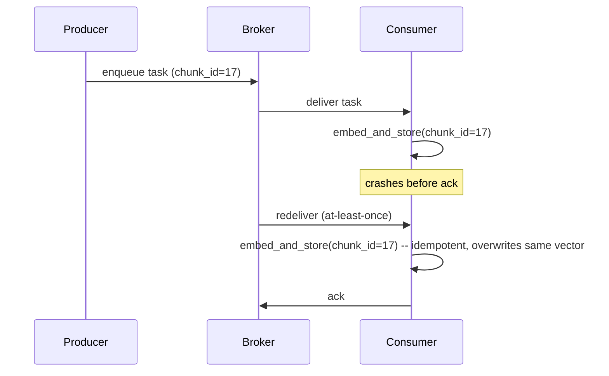
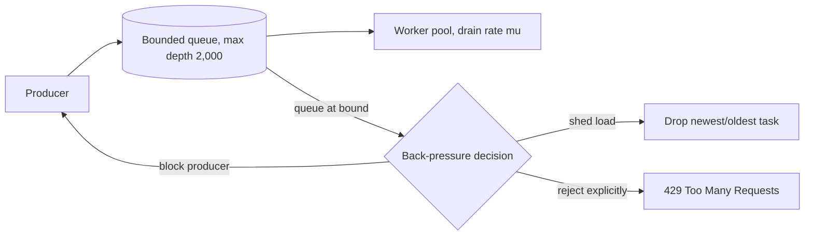
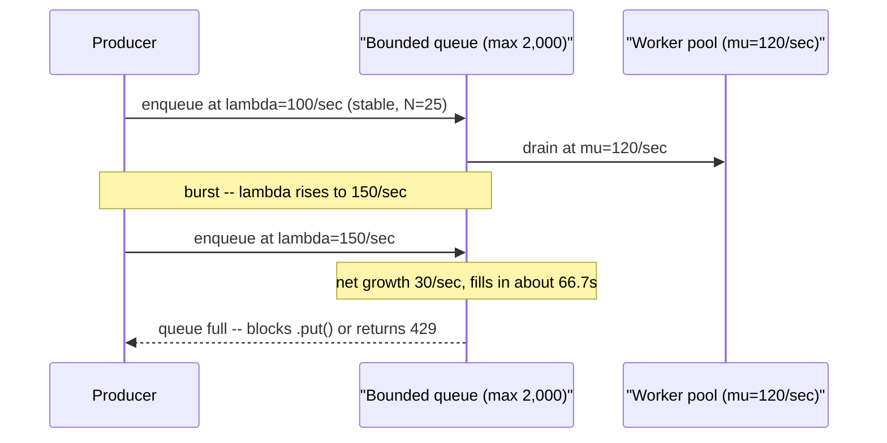
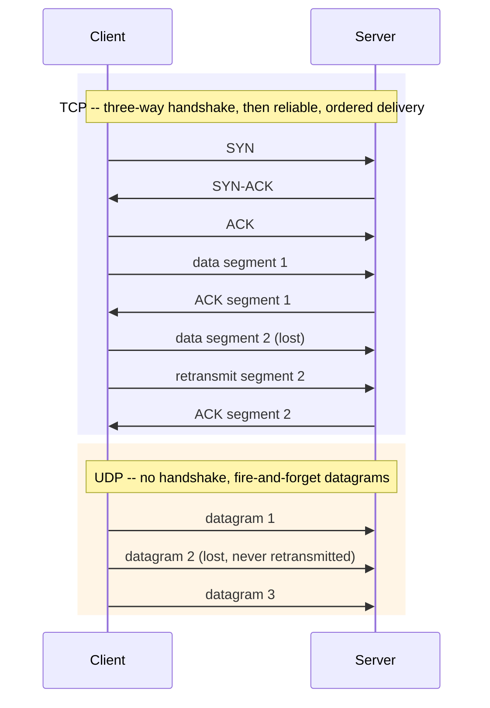
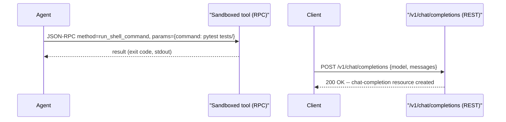
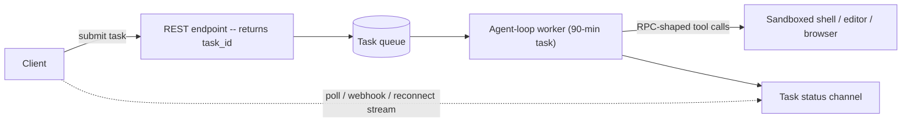

# Lesson 6: Async and Communication

**Time:** 75-90 minutes
**Tool(s):** Conceptual (no single verified CLI) — a real task-queue job schema, a runnable Python bounded-queue/backpressure snippet, and RPC-vs-REST payload comparisons instead

## Learning Objectives

By the end of this lesson, you will:

- Be able to distinguish a message queue from a task queue by what each adds on top of the other, name the three delivery guarantees (at-most-once, at-least-once, exactly-once), and explain why at-least-once delivery requires idempotent consumers to be safe
- Be able to compute, from an arrival rate and a drain rate, how long a bounded queue takes to fill, apply Little's Law to a stable queue, and explain what back pressure actually does once a queue hits its bound
- Be able to distinguish TCP from UDP by what each guarantees, compute the real latency cost of a TCP handshake, and explain why that cost is still worth paying for streamed LLM token responses
- Be able to distinguish RPC from REST by their calling shape (actions vs. resources), and compute concretely why a long-running agentic task cannot be served as a single synchronous REST request
- Be able to point to exactly which capstones (#9 RAG/contextual-retrieval ingestion, #10 LLM inference serving, #13 autonomous coding agent, #15 LLM API gateway) each Concept in this lesson overlays onto — and why capstone #4 (Airbnb search ranking) does not belong in that list, despite appearing paired with #13 in an earlier draft of this repo's plan

---

## Concept 1: Message Queues vs. Task Queues

### Why?

A synchronous request/response call couples the caller's fate to the callee's. The caller blocks until the callee responds, so a slow, overloaded, or down callee becomes the caller's problem too.

This hurts AI workloads more than a typical CRUD app, for two reasons from Lesson 1:

- Per-unit cost and latency scale with tokens processed (Lesson 1, Concept A1). A single unit of work, like embedding a chunk or running an agent's next tool call, can take seconds to minutes.
- A long-running, multi-step agent task (Lesson 1, Concept E3 — checkpointing across multi-step runs) can run far longer than any caller should stay blocked on one HTTP connection.

Asynchronous communication exists to decouple a producer's pace from a consumer's pace, so neither side's availability or speed directly determines the other's.

### What?

A **message queue** is a durable, ordered (or orderable) channel.

- One or more **producers** write discrete **messages** into it.
- One or more **consumers** read and acknowledge them.
- A **broker** sits between them: the server process that stores and routes messages (e.g. Apache Kafka, RabbitMQ, Amazon SQS).

A message queue comes in one of two shapes:

- **Point-to-point** — each message goes to, and is processed by, exactly one consumer, even if several are listening. Used to spread units of work across a worker pool.
- **Publish/subscribe (pub/sub)** — each message goes to *every* currently subscribed consumer. Used to broadcast an event to several independent listeners that each need to know it happened.

A **task queue** is a message queue specialized for distributing units of work ("**tasks**"/"**jobs**") to a pool of worker processes that run them asynchronously.

- It is usually built on a message-queue broker, adding job semantics the broker alone doesn't provide:
  - tracking each task's status (queued, running, succeeded, failed)
  - a configurable retry policy on failure
  - a way to fetch the task's eventual result
- Examples: Celery (Python, commonly backed by Redis or RabbitMQ), Sidekiq (Ruby, backed by Redis).
- One line: a message queue moves messages; a task queue moves *jobs*, and also tracks what happened to each.

A pub/sub message queue's fan-out against a task queue's point-to-point worker pool:



**Delivery guarantees — and why they're hard.**

Every queue commits to one of three **delivery guarantees**: how many times a message actually reaches a consumer. Think of phoning a restaurant to confirm a reservation:

1. **At-most-once** — you call once and hang up, confirmed or not.
   - Never duplicated, but it can be silently lost if the line drops and nobody calls back.
   - A message is delivered zero or one times (e.g. the broker crashes after removing a message but before a consumer finishes processing it).
2. **At-least-once** — if you don't hear "confirmed", you call again.
   - You're never left un-booked, but you might double-book if the first call succeeded and only the confirmation was cut off.
   - A message is delivered one or more times (e.g. a consumer processes a message, then crashes or times out before acking, so the broker redelivers it to another consumer).
3. **Exactly-once** — the call always connects, you always hear the confirmation, with no retries and no duplicates.
   - No real phone system offers this, and neither does any real distributed system. It would require the broker's delivery and the consumer's processing-and-acknowledgment to happen as one indivisible step.
   - Systems that advertise "exactly-once" almost always do at-least-once delivery *plus consumer-side deduplication*, not a true protocol-level guarantee.

At-least-once is both the easiest to implement and the most common default. So consumers built against it must be **idempotent**: doing an operation many times has the same effect as doing it once.

- Idempotent: an embedding-and-store operation keyed on a stable `chunk_id`. Re-embedding the same chunk overwrites its existing vector.
- Not idempotent: "increment this document's processed-chunk counter by one". Redelivering the same message double-counts it.

At-least-once redelivery, and why keying the retry on `chunk_id` keeps it safe:



### How?

**Worked example — sizing a task-queue worker pool for a RAG ingestion job.**

A RAG indexing pipeline (the kind capstone #9's design depends on) must chunk, generate context for, and embed 2,000,000 chunks before a 4-hour window closes. One worker, bottlenecked on the network round trip to the LLM used for context generation, processes 5 chunks/sec.

```
ingestion_window = 4 hours × 3,600 sec/hour = 14,400 seconds

required_throughput = total_chunks / ingestion_window
                     = 2,000,000 / 14,400
                     ≈ 138.9 chunks/sec

workers_needed = ceil(required_throughput / throughput_per_worker)
               = ceil(138.9 / 5)
               = 28 workers
```

28 workers, each pulling chunk-embedding tasks from the same queue, are the minimum to clear the backlog inside the window. It is the same "divide required throughput by per-unit capacity, round up" arithmetic Lesson 5's Concept 1 used for read replicas.

**Trade-offs considered:**

- **Plain message queue (point-to-point)**
  - Simpler to operate, and enough when "deliver this work to exactly one of several interchangeable workers" is all you need.
  - No built-in task status, retries, or results. You build that by hand.
- **Task queue**
  - More operational complexity (a heavier abstraction, usually with its own result store).
  - Gives retry policy, status, and result retrieval for free. Worth it the moment a failed unit must be retried rather than silently dropped.
- **At-least-once delivery:** cheap on the broker side but pushes the idempotency burden onto every consumer. Exactly-once removes that burden but is expensive or impractical to implement correctly at the broker alone.

**Situation to reason through:**

- A RAG pipeline must ingest 2,000,000 chunks in a 4-hour window. A pool of 28 workers (5 chunks/sec each) was sized for it.
- After the run, the vector index holds exactly 2,000,000 vectors, but the progress counter reads 2,031,400.

<details>
<summary><b>Q1.</b> Why is the counter higher than the index?</summary>

**How to think:** the index is right and the counter is wrong, so ask which operation is safe to repeat.

- This points at at-least-once delivery. A consumer finished a task, then crashed or timed out before acking, and the broker redelivered it.
- 31,400 redeliveries is the gap.
- The vector write is an upsert keyed on `chunk_id`, so repeating it overwrites the same vector (idempotent).
- "Add one to the counter" is not idempotent, so every redelivery counted twice.

<details>
<summary><b>Q1a.</b> How do you fix the counter?</summary>

**How to think:** derive it from state instead of incrementing it.

- Count distinct `chunk_id`s whose status is succeeded, or record each ID and increment only on first insertion.
- This is how "exactly-once" systems work in practice: at-least-once plus deduplication.
- Chasing true exactly-once is the wrong goal.

<details>
<summary><b>Q1b.</b> Was the 28-worker pool sized correctly?</summary>

- Redelivered tasks are real work, so include them.
- 2,031,400 / 14,400 ≈ 141.1 chunks/sec, and 141.1 / 5 ≈ 28.2, so you need **29 workers**. The original 28 was one short.
- If the redeliveries come from timeouts rather than crashes, fix the timeout as well.
- Cap retries with `max_attempts` so a task that always fails can't loop forever.
</details>
</details>
</details>

**Case-study pointer:**

- Capstone #9 (`case-studies/rag-contextual-retrieval`, grounded in Anthropic's *"Introducing Contextual Retrieval,"* Sept. 2024) is the primary overlay. The pairing is inferred, not documented.
  - Documented: context generation happens before embedding/indexing and costs tokens.
  - Not documented: that it runs as an async task-queue pipeline.
  - That is a reasoned inference. Indexing-time work over millions of independently embeddable chunks, each costing a real LLM call, is the bursty, parallelizable workload a task queue exists for.
  - Treat the worker-pool sizing above as this lesson's own worked example built on that inference, not a documented detail of capstone #9.
- Capstone #13 (`case-studies/autonomous-coding-agent`, Devin-style) is this Concept's sibling pattern one layer up.
  - Its "plan-then-execute loop" naturally decomposes into a task queue of agent steps (a shell command, a file edit, a test run).
  - Each is a discrete, retryable, idempotency-sensitive unit of work shaped like an embedding task.
  - See Concept 4 below for the full, confirmed-fit treatment.

**Source(s) and further reading:**

- `system-design-primer`'s "Asynchronism" section, specifically its "Message queues" and "Task queues" subsections (the classic, non-AI framing this Concept curates from)
- Apache Kafka documentation (pub/sub message-queue semantics) and Celery documentation (task-queue semantics, retries, result backends)
- Anthropic, *"Introducing Contextual Retrieval,"* Sept. 2024 — capstone #9's source for the context-generation-before-embedding step this worked example is built around
- Cognition Labs, *"Introducing Devin,"* March 2024 — capstone #13's source for the plan-then-execute loop this Concept's sibling pattern points at

---

## Concept 2: Back Pressure

### Why?

Picture a kitchen during a dinner rush. Tickets arrive faster than the cooks can plate them. If the expediter keeps spiking tickets onto the rail with no limit, nothing fails loudly at first. The backlog just grows until the kitchen seizes up.

A software queue with no size limit has the same failure mode, invisible until something breaks.

- Concept 1's queues decouple a producer's pace from a consumer's pace, but only up to a point.
- If a producer *sustainably* sends work faster than consumers drain it, an unbounded queue hides the problem. The backlog grows quietly in memory until either:
  - the process runs out of memory and crashes, or
  - every queued task's wait grows without bound and the system becomes unusably slow long before anyone sees an error.

Back pressure makes that failure mode explicit and bounded instead of invisible.

### What?

**Back pressure** is how a system signals its upstream producers to slow down, pause, or have new work rejected outright, once a downstream consumer or queue can no longer keep up. The alternative is letting work accumulate without limit.

- The name is literal, from plumbing: pressure builds when flow can't drain as fast as it arrives, pushing back against the inflow.
- The design question is always the same: once a queue hits its limit, where does the excess go? Three common answers:

1. **Block the producer** — a bounded queue's "add" doesn't return until space frees up, forcing the producer to the consumer's real drain rate (e.g. Python's `queue.Queue(maxsize=N)`, whose `.put()` blocks once the queue holds `N` items).
2. **Shed load** — drop the newest or oldest item rather than queue it. Accepts data loss in exchange for a queue that never grows past its bound.
3. **Reject explicitly** — return an error the caller can act on, rather than silently blocking or dropping.
   - E.g. HTTP **429 Too Many Requests**, the standard code telling a client it sent too much and should retry later.
   - Or TCP's own flow-control window, which throttles a sender automatically once the receiver's buffer is full.

The three answers as branches a bounded queue takes at its limit:



**Back pressure vs. rate limiting.** Both cap how much traffic gets through, but they ask different questions. Rate limiting asks whether a request is *allowed*. Back pressure asks whether the system can *actually handle it right now*.

- **Rate limiting** decides in advance how much a caller is *allowed* to send, from a configured policy or budget (the **token bucket algorithm**, defined in this repo's `appendix/glossary.md` from capstone #15's gateway, not re-derived here). It is independent of whether the backend is under load right now.
- **Back pressure** is reactive: triggered by the consumer's real, current capacity, whatever any policy says is "allowed".
- A system can have either without the other, or both. A generous rate limit can still leave room for a real burst that only back pressure catches.

### How?

**Worked example — Little's Law for a stable queue, then what changes once it isn't stable.**

**Little's Law** is a queueing-theory identity for any stable queueing system: the long-run average number of items in the system (N) equals the average arrival rate (λ) times the average time an item spends in the system (W).

`N = λ × W`

- Intuition: a coffee shop averages 20 customers inside (N), and new ones walk in at a steady 4 per minute (λ). So each must spend 5 minutes inside (W).
- The three numbers constrain each other, for any queue that is keeping up.

A task queue (Concept 1) feeds a pool of embedding workers. Under normal load:

- Tasks arrive at λ = 100 tasks/sec.
- Workers drain at μ = 120 tasks/sec (the **service rate**, the maximum the consumer side sustains).
- λ < μ, so the queue is stable. A dashboard shows an average of N = 25 tasks in the queue.

```
Little's Law:  N = λ × W   →   W = N / λ = 25 / 100 = 0.25 seconds

Every task spends, on average, a quarter of a second in the queue before a worker picks it up.
```

Now an ingestion burst pushes arrivals to λ = 150 tasks/sec while the drain rate stays μ = 120:

```
net growth rate = λ - μ = 150 - 120 = 30 tasks/sec
```

- The queue is no longer stable. Little's Law's steady-state assumption no longer holds, and the queue grows without bound while the imbalance lasts.
- This is the regime back pressure exists to catch. With the queue bounded at 2,000 tasks:

```
time_to_full = max_queue_depth / net_growth_rate = 2,000 / 30 ≈ 66.7 seconds
```

- About 67 seconds in, the queue hits its bound and back pressure must engage: a blocking `.put()` stalls the producer, or the system returns 429s, or it sheds load.
- Once engaged, the arrival rate the queue accepts is capped at what consumers can drain, so it stops growing. It stays pinned near its bound until the burst subsides and λ drops below μ, then drains at rate `μ - λ`.

The same burst, from stable queue to the moment back pressure engages:



**Trade-offs considered:**

- **Blocking**
  - Simplest, and loses no data.
  - If the producer is also serving a live human-facing request (not a background batch), that request's latency absorbs the block. The back-pressure cost has moved one layer upstream.
- **Load shedding**
  - Keeps the queue's latency bounded and the producer unblocked.
  - Silently loses whatever is dropped. Fine for a real-time metrics stream that tolerates gaps, unacceptable for a task tied to a user's paid request.
- **Explicit rejection (429, queue-full error)**
  - Puts the decision back in the caller's hands: retry later, or surface an error.
  - The caller must actually handle the signal, rather than it being invisible plumbing.

**Situation to reason through:**

- A nightly ingestion burst raises arrivals to 150 tasks/sec while workers drain 120/sec. The queue is bounded at 2,000.
- A PM complains that producers sometimes block, and asks for an unbounded queue "so nothing is ever rejected".
- The burst lasts 30 minutes.

<details>
<summary><b>Q1.</b> What is the producer blocking actually telling you?</summary>

**How to think:** read the bound as a signal, not an annoyance.

- Net growth is 150 − 120 = 30 tasks/sec, so the queue fills in 2,000 / 30 ≈ 67 seconds.
- Blocking after about a minute is the system telling you λ is above μ.

<details>
<summary><b>Q1a.</b> What would an unbounded queue do over the 30-minute burst?</summary>

**How to think:** price the backlog.

- The backlog reaches 1,800 s × 30/s = 54,000 tasks.
- A task arriving at the end waits 54,000 / 120 = 450 seconds.
- When arrivals drop back to 100/sec, the queue drains at only 20/sec: 54,000 / 20 = 2,700 seconds (45 minutes) to clear.
- Everything is late throughout, and memory grows the whole time. Little's Law doesn't apply while the queue is unstable.

<details>
<summary><b>Q1b.</b> Which back-pressure action do you choose, and what do you fix?</summary>

- Choose by who the producer is.
  - A background ingest job: **block** (no loss, nobody is waiting).
  - A user-facing request: **reject with a 429** so the caller can retry.
  - A lossy metrics feed: **shed**.
- Fix the cause: drain rate must exceed peak arrivals. 150 / 120 = 1.25x, so at least 25% more workers, plus headroom.
- Don't confuse this with rate limiting. A rate limit is a policy cap set in advance and might allow this traffic. Back pressure reacts to what consumers can handle right now.
</details>
</details>
</details>

**Case-study pointer:**

- Capstone #10 (`case-studies/llm-inference-serving`) is the confirmed overlay. Its Steps 5 and 6 describe exactly this shape:
  - A scheduler admits waiting requests into the running batch only as free KV-cache blocks exist. Admission is gated on real, current capacity, not a fixed count, matching the back-pressure definition.
  - Under memory pressure it applies **preemptive scheduling** (defined in this repo's glossary) rather than letting the queue grow unbounded, swapping a lower-priority request's blocks out to free room for a higher-priority one.
  - Step 6 names "KV-cache utilization near 100% with a growing queue depth" as the real capacity-exhaustion signal: the λ > μ condition this worked example computes a time-to-full for.
- Capstone #15's token-bucket rate limiting (`case-studies/llm-api-gateway`) is the related-but-distinct sibling: a *proactive* policy cap, not a reactive signal tied to real-time downstream load.

**Source(s) and further reading:**

- Little, J.D.C., *"A Proof for the Queuing Formula: L = λW,"* Operations Research, 1961 — the original proof of the identity this worked example applies
- Kwon et al., *"Efficient Memory Management for LLM Serving with PagedAttention,"* SOSP 2023 (arXiv:2309.06180) — capstone #10's source for the preemptive-scheduling-under-memory-pressure mechanism
- `case-studies/llm-api-gateway/README.md` (capstone #15) and this repo's `appendix/glossary.md` — the token-bucket algorithm referenced, not re-derived, above
- Python standard library `queue` module documentation — the runnable `Queue(maxsize=N)` blocking-backpressure mechanism used in this lesson's Hands-On Walkthrough

---

## Concept 3: TCP vs. UDP

### Why?

Every queue in Concept 1, every back-pressure signal in Concept 2, and every RPC or REST call in Concept 4 rides over one of two transport protocols. Which one decides what guarantees the application gets for free versus what it must build itself.

- This is the one foundational-networking Concept in the lesson, not an AI-specific pattern. Its case-study grounding is a general infrastructure point.
- It is still concrete: it explains a real design choice every streaming LLM system in this repo has made.

### What?

**TCP (Transmission Control Protocol)** is connection-oriented. Before any application data moves, the two sides do a **three-way handshake** (SYN, SYN-ACK, ACK) to agree the connection exists and synchronize initial sequence numbers.

- Like a phone call's opening "hello?" / "hello, go ahead" / "okay, here I am" before either side says anything that matters.
- Once established, TCP guarantees:
  - **reliable, ordered delivery** — every byte arrives exactly once and in order. Lost segments are retransmitted and out-of-order ones buffered and reassembled before the application sees them.
  - **flow control** — throttles the sender so it never overwhelms the receiver's buffer (the mechanism behind one of Concept 2's back-pressure signals).
  - **congestion control** — throttles the sender based on inferred network congestion, independent of the receiver's buffer.

**UDP (User Datagram Protocol)** is connectionless: no handshake, no setup cost, no persistent connection state.

- A sender just sends a discrete **datagram** (a self-contained packet). Like dropping a postcard in the mail: no confirmation it arrived, no setup, it either gets there or doesn't.
- UDP gives up every TCP guarantee:
  - no ordering guarantee — datagrams can arrive out of order
  - no reliability guarantee — a lost datagram is gone, nothing retransmits it
  - no built-in flow or congestion control
- In exchange it has lower overhead and latency for anything that doesn't need those guarantees.
- DNS queries (Lesson 4, Concept 1) are typically single-datagram UDP exchanges, because a full TCP handshake would cost more than the query.

**Head-of-line (HOL) blocking** is a direct consequence of TCP's ordered delivery.

- If one segment is lost, every byte sent *after* it, even bytes already at the receiver, waits until the lost segment is retransmitted.
- The data isn't gone, it's stuck behind the piece that is. Like a single-file checkout line where one jammed register stalls everyone behind it.

TCP's handshake-then-reliable-delivery flow vs. UDP's fire-and-forget datagrams:



### How?

**Worked example — TCP handshake cost, amortized over a token stream.**

A client and a regional inference gateway (Lesson 4's load-balanced serving stack) have a measured round-trip time (RTT) of 40 ms. A brand-new TCP connection costs one full RTT before any data moves:

```
TCP three-way handshake cost = 1 RTT = 40ms   (SYN → SYN-ACK → ACK, before any app data moves)
```

If the connection is also TLS-encrypted (as essentially all production LLM API traffic is), a TLS 1.3 handshake adds one more RTT. It can be combined with the TCP handshake in practice, but is shown separately here:

```
total handshake cost (TCP + TLS 1.3) ≈ 2 RTT = 80ms, paid once per new connection
```

Now that connection streams a chat-completion response of 500 output tokens (capstone #10's "streamed sequence of generated tokens out", per its Step 1) over a single kept-alive connection:

```
amortized handshake cost per token = 80ms / 500 tokens = 0.16ms/token
```

- That is negligible next to capstone #10's inter-token latency target (`case-studies/llm-inference-serving`, Step 1: p50 < 40 ms/token, p99 < 120 ms/token).
  - p50 and p99 are the 50th- and 99th-percentile latency: the value below which 50%, respectively 99%, of requests fall (defined in Lesson 9's Concept 2).
- The 80 ms handshake is real, but paid once per connection, not once per token. Connection reuse (HTTP keep-alive) makes it vanish for any reasonably long stream.

**Why UDP's lower setup cost still doesn't win here.**

- UDP would skip the 80 ms entirely.
- But if even one datagram carrying part of the token stream is lost, nothing retransmits it. And nothing guarantees the next datagram to arrive is the next in sequence.
- The application itself would have to detect the gap and decide what to do about missing or out-of-order tokens mid-stream.
- TCP's ordered, reliable delivery guarantees the stream arrives complete and in the order the model generated it. That is non-negotiable for response text, unlike a dropped video frame in a live call.

**Trade-offs considered:**

- **TCP**
  - Reliability and ordering are exactly what a token stream needs.
  - Costs: the one-time handshake, and HOL blocking as a structural property.
  - HOL matters for HTTP/2, which multiplexes several logical request/response streams over one TCP connection (the second major HTTP version, succeeding HTTP/1.1's one-request-at-a-time model). One lost segment can stall all of them until it is retransmitted.
- **UDP**
  - Near-zero setup cost and no HOL blocking (a lost datagram affects only itself).
  - That is why it suits traffic that tolerates loss or reordering: DNS queries, real-time voice/video where a dropped frame beats a stalled stream.
  - It would be wrong for an LLM token stream. "Tolerate loss" would mean silently returning corrupted or truncated text with no way to notice.

**Situation to reason through:**

- A mobile app opens a fresh connection for every chat request on a network with a 120 ms round trip.
- Replies average 40 tokens.
- An engineer proposes sending the token stream over UDP to remove the handshake cost.

<details>
<summary><b>Q1.</b> How big is the handshake cost in this setup?</summary>

**How to think:** size the cost before arguing about the fix.

- TCP plus TLS 1.3 ≈ 2 RTT = 240 ms before the first byte. It lands directly in TTFT.
- Spread over 40 tokens that is 6 ms per token, versus 0.16 ms per token in the 500-token, 40 ms-RTT example.
- Short replies on slow networks are where the handshake hurts.

<details>
<summary><b>Q1a.</b> What do you do about it?</summary>

**How to think:** fix the cause (a new connection every time), not the protocol.

- Keep the connection alive. The 240 ms is paid once per session, and later requests pay nothing.

<details>
<summary><b>Q1b.</b> Why not UDP anyway, and what does TCP cost on a lossy link?</summary>

- UDP drops ordering and reliability. A lost datagram is gone and datagrams can arrive out of order, so the app would have to detect gaps and recover. That means rebuilding what TCP already guarantees.
- For response text, missing or reordered tokens are not acceptable.
- TCP's real cost: a lost segment stalls everything behind it (head-of-line blocking). On a lossy mobile link that can pause the whole stream, including every HTTP/2 stream multiplexed on that connection.
- Accept it, and don't multiplex unrelated work onto one lossy connection without thinking.
</details>
</details>
</details>

**Case-study pointer:**

- This Concept's strongest grounding is a general infrastructure point, not a capstone-specific mechanic.
  - It explains *why* virtually all LLM-serving traffic, including token streaming, rides over TCP and never UDP.
  - It does not exercise a capstone's own documented design decision.
- The concrete anchor is capstone #10 (`case-studies/llm-inference-serving`). Its Step 1 scopes its functional requirement as serving "a streamed sequence of generated tokens out", the ordered-delivery requirement this worked example is built around.

**Source(s) and further reading:**

- `system-design-primer`'s "Communication" section, TCP and UDP subsections (the classic framing this Concept curates from)
- RFC 793 (TCP) and RFC 768 (UDP) — the original IETF protocol specifications
- RFC 9113 (HTTP/2) — the multiplexed-streams-over-one-TCP-connection framing referenced above
- `case-studies/llm-inference-serving/README.md` (capstone #10), Step 1 — the streamed-token-output requirement this worked example overlays onto

---

## Concept 4: RPC vs. REST

### Why?

Lesson 1's Concept D established **tool use / function calling**: the model generates a structured request to invoke a named function with specific arguments, and the surrounding application executes it.

- That mechanism already has a calling *shape*: a named action plus arguments, not a resource being read or modified.
- This Concept names that shape (RPC) and contrasts it with the shape a public-facing API almost always uses instead (REST). It isn't re-teaching function calling.
- It matters because the same agentic product typically uses both shapes for different parts of its own request path. Conflating them obscures why one part behaves so differently from the other under load.

### What?

**RPC (Remote Procedure Call)** is an API style built around invoking a named action.

- A client calls a method (e.g. `run_shell_command(cmd, cwd)`, `get_embedding(text)`) that runs on a remote server. The framework handles serialization, the network call, and deserializing the result.
- From the caller's view it feels like calling a local function.
- The API surface is organized around *verbs* (actions the system can perform), not data.
- Concrete forms:
  - **gRPC** (defined in Lesson 4, Concept 3, as a binary RPC protocol built on HTTP/2; referenced here, not re-derived).
  - **JSON-RPC 2.0**: a lighter, text-based spec that encodes a call as a plain JSON object with a method name, a parameters object, and a request ID used to match the eventual response.

**REST (REpresentational State Transfer)** is an API style built around *resources* (nouns: a user, a conversation, a document) addressed by URLs.

- Resources are manipulated through a small fixed set of HTTP verbs: GET to read, POST to create, PUT/PATCH to update, DELETE to remove.
- Requests are **stateless**: each carries everything the server needs, so the server remembers nothing about the client between calls.
- The shape is organized around *data*, not actions. There's no `run_shell_command` endpoint. There's a `/v1/chat/completions` resource you POST a new completion request to.

One way to hold the distinction: RPC is phoning a specific extension and saying "do this now". REST is mailing a labeled package to an address and letting a small standard set of verbs say what to do with what's inside.

An RPC-shaped internal tool call beside a REST-shaped public API call:



### How?

**Worked example — the same system, two calling shapes, side by side.**

An internal agent-to-tool call (RPC-shaped: an action with arguments), using JSON-RPC 2.0:

```json
{
  "jsonrpc": "2.0",
  "method": "run_shell_command",
  "params": {"command": "pytest tests/", "cwd": "/workspace/repo"},
  "id": "tool-call-482"
}
```

The same product's public chatbot API (REST-shaped: a resource being created), reusing the `/v1/chat/completions` JSON shape from Lesson 4 Concept 3's illustrative load-balancer example:

```
POST /v1/chat/completions HTTP/1.1
Host: api.example.com

{
  "model": "large-context-model-v2",
  "messages": [{"role": "user", "content": "Fix the failing test in tests/test_auth.py"}]
}
```

- The public call asks for a *resource* (a chat completion) to be created. The internal call asks for an *action* (run this command) to be taken.
- Same product, two shapes, chosen for two audiences:
  - The public endpoint wants a predictable, cacheable, widely understood interface (REST, per capstone #15's OpenAI-API-compatible design).
  - The internal tool call wants direct, low-overhead invocation between the agent's reasoning loop and the sandboxed environment running its commands (Lesson 8 covers the sandboxing).

**Worked example — why a long-running agentic task can't be a single synchronous REST request.**

- A typical load balancer or reverse proxy (Lesson 4, Concepts 3-4) enforces a default **idle timeout**: a maximum time a request/connection may wait for a response before it is closed.
- AWS's Application Load Balancer, for example, defaults to 60 seconds.
- Capstone #13's autonomous coding agent (`case-studies/autonomous-coding-agent`, Devin-style) is capable of "multi-hour autonomous task completion". Take a conservative 90-minute (5,400-second) task:

```
timeout_ratio = task_duration / typical_gateway_idle_timeout
              = 5,400 seconds / 60 seconds
              = 90x
```

A task 90 times longer than the gateway's idle timeout can't be one synchronous REST request held open end to end. The gateway would kill the connection long before the task finishes, whatever the agent wants. That is why agentic systems lean on async queues far more than typical request/response apps. The task is decomposed into:

- a REST-shaped call that *submits* the task and immediately returns a task ID (a fast, ordinary exchange, well under any timeout)
- a task queue (Concept 1) running the multi-step agent loop as a background job, decoupled from any held-open connection
- a separate channel (polling, a webhook callback, or a reconnectable stream) for continuous progress reporting

The RPC-shaped tool calls inside that loop (shell, editor, browser actions) are just as prone to outlasting a request timeout. So they run inside the queue's worker, not behind a synchronous gateway call either.

That decomposition end to end, from the REST submit call to the RPC-shaped tool calls inside the worker:



**A note on sourcing:** capstone #13 is the autonomous coding agent above, and the only capstone that fits this point (long-running coding-agent tasks, async queues, agent loops). Capstone #4, Airbnb's search-ranking system (Haldar et al., *"Applying Deep Learning to Airbnb Search,"* KDD 2019), is a listing-ranking model-architecture capstone with no connection to any of that, so it isn't cited here.

**Trade-offs considered:**

- **RPC**
  - A natural fit for an agent's own tool-use loop. It is quite literally the shape Lesson 1's function calling already uses.
  - Tightly couples caller and callee to a set of named methods. A new capability means a new method, and every caller must know its exact name and signature.
- **REST**
  - Better for a broad, stable, externally consumed public API: predictable, cacheable, easy for any HTTP client (as capstone #15's OpenAI-compatible design shows).
  - Awkward for "run this specific action right now". Even REST-shaped public APIs like chat-completions are a thin REST wrapper around what is still a procedure call ("generate a completion") dressed as resource creation.

**Situation to reason through:**

- A team adds a "Fix this bug" button to a coding agent. A typical task takes 45 minutes.
- The first version is `POST /v1/agent/run`, which holds the connection open and streams progress until done.
- It works in staging. In production, behind a load balancer with a 60-second idle timeout, every task dies at the one-minute mark.

<details>
<summary><b>Q1.</b> Why does it die, and by how much?</summary>

**How to think:** compute the ratio, then ask whether any setting could fix it.

- 45 minutes is 2,700 seconds. 2,700 / 60 = **45x** the timeout.
- No setting on the agent can fix that, because the gateway closes the connection first.

<details>
<summary><b>Q1a.</b> How do you redesign it?</summary>

**How to think:** split "start the work" from "hold the connection".

- A REST call **submits** the task and returns a `task_id` at once.
- A **task queue** runs the agent loop in a worker.
- A separate channel (polling, a webhook, or a stream the client can reconnect to) **reports progress**.
- The agent's tool calls (`run_shell_command` and similar) are RPC-shaped and run inside the worker, not behind any synchronous gateway call.

<details>
<summary><b>Q1b.</b> What happens if a worker dies at minute 30, and when the workers are all busy?</summary>

- **Worker dies:** at-least-once redelivery means steps may run again.
  - Applying a file edit keyed on its content is safe to repeat.
  - `git commit` or incrementing a counter is not, so those steps need an idempotency check or a checkpoint (Lesson 1, E3).
- **All workers busy:** bound the queue. Answer the submit call with a 429 and a retry hint, instead of accepting a task that will sit for hours.
</details>
</details>
</details>

**Case-study pointer:**

- Capstone #13 (`case-studies/autonomous-coding-agent`) is the confirmed overlay for both halves of this Concept: the RPC-shaped internal tool calls (sandboxed shell/editor/browser access) and the async-queue-over-synchronous-REST argument worked through above.
- Capstone #15 (`case-studies/llm-api-gateway`) is the concrete source for the REST-shaped public-API side. Its README documents an OpenAI-compatible interface as the gateway's whole premise.
  - The exact `/v1/chat/completions` JSON shape in the first worked example isn't shown there. It is reused from Lesson 4 Concept 3's illustrative load-balancer example, which is this payload's actual source.

**Source(s) and further reading:**

- `system-design-primer`'s "Communication" section, RPC and REST subsections, including its "RPC and REST at a glance" comparison (the classic framing this Concept curates from)
- JSON-RPC 2.0 specification (jsonrpc.org) — the real spec this Concept's internal tool-call example is written against
- gRPC documentation (grpc.io) — a production RPC framework, referenced rather than re-derived from Lesson 4's existing definition
- AWS Application Load Balancer documentation — the 60-second default idle timeout cited in the worked example
- Cognition Labs, *"Introducing Devin,"* March 2024 — capstone #13's source for the multi-hour task duration and continuous-progress-reporting requirement
- Lesson 1 (`lesson-1-ai-fundamentals-refresher.md`), Concept D — the original full definition of tool use/function calling, referenced rather than re-derived here
- Lesson 4 (`lesson-4-network-and-delivery.md`), Concept 3 — the actual source of the exact `/v1/chat/completions` JSON shape (including the `"model": "large-context-model-v2"` example value) reused in the worked example
- `case-studies/llm-api-gateway/README.md` (capstone #15) — the broader REST-shaped, OpenAI-API-compatible public-API concept this Concept's worked example illustrates, though not the source of the specific JSON payload above

---

## Hands-On Walkthrough

There's no single CLI for "async communication" in general. Work through this real job schema and runnable code instead.

**1. A real task-queue job schema.**

The JSON shape of one embedding task from Concept 1's RAG-ingestion worked example, as it would be enqueued:

```json
{
  "task_id": "3f2a9e1c-8b7d-4e5a-9c6f-1a2b3c4d5e6f",
  "document_id": "doc-00482",
  "chunk_id": 17,
  "chunk_text": "The quarterly report shows revenue growth of...",
  "status": "queued",
  "attempt_count": 0,
  "max_attempts": 3
}
```

- `task_id` is a unique identifier for this enqueued job. It is generated fresh per task, not tied to `chunk_id`.
- `chunk_id` identifies *which* chunk the task processes. It is the field that makes retrying idempotent: re-running re-embeds and overwrites the same `chunk_id`'s stored vector instead of creating a duplicate.
- `status` and `attempt_count` are the job-tracking fields Concept 1 said a task queue adds on top of a plain message queue.

**2. A runnable Python bounded queue, demonstrating back pressure and idempotent retries.**

```python
import queue
import threading
import time
import uuid

MAX_QUEUE_DEPTH = 2000  # the back-pressure bound from Concept 2's worked example

task_queue: "queue.Queue[dict]" = queue.Queue(maxsize=MAX_QUEUE_DEPTH)


def submit_task(document_id: str, chunk_id: int, chunk_text: str) -> str:
    """Producer side: build a task matching the schema above and enqueue it.
    queue.Queue.put() BLOCKS once the queue already holds MAX_QUEUE_DEPTH tasks --
    that block IS the back pressure (Concept 2): the producer is forced to slow
    down to the consumer's drain rate instead of the queue growing without bound."""
    task_id = str(uuid.uuid4())
    task = {
        "task_id": task_id,
        "document_id": document_id,
        "chunk_id": chunk_id,
        "chunk_text": chunk_text,
        "status": "queued",
        "attempt_count": 0,
        "max_attempts": 3,
    }
    task_queue.put(task)  # blocks here once the queue is at MAX_QUEUE_DEPTH
    return task_id


def embed_chunk_worker() -> None:
    """Consumer side: drain tasks and process them, keyed on chunk_id so
    reprocessing the same chunk_id (an at-least-once redelivery, Concept 1) is
    idempotent rather than corrupting -- it just overwrites the same stored vector."""
    while True:
        task = task_queue.get()
        try:
            task["status"] = "running"
            embed_and_store(task["chunk_id"], task["chunk_text"])  # keyed on chunk_id: idempotent
            task["status"] = "succeeded"
        except Exception:
            task["attempt_count"] += 1
            if task["attempt_count"] < task["max_attempts"]:
                task["status"] = "queued"
                task_queue.put(task)  # requeue for retry, same chunk_id
            else:
                task["status"] = "failed"
        finally:
            task_queue.task_done()


def embed_and_store(chunk_id: int, chunk_text: str) -> None:
    """Illustrative stand-in for a real embedding-model call + vector-DB upsert
    (Lesson 1, Concept C1/C2; Lesson 5, Concept 2) keyed on chunk_id."""
    time.sleep(0.2)  # stand-in for the real network/model latency
```

Confirm for yourself:

- `submit_task` builds exactly the schema from Part 1. The dict's keys match the JSON fields one for one.
- `task_queue.put(task)` is where back pressure from Concept 2 lives. With `MAX_QUEUE_DEPTH = 2000`, the 2,001st concurrently queued task's `put()` blocks the calling thread until a worker's `get()` frees a slot. That is the mechanism behind the `time_to_full` calculation, now as runnable code.
- `embed_chunk_worker`'s retry path requeues the *same* task (same `chunk_id`) rather than a new one. That is only safe because `embed_and_store` is idempotent on `chunk_id`.
- Swap in a non-idempotent operation (e.g. an unconditional counter increment) and this exact retry logic would silently double-count on every redelivery.

---

## Summary

| Concept | One-line takeaway |
|---|---|
| Message queues vs. task queues | A message queue moves point-to-point or pub/sub messages; a task queue adds job status, retries, and results on top — and at-least-once delivery (the common default) requires idempotent consumers to be safe, as capstone #9's ingestion pipeline and capstone #13's agent-step loop both illustrate. |
| Back pressure | A bounded queue's fill time is `max_depth / (arrival_rate − drain_rate)`, and once it fills, back pressure (blocking, load-shedding, or an explicit 429/flow-control signal) is what keeps an overload from becoming an invisible, unbounded backlog — capstone #10's KV-cache-gated admission is this pattern in production. |
| TCP vs. UDP | TCP's reliable, ordered delivery costs a one-time handshake (and risks head-of-line blocking) but is non-negotiable for a token stream that must arrive complete and in order; UDP skips that cost but tolerates loss in a way response text cannot. |
| RPC vs. REST | RPC's action-shaped calls fit an agent's internal tool-use loop; REST's resource-shaped calls fit a stable public API — and a task running 90x longer than a typical 60-second gateway timeout cannot be a single synchronous REST call, which is exactly why capstone #13's long-running agent runs behind a task queue, not a held-open HTTP connection. |

## Key Formulas & Queue/Payload Reference

```
Task-queue worker sizing:
  workers_needed = ceil(required_throughput / throughput_per_worker)

Bounded-queue time to fill (back pressure):
  net_growth_rate = arrival_rate - drain_rate         (only grows if arrival > drain)
  time_to_full    = max_queue_depth / net_growth_rate

Little's Law (stable queue only, i.e. arrival_rate < drain_rate):
  N = λ × W   →   average_wait = N / arrival_rate

TCP/TLS handshake cost, amortized:
  handshake_cost_per_unit = (handshake_RTTs × RTT) / units_sent_over_that_connection

Async-vs-sync timeout ratio:
  timeout_ratio = task_duration / gateway_idle_timeout
```

```json
// Task-queue job schema, from the Hands-On Walkthrough
{
  "task_id": "3f2a9e1c-8b7d-4e5a-9c6f-1a2b3c4d5e6f",
  "document_id": "doc-00482",
  "chunk_id": 17,
  "chunk_text": "...",
  "status": "queued",
  "attempt_count": 0,
  "max_attempts": 3
}
```

```json
// RPC-shaped internal tool call (JSON-RPC 2.0) vs. REST-shaped public API call, from Concept 4
{"jsonrpc": "2.0", "method": "run_shell_command", "params": {"command": "pytest tests/"}, "id": "tool-call-482"}
```
```
POST /v1/chat/completions HTTP/1.1
{"model": "large-context-model-v2", "messages": [{"role": "user", "content": "..."}]}
```

**Next:** Checkpoint 6, then Lesson 7 — monolith vs. microservices, service discovery, core security, and back-of-envelope estimation.
